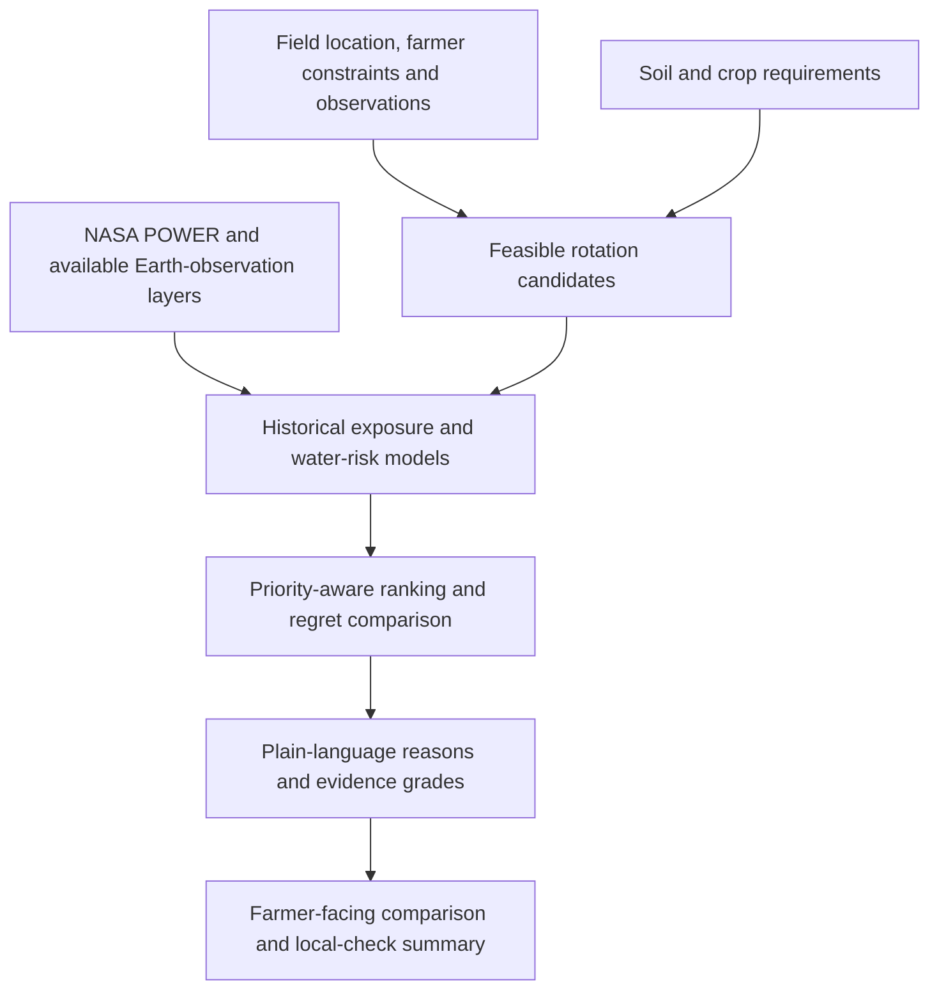

# 🌾 Field Shift

### Earth intelligence. Decisions farmers can actually use.

**NASA Space Apps Challenge 2026 · [Field Shift: Adapting Farms with NASA Data](https://www.spaceappschallenge.org/2026/challenges/field-shift-adapting-farms-with-nasa-data/)**

**Field Shift** is a farmer-centered, explainable crop-rotation decision-support platform. It combines NASA Earth observations with local soil information, crop requirements, field history, and farmer priorities to help answer one practical question:

> **After this harvest, what should I plant next—and what could go wrong?**

Instead of offering an unexplained “best crop,” Field Shift compares realistic crop sequences, replays how they would have faced past weather, identifies vulnerabilities, shows water and income trade-offs, and explains **why** an option may fit a farmer's conditions.

**Pilot context:** Myanmar — including the Ayeyarwady Delta, Central Dry Zone, and Shan uplands. The approach is intended to be adaptable to other regions when local crops, soils, and evidence are available.

**Project at a glance:**

- 🛰️ **Earth observations that change decisions**, not just decorate a dashboard.
- 🌱 **Whole crop rotations**, not isolated crop suggestions.
- 💧 **Water, flood, heat, erosion, soil, disease, and income** considered together.
- 👩‍🌾 **Farmer priorities first** — water availability and financial constraints affect comparisons.
- 🔎 **A reason for every result**, with data sources, limits, and missing evidence visible.

> **Research prototype, not a forecast.** Field Shift is not an official NASA product or endorsed by NASA. Its results support farm planning and local expert discussion; they do not guarantee yields, income, or safety.

---

## The problem

A farmer may know which crops traditionally grow in a region, yet still face new decisions:

- Will a post-monsoon crop have enough moisture to establish?
- Is planting another rice season worth the additional water demand?
- Will the most profitable rotation also leave the field exposed to flood or heat?
- Could a longer bare-soil gap increase risk on sloping land?
- Is the apparent satellite signal actually about *this field*, or a much larger regional area?

NASA has observations that can help investigate these questions. But raw satellite products are not crop plans. Their spatial scale, missing observations, uncertain estimates, and scientific terminology make direct use difficult.

**Field Shift connects the observation to the decision, then explains the trade-off in plain language.**

## The farmer's journey

The goal is a short, usable farmer-facing journey. Detailed equations, satellite metadata, and uncertainty information remain available to people who want to inspect the evidence.

---

## ⭐ Features that make Field Shift different

*The status labels reflect the supplied scientific whitepaper (research prototype v3.3.1), not an independent audit of the current application deployment.*

**Status key:** **Implemented** = described as running in the prototype; **Access-gated** = adapter exists but a live upstream data connection, credentials, or further verification is needed; **Research/next** = proposed experience or further validation.

### 1. 🌱 Compare crop *rotations*, not just individual crops

**Status: Implemented**

Field Shift considers multi-season crop sequences and their consequences for the entire field, rather than ranking one crop in isolation.

**Capabilities**

- Generate rotation candidates from regional crop templates and sowing windows.
- Compare seasonal combinations such as **monsoon rice → black gram** or **rice → dry-season rice**.
- Assess suitability against growing season, soil pH, texture, thermal conditions, water demand, and drainage.
- Screen disease carryover when host crops recur too frequently.
- Compare which options better support cover, legumes, forage, water conservation, and farm income.

**Why it matters:** A crop can look attractive on price alone but be a poor second crop after a wet season, or leave too little time for soil preparation.

### 2. 🛰️ Replay ten historical seasons before choosing the next one

**Status: Implemented; rainfall source may be access-gated**

Field Shift evaluates alternatives against **daily historical weather from 2016–2025** to show how each rotation would have performed under differing past conditions.

**Capabilities**

- Detect past rainy periods, dry spells, heat exposures, and rainfall shortfalls.
- Check whether hazards overlap a crop's particularly sensitive growth stage.
- Compare rotations under **the same historical weather**, avoiding mismatched baselines.
- Use **minimax regret** to highlight options that avoid being consistently poor choices across the observed seasons.
- Show how often evidence is missing rather than silently filling gaps.

**Why it matters:** A single average rainfall number hides bad years. Farmers need to understand downside exposure—not only the outcome in a typical season.

**Important:** Historical replay is **not** a prediction of next year's weather. NASA POWER weather is operational in the documented prototype; GPM IMERG archive extraction requires configured Earthdata access.

### 3. 🌍 Explore four kinds of field vulnerability

**Status: Implemented as risk-screening and plain-language evidence models; some source layers access-gated**

The **Four-Pillar Risk Explorer** connects climate and land observations to practical questions:

| Vulnerability | What the system looks for | Farmer question |
| --- | --- | --- |
| **Water stress** 💧 | Rain shortfall, atmospheric crop-water demand, and root-zone depletion where initial conditions are known | “Could this crop run short of water?” |
| **Flood exposure** 🌊 | Historical inundation signals and Sentinel-1 radar backscatter anomalies | “Could flooding disrupt this season?” |
| **Erosion exposure** ⛰️ | Terrain slope, rainfall season, and planned low-cover intervals | “Would leaving this slope bare be risky?” |
| **Heat & cold** 🌡️ | High temperature at flowering, chilling during sensitive stages, and frost where geographically plausible | “Could temperature hurt flowering or establishment?” |

Risk levels are **screening indicators**, not measurements of actual crop loss. When a required source is missing or too coarse, Field Shift marks the assessment as unresolved rather than inventing field-specific detail.

### 4. 🌧️ See flooding even when clouds hide the ground

**Status: Implemented; project-reported historical case study**

Optical satellite images can be obscured by clouds during the very monsoon events when flood information is most needed. Field Shift includes **Sentinel-1 C-band radar** evidence, using changes in radar backscatter to identify potential water expansion.

**Capabilities**

- Search for radar scenes through a cloud-native geospatial catalog.
- Detect candidate inundation with a documented backscatter-change screen.
- Contrast all-weather radar evidence with cloud-limited optical observations.
- Preserve acquisition dates and methodological limits.

**Why it matters:** Flood screening should not disappear just because the sky is cloudy. Radar-derived water signals still require interpretation: crop canopy, viewing geometry, and naturally flooded paddy can complicate detection.

### 5. 💦 Estimate water demand and the right post-paddy planting window

**Status: Implemented model; field initialization remains constrained**

Field Shift combines **FAO-56 Penman–Monteith evapotranspiration**, crop growth stages, and a **three-zone soil water balance** to screen water demand and possible seedbed drying.

**Capabilities**

- Model seedbed, sub-seedbed, and deeper soil separately.
- Account for how crop water demand changes across growth stages.
- Evaluate possible **post-rice drainage and sowing windows** for pulses.
- Represent paddy standing water and soil-water carryover as distinct processes.
- Refuse a definitive root-zone depletion result when planting-time soil moisture is unknown.

**Why it matters:** A farmer needs to know not merely whether rain is expected in a region, but whether field conditions may permit the next crop to establish.

### 6. 🧑‍🌾 Let farmers decide what “best” means

**Status: Implemented ranking logic; individual interface controls should be checked against the live build**

Different farmers can rationally choose different rotations. Field Shift's **multi-criteria decision analysis (MCDA)** considers priorities such as:

- Conserving water.
- Protecting soil and keeping land covered.
- Improving gross margin or reducing financial exposure.
- Supporting legumes and managing nutrient demand.
- Producing forage where relevant.

Its rank-sum weighting method converts an ordered set of priorities into explicit weights. Scores use documented agronomic targets and, in supported pilot regions, regional income benchmarks.

**Why it matters:** The tool should support a farmer's constraints, not impose one universal answer.

### 7. 🔍 Explain the recommendation—and when it might change

**Status: Implemented**

Field Shift is designed to make recommendations inspectable rather than treating them as black-box predictions.

**Capabilities**

- Plain-language explanations of strengths, weaknesses, and missing evidence.
- Evidence grades: **strong**, **fair**, or **weak**, based on coverage and rule checks—not calibrated probabilities.
- Direct comparison of water, soil, and economic trade-offs.
- **Switching-point analysis** to show how changing the relative importance of two priorities can reverse an option's rank.
- An **unresolved** result when decisive missing evidence prevents a defensible winner.

**Why it matters:** Farmers and local advisers can disagree with an assumption, inspect the basis, and make a deliberate decision.

### 8. 🪴 Bring soil health into the rotation decision

**Status: Implemented as scientifically bounded screens**

Crop rotation is about more than the next harvest. Field Shift considers:

- Legume nitrogen fixation potential and nitrogen removed by harvest.
- Whether crop residues are **retained, mulched, removed, or burned**.
- Short-term nitrogen immobilization and estimated first-season mineralization.
- Crop-family recurrence and **species-specific pathogen carryover**.
- Additional caution for persistent vascular wilts and repeated host crops.

**Why it matters:** A rotation that looks profitable this season may create a problem for the following one. These outputs are **partial nutrient and disease-risk indicators**, not measured improvements in soil organic carbon or guaranteed pest control.

### 9. 💰 Compare realistic income *ranges*, not a made-up profit number

**Status: Implemented interval model**

Field Shift compares estimated **gross-margin ranges** using farmer-provided prices, yields, and variable costs, with documented regional references where needed.

**Capabilities**

- Lower and upper margin ranges rather than an unsupported single forecast.
- Regional benchmark comparisons for pilot areas in Myanmar.
- Break-even price calculation.
- Water-sensitive yield-response adjustment **only** for crops with a supported coefficient.
- Explicitly unquantified financial consequences where a crop's water-response coefficient is not supported.

**Why it matters:** An attractive average income is not enough if costs, markets, and water availability are uncertain.

### 10. 🗺️ Use satellite maps without pretending coarse pixels are farm measurements

**Status: Implemented spatial governance; individual map layers vary by provider access**

Field Shift does not stretch a 9 km or 50 km data product into a fake precision map of an individual field.

**Four evidence scales**

| Scale | Appropriate interpretation | Examples |
| --- | --- | --- |
| **Field-resolved imagery** | Observed patterns at nominal 10–30 m pixels, where the field and image quality permit | Sentinel-1 radar, Landsat, SRTM terrain |
| **Catchment / surrounding-area context** | Nearby rainfall patterns, not plot irrigation measurements | GPM IMERG (~11 km) |
| **Regional landscape context** | Broad climate and root-zone moisture background | NASA POWER (~50 km), SMAP (~9 km); MODIS is also treated as broader context |
| **Basin / aquifer context** | Regional water-storage trends only | GRACE-FO is a **future/policy example**, not a documented live adapter |

**Why it matters:** Science is more useful when the farmer can tell what the satellite actually observed—and what it could not.

### 11. 🧾 Give every observation a source and a limitation

**Status: Documented provenance contract; deployment-wide coverage not independently checked**

Evidence is designed to carry its **dataset, acquisition period, native resolution, quality checks, and processing version**. When a satellite product fails coverage thresholds, lacks credentials, or falls outside the measured area, the system should say so.

**Non-negotiable rule:** **Unknown is not zero.** Missing soil moisture does not mean no stress; a cloudy image does not mean healthy vegetation; a missing flood observation does not prove safety.

### 12. 📄 Turn results into a decision discussion, not an unqualified prescription

**Status: Farmer-report intent documented; complete end-to-end usability not independently verified**

The farmer-facing output is designed around a useful discussion with an extension officer or farm team:

1. **Which rotation looks most suitable for the stated priorities?**
2. **Why does it compare favorably?**
3. **Which risks could change that decision?**
4. **What should the farmer check locally before acting?**

The result should make the next useful action visible while keeping calculations, source quality, and alternative options available for inspection.

---

## 🚀 The innovation: NASA data must change the answer

Many agricultural dashboards display satellite maps beside generic crop recommendations. Field Shift's distinctive approach is to test **whether environmental evidence changes the ranking itself**.

The research prototype reports a **five-way ablation experiment** comparing: a full system; baseline climatology; satellite climate without unequal economic margins; economics-only ranking; and unconstrained ranking.

| Scripted example from the research report | Economics-only preference | Climate-aware selection | What changed |
| --- | --- | --- | --- |
| Normal conditions in the delta | Rice → dry-season rice | Rice → black gram | Water and drainage constraints favored the less water-intensive follow-on crop |
| Severe Dry Zone drought | Rice → sesame double-crop | Early sesame → fallow | Rainfall shortfall made the second crop less attractive |
| High-flood-exposure delta season | Higher-yield dry-season rice | Flood-tolerant rice option | Inundation risk changed the preferred strategy |
| Mild anomaly | Rice → black gram | Rice → black gram | Both approaches agreed |

**These are scripted comparison scenarios, not demonstrated gains on real farms.** They are valuable because they test a critical proposition: the NASA-based environmental layers have a meaningful pathway into the recommendation, rather than serving as background decoration. The live decision engine and case-specific provenance should be shown during the judges' demo.

---

## 🛰️ Data behind the decisions

The platform blends sources according to their legitimate purpose. **NASA data is central**, while other agencies provide complementary land cover, soils, mapping, and independent weather observations.

| Dataset | Role | Documented prototype status |
| --- | --- | --- |
| **NASA POWER** | Daily temperature, solar radiation, reference crop water demand, historical weather replay | Implemented; audited against station weather |
| **NASA GPM IMERG** | Daily precipitation and rain-shortfall context | Adapter implemented; Earthdata access required |
| **NASA SMAP L4** | Regional soil-moisture context | Adapter implemented; Earthdata access required |
| **NASA MODIS vegetation indices** | Broader vegetation and phenology context | Public extraction route; quality-gated |
| **NASA HLS** | High-resolution vegetation evidence | Adapter implemented; Earthdata access required |
| **NASA ECOSTRESS** | Land-surface temperature and evapotranspiration context | Adapter implemented; Earthdata access required |
| **NASA SRTM** | Terrain slope screening | Adapter implemented; Earthdata access required |
| **USGS Landsat** | Cloud-screened vegetation indicators, field image context | Live scene checked for one test polygon |
| **ESA Sentinel-1 radar** | Cloud-penetrating flood evidence | Implemented; historical flood case reported |
| **ESA WorldCover** | Cropland land-cover mask | Implemented static layer |
| **ISRIC SoilGrids** | Soil texture, pH, carbon, and water-retention estimates | Implemented; model estimate, not a lab test |
| **NOAA GHCN-Daily** | Independent meteorological benchmark | Used in project-reported offline audit |

*Not every dataset is available on every field, date, or deployment. The interface must communicate source coverage and degraded states. A product being listed is not proof of a live, successful retrieval for a particular field.*

---

## 🔬 Scientific credibility is part of the product

According to the supplied v3.3.1 scientific documentation, the prototype includes:

- **880 automated tests** across **104 test suites** for model implementation, invariants, and error cases.
- A reported NOAA GHCN-Daily weather audit covering **18,260 station-day records**, with notable source-specific biases.
- A historical Sentinel-1 flood case study reporting **IoU = 0.784** against disaster polygons during Cyclone Komen (2015).
- A **five-way ablation design** to compare the full model against simplified alternatives.
- A deliberate refusal to convert missing observations into favorable scores.

**A meaningful negative finding:** the source documents report approximately **51% rainfall underestimation by NASA POWER in Mandalay** in one benchmark. This makes uncorrected daily POWER rain unsuitable as a plot-level irrigation instruction. Field Shift surfaces such limitations rather than concealing them.

**Evidence boundary:** These figures are **project-reported in [`WHITEPAPER.md`](./WHITEPAPER.md)**, not independently reproduced in this README. Automated tests and historical benchmarks do not replace farmer trials, field soil-water measurements, or multi-location crop-yield validation.

---

## 🎬 Three-minute judge demo

Use an authentic, verified agricultural field location. The exact demo should reflect what the deployed build can actually retrieve; if using cached or recorded observations, label them.

| Time | Show | What the judge learns |
| --- | --- | --- |
| **0:00–0:30** | Select a cultivated field and state one decision: **“What follows monsoon rice?”** | A real farmer problem drives the product |
| **0:30–1:00** | Enter or confirm water access, soil observations, and the farmer's top priority | The plan reflects local knowledge and agency |
| **1:00–1:40** | Compare two or three crop rotations and inspect the reasons | NASA-informed weather exposure affects ranking |
| **1:40–2:15** | Open a specific vulnerability: flood, water stress, or reproductive heat | Risks connect to evidence, not decorative map colors |
| **2:15–2:40** | Show a source date, scale, uncertainty warning, or unresolved input | Transparency prevents false precision |
| **2:40–3:00** | Open the farmer summary and describe one local check before planting | The end result is an understandable decision conversation |

**Demo highlight:** When possible, compare a climate-aware ranking with its **economics-only** counterpart on the same input. State clearly if this is a scripted ablation test rather than an observed farmer outcome.

---

## How it works

The prototype uses an asynchronous ingestion design with separate weather, rainfall, and remote-sensing lanes. Field records are stored in the browser, while coordinates or geometry needed for Earth-observation queries are transmitted to server/provider services. **Browser-side storage does not make field location fully private.**

The algorithms draw on **FAO-56 reference evapotranspiration**, crop coefficients, a **conserved three-zone soil model**, growth-stage hazard rules, crop host–pathogen records, **interval gross margins**, and **multi-criteria optimization**. Full methods and references are in [`WHITEPAPER.md`](./WHITEPAPER.md).

## Documentation and attribution

- **Scientific methods, implementation status, source inventory, validation, and references:** [`WHITEPAPER.md`](./docs/WHITEPAPER.md)
- **Official 2026 challenge:** [Field Shift: Adapting Farms with NASA Data](https://www.spaceappschallenge.org/2026/challenges/field-shift-adapting-farms-with-nasa-data/)
- **NASA datasets used:** NASA POWER daily weather and reference evapotranspiration; GPM IMERG Final Daily V07 rainfall; SMAP L4 surface and root-zone soil moisture (`SPL4SMGP.008`); Harmonized Landsat and Sentinel-2 surface reflectance (HLS L30/S30); SRTM 30 m elevation (`SRTMGL1_NC.003`); MODIS 250 m vegetation indices (`MOD13Q1.061`); and ECOSTRESS land-surface temperature, evapotranspiration, and meteorology products. AppEEARS products require NASA Earthdata credentials and may be unavailable when credentials or coverage are missing.
- **Other datasets:** ISRIC SoilGrids v2 soil properties; USGS Landsat Collection 2 Level-2 imagery; geoBoundaries gbOpen Myanmar administrative boundaries; Myanmar Department of Agriculture crop calendars and yield/cost benchmarks; and MPBMSMA and Bayintnaung wholesale price benchmarks.
- **Validation only:** NOAA GHCN-Daily weather-station observations are used to validate NASA POWER weather data; they are not an input to farmer-facing comparisons.
- **Access services:** Microsoft Planetary Computer provides STAC/COG access to Landsat and MODIS data. Mapbox provides map tiles and place search; these are services, not agronomic datasets.

**Scientific and ethical note:** The prototype compares *relative suitability under documented assumptions*. It is not an operational flood-warning service, an irrigation-control system, an insurance assessment, or a replacement for farmer experience and qualified local agronomic advice.

---

### Built around one belief

> **A useful satellite insight is not a pixel on a map. It is a better-informed decision in a farmer's hands.**

**Field Shift · NASA Space Apps Challenge 2026 · Research prototype v3.3.1**
