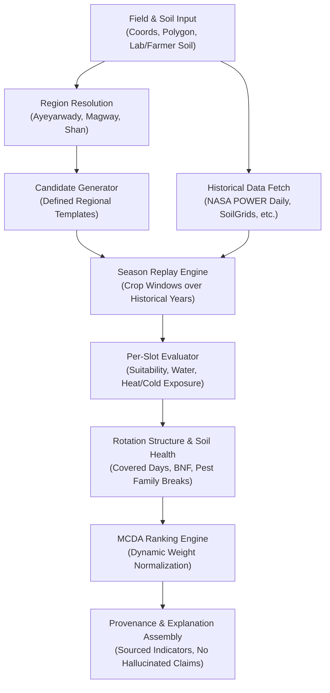

# Algorithmic Specifications & Decision Architecture

> **Status:** Implementation Blueprint & Algorithmic Reference  
> **Target Audience:** Algorithm Engineers, Optimization Specialists, AI Subagents  
> **Source Files:** `lib/engine/mcda.ts`, `lib/engine/candidates.ts`, `lib/engine/suitability.ts`, `lib/engine/season.ts`, `lib/engine/exposure.ts`, `lib/engine/lowcover.ts`, `lib/engine/soil-input.ts`, `lib/engine/compare.ts`  
> **Last Verified:** November 2026

---

## Table of Contents
1. [Architectural Overview & Pipeline Flow](#1-architectural-overview--pipeline-flow)
2. [Multi-Criteria Decision Analysis (MCDA) Algorithm](#2-multi-criteria-decision-analysis-mcda-algorithm)
3. [Candidate Generation & Combinatorial Filtering Algorithm](#3-candidate-generation--combinatorial-filtering-algorithm)
4. [Multi-Tiered Crop Suitability Engine](#4-multi-tiered-crop-suitability-engine)
5. [Historical Season Replay & Exposure Simulation Engine](#5-historical-season-replay--exposure-simulation-engine)
6. [Bare-Field & Low-Cover Detection Algorithm](#6-bare-field--low-cover-detection-algorithm)
7. [Soil Data Arbitration & Priority Hierarchy Engine](#7-soil-data-arbitration--priority-hierarchy-engine)
8. [End-to-End Comparison Pipeline (`compareRotations`)](#8-end-to-end-comparison-pipeline-comparerotations)
9. [Edge Cases, Invariants & Error Recovery](#9-edge-cases-invariants--error-recovery)

---

## 1. Architectural Overview & Pipeline Flow

The engine evaluates candidate rotations as a deterministic, pure pipeline:

---

## 2. Multi-Criteria Decision Analysis (MCDA) Algorithm

### 2.1 Problem Formulation & Criteria
$$S(R) = \sum_{i \in \mathcal{C}_{\text{active}}} w'_i \cdot s_i(R)$$

#### Active Evaluation Criteria
| Criterion ID | Description | Direction | Units | Associated Priority |
|---|---|---|---|---|
| `water-shortfall` | Rain shortfall vs. potential crop demand | Lower is better | $\text{mm}/\text{crop}$ | `water` |
| `soil-legume-share` | Share of rotation slots containing legumes | Higher is better | Ratio $[0, 1]$ | `soil` |
| `soil-cover` | Share of cycle days with a crop in the field | Higher is better | Ratio $[0, 1]$ | `soil` |
| `income-margin` | Estimated midpoint gross margin | Higher is better | $\text{MMK}\cdot\text{ha}^{-1}\cdot\text{yr}^{-1}$ | `income` |
| `forage-slots` | Crops yielding fodder or forage | Higher is better | $\text{count}/\text{year}$ | `forage` |
| `input-nitrogen` | Total external nitrogen requirement | Lower is better | $\text{kg N}\cdot\text{ha}^{-1}\cdot\text{yr}^{-1}$ | `lower-inputs` |

---

### 2.2 Normalization & Missing Data Rules (spec v3.1)
1. **Anchor utility is primary:** every criterion has a target and a limit. Income uses a regional benchmark anchor passed in by `compareRotations` (0 at break-even, 1 at the region's usual rotation margin) ($u = \text{clip}\left(\frac{x - x_{\text{limit}}}{x_{\text{target}} - x_{\text{limit}}}, 0, 1\right)$, reversed for lower-is-better), so tiny differences between options stay tiny. The anchors are analyst assumptions listed in `CRITERIA`.
2. **Relative min-max with a zero-variance guard** is used only where there is no anchor (income outside the three supported regions): $\frac{x - \min}{\max - \min}$ (or $\frac{\max - x}{\max - \min}$), and $1.0$ for everyone when $\max - \min < 10^{-9}$. A relative criterion on which all options tie is reported as `"no difference"` and left out of the weights.
3. **The Non-Imputation Rule:** A missing value is **never** defaulted to zero or an average. A criterion nobody has evidence for is dropped for all. If some options lack evidence the others have, they form a **partial-evidence set**: listed with a warning, not scored. The rest (the complete-evidence set) are ranked on every criterion. With fewer than two complete options, only criteria every option has are used.
4. **Dynamic Renormalization:** $w'_i = \frac{w_i}{\sum_{j \in \text{active}} w_j}$.
5. **Unresolved Trigger:** If the farmer's top priority cannot be evaluated on the complete set, or any partial-evidence option has no evidence at all on that priority $\implies$ `status: "unresolved"`.
6. **Regret:** `minimaxRegret` reports $L_{\max}$ and the 90th-percentile regret $L_{P90}$ per option; the choice stays minimax, ties go to the lower $L_{P90}$.

**Implementation:** `lib/engine/mcda.ts` (`rankRotations`)

---

## 3. Candidate Generation & Combinatorial Filtering Algorithm

### 3.1 Template-Driven Generation
Candidate sequences are generated from regional templates (e.g. `rice -> black-gram`, `sesame -> green-gram`, `maize -> soybean`).

### 3.2 Dynamic Slot Tiling & Sowing Window Alignment
1. **First Crop:** Anchored to regional sowing window $[t_{\text{sow,start}}, t_{\text{sow,end}}]$ in cycle year $Y$.
2. **Subsequent Crops:** Earliest sowing date is $t_{\text{harvest}, j} + 1\text{ day}$. Scans open sowing windows across $Y, Y+1, Y+2$ using circular date matching `inMonthDayWindow`.
3. **Maximum Turnaround Constraint:** Turnaround between crops must not exceed $\text{MAX\_WAIT\_DAYS} = 240\text{ days}$.
4. **Cycle Closure:** $\text{CycleYears} = \max(1, \text{round}(\text{CycleDays} / 365))$.

**Implementation:** `lib/engine/candidates.ts` (`generateCandidates`, `nextPlantDate`)

---

## 4. Multi-Tiered Crop Suitability Engine

### 4.1 Four-Tier Logic
1. `preferred`: Optimal crop development range.
2. `tolerated`: Outside optimal but within survival limits.
3. `outside`: Exceeds survival limits (biological blocker).
4. `unknown`: Input data missing or unverified (**Unknown is not a pass**).

### 4.2 Evaluated Checks
- `temperature`: Season mean temp vs. optimal/tolerated thermal envelope. Decisive.
- `sowing-window`: Sowing date vs. regional window. Decisive.
- `ph`: Soil pH vs. tolerance envelope. Decisive.
- `texture`: USDA texture class vs. accepted textures. Non-decisive.
- `drainage`: Drainage class vs. waterlogging tolerance. Non-decisive.
- `salinity`: Soil ECe vs. crop threshold. Decisive.

**Implementation:** `lib/engine/suitability.ts` (`assessSuitability`)

---

## 5. Historical Season Replay & Exposure Simulation Engine

1. **Replay Loop:** Projects the rotation's calendar window across 40+ historical weather years (1981–2024).
2. **Completeness:** Valid days / total calendar days $\ge 0.90$.
3. **Exposure Counters:** Heat stress days ($T_{\max} > T_{\text{crit,heat}}$), cold stress days ($T_{\min} < T_{\text{crit,cold}}$), longest consecutive dry run ($P < 1\text{ mm}$), heavy rain days ($P \ge 50\text{ mm}$).

**Implementation:** `lib/engine/season.ts`, `lib/engine/exposure.ts`, `lib/engine/rain.ts`

---

## 6. Bare-Field & Low-Cover Detection Algorithm

For unplanted gaps in rotation:
1. Query satellite scenes (HLS, MODIS) in gap window.
2. Require cloud-free valid land coverage $\ge 50\%$.
3. If water pixels $> 30\% \implies$ `mostly-water` (not bare ground).
4. If $< 2$ clear scenes $\implies$ `planned-gap-no-clear-imagery`.
5. If $\ge 50\%$ clear scenes have $NDVI < 0.25 \implies$ `possible-low-cover`; else `green-in-past-years`.

**Implementation:** `lib/engine/lowcover.ts` (`assessGaps`)

---

## 7. Soil Data Arbitration & Priority Hierarchy Engine

$$\text{Rank 0: Laboratory Test} \succ \text{Rank 1: Field Kit} \succ \text{Rank 2: SoilGrids v2 Map} \succ \text{Rank 3: Farmer Estimate}$$

Sorted by method rank ascending, then by observation date descending (most recent first). Missing properties stay null.

**Implementation:** `lib/engine/soil-input.ts` (`effectiveSoil`)

---

## 8. End-to-End Comparison Pipeline (`compareRotations`)

Coordinates field inputs, candidate generation, weather fetch, suitability, water balance, exposure, soil health, and MCDA ranking into an evaluated comparison result.

**Implementation:** `lib/engine/compare.ts` (`compareRotations`)

---

## 9. Edge Cases, Invariants & Error Recovery
- Missing radiation/wind/humidity $\to$ Hargreaves $ET_0$ with fallback flag.
- Polar night/day in $ET_0 \to$ clamp $\arccos$ to $[-1, 1]$.
- Null SoilGrids profile $\to$ report unknown, never crash.
- Missing soil pH $\to$ suitability unknown, blocks unearned pass.
- Farmer sets no priorities $\to$ MCDA returns `status: "no-priorities"`.
