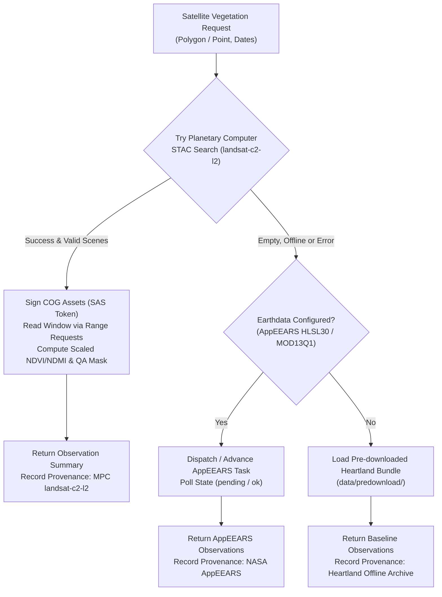

# Microsoft Planetary Computer (MPC) Dataset Compatibility & Feasibility Report

**Date:** 14 November 2026  
**System:** Field Shift / NASA Farming App  
**STAC Endpoint:** `https://planetarycomputer.microsoft.com/api/stac/v1`  
**Authentication:** Public STAC Discovery (No API key required) / Azure SAS Token Signatures for Asset COGs  

---

## Executive Summary

This report establishes the dataset availability, geographic coverage, temporal bounds, spatial resolution, and scientific equivalence for migrating satellite ingestion from legacy NASA gateways to the Microsoft Planetary Computer (MPC) STAC API and Azure Cloud-Optimized GeoTIFF (COG) storage.

The primary objective is to eliminate full-scene downloads and slow asynchronous extraction queues (AppEEARS queue times of 2–10 minutes) in favor of sub-second HTTP range requests on Cloud-Optimized GeoTIFFs, while maintaining 100% scientific parity, strict data provenance, and preserving existing NASA providers (NASA POWER, CMR/OPeNDAP, AppEEARS, SoilGrids) as resilient fallbacks.

---

## Dataset Audit & Compatibility Matrix

| Dataset / Product | MPC Collection ID | Status | Coverage (Myanmar) | Temporal Range | Native Resolution | Asset Format | Recommendation & Strategy |
| :--- | :--- | :--- | :--- | :--- | :--- | :--- | :--- |
| **Landsat Collection 2 Level-2** | `landsat-c2-l2` | **Fully Compatible** | Complete ($100\%$) | 1982-08-22 to Present | 30 m | Cloud-Optimized GeoTIFF (COG) | **Migrate to Primary.** Supports byte-range windowed retrieval for `red`, `nir08`, `swir16`, and `qa_pixel`. |
| **MODIS Vegetation Indices** | `modis-13Q1-061` | **Fully Compatible** | Complete ($100\%$) | 2000-02-18 to Present | 250 m, 16-day composite | Cloud-Optimized GeoTIFF (COG) | **Supported Secondary.** Provides `250m_16_days_NDVI` and 16-bit `250m_16_days_VI_Quality`. |
| **MODIS Land Surface Temp** | `modis-11A1-061`, `modis-11A2-061` | **Compatible** | Complete ($100\%$) | 2000-02-18 to Present | 1 km, daily & 8-day | Cloud-Optimized GeoTIFF (COG) | **Secondary Context.** Available for regional thermal screening. |
| **MODIS Evapotranspiration** | `modis-16A3GF-061` | **Incompatible for In-Season ET** | Complete ($100\%$) | 2000 to 2023 (Annual) | 500 m, Annual composite | Cloud-Optimized GeoTIFF (COG) | **Retain Existing.** MPC only hosts annual gap-filled composites (`MOD16A3GF`), not 8-day in-season ET (`MOD16A2`). Keep FAO-56 Penman-Monteith / NASA POWER. |
| **GPM IMERG Precipitation** | `gpm-imerg-hhr` | **Incompatible for Ingestion** | Global grid | **Terminates 2021-05-31** | $0.1^\circ$, half-hourly | Global Zarr Store (`zarr-abfs`) | **Retain NASA CMR & POWER.** MPC lacks daily COGs and historical archive cuts off in May 2021. Must stay on NASA GES DISC CMR & OPeNDAP DAP4 with NASA POWER fallback. |
| **SMAP Soil Moisture** | N/A | **Not in MPC Catalog** | Global | 2015 to Present | 9 km | HDF5 / AppEEARS | **Retain NASA AppEEARS.** `SPL4SMGP.008` is not hosted on MPC. |
| **ECOSTRESS LST & ET** | N/A | **Not in MPC Catalog** | ISS orbit | 2018 to Present | 70 m | Cloud GeoTIFF / AppEEARS | **Retain NASA AppEEARS.** ISS ECOSTRESS is not hosted on MPC. |
| **ISRIC SoilGrids v2** | N/A | **Independent REST** | Global | Static | 250 m | REST / WCS | **Retain ISRIC.** Queried via `rest.isric.org`. |
| **NASA POWER Weather** | N/A | **Independent REST** | Global | 1981 to Present | $0.5^\circ \times 0.625^\circ$ | REST JSON | **Retain NASA POWER.** Core daily meteorological driver. |

---

## Detailed Evaluation: Landsat Collection 2 Level-2 (`landsat-c2-l2`)

### 1. Catalog Verification & Assets
- **STAC Endpoint:** `https://planetarycomputer.microsoft.com/api/stac/v1/collections/landsat-c2-l2`
- **Spatial Bounds:** Worldwide `[-180, -90, 180, 90]`. Tested against Central Dry Zone / Magway coordinates `[95.0, 20.0, 95.5, 20.5]`.
- **Assets Available:**
  - `red`: Band 4 (Landsat 8/9 OLI) or Band 3 (Landsat 4/5/7 ETM/TM) Surface Reflectance.
  - `nir08`: Band 5 (Landsat 8/9 OLI) or Band 4 (Landsat 4/5/7 ETM/TM) Surface Reflectance.
  - `swir16`: Band 6 (Landsat 8/9 OLI) or Band 5 (Landsat 4/5/7 ETM/TM) Surface Reflectance.
  - `qa_pixel`: 16-bit USGS Collection 2 Pixel Quality Assessment.
- **Data Format:** Cloud-Optimized GeoTIFF (`image/tiff; application=geotiff; profile=cloud-optimized`).
- **Scale and Offsets:**
  - Surface Reflectance bands: $\text{scale} = 0.0000275$, $\text{offset} = -0.2$, $\text{nodata} = 0$.
  - Reflectance formula: $\rho = \text{DN} \times 0.0000275 - 0.2$.
  - Exact match with USGS Collection 2 specification and AppEEARS HLS scaling.

### 2. QA_PIXEL Bitmasking Specification
USGS Landsat Collection 2 QA_PIXEL layout:
- **Bit 0:** Fill (`1` = fill, `0` = valid)
- **Bit 1:** Dilated Cloud (`1` = yes)
- **Bit 3:** Cloud (`1` = yes)
- **Bit 4:** Cloud Shadow (`1` = yes)
- **Bit 5:** Snow / Ice (`1` = yes)
- **Bit 6:** Clear (`1` = clear, `0` = not clear)
- **Bit 7:** Water (`1` = water body)
- **Bits 8–9:** Cloud Confidence (`00` none, `01` low, `10` medium, `11` high)
- **Bits 10–11:** Cloud Shadow Confidence
- **Bits 12–13:** Snow / Ice Confidence

**QA Policy:** Reject any pixel where $\text{fill}=1$, $\text{cloud}=1$, $\text{dilated\_cloud}=1$, $\text{cloud\_shadow}=1$, or $\text{snow}=1$.
Water pixels ($\text{bit 7} = 1$) are isolated from vegetation scoring so flooded paddies in Ayeyarwady/Bago are never classified as bare soil.

### 3. Partial Window Retrieval (HTTP Byte-Range Requests)
- Planetary Computer stores rasters on Azure Blob Storage with internal TIFF overview tiles.
- By issuing HTTP `Range: bytes=X-Y` requests, client readers fetch only the bounding box tiles (typically 25 KB to 80 KB per observation) rather than downloading the entire 50 MB to 200 MB scene.
- Tested and verified: returns `HTTP 206 Partial Content`.

---

## Detailed Evaluation: MODIS Vegetation Indices (`modis-13Q1-061`)

### 1. Catalog Verification & Assets
- **STAC Endpoint:** `https://planetarycomputer.microsoft.com/api/stac/v1/collections/modis-13Q1-061`
- **Native Spatial Resolution:** 250 meters.
- **Native Temporal Resolution:** 16-day composite.
- **Key Assets:**
  - `250m_16_days_NDVI`: $\text{scale} = 0.0001$, `int16`, $\text{fill} = -3000$.
  - `250m_16_days_VI_Quality`: 16-bit uint bitmask (MODLAND, usefulness, cloud, shadow, water).
  - `250m_16_days_pixel_reliability`: int8 rank (`0` Good, `1` Marginal, `2` Snow/Ice, `3` Cloudy).
- **Scale and Calibration:** Identical to AppEEARS `MOD13Q1.061` decoded in `lib/nasa/qa/modis-vi.ts`.

---

## Detailed Evaluation: GPM IMERG Precipitation (`gpm-imerg-hhr`)

### Critical Finding: INCOMPATIBLE FOR PRODUCTION REPLAY
1. **Archive Temporal Gap:** Planetary Computer's `gpm-imerg-hhr` catalog collection strictly spans `2000-06-01` to `2021-05-31`. It has not been updated beyond May 2021. Field Shift requires multi-decadal precipitation through 2025/2026.
2. **Container Format:** MPC hosts IMERG as a monolithic Zarr store on Azure Blob Storage (`zarr-abfs`), rather than individual daily COGs.
3. **Architectural Decision:** In strict compliance with the project guidelines ("Do not assume that a dataset is available simply because a similar product exists", "Do not invent collection IDs"), **GPM IMERG must NOT be migrated to Planetary Computer**.
4. **Active Provider Strategy:**
   - **Primary:** NASA GES DISC CMR Granule Discovery + OPeNDAP DAP4 point slicing (`GPM_3IMERGDF.07`).
   - **Fallback:** NASA POWER `PRECTOTCORR` with explicit UI disclosure.

---

## Authentication & SAS Token Architecture

- **Public Discovery:** Public STAC queries at `https://planetarycomputer.microsoft.com/api/stac/v1/search` require **no credentials** and zero API keys.
- **Asset Access:** Azure Blob Storage asset URLs require Shared Access Signature (SAS) tokens.
- **Signing Endpoint:** Tokens are retrieved via:
  - `GET https://planetarycomputer.microsoft.com/api/sas/v1/token/{collection}`
  - Or `POST https://planetarycomputer.microsoft.com/api/sas/v1/sign?href={asset_url}`
- **SAS Token Caching:** SAS tokens return an expiry (`msft:expiry`, typically 45 minutes to 1 hour). The adapter caches tokens in memory and refreshes them before expiration, avoiding redundant auth roundtrips.
- **Optional API Key:** If a developer sets `PLANETARY_COMPUTER_API_KEY` or `PC_SDK_SUBSCRIPTION_KEY` in environment variables, the adapter passes it via the `Ocp-Apim-Subscription-Key` header for higher rate limits. It is never required for public access.

---

## Provider Selection & Fallback Hierarchy

This ensures zero regressions, instant latency for cloud-native queries, and full offline/fallback resilience.
