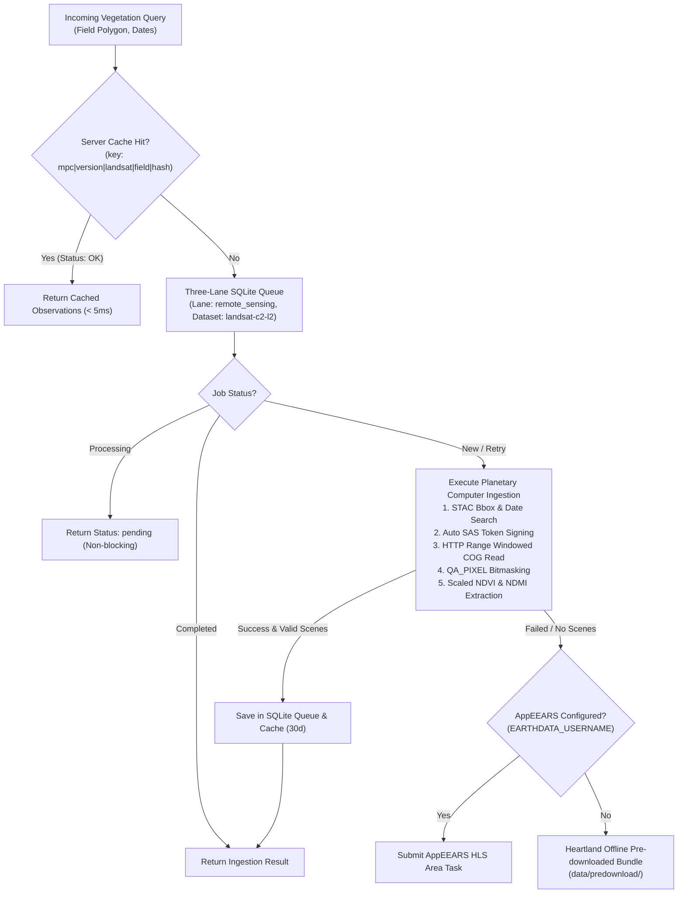

# Microsoft Planetary Computer (MPC) Integration Reference

**System:** Field Shift / NASA Farming App  
**Architecture:** Cloud-Native STAC + COG Byte-Range Retrieval with 3-Lane SQLite Queue  
**Date:** 14 November 2026  
**STAC Endpoint:** `https://planetarycomputer.microsoft.com/api/stac/v1`  
**SAS Auth Endpoint:** `https://planetarycomputer.microsoft.com/api/sas/v1`  

---

## 1. Supported Planetary Computer Collections

| Collection ID | Dataset | Spatial Resolution | Temporal Extent | Assets Utilized | Primary / Secondary |
| :--- | :--- | :--- | :--- | :--- | :--- |
| `landsat-c2-l2` | USGS Landsat Collection 2 Level-2 Surface Reflectance | 30 m | 1982-08-22 to Present | `red`, `nir08`, `swir16`, `qa_pixel` | **Primary Vegetation Route** |
| `modis-13Q1-061` | MODIS Terra/Aqua 16-Day Vegetation Indices | 250 m | 2000-02-18 to Present | `250m_16_days_NDVI`, `250m_16_days_VI_Quality`, `250m_16_days_pixel_reliability` | **Secondary Regional VI** |
| `modis-11A2-061` | MODIS Land Surface Temperature / Emissivity 8-Day | 1000 m | 2000-02-18 to Present | `LST_Day_1km`, `QC_Day`, `LST_Night_1km`, `QC_Night` | Contextual Thermal |

---

## 2. Incompatible / Excluded MPC Collections

| Collection ID | Product | Why Incompatible / Excluded | Active Production Provider |
| :--- | :--- | :--- | :--- |
| `gpm-imerg-hhr` | GPM IMERG Half-Hourly Precipitation | **Catalog terminates at 2021-05-31** and is stored as a global Zarr store (`zarr-abfs`), not daily COGs or point-sliceable GeoTIFFs. | **NASA GES DISC CMR Granule Discovery & OPeNDAP DAP4 point slicing** (`lib/nasa/imerg.ts`) with NASA POWER fallback. |
| `modis-16A3GF-061` | MODIS Annual Net Evapotranspiration | Only annual composites (`MOD16A3GF`), not 8-day in-season ET (`MOD16A2`). | **FAO-56 Penman-Monteith & Hargreaves-Samani via NASA POWER daily** (`lib/engine/water.ts`). |
| N/A | SMAP Level-4 Soil Moisture (`SPL4SMGP.008`) | Not hosted on Planetary Computer. | **NASA AppEEARS** (`lib/server/remote-sensing.ts`). |
| N/A | ECOSTRESS Thermal & ET (`ECO_L2T_LSTE.002`, `ECO_L3T_JET.002`) | Not hosted on Planetary Computer. | **NASA AppEEARS** (`lib/nasa/appeears/*`). |

---

## 3. Data Ingestion Architecture & Provider Selection

---

## 4. Scientific Parity & Validation Rules

1. **Landsat Surface Reflectance Scaling:**
   $$\rho = \text{DN} \times 0.0000275 - 0.2$$
   - Fill/NoData: $\text{DN} \le 0 \implies \text{null}$.
   - Physical bounds: $0.0 \le \rho \le 1.6$.
2. **USGS Collection 2 QA_PIXEL Masking:**
   - Rejected: Fill (bit 0), Dilated Cloud (bit 1), Cloud (bit 3), Cloud Shadow (bit 4), Snow (bit 5), Cloud Confidence $= 3$, Shadow Confidence $= 3$.
   - Water Isolation: Water (bit 7) is strictly isolated and counted separately so that flooded paddy rice in Ayeyarwady is not scored as bare soil.
3. **Vegetation Indices:**
   $$\text{NDVI} = \frac{\rho_{\text{NIR}} - \rho_{\text{Red}}}{\rho_{\text{NIR}} + \rho_{\text{Red}}}$$
   $$\text{NDMI} = \frac{\rho_{\text{NIR}} - \rho_{\text{SWIR1}}}{\rho_{\text{NIR}} + \rho_{\text{SWIR1}}}$$
   - Denominator $\le 0 \implies \text{null}$, never synthetic zero.
4. **MODIS 16-Day 250m Scaling & QA:**
   $$\text{NDVI}_{\text{MODIS}} = \text{DN} \times 0.0001$$
   - Fill: $-3000 \implies \text{null}$.
   - QA Criteria: MODLAND $= 0$ (good quality), pixel reliability $= 0$ (good), land pixel ($\text{landWater} = 1$), no cloud/snow/shadow.

---

## 5. Caching and Queue Strategy

- **Three Lanes:**
  1. `weather`: NASA POWER agroclimatological history.
  2. `precipitation`: GPM IMERG daily cell slicing / POWER fallback.
  3. `remote_sensing`: Planetary Computer Landsat COGs / AppEEARS HLS/SMAP/SRTM.
- **Deduplication:** Jobs use deterministic IDs derived from `computeJobId(lane, dataset, params)`. Duplicate in-flight requests share the running execution.
- **Non-blocking Operations:** Farmer requests return status immediately (`pending` or cached `ok`). Ingestion never blocks UI responsiveness.
- **SAS Token Caching:** Azure Blob SAS tokens are cached in-memory and automatically refreshed 60 seconds before expiration.

---

## 6. Test Suite Coverage

The Planetary Computer integration is verified across 13 dedicated unit and integration tests (`tests/lib/planetary-computer.test.ts`) alongside 182 existing test suites (195 tests total, 100% passing):
- STAC endpoint & public authentication (no API key required).
- GeoJSON query serialization with cloud cover threshold.
- SAS token caching and URL query appending.
- Landsat Collection 2 QA_PIXEL bitmask decoding (fill, cloud, shadow, snow, water separation).
- Reflectance scaling formula adherence ($0.0000275 \times \text{DN} - 0.2$).
- Scientific equivalence between HLS and Planetary Computer NDVI/NDMI.
- Bounding box calculation for Point and Polygon geometries.
- Three-lane SQLite queue deduplication, async state tracking, and failure recovery.
- Provider fallback hierarchy from Planetary Computer to AppEEARS and pre-downloaded offline bundles.
