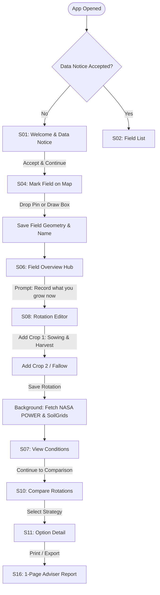
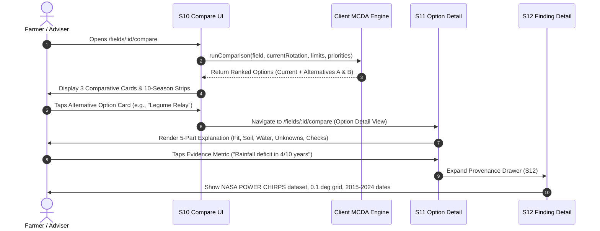
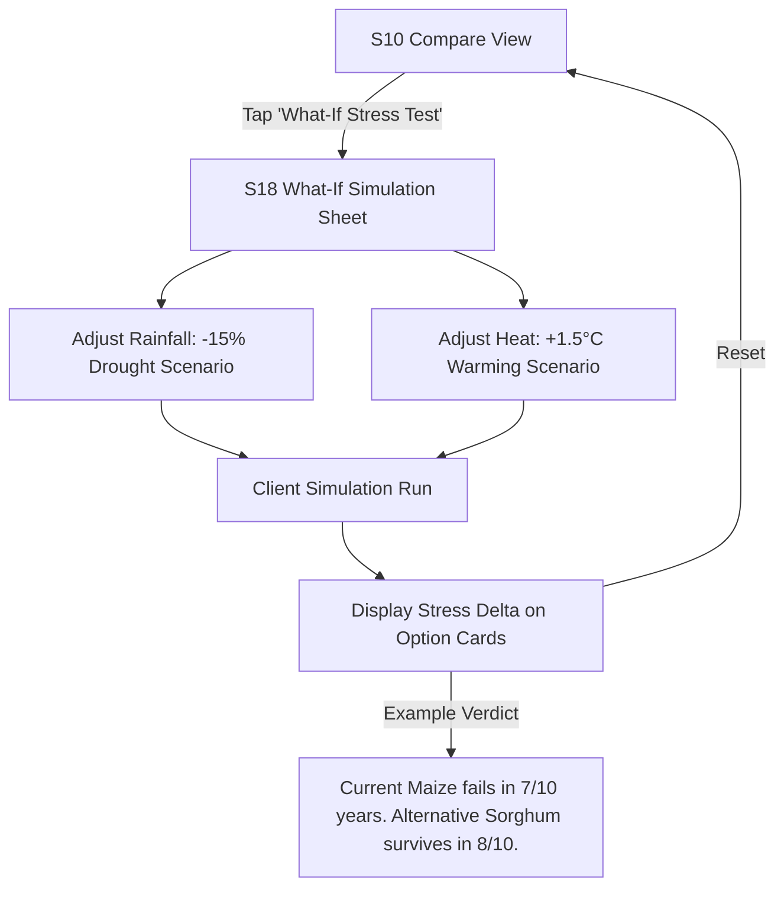
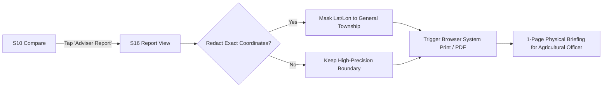

# Field Shift — Comprehensive Screen Flows & Process Architecture

**Document Version:** 1.0.0  
**Status:** Approved Specification & Implementation Reference  
**Scope:** Complete screen inventory (S01–S18), user journeys, interaction mechanics, data contracts, and background processes for the Field Shift rotation planner.

---

## 1. System Overview & Architectural Paradigm

Field Shift is an offline-first, local-first crop rotation decision-support tool. It empowers smallholder farmers and agricultural extension officers (initially in Myanmar's Central Dry Zone and Ayeyarwady Delta) to evaluate current crop rotations against resilient alternatives using historical NASA Earth observation data and modeled soil characteristics.

```
┌────────────────────────────────────────────────────────────────────────────────┐
│                           CLIENT BROWSER / DEVICE                              │
│                                                                                │
│  ┌────────────────────────┐  ┌───────────────────────┐  ┌───────────────────┐  │
│  │   UI View Hierarchy    │  │  Zustand Stores       │  │    Local MCDA     │  │
│  │  • Next.js App Router  │  │  • fields-store.ts    │  │     Engine        │  │
│  │  • Tailwind CSS / CSS  │  │  • settings-store.ts  │  │  • Rank-sum MCDA  │  │
│  │  • Light-only tokens   │  │  • locale-store.ts    │  │  • Limit checks   │  │
│  └───────────┬────────────┘  └───────────┬───────────┘  │  • What-If sim    │  │
│              │                           │              └─────────┬─────────┘  │
│              ▼                           ▼                        ▼            │
│  ┌──────────────────────────────────────────────────────────────────────────┐  │
│  │                LocalStorage Persistence Layer (Offline)                  │  │
│  │  • Key: `fieldshift.fields.v1`    • Key: `fieldshift.settings.v1`        │  │
│  └───────────────────────────────────────┬──────────────────────────────────┘  │
└──────────────────────────────────────────┼─────────────────────────────────────┘
                                           │ (Background fetch when online)
                                           ▼
┌────────────────────────────────────────────────────────────────────────────────┐
│                         EXTERNAL DATA SERVICES & APIS                          │
│                                                                                │
│  ┌───────────────────────┐  ┌───────────────────────┐  ┌───────────────────┐  │
│  │ NASA POWER API        │  │ ISRIC SoilGrids API   │  │ Mapbox GL / Tiles │  │
│  │ • 10-yr daily agmet   │  │ • 250m soil profile   │  │ • Satellite base  │  │
│  │ • Rain, temp, RH      │  │ • pH, clay, sand, SOC │  │ • Static map pins │  │
│  └───────────────────────┘  └───────────────────────┘  └───────────────────┘  │
└────────────────────────────────────────────────────────────────────────────────┘
```

### 1.1 Core Architectural Principles

1. **Local-First & Offline-First:**
   - No mandatory user account, password, or cloud database.
   - All entered fields, crop sequences, and custom soil test values reside in `localStorage`.
   - Results are computed client-side by the MCDA engine.
   - When network connectivity is absent, cached data and stored rotations remain completely functional.

2. **Honesty & Provenance First:**
   - Every metric explicitly declares its source, temporal span, and spatial resolution (e.g., *NASA POWER ~10 km grid*, *SoilGrids 250 m*).
   - Coarse measurements are honestly labeled **around your field**, never pretending to be meter-precision plot readings.
   - Data colors (`water`, `heat`, `drought`, `frost`, `healthy`) are never shown alone; they are always paired with icons and plain-language verdicts.

3. **Light Mode Only:**
   - Strict design requirement (`DESIGN.md`, The Light-Only Rule). Natural parchment backgrounds (`#f4f3ee`), warm off-white surfaces (`#ffffff`), and high-contrast ink (`#1c1b18`) ensure readability under direct sunlight in outdoor field conditions.

---

## 2. Global Route Map & Navigation Matrix

The field is the core entity. The application structures views into **Tab Roots**, **Push Navigations**, **Modal Sheets**, and **System Overlays**.

| ID | Screen Name | Route Path | Container Type | Primary Responsibility |
|:---|:---|:---|:---|:---|
| **S01** | First Launch / Welcome | `/welcome` | Full-Screen Cover | Language selection, privacy notice, offline data disclaimer. |
| **S02** | Field List (Home) | `/` | Tab Root (`/`) | List of saved fields, quick status cards, add field trigger. |
| **S03** | Field Map | `/fields/map` | Tab Root Mode | Spatial visualization of all user fields on satellite basemap. |
| **S04** | Mark Field | `/fields/new` | Push / Full View | Map-based boundary drawing, point placement, or coordinate entry. |
| **S05** | Farm Profile & Limits | `/fields/:id/profile` | Tab Sub-screen | Soil overrides, irrigation type, labor, and economic limits. |
| **S06** | Field Hub (Overview) | `/fields/:id` | Tab Sub-screen | Central management dashboard, current crop status, next step banner. |
| **S07** | Conditions & History | `/fields/:id/conditions` | Tab Sub-screen | NASA POWER weather, rainfall patterns, SoilGrids profile, dry spells. |
| **S08** | Rotation Editor | `/fields/:id/rotation` | Tab Sub-screen | Define current crop sequences, sowing/harvest months, residue rules. |
| **S09** | Priorities & Limits | `/fields/:id/profile#limits`| Sheet / Section | Rank-sum priority weighting (water, soil, earnings, livestock). |
| **S10** | Compare Rotations | `/fields/:id/compare` | Tab Sub-screen | Multi-criteria matrix: current rotation vs. 2+ alternatives. |
| **S11** | Option Detail | `/fields/:id/compare` (Expanded) | Push / View | In-depth breakdown of a single strategy (agronomic fit, risks, checks). |
| **S12** | Finding / Evidence Detail | `/fields/:id/conditions` (Deep) | Push / Modal | Detailed dataset citations, spatial resolution, and calculation logic. |
| **S13** | Explain a Term | `/learn#terms` | Modal Sheet | Plain-language glossaries for technical agronomic terms. |
| **S14** | Answer an Unknown | `/fields/:id/questions/:qId`| Modal Sheet | Single-question focused flow resolving unmeasured field limits. |
| **S15** | Learn & Crop Library | `/learn` | Tab Root | Reference library of regional crops, benefits, and rotation rules. |
| **S16** | Share & Print Report | `/fields/:id/report` | Push / Print View| 1-page condensed field briefing designed for extension consultation. |
| **S17** | Long-Term Trends | `/fields/:id/trends` | Tab Sub-screen | 10-to-40 year rainfall and temperature shift trajectories. |
| **S18** | What-If Simulator | `/fields/:id/compare` (What-If) | Modal Sheet | Real-time climate stress simulation (monsoon delay, +2°C heat). |

---

## 3. End-to-End User Journeys

### 3.1 Journey 1: First Run (Zero State to First Comparison)

The primary journey takes a first-time user from opening the application to viewing their first rotation comparison.



#### Detailed Process Steps:
1. **First Launch (`/welcome`):**
   - User lands on S01. The UI displays language selection (Myanmar Unicode / English) and a transparent data disclosure.
   - User taps **Continue**. The timestamp is saved to `localStorage` under `fieldshift.settings.v1`.
   - Next.js router replaces route with `/fields/new`.

2. **Delineate Field (`/fields/new`):**
   - User searches village/town or uses device geolocation.
   - User drops a center coordinate or traces a bounding box polygon.
   - User enters Field Name (e.g., *"North Creek Field"*) and optional acres.
   - User taps **Save Field**. State is committed to `useFieldsStore`, and user is navigated to `/fields/:id`.

3. **Record Current Rotation (`/fields/:id/rotation`):**
   - User clicks **Record what you grow now**.
   - User adds Crop 1 (e.g., *Monsoon Sesame*, May–Aug) and Crop 2 (e.g., *Winter Chickpea*, Oct–Jan).
   - User marks date certainty (*Exact*, *About*, *Usual time*) and residue practice (*Left on field*, *Grazed*, *Burned*).
   - Tapping **Save rotation** writes the sequence to `useFieldsStore.rotations`.

4. **Environmental Diagnostics (`/fields/:id/conditions`):**
   - The app initiates parallel API calls to NASA POWER (10-year daily weather series) and ISRIC SoilGrids.
   - If offline, regional climate baseline models populate the values with an explicit indicator.
   - Conditions dashboard displays: seasonal rainfall totals, dry spell risks, temperature bounds, and soil texture.

5. **Multi-Criteria Comparison (`/fields/:id/compare`):**
   - Client engine evaluates the current rotation against regional agronomic templates (e.g., *Pigeon Pea intercrop*, *Green gram short-season relay*).
   - MCDA algorithm computes scores across 4 key criteria: **Water Conservation**, **Soil Health**, **Gross Margin**, and **Climate Resilience**.
   - Cards display comparative performance, historical stress strips (10 seasons), and critical drawbacks.

---

### 3.2 Journey 2: The Decision Loop (Compare, Option Detail & Evidence)



---

### 3.3 Journey 3: Answering Unknowns (Closing Data Gaps)


#### Detailed Process Steps:
1. When comparison rules detect an unmeasured boundary condition (e.g., whether irrigation water is available in January), an **Unknown Chip** appears on the option card.
2. The user taps the chip, which opens **S14 Answer an Unknown** (`/fields/:id/questions/:questionId`) as a focused sheet.
3. The screen asks a single targeted multiple-choice question:
   - *"Do you have access to supplemental irrigation in the dry season (Nov–Feb)?"*
   - Options: `No, rainfed only` | `Yes, tubewell / pump` | `Yes, canal / river scheme`
4. Selecting an answer immediately updates `field.waterAccess` in the store and closes the sheet.
5. The comparison matrix dynamically re-scores the rotations; previously penalized or blocked strategies become active with refreshed score badges.

---

### 3.4 Journey 4: "What-If" Climate Stress Testing



---

### 3.5 Journey 5: Extension Consultation & Reporting



---

## 4. Comprehensive Screen Specifications (S01 to S18)

---

### S01 — First Launch / Welcome Screen

- **Route:** `/welcome`
- **Container:** Full-screen modal cover (non-dismissible without explicit acceptance).
- **Primary Goal:** Onboard user, ensure language choice, disclose local storage privacy model.

```
┌──────────────────────────────────────────────┐
│  Field Shift                                 │
│  Crop rotation planner for smallholder farms │
│                                              │
│  Language / ဘာသာစကား                       │
│  (•) မြန်မာ (Myanmar Unicode)                │
│  ( ) English                                 │
│                                              │
│  ┌────────────────────────────────────────┐  │
│  │ What stays on this phone               │  │
│  │ • Your field boundaries and names      │  │
│  │ • Crop rotations and soil test inputs  │  │
│  │ • Your priority settings and limits    │  │
│  │                                        │  │
│  │ What is retrieved online               │  │
│  │ • NASA POWER weather around your field │  │
│  │ • ISRIC SoilGrids modeled baseline     │  │
│  └────────────────────────────────────────┘  │
│                                              │
│  [          Continue / ဆက်လက်လုပ်ဆောင်မည်       ]  │
└──────────────────────────────────────────────┘
```

#### Process & Interactions:
1. **On Load:** Reads `useSettingsStore`. If `dataNoticeAcceptedAt` already exists, redirects immediately to `/`.
2. **Language Selection:** Tapping Myanmar/English immediately toggles `useLocaleStore.setLocale(locale)`. Text translates dynamically without reloading.
3. **Continue Action:** User clicks **Continue**:
   - Commits `new Date().toISOString()` to `localStorage.setItem('fieldshift.settings.v1')`.
   - Router pushes `/fields/new` (if 0 fields) or `/` (if fields exist).

#### State & Edge Cases:
- **Offline:** Allowed. The notice explicitly reassures the user that satellite data will load when connected.
- **Zawgyi Encoding Check:** Warns users if their device environment uses non-standard Zawgyi fonts instead of standard Myanmar Unicode.

---

### S02 — Field List (Home View)

- **Route:** `/`
- **Container:** Tab root view.
- **Primary Goal:** Display all saved fields, track progress, provide entry point to add or edit fields.

```
┌──────────────────────────────────────────────┐
│ Field Shift                    [Settings] [?]│
│ ┌──────────────────────────────────────────┐ │
│ │ Fields (3)                  [+ Add Field]│ │
│ └──────────────────────────────────────────┘ │
│                                              │
│ ┌──────────────────────────────────────────┐ │
│ │ [Map Thumbnail]  North Creek Field       │ │
│ │ Ayeyarwady · 3.5 acres                   │ │
│ │ Current: Monsoon Rice → Winter Sesame    │ │
│ │ Status: [ Done ] Next: Compare Options > │ │
│ └──────────────────────────────────────────┘ │
│ ┌──────────────────────────────────────────┐ │
│ │ [Map Thumbnail]  U Lwin Upper Plot       │ │
│ │ Magway · 1.8 acres                       │ │
│ │ Current: Groundnut only (fallow winter)  │ │
│ │ Status: [ 1 Question Open ]            > │ │
│ └──────────────────────────────────────────┘ │
│                                              │
│ [ Fields (Active) ]     [ Learn Library ]    │
└──────────────────────────────────────────────┘
```

#### Process & Interactions:
1. **Store Hydration:** Loads `useFieldsStore.fields`.
2. **Map Thumbnail Render:** Uses Mapbox static map API to display field bounding box.
3. **Step State Resolution:** For each card, evaluates `deriveStepStates(field, rotations)`:
   - Location: Done
   - Rotation: Done / Needs input
   - Conditions: Ready / Loading
   - Compare: Ready / Needs input
4. **Card Click:** Directly navigates to Field Hub `/fields/:fieldId`.
5. **Swipe / Menu Actions:** Provides **Archive** (hides field) and **Delete** (destructive confirmation).

---

### S03 — Field Map (Spatial Multi-Field View)

- **Route:** `/fields/map`
- **Container:** Tab root full-viewport interactive map.
- **Primary Goal:** Spatial overview of all farm plots against regional satellite basemaps.

#### Key Mechanics:
- Renders Mapbox GL JS map centered on the bounding box containing all user fields.
- Clicking any polygon or pin opens a bottom sheet card displaying field name, crop, and link to `/fields/:fieldId`.
- Toggleable data layer overlays: NASA SRTM elevation contours, MODIS NDVI seasonal vegetation.

---

### S04 — Mark Field (Boundary & Location Picker)

- **Route:** `/fields/new` or `/fields/:fieldId/location`
- **Container:** Full-screen interactive map with floating action bar.
- **Primary Goal:** Accurately set geographic coordinates and boundary shape.

```
┌──────────────────────────────────────────────┐
│ < Back           Mark Your Field             │
│ ┌──────────────────────────────────────────┐ │
│ │ [ Search village, pagoda or creek...   ] │ │
│ └──────────────────────────────────────────┘ │
│                                              │
│                  ▲                           │
│                 / \  [ Polygon Drawn ]       │
│                /___\ Area: ~3.2 acres        │
│                                              │
│ ┌──────────────────────────────────────────┐ │
│ │ Tools: [ Drop Pin ]  [ Draw Box ]        │ │
│ │ Coordinates: 20.1458° N, 95.1245° E      │ │
│ │ Field Name: [ North Creek Field        ] │ │
│ │                                          │ │
│ │ [           Save This Field            ] │ │
│ └──────────────────────────────────────────┘ │
└──────────────────────────────────────────────┘
```

#### Process & Interactions:
1. **Map Interaction:**
   - User drags map, searches by settlement name, or clicks **Use My Location**.
   - User chooses geometry mode: **Pin (approximate point)**, **Box**, or **Custom polygon**.
2. **Area Calculation:** Computes geodesic area in local acres (`1 acre = 4,046.86 m²`).
3. **Persistence:** On **Save This Field**:
   - Creates a unique UUID `f-<timestamp>`.
   - Saves geometry to `useFieldsStore.addField`.
   - Automatically kicks off prefetching of environmental diagnostics in the background.
   - Pushes user to `/fields/:fieldId`.

---

### S05 — Farm Profile & Constraints

- **Route:** `/fields/:fieldId/profile`
- **Container:** Inset grouped form within Field Shell.
- **Primary Goal:** Record farm-specific management limits and soil overrides.

#### Fields Collected:
- **Water Source:** Rainfed only / Shallow tubewell / River lift / Canal irrigation.
- **Soil Texture Override:** Farmer's observed texture (Clay / Sandy Loam / Loam / Black Cotton Soil) which overrides coarse satellite SoilGrids data.
- **Soil Test Data (Optional):** Observed pH, Nitrogen, Phosphorus, Potassium levels.
- **Machinery & Labor Constraints:** Tractor access, draft animals, peak harvest labor shortages.

---

### S06 — Field Hub (Overview Dashboard)

- **Route:** `/fields/:fieldId`
- **Container:** Field Shell with 5-tab top bar (Overview, Profile, Crops, Conditions, Compare).
- **Primary Goal:** Central mission control for a field.

```
┌──────────────────────────────────────────────┐
│ < Fields          North Creek Field          │
│ [Overview] [Farm] [Crops] [Conditions] [Comp]│
│                                              │
│ ┌──────────────────────────────────────────┐ │
│ │ Next Step: Compare rotation options      │ │
│ │ 3 alternative strategies ready to test.  │ │
│ │ [       Compare Options Now            ] │ │
│ └──────────────────────────────────────────┘ │
│                                              │
│ ┌──────────────────────────────────────────┐ │
│ │ Current Sequence                         │ │
│ │ Monsoon Rice  ->  Winter Chickpea        │ │
│ │ Sown: June        Sown: November         │ │
│ │ [Edit Rotation]                          │ │
│ └──────────────────────────────────────────┘ │
│                                              │
│ ┌──────────────────────────────────────────┐ │
│ │ Local Conditions Snapshot                │ │
│ │ • Annual Rainfall: 840 mm (NASA POWER)   │ │
│ │ • Dominant Risk: 22-day mid-season dry   │ │
│ │ • Soil Texture: Sandy Clay Loam (250m)   │ │
│ └──────────────────────────────────────────┘ │
└──────────────────────────────────────────────┘
```

---

### S07 — Environmental Conditions & Climate History

- **Route:** `/fields/:fieldId/conditions`
- **Container:** Field Sub-screen.
- **Primary Goal:** Explain seasonal rainfall, dry spell patterns, temperature extremes, and soil properties.

#### Sections Displayed:
1. **Headline Finding:** One plain-language verdict (e.g., *"Dry spells over 20 days occurred in 6 of the last 10 monsoon seasons."*).
2. **Rainfall & Water Balance Panel:**
   - 10-year monthly bar charts from NASA POWER.
   - Wet season onset date and duration.
3. **Temperature & Heat Stress Panel:**
   - Days exceeding 38°C during critical flowering windows.
4. **Soil Grids Profile:**
   - Soil pH, Organic Carbon, Clay %, Sand %, and Cation Exchange Capacity.
   - If farmer entered a local soil test, displays badge: **Your soil test (overrides satellite model)**.
5. **Data Provenance Line:** Shows spatial grid cell size (e.g. *NASA POWER 0.1° cell ~10 km around your field*).

---

### S08 — Rotation Editor

- **Route:** `/fields/:fieldId/rotation`
- **Container:** Field Sub-screen.
- **Primary Goal:** Capture farmer's real crop sequence, planting/harvest windows, and fallow periods.

```
┌──────────────────────────────────────────────┐
│ < Field Hub        Crop Rotation             │
│                                              │
│ Record crops in the order they are grown:    │
│                                              │
│ ┌──────────────────────────────────────────┐ │
│ │ Crop 1: Monsoon Sesame                   │ │
│ │ Sowing: May (About) · Harvest: August    │ │
│ │ Residue: Cut and removed for fodder      │ │
│ │ [ Edit ]                         [Remove]│ │
│ └──────────────────────────────────────────┘ │
│ ┌──────────────────────────────────────────┐ │
│ │ Crop 2: Winter Chickpea                  │ │
│ │ Sowing: October · Harvest: January       │ │
│ │ Residue: Stubble retained in field       │ │
│ │ [ Edit ]                         [Remove]│ │
│ └──────────────────────────────────────────┘ │
│                                              │
│ [ + Add Next Crop / Fallow                 ] │
│                                              │
│ [             Save Rotation                ] │
└──────────────────────────────────────────────┘
```

#### Process & Interactions:
1. **Adding a Crop:** User selects crop name, typical sowing month, typical harvest month.
2. **Gap Detection:** If a gap of >60 days exists between harvest of Crop 1 and sowing of Crop 2, the UI automatically flags a **Bare Soil / Fallow Gap**.
3. **Validation:** Checks that sowing occurs before harvest within the sequence year.
4. **Saving:** Saves array to `useFieldsStore.rotations`. Immediately triggers MCDA engine re-evaluation for `/fields/:fieldId/compare`.

---

### S09 — Priorities & Decision Limits

- **Route:** `/fields/:fieldId/profile#limits` or Compare filter modal.
- **Container:** Large modal sheet with draggable cards.
- **Primary Goal:** Assign personal weights to agronomic and economic criteria.

#### Mechanics:
- 4 draggable priority cards:
  1. **Save Water & Drought Resilience**
  2. **Build Soil & Nitrogen**
  3. **Earn Higher Income**
  4. **Feed Farm Livestock**
- Dragging cards changes rank order (1st to 4th).
- Engine computes normalized rank-sum weights:
  $$w_i = \frac{n - r_i + 1}{\sum_{j=1}^n (n - r_j + 1)}$$
  (For 4 criteria: 1st = 40%, 2nd = 30%, 3rd = 20%, 4th = 10%).

---

### S10 — Compare Rotations (Core Decision Matrix)

- **Route:** `/fields/:fieldId/compare`
- **Container:** Tab Sub-screen with Segmented Depth Control.
- **Primary Goal:** Compare current rotation side-by-side with at least 2 viable alternative rotations.

```
┌──────────────────────────────────────────────┐
│ < Field Hub         Compare Rotations        │
│ View: [ Answer ] [ Reasons ] [ Evidence ]    │
│                                              │
│ ┌──────────────────────────────────────────┐ │
│ │ Current: Sesame -> Chickpea              │ │
│ │ Score: 62/100 · Moderate Dry Risk        │ │
│ │ 10-Yr History: [■■■■■□□■■■] 3 Stress Yrs │ │
│ │ Main drawback: High nitrogen depletion   │ │
│ └──────────────────────────────────────────┘ │
│ ┌──────────────────────────────────────────┐ │
│ │ Alternative A: Sesame -> Green Gram Relay│ │
│ │ Score: 78/100 · [ Best Soil Fit ]        │ │
│ │ 10-Yr History: [■■■■■■■■□■] 1 Stress Yr  │ │
│ │ Advantage: Adds ~30 kg N/ha, saves water │ │
│ │ [ Inspect Option Details > ]             │ │
│ └──────────────────────────────────────────┘ │
│ ┌──────────────────────────────────────────┐ │
│ │ Alternative B: Sorghum -> Chickpea       │ │
│ │ Score: 71/100 · [ Best Drought Fit ]     │ │
│ │ 10-Yr History: [■■■■■■■■■■] 0 Stress Yrs │ │
│ │ Advantage: Deep roots resist dry spells  │ │
│ │ [ Inspect Option Details > ]             │ │
│ └──────────────────────────────────────────┘ │
│                                              │
│ [ What-If Simulator ]     [ Printable Report]│
└──────────────────────────────────────────────┘
```

#### Depth Control Toggles:
- **Answer Mode:** Clean, plain-language summary sentences with primary win and drawback.
- **Reasons Mode:** Shows specific quantitative metrics (water consumed in mm, nitrogen balance in kg/ha, gross margin in MMK/acre).
- **Evidence Mode:** Displays dataset sources, temporal windows, and confidence ratings.

---

### S11 — Option Detail View

- **Route:** Pushed from S10 card.
- **Container:** Deep-dive view.
- **Primary Goal:** Provide exhaustive technical and practical breakdown of one specific rotation.

#### Sections:
1. **Why It Was Suggested:** Matches current field soil texture and past rainfall distribution.
2. **What It Does for the Field:** Soil organic carbon impact, erosion protection during monsoon onset.
3. **10-Season Interactive Strip:**
   - 10 squares representing years 2015 to 2024.
   - Green = good rainfall & yield fit; Orange = moisture stress during flowering; Red = severe drought failure.
   - **Ground-Truth Recall Probe:** Tapping a year prompts: *"How did your field do in 2020? (Dry / Normal / Wet)"*. Comparing the farmer's memory against satellite data builds trust.
4. **Unknowns & Local Checks:** Questions extension officer must verify (e.g. seed availability in local market).

---

### S12 — Finding & Evidence Detail

- **Route:** Modal overlay from any metric link.
- **Container:** Push or modal sheet.
- **Primary Goal:** Complete scientific transparency on data provenance.
- **Content:**
  - Full scientific name of satellite sensor (e.g. *NASA GPM IMERG Final Precipitation V06*).
  - Spatial resolution (0.1° × 0.1° cell).
  - Frequency of update (Daily, 3-month latency).
  - Methodology used to calculate dry spell index.

---

### S13 — Explain a Term (Glossary Sheet)

- **Route:** Accessible from underlined terms across the app.
- **Container:** Medium detent bottom sheet with VoiceOver / Read Aloud audio support.
- **Content:** Concise explanation in plain Burmese and English. Example: *Legume Nitrogen Fixation: Bacteria on roots take nitrogen from the air and leave it in the soil for the next crop.*

---

### S14 — Answer an Unknown (Question Sheet)

- **Route:** `/fields/:fieldId/questions/:questionId`
- **Container:** Focused modal sheet.
- **Primary Goal:** Convert an agronomic unknown into known local ground truth.
- **UX Rule:** One single question per sheet. Never show a long overwhelming survey. Selecting an answer immediately updates the model and dismisses the sheet.

---

### S15 — Learn & Crop Library

- **Route:** `/learn`
- **Container:** Tab root view.
- **Primary Goal:** Reference guide for crops adapted to Myanmar's agro-ecological zones (Central Dry Zone, Shan Plateau, Delta).
- **Content:** Planting calendars, water requirements, rooting depths, market uses, and nitrogen fixation capacities.

---

### S16 — Share & Print Report

- **Route:** `/fields/:fieldId/report`
- **Container:** Clean print-optimized document view.
- **Primary Goal:** 1-page condensed field briefing designed to be taken to an extension office or agricultural bank.

```
┌────────────────────────────────────────────────────────┐
│ FIELD SHIFT — ROTATION PLANNING REPORT                 │
│ Field: North Creek Field · Ayeyarwady · 3.5 acres      │
│ Date: 14 Nov 2026 · Field Shift Engine v2.1            │
│ ────────────────────────────────────────────────────── │
│ CURRENT ROTATION:                                      │
│ Monsoon Rice -> Winter Sesame (Score: 62/100)          │
│                                                        │
│ RECOMMENDED ALTERNATIVE:                               │
│ Monsoon Rice -> Green Gram Relay (Score: 78/100)       │
│                                                        │
│ KEY DIFFERENCES & ADVANTAGES:                          │
│ • Soil: Adds ~30 kg N/ha instead of depleting N.       │
│ • Water: Reduces late-season pumping requirement.      │
│ • Climate Risk: Survived 9 of 10 recent seasons.       │
│                                                        │
│ QUESTIONS TO DISCUSS WITH YOUR ADVISER:                │
│ 1. Is certified early-maturing green gram seed ready?  │
│ 2. Is there a local market buyer for green gram?       │
│ ────────────────────────────────────────────────────── │
│ [Print / Save PDF]            [Privacy: Hide GPS Coords]│
└────────────────────────────────────────────────────────┘
```

#### Process & Print Rules:
- Implements CSS `@media print` with explicit page breaks (`break-inside: avoid`).
- Hides headers, tab bars, and interactive buttons during print.
- Renders high-contrast monochrome and grayscale patterns so information is 100% legible on inexpensive black-and-white local printers.

---

### S17 — Long-Term Climate Trends

- **Route:** `/fields/:fieldId/trends`
- **Container:** Field Sub-screen.
- **Primary Goal:** Display multi-decadal shift (1981–2024) in local temperature, precipitation onset, and heat stress days.
- **Visuals:** Mann-Kendall trendline plots showing whether the monsoon onset is moving earlier or later in the farmer's township.

---

### S18 — What-If Climate Stress Simulator

- **Route:** Modal sheet from S10.
- **Container:** Modal sheet with dual interactive range sliders.
- **Primary Goal:** Stress-test crop rotations against hypothetical adverse climate shocks.
- **Sliders:**
  1. *Rainfall Variation:* `-30% (Severe Drought)` to `+30% (Excess Water)`.
  2. *Temperature Anomaly:* `0.0°C (Historical)` to `+3.0°C (Extreme Heat)`.
- **Feedback:** Real-time re-scoring showing which crop options survive the shock and which fail. Every screen explicitly carries the banner: **Hypothetical Simulation — Not a Weather Forecast**.

---

## 5. State Management & Data Flow Architecture

The application coordinates data between UI components, client stores, and background services.

```
┌──────────────────────────────────────────────────────────────────────────────┐
│                                ZUSTAND STORES                                │
│                                                                              │
│  ┌────────────────────────┐  ┌──────────────────────┐  ┌──────────────────┐  │
│  │ useFieldsStore         │  │ useSettingsStore     │  │ useLocaleStore   │  │
│  │ • fields: Field[]      │  │ • hydrated: boolean  │  │ • locale: 'my'   │  │
│  │ • rotations: Record    │  │ • dataNoticeAccepted │  │           | 'en' │  │
│  │ • activeFieldId: string│  │ • language: string   │  │ • setLocale()    │  │
│  │ • addField()           │  │ • hydrate()          │  └──────────────────┘  │
│  │ • updateField()        │  │ • acceptDataNotice() │                        │
│  │ • saveRotation()       │  └──────────────────────┘                        │
│  └───────────┬────────────┘                                                  │
└──────────────┼───────────────────────────────────────────────────────────────┘
               │
               ▼
┌──────────────────────────────────────────────────────────────────────────────┐
│                            LOCALSTORAGE SYNC LAYER                           │
│                                                                              │
│   Key: `fieldshift.fields.v1`        Key: `fieldshift.settings.v1`           │
│   Payload: JSON serialized array     Payload: JSON metadata & timestamps     │
└──────────────────────────────────────────────────────────────────────────────┘
```

### 5.1 Store Invariants & Hydration Safety

- **Server-Side Rendering (SSR) Compatibility:**
  To guarantee instant navigation and eliminate hydration mismatches in Next.js App Router, all stores initialize with inert static defaults (`hydrated: false`).
  Stores hydrate from `localStorage` inside client-side `useEffect` hooks.
  Layouts never conditionally unmount `{children}` based on hydration state, ensuring Next.js prerender boundaries and instant navigation validation remain uninterrupted.

---

## 6. UI/UX Rules & Accessibility Guardrails

1. **Light-Only Surface Hierarchy:**
   - App Shell Background: `#f4f3ee`
   - Card Surfaces: `#ffffff`
   - Sunken / Inactive Elements: `#eceae3`
   - Border Lines: `#d9d6cc`
   - Primary Accent: Field Green `#0e6b4f`
   - Ink Text: `#1c1b18` (WCAG AAA contrast against parchment).

2. **Never Color Alone:**
   - Hazards (Drought, Heat, Flood, Disease) must never be signaled purely by color. Every chip combines:
     - An explicit SVG icon (water drop, thermometer, flame, leaf).
     - A clear textual severity label (*"Drought risk"*, *"In range"*, *"Deficit"*).

3. **Touch Targets & Outdoors Usability:**
   - All interactive buttons, cards, and tabs have a minimum bounding tap target of **44 × 44 pt** (meeting Apple HIG and Android Material guidelines).
   - Generous padding and spacing prevent mis-taps when using mobile devices in farm fields with dusty or wet hands.

---

## 7. Complete Summary Matrix

| Screen | Route | Key Data Ingest | Core Output / Decision |
|:---|:---|:---|:---|
| **S01** | `/welcome` | User language preference | Sets privacy consent timestamp |
| **S02** | `/` | Stored field list | Selects active farm plot |
| **S03** | `/fields/map` | Mapbox GL basemap tiles | Spatial visualization of field plots |
| **S04** | `/fields/new` | GPS or Mapbox bounding box | Geocoded polygon / coordinates |
| **S05** | `/fields/:id/profile`| Local soil test & farm inputs | Overrides satellite baseline |
| **S06** | `/fields/:id` | Field store & condition summaries| Main dashboard & next unfinished task |
| **S07** | `/fields/:id/conditions`| NASA POWER & ISRIC SoilGrids | Diagnostic climate & soil charts |
| **S08** | `/fields/:id/rotation`| Sowing/harvest dates & crops | Chronological crop rotation array |
| **S09** | `/fields/:id/profile#limits`| Priority drag order (1 to 4) | MCDA criterion weights ($w_i$) |
| **S10** | `/fields/:id/compare` | MCDA engine matrix calculation | Ranked comparative cards |
| **S11** | `/fields/:id/compare` (Detail)| Option suitability rules | 5-part deep agronomic explanation |
| **S12** | Evidence Drawer | Sensor metadata & cell resolution| Complete scientific transparency |
| **S13** | `/learn#terms` | Whitepaper glossary content | Plain-language definitions & TTS |
| **S14** | `/fields/:id/questions/:qId`| Single user response | Resolves model uncertainty |
| **S15** | `/learn` | Regional crop knowledge base | Crop handbook & planting calendars |
| **S16** | `/fields/:id/report` | Condensed summary data | 1-page printable extension briefing |
| **S17** | `/fields/:id/trends` | 40-year historical climate log | Decadal climate shift trajectory |
| **S18** | What-If Simulator | Dual climate slider offsets | Dynamic resilience stress test |
