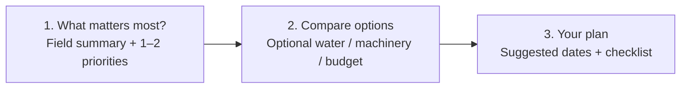
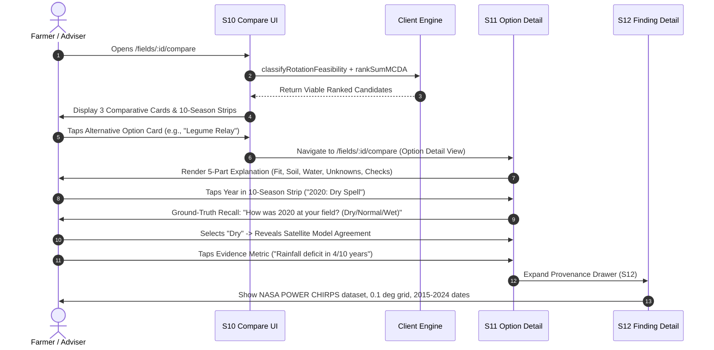
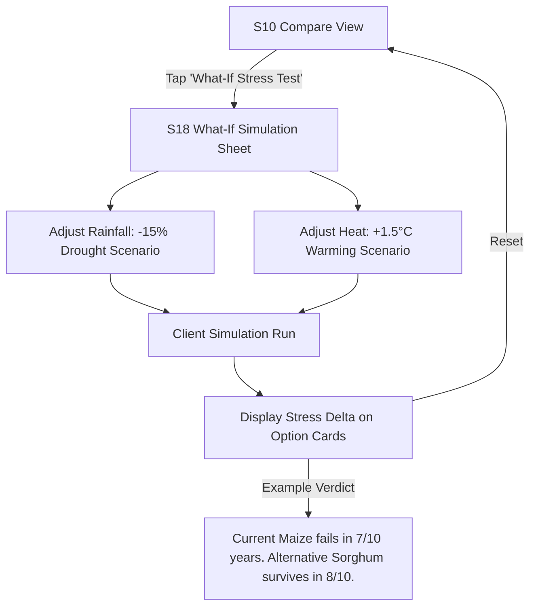
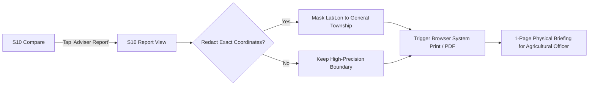

# Field Shift — Comprehensive Screen Flows & Process Architecture

**Document Version:** 1.1.0  
**Status:** Approved Master Specification & Engineering Reference  
**Last Updated:** 15 November 2026  
**Scope:** Complete screen inventory (S01–S18), guided farmer workflows, transition policies (*Ye-pyan* relay broadcast), feasibility gates, data contracts, and background calculation engines.

---

## 1. System Overview & Architectural Paradigm

Field Shift is an offline-first, local-first crop rotation decision-support tool. It empowers smallholder farmers and agricultural extension officers (initially across Myanmar's Central Dry Zone and Ayeyarwady Delta) to evaluate their current crop rotations against resilient alternatives using historical NASA Earth observation data and modeled soil characteristics.

```
┌────────────────────────────────────────────────────────────────────────────────┐
│                           CLIENT BROWSER / DEVICE                              │
│                                                                                │
│  ┌────────────────────────┐  ┌───────────────────────┐  ┌───────────────────┐  │
│  │   UI View Hierarchy    │  │  Zustand Stores       │  │    Local Engine   │  │
│  │  • Next.js App Router  │  │  • fields-store.ts    │  │  • Feasibility    │  │
│  │  • Guided Farmer View  │  │  • settings-store.ts  │  │  • 3-Zone Hydro   │  │
│  │  • Advanced View       │  │  • locale-store.ts    │  │  • Rank-sum MCDA  │  │
│  │  • Light-only tokens   │  │                       │  │  • Transition Pol │  │
│  └───────────┬────────────┘  └───────────┬───────────┘  │  • What-If sim    │  │
│              │                           │              └─────────┬─────────┘  │
│              ▼                           ▼                        ▼            │
│  ┌──────────────────────────────────────────────────────────────────────────┐  │
│  │                LocalStorage Persistence Layer (Offline)                  │  │
│  │  • Key: `fieldshift.fields.v1`    • Key: `fieldshift.settings.v1`        │  │
│  └───────────────────────────────────────┬──────────────────────────────────┘  │
└──────────────────────────────────────────┼─────────────────────────────────────┘
                                           │ (Background fetch when online)
                                           ▼
┌────────────────────────────────────────────────────────────────────────────────┐
│                         EXTERNAL DATA SERVICES & APIS                          │
│                                                                                │
│  ┌───────────────────────┐  ┌───────────────────────┐  ┌───────────────────┐  │
│  │ NASA POWER API        │  │ ISRIC SoilGrids API   │  │ Mapbox GL / Tiles │  │
│  │ • 10-yr daily agmet   │  │ • 250m soil profile   │  │ • Satellite base  │  │
│  │ • Rain, temp, RH      │  │ • pH, clay, sand, SOC │  │ • Static map pins │  │
│  └───────────────────────┘  └───────────────────────┘  └───────────────────┘  │
└────────────────────────────────────────────────────────────────────────────────┘
```

### 1.1 Core Architectural Principles

1. **Local-First & Offline-First:**
   - No mandatory user account, password, or cloud database.
   - All fields, crop sequences, and custom soil test values reside in `localStorage`.
   - Results are computed client-side by the biophysical and MCDA engines.
   - When network connectivity is absent, cached data and stored rotations remain completely functional.

2. **Honesty & Provenance First:**
   - Every metric explicitly declares its source, temporal span, and spatial resolution (e.g., *NASA POWER ~50 km grid*, *SoilGrids 250 m*).
   - Coarse measurements are labeled **regional context around your field**, strictly preventing any claim of "measured in your field".
   - Data colors (`water`, `heat`, `drought`, `frost`, `healthy`) are never shown alone; they are always paired with icons and plain-language verdicts.

3. **Light Mode Only:**
   - Strict design requirement (`DESIGN.md`, The Light-Only Rule). Natural parchment backgrounds (`#f4f3ee`), warm off-white surfaces (`#ffffff`), and high-contrast ink (`#1c1b18`) ensure readability under direct sunlight in outdoor field conditions.

4. **Hard Feasibility Gate Before MCDA Ranking:**
   - Additive utility formulas (MCDA) cannot allow high market profit to mask a physical water shortage or labor impossibility. Options are filtered through a hard feasibility check before being scored.

---

## 2. Global Route Map & Navigation Matrix

The field is the core entity. Views are structured into **Tab Roots**, **Push Navigations**, **Modal Sheets**, and **System Overlays**.

| ID | Screen Name | Route Path | Container Type | Primary Responsibility |
|:---|:---|:---|:---|:---|
| **S01** | First Launch / Welcome | `/welcome` | Full-Screen Cover | Language selection, privacy notice, offline data disclaimer. |
| **S02** | Field List (Home) | `/` | Tab Root (`/`) | List of saved fields, quick status cards, add field trigger. |
| **S03** | Field Map | `/fields/map` | Tab Root Mode | Spatial visualization of all user fields on satellite basemap. |
| **S04** | Mark Field | `/fields/new` | Push / Full View | Map-based boundary drawing, point placement, or coordinate entry. |
| **S05** | Farm Profile & Limits | `/fields/:id/profile` | Tab Sub-screen | Soil overrides, irrigation type, labor, and economic limits. |
| **S06** | Field Hub (Overview) | `/fields/:id` | Tab Sub-screen | Central management dashboard, current crop status, next step banner. |
| **S07** | Conditions & History | `/fields/:id/conditions` | Tab Sub-screen | NASA POWER weather, rainfall patterns, SoilGrids profile, dry spells. |
| **S08** | Rotation Editor & Guided Flow | `/fields/:id/rotation` | Tab Sub-screen | Dual-mode editor: Guided or Detailed. Detailed shows the crop sequence first, the timeline on request, and field practices grouped per crop. |
| **S09** | Priorities & Limits | `/fields/:id/profile#limits`| Sheet / Section | Rank-sum priority weighting (water, soil, earnings, livestock). |
| **S10** | Compare Rotations | `/fields/:id/compare` | Tab Sub-screen | Feasibility-gated matrix: current rotation vs. 2+ alternatives. |
| **S11** | Option Detail | `/fields/:id/compare` (Expanded) | Push / View | In-depth breakdown of a single strategy (agronomic fit, risks, checks). |
| **S12** | Finding / Evidence Detail | `/fields/:id/conditions` (Deep) | Push / Modal | Detailed dataset citations, spatial resolution, and calculation logic. |
| **S13** | Explain a Term | `/learn#terms` | Modal Sheet | Plain-language glossaries for technical agronomic terms. |
| **S14** | Answer an Unknown | `/fields/:id/questions/:qId`| Modal Sheet | Single-question focused flow resolving unmeasured field limits. |
| **S15** | Learn & Crop Library | `/learn` | Tab Root | Reference library of regional crops, benefits, and rotation rules. |
| **S16** | Share & Print Report | `/fields/:id/report` | Push / Print View| 1-page condensed field briefing designed for extension consultation. |
| **S17** | Long-Term Trends | `/fields/:id/trends` | Tab Sub-screen | 10-to-40 year rainfall and temperature shift trajectories. |
| **S18** | What-If Simulator | `/fields/:id/compare` (What-If) | Modal Sheet | Real-time climate stress simulation (monsoon delay, +2°C heat). |

---

## 3. End-to-End User Journeys

### 3.1 Journey 1: First Run (Zero State to First Comparison)

The primary journey takes a first-time user from opening the application to viewing their first rotation comparison.


---

### 3.2 Journey 2: Guided Farmer Decision Flow (3-Step Mobile Journey)

The Guided Farmer Flow (`FarmerGuidedFlow`) shows useful options first and treats farm details as optional refinements. Saved field details are summarised, never asked again.



#### Detailed Step-by-Step Breakdown:
1. **Step 1: What matters most?**
   - A compact field summary (name, region, area with acre/ha toggle, saved water) with an **Edit field** link to `/fields/:id/profile`.
   - Choose 1–2 of 5 priorities: `profit`, `low_water`, `low_cash`, `reliable_harvest`, `soil_improvement`. English label first, Burmese beneath as help text.
2. **Step 2: Compare options**
   - Up to 3 candidates appear straight away, checked with `classifyRotationFeasibility`: **Passes your answers**, **Needs a check**, **Ruled out by your answers**.
   - A readiness note says the options are ready and how many of the 3 optional farm details are answered. **Add farm details (optional)** opens water, machinery and budget.
   - Water defaults from the saved field; machinery and budget default to unanswered. Each card lists what to add under **Add to check**.
   - Budget answers: a stated per-acre limit (converted to MMK/ha and checked against whole-sequence cost), *No fixed limit*, *Not sure yet*, or unanswered. An unanswered budget is never treated as unlimited.
3. **Step 3: Your plan**
   - Crop sequence with **Suggested dates** ("sow around 15 Jun") because candidate dates come from the usual season.
   - Before-planting checklist, including anything still unchecked. **Save this plan** stores it and opens Compare.

---

### 3.3 Journey 3: Dual-Mode Rotation Editing & Relay Broadcast (*Ye-pyan*) Scheduling

Farmers and extension officers can toggle between two perspectives in S08 (`/fields/:id/rotation`):

```
┌────────────────────────────────────────────────────────┐
│  Mode: [ 🌾 Guided Farmer View ]  [ 🔬 Advanced View ] │
└────────────────────────────────────────────────────────┘
```

#### Transition Dynamics & Relay Broadcast Rules (`lib/engine/transition.ts`):
In traditional rotation calendars, overlapping crops (where Crop 2 plants before Crop 1 harvests) are flagged as errors. In Myanmar lowland rice systems, pre-harvest relay broadcasting (**Ye-pyan**) is an essential agronomic practice where legume seeds (black gram / green gram) are broadcast directly into standing rice water 7 to 10 days before drainage and harvest:

```
Monsoon Rice:      [═══════════════════════════════] (Harvest: Nov 15)
                                          ▲
                                          │ -7 to -10 days overlap (Ye-pyan)
                                          ▼
Winter Black Gram:                     [═════════════════════════] (Plant: Nov 8)
```

1. **Policy Rules:**
   - Standard turnaround: Minimum +14 days bare window required between harvest and tillage.
   - Zero-tillage turnaround: Minimum +7 days required.
   - Relay broadcast (*Ye-pyan*): Negative gap of up to **-12 days** is permitted **if and only if**:
     1. The next slot selects `establishmentMode: "relay_broadcast"`;
     2. The pair is an eligible biological combination (e.g., `Rice` $\rightarrow$ `Black Gram` or `Green Gram`).
2. **1-Click Repair Helpers:**
   - If an invalid collision is detected, S08 provides immediate action buttons:
     - `[ Snap to Relay (-7d) ]`
     - `[ Snap to Turnaround (+14d) ]`

---

### 3.4 Journey 4: The Decision Loop (Compare, Option Detail & Evidence)



---

### 3.5 Journey 5: Answering Unknowns (Closing Data Gaps)


---

### 3.6 Journey 6: Climate Stress Testing ("What-If" Simulation)



---

### 3.7 Journey 7: Extension Consultation & Reporting



---

## 4. Comprehensive Screen Specifications (S01 to S18)

---

### S01 — First Launch / Welcome Screen

- **Route:** `/welcome`
- **Container:** Full-screen modal cover (non-dismissible without explicit acceptance).
- **Primary Goal:** Onboard user, ensure language choice, disclose local storage privacy model.

```
┌──────────────────────────────────────────────┐
│  Field Shift                                 │
│  Crop rotation planner for smallholder farms │
│                                              │
│  Language / ဘာသာစကား                       │
│  (•) မြန်မာ (Myanmar Unicode)                │
│  ( ) English                                 │
│                                              │
│  ┌────────────────────────────────────────┐  │
│  │ What stays on this phone               │  │
│  │ • Your field boundaries and names      │  │
│  │ • Crop rotations and soil test inputs  │  │
│  │ • Your priority settings and limits    │  │
│  │                                        │  │
│  │ What is retrieved online               │  │
│  │ • NASA POWER weather around your field │  │
│  │ • ISRIC SoilGrids modeled baseline     │  │
│  └────────────────────────────────────────┘  │
│                                              │
│  [          Continue / ဆက်လက်လုပ်ဆောင်မည်       ]  │
└──────────────────────────────────────────────┘
```

#### Process & Interactions:
1. **On Load:** Reads `useSettingsStore`. If `dataNoticeAcceptedAt` already exists, redirects immediately to `/`.
2. **Language Selection:** Tapping Myanmar/English immediately toggles `useLocaleStore.setLocale(locale)`. Text translates dynamically without reloading.
3. **Continue Action:** User clicks **Continue**:
   - Commits `new Date().toISOString()` to `localStorage.setItem('fieldshift.settings.v1')`.
   - Router pushes `/fields/new` (if 0 fields) or `/` (if fields exist).

---

### S02 — Field List (Home View)

- **Route:** `/`
- **Container:** Tab root view.
- **Primary Goal:** Display all saved fields, track progress, provide entry point to add or edit fields.

```
┌──────────────────────────────────────────────┐
│ Field Shift                    [Settings] [?]│
│ ┌──────────────────────────────────────────┐ │
│ │ Fields (3)                  [+ Add Field]│ │
│ └──────────────────────────────────────────┘ │
│                                              │
│ ┌──────────────────────────────────────────┐ │
│ │ [Map Thumbnail]  North Creek Field       │ │
│ │ Ayeyarwady · 3.5 acres                   │ │
│ │ Current: Monsoon Rice → Winter Sesame    │ │
│ │ Status: [ Done ] Next: Compare Options > │ │
│ └──────────────────────────────────────────┘ │
│ ┌──────────────────────────────────────────┐ │
│ │ [Map Thumbnail]  U Lwin Upper Plot       │ │
│ │ Magway · 1.8 acres                       │ │
│ │ Current: Groundnut only (fallow winter)  │ │
│ │ Status: [ 1 Question Open ]            > │ │
│ └──────────────────────────────────────────┘ │
│                                              │
│ [ Fields (Active) ]     [ Learn Library ]    │
└──────────────────────────────────────────────┘
```

#### Process & Interactions:
1. **Store Hydration:** Loads `useFieldsStore.fields`.
2. **Map Thumbnail Render:** Uses Mapbox static map API to display field bounding box.
3. **Step State Resolution:** For each card, evaluates `deriveStepStates(field, rotations)`:
   - Location: Done
   - Rotation: Done / Needs input
   - Conditions: Ready / Loading
   - Compare: Ready / Needs input
4. **Card Click:** Directly navigates to Field Hub `/fields/:fieldId`.
5. **Swipe / Menu Actions:** Provides **Archive** (hides field) and **Delete** (destructive confirmation).

---

### S03 — Field Map (Spatial Multi-Field View)

- **Route:** `/fields/map`
- **Container:** Tab root full-viewport interactive map.
- **Primary Goal:** Spatial overview of all farm plots against regional satellite basemaps.
- **Key Mechanics:** Renders Mapbox GL JS map centered on the bounding box containing all user fields. Tapping any polygon opens a card linking to `/fields/:fieldId`.

---

### S04 — Mark Field (Boundary & Location Picker)

- **Route:** `/fields/new` or `/fields/:fieldId/location`
- **Container:** Full-screen interactive map with floating action bar.
- **Primary Goal:** Accurately set geographic coordinates and boundary shape.

```
┌──────────────────────────────────────────────┐
│ < Back           Mark Your Field             │
│ ┌──────────────────────────────────────────┐ │
│ │ [ Search village, pagoda or creek...   ] │ │
│ └──────────────────────────────────────────┘ │
│                                              │
│                  ▲                           │
│                 / \  [ Polygon Drawn ]       │
│                /___\ Area: ~3.2 acres        │
│                                              │
│ ┌──────────────────────────────────────────┐ │
│ │ Tools: [ Drop Pin ]  [ Draw Box ]        │ │
│ │ Coordinates: 20.1458° N, 95.1245° E      │ │
│ │ Field Name: [ North Creek Field        ] │ │
│ │                                          │ │
│ │ [           Save This Field            ] │ │
│ └──────────────────────────────────────────┘ │
└──────────────────────────────────────────────┘
```

#### Process & Interactions:
1. User searches settlement or clicks **Use My Location**.
2. Selects geometry mode: **Pin (approximate point)**, **Box**, or **Polygon**.
3. Computes geodesic area in local acres (`1 acre = 4,046.86 m²`).
4. On save: creates UUID `f-<timestamp>`, commits to store, initiates background diagnostic prefetch, and navigates to `/fields/:fieldId`.

---

### S05 — Farm Profile & Constraints

- **Route:** `/fields/:fieldId/profile`
- **Container:** Inset grouped form within Field Shell.
- **Primary Goal:** Record farm-specific management limits and soil overrides.
- **Fields Collected:**
  - Water source (Rainfed / Tubewell / Canal)
  - Observed soil texture (overrides coarse SoilGrids)
  - Custom soil test values (pH, N, P, K)
  - Labor and equipment constraints

---

### S06 — Field Hub (Overview Dashboard)

- **Route:** `/fields/:fieldId`
- **Container:** Field Shell with 4-tab top bar (Overview, Crops, Compare, Farm). Conditions and Trends open from the Overview and highlight its tab.
- **Primary Goal:** Central mission control for a field.
- **Content:** Displays current crop status, next step banner, and local weather/soil highlights.

---

### S07 — Environmental Conditions & Climate History

- **Route:** `/fields/:fieldId/conditions`
- **Container:** Field Sub-screen.
- **Primary Goal:** Explain seasonal rainfall, dry spell patterns, temperature extremes, and soil properties.
- **Sections:**
  1. Headline plain-language verdict (e.g., *"Dry spells over 20 days occurred in 6 of the last 10 seasons"*).
  2. 10-year monthly rainfall bar charts.
  3. Heat stress screening (>35°C during flowering).
  4. SoilGrids profile with local override indicator.
  5. Attribution line showing 0.1° (~10 km) cell scale.

---

### S08 — Rotation Editor & Guided Flow

- **Route:** `/fields/:fieldId/rotation`
- **Container:** Field Sub-screen with dual view modes: `[ 🌾 Guided Farmer View | 🔬 Advanced Detail View ]`.
- **Primary Goal:** Capture farmer's real crop sequence, validate turnarounds, and schedule pre-harvest relay broadcasting.

```
┌──────────────────────────────────────────────┐
│ < Field Hub        Crop Rotation             │
│ Mode: [ 🌾 Guided Farmer View ] [ 🔬 Detail ]│
│                                              │
│ ┌──────────────────────────────────────────┐ │
│ │ Moisture Window: [ Field Check Needed ]  │ │
│ │ "Check topsoil moisture before sowing"   │ │
│ └──────────────────────────────────────────┘ │
│                                              │
│ ┌──────────────────────────────────────────┐ │
│ │ Slot 1: Monsoon Lowland Rice             │ │
│ │ Sowing: Jun 15 · Harvest: Nov 15         │ │
│ │ Method: Transplanting                    │ │
│ └──────────────────────────────────────────┘ │
│                     ▲                        │
│                     │ -7d Relay Overlap      │
│                     ▼                        │
│ ┌──────────────────────────────────────────┐ │
│ │ Slot 2: Winter Black Gram (Matpe)        │ │
│ │ Sowing: Nov 8 · Harvest: Feb 20          │ │
│ │ Method: [ 🌱 Relay Broadcast (Ye-pyan) ] │ │
│ └──────────────────────────────────────────┘ │
│                                              │
│ [ + Add Crop ]        [ Save Rotation ]      │
└──────────────────────────────────────────────┘
```

#### Process & Interactions:
1. **Guided Mode:** Executes the 3-step `FarmerGuidedFlow` (Priorities $\rightarrow$ Compare with optional refinements $\rightarrow$ Plan).
2. **Advanced Mode:** Provides timeline crop cards with explicit sowing/harvest month controls, residue fate options, and establishment modes.
3. **Moisture Clock Ribbon:** If topsoil drainage is unconfirmed, displays *"Check topsoil moisture and drainage before sowing"*. When confirmed, displays the 3-phase seedbed drydown window.
4. **Relay Handling:** Detects eligible rice $\rightarrow$ pulse relay pairs; allows negative gap up to -12 days; provides 1-click snap repair buttons.

---

### S09 — Priorities & Decision Limits

- **Route:** `/fields/:fieldId/profile#limits` or Compare filter modal.
- **Container:** Large modal sheet with draggable cards.
- **Primary Goal:** Assign personal weights to agronomic and economic criteria using normalized rank-sum math:
  $$w_i = \frac{n - r_i + 1}{\sum_{j=1}^n (n - r_j + 1)}$$

---

### S10 — Compare Rotations (Feasibility-Gated Matrix)

- **Route:** `/fields/:fieldId/compare`
- **Container:** Tab Sub-screen with Segmented Depth Control (*Answer / Reasons / Evidence*).
- **Primary Goal:** Compare current rotation side-by-side with feasible alternative rotations.

```
┌──────────────────────────────────────────────┐
│ < Field Hub         Compare Rotations        │
│ View: [ Answer ] [ Reasons ] [ Evidence ]    │
│                                              │
│ ┌──────────────────────────────────────────┐ │
│ │ Current: Rice -> Fallow                  │ │
│ │ Score: 52/100 · High Moisture Loss       │ │
│ │ 10-Yr History: [■■■■■□□■■■] 3 Stress Yrs │ │
│ │ Drawback: Residual moisture wasted       │ │
│ └──────────────────────────────────────────┘ │
│ ┌──────────────────────────────────────────┐ │
│ │ Alternative A: Rice -> Black Gram Relay  │ │
│ │ Status: [ Suitable ] · Score: 81/100     │ │
│ │ 10-Yr History: [■■■■■■■■□■] 1 Stress Yr  │ │
│ │ Advantage: Utilizes residual moisture    │ │
│ │ [ Inspect Option Details > ]             │ │
│ └──────────────────────────────────────────┘ │
│ ┌──────────────────────────────────────────┐ │
│ │ Alternative B: Summer Sesame             │ │
│ │ Status: [ Blocked ]                      │ │
│ │ Reason: Requires reliable dry irrigation │ │
│ └──────────────────────────────────────────┘ │
│                                              │
│ [ What-If Simulator ]     [ Printable Report]│
└──────────────────────────────────────────────┘
```

#### Feasibility & Depth Mechanics:
- Rotations that violate hard constraints (e.g. insufficient water, excessive upfront capital) are marked **Blocked** with the exact blocking constraint stated plainly.
- Toggling between **Answer**, **Reasons**, and **Evidence** shifts the data density from concise summaries to detailed physical balances and satellite metadata.

---

### S11 — Option Detail View

- **Route:** Pushed from S10 card.
- **Container:** Deep-dive view.
- **Primary Goal:** Provide exhaustive technical and practical breakdown of one specific rotation.
- **Key Features:**
  - 5-part explanation: Why suggested, Soil impact, Water resilience, Unknowns, Local checks.
  - Interactive 10-season history strip with ground-truth recall probe.
  - Cash-at-risk envelope and break-even yield analysis.

---

### S12 — Finding & Evidence Detail

- **Route:** Modal overlay from any metric link.
- **Container:** Push or modal sheet.
- **Primary Goal:** Complete scientific transparency on data provenance (sensor name, resolution, dates, methodology).

---

### S13 — Explain a Term (Glossary Sheet)

- **Route:** Accessible from underlined terms across the app.
- **Container:** Medium detent bottom sheet with VoiceOver / Read Aloud audio support.
- **Content:** Concise explanation in plain Burmese and English.

---

### S14 — Answer an Unknown (Question Sheet)

- **Route:** `/fields/:fieldId/questions/:questionId`
- **Container:** Focused modal sheet.
- **Primary Goal:** Convert an agronomic unknown into known local ground truth with a single targeted multiple-choice question.

---

### S15 — Learn & Crop Library

- **Route:** `/learn`
- **Container:** Tab root view.
- **Primary Goal:** Reference guide for crops adapted to Myanmar's agro-ecological zones (Central Dry Zone, Shan Plateau, Delta).

---

### S16 — Share & Print Report

- **Route:** `/fields/:fieldId/report`
- **Container:** Clean print-optimized document view.
- **Primary Goal:** 1-page condensed field briefing designed to be taken to an extension office or agricultural bank.
- **Privacy Controls:** Includes an instant toggle to redact precise GPS coordinates to township level.
- **Print Optimization:** High-contrast monochrome layout with clean `@media print` page boundaries.

---

### S17 — Long-Term Climate Trends

- **Route:** `/fields/:fieldId/trends`
- **Container:** Field Sub-screen.
- **Primary Goal:** Display multi-decadal shift (1981–2024) in local temperature, precipitation onset, and heat stress days using Mann-Kendall trendline plots.

---

### S18 — What-If Climate Stress Simulator

- **Route:** Modal sheet from S10.
- **Container:** Modal sheet with dual interactive range sliders.
- **Primary Goal:** Stress-test crop rotations against hypothetical adverse climate shocks (Rainfall $-30\%$ to $+30\%$; Temperature $+0.0^\circ\text{C}$ to $+3.0^\circ\text{C}$).

---

## 5. Core Calculation Engines & Decision Algorithms

### 5.1 Hard Feasibility Gate (`lib/engine/farmer-decision.ts`)
Before any MCDA ranking occurs, candidate rotations must pass hard operational gates:
1. **Water Feasibility:** If candidate requires irrigation and farmer has `availableWater === "rainfed"`, the candidate is marked `infeasible` with code `WATER_DEFICIT_BLOCKED`.
2. **Budget Feasibility:** If upfront cash requirement exceeds `budgetMaxMmkHa`, the candidate is marked `infeasible` with code `BUDGET_EXCEEDED`.
3. **Turnaround Biological Feasibility:** Evaluated via `evaluateTransition`. Negative overlaps exceeding 12 days or between non-relay crops produce a hard veto `RELAY_WINDOW_EXCEEDED`.

### 5.2 Hydrological Ledger (`lib/engine/water.ts`)
- **Three-Zone Water Balance:** Tracks root-zone moisture across three explicit vertical compartments ($Z_1 = 0.12\text{ m}$ topsoil seedbed, $Z_2$ active root zone, $Z_3$ deep subsoil). Mass conservation residual is verified at $\le 10^{-9}\text{ mm/day}$.
- **Paddy Drainage Handover:** Explicitly models surface pond drainage and plough pan conductance ($k_{\text{pan}} \in [2.5, 6.0]\text{ mm/day}$) after lowland rice harvest to determine legume seedbed moisture conditions.

### 5.3 Reference Evapotranspiration (`lib/engine/et0.ts`)
- Implements two-tier reference ET0: FAO-56 Penman-Monteith with net solar and longwave radiation ($R_{ns}, R_{nl}$), with automatic fallback to calibrated Hargreaves when radiation or humidity inputs are missing.

---

## 6. State Management, Schemas & Persistence

### 6.1 Data Schemas (`lib/types.ts`)
- `EstablishmentMode = "tillage" | "zero_till" | "relay_broadcast" | "unknown"`
- `ResidueFate = "retain_incorporate" | "retain_mulch" | "remove_fodder" | "burn" | "unknown"`
- `farmerObservedDrainage = "waterlogged" | "adequate" | "dry" | "unknown"`
- `farmerObservedSoilCondition = "wet" | "moist" | "dry" | "unknown"`

### 6.2 Zustand Stores & Hydration Safety
```
┌──────────────────────────────────────────────────────────────────────────────┐
│                                ZUSTAND STORES                                │
│                                                                              │
│  ┌────────────────────────┐  ┌──────────────────────┐  ┌──────────────────┐  │
│  │ useFieldsStore         │  │ useSettingsStore     │  │ useLocaleStore   │  │
│  │ • fields: Field[]      │  │ • hydrated: boolean  │  │ • locale: 'my'   │  │
│  │ • rotations: Record    │  │ • dataNoticeAccepted │  │           | 'en' │  │
│  │ • activeFieldId: string│  │ • language: string   │  │ • setLocale()    │  │
│  │ • addField()           │  │ • hydrate()          │  └──────────────────┘  │
│  │ • updateField()        │  │ • acceptDataNotice() │                        │
│  │ • saveRotation()       │  └──────────────────────┘                        │
│  └───────────┬────────────┘                                                  │
└──────────────┼───────────────────────────────────────────────────────────────┘
               │
               ▼
┌──────────────────────────────────────────────────────────────────────────────┐
│                            LOCALSTORAGE SYNC LAYER                           │
│                                                                              │
│   Key: `fieldshift.fields.v1`        Key: `fieldshift.settings.v1`           │
│   Payload: JSON serialized array     Payload: JSON metadata & timestamps     │
└──────────────────────────────────────────────────────────────────────────────┘
```

- **Next.js App Router Prerender Safety:** Stores initialize with static inert defaults (`hydrated: false`). Client-side hydration executes inside `useEffect`. Layouts never unmount `{children}` based on hydration state, ensuring Next.js static prerendering and instant-navigation validation remain intact.

---

## 7. UI/UX Rules & Accessibility Guardrails

1. **Light-Only Surface Hierarchy:**
   - App Shell Background: `#f4f3ee`
   - Card Surfaces: `#ffffff`
   - Sunken / Inactive Elements: `#eceae3`
   - Border Lines: `#d9d6cc`
   - Primary Accent: Field Green `#0e6b4f`
   - Ink Text: `#1c1b18` (WCAG AAA contrast against parchment).

2. **Never Color Alone:**
   - Hazards (Drought, Heat, Flood, Disease) must never be signaled purely by color. Every chip combines an explicit SVG icon with a clear textual severity label.

3. **Touch Targets & Outdoors Usability:**
   - All interactive buttons, cards, and tabs have a minimum bounding tap target of **44 × 44 pt**.
   - Generous padding and spacing prevent mis-taps when using mobile devices in farm fields with dusty or wet hands.

---

## 8. Complete Screen Summary Matrix

| Screen | Route | Key Data Ingest | Core Output / Decision |
|:---|:---|:---|:---|
| **S01** | `/welcome` | User language preference | Sets privacy consent timestamp |
| **S02** | `/` | Stored field list | Selects active farm plot |
| **S03** | `/fields/map` | Mapbox GL basemap tiles | Spatial visualization of field plots |
| **S04** | `/fields/new` | GPS or Mapbox bounding box | Geocoded polygon / coordinates |
| **S05** | `/fields/:id/profile`| Local soil test & farm inputs | Overrides satellite baseline |
| **S06** | `/fields/:id` | Field store & condition summaries| Main dashboard & next unfinished task |
| **S07** | `/fields/:id/conditions`| NASA POWER & ISRIC SoilGrids | Diagnostic climate & soil charts |
| **S08** | `/fields/:id/rotation`| Sowing/harvest dates & crops | Chronological crop rotation array |
| **S09** | `/fields/:id/profile#limits`| Priority drag order (1 to 4) | MCDA criterion weights ($w_i$) |
| **S10** | `/fields/:id/compare` | Feasibility gate & MCDA engine | Ranked comparative cards |
| **S11** | `/fields/:id/compare` (Detail)| Option suitability rules | 5-part deep agronomic explanation |
| **S12** | Evidence Drawer | Sensor metadata & cell resolution| Complete scientific transparency |
| **S13** | `/learn#terms` | Whitepaper glossary content | Plain-language definitions & TTS |
| **S14** | `/fields/:id/questions/:qId`| Single user response | Resolves model uncertainty |
| **S15** | `/learn` | Regional crop knowledge base | Crop handbook & planting calendars |
| **S16** | `/fields/:id/report` | Condensed summary data | 1-page printable extension briefing |
| **S17** | `/fields/:id/trends` | 40-year historical climate log | Decadal climate shift trajectory |
| **S18** | What-If Simulator | Dual climate slider offsets | Dynamic resilience stress test |
