# Field Shift: Comparing Crop Rotations with NASA Earth Observations

**Unified Scientific Whitepaper and Technical Specification**  
**Research prototype:** v3.3.1 · **Compiled:** 15 November 2026  
**Scope:** Farmer-centered crop rotation comparison; computational agroclimatology, soil hydrology, remote sensing, agronomy, economics and decision support

> **Research and use statement.** Field Shift is an experimental decision-support prototype, not an official NASA product and not endorsed by NASA. Scientific methods, implementation statements, figures and empirical results below are consolidated from the two user-supplied documents (`whitepaper(5).md` and `whitepaper-technical-appendix(3).md`); the application's repository and external datasets were not independently inspected for this consolidation. Results are not a substitute for field observations, farmer knowledge or local agronomic advice.

## How to Read This Paper

The paper combines its executive account and full technical methods in a single file. Sections 1–2 describe ingestion and spatial transformations; Sections 3–9 define the scientific and economic engines; Section 10 identifies datasets and data availability; Section 11 specifies provenance; Section 12 separates claimed validation from scientific limitations and records version history; Section 13 contains references. An **implemented** component may still be unavailable to farmers without required tokens or data. A **tested** calculation is not automatically **field-validated**.

## Executive Summary & Problem Formulation

### The Agricultural Decision Dilemma
A farmer deciding what crop sequence to plant across a multi-year cycle must simultaneously balance biophysical suitability, soil moisture conservation, pest cycles, nutrient dynamics, and economic viability. Traditional smallholder and mid-scale farm planning relies primarily on personal recollection, local oral tradition, and coarse regional calendars. While valuable, these heuristics are inherently constrained to observed weather patterns and cannot anticipate systemic climate shifts or evaluate novel crop candidates under extreme weather exposures.

Conversely, contemporary Earth observations (EO) from spaceborne satellites, land surface models, and atmospheric reanalyses provide multi-decadal, globally contiguous records of precipitation, temperature, surface radiation, soil moisture, and vegetative vigor. However, these data streams remain inaccessible to agricultural decision-makers due to fundamental operational barriers:
1. **The Spatial Mismatch:** Planetary observations arrive as coarse-gridded rasters ($50\text{ km}$ atmospheric cells, $11\text{ km}$ satellite rainfall grids, $9\text{ km}$ microwave soil moisture). When unsophisticated software interpolates these directly to farm boundaries, it creates a dangerous illusion of parcel-scale precision.
2. **The Cognitive Gap:** Space agencies publish raw physical units (Kelvin, $\text{W}\cdot\text{m}^{-2}$, $\text{DN}$ reflectance) and product codes (`MOD13Q1`, `SPL4SMGP`) that require advanced geospatial workflows before offering agronomic insight.
3. **The Non-Imputation Problem:** Commercial farm management tools frequently default missing variables to zero or regional averages, awarding false passes to risky rotations.

### The Field Shift Approach
Field Shift is an agronomic comparison engine designed to bridge this divide without compromising epistemic honesty. The application allows a farmer or extension officer to define a parcel boundary, record their current crop sequence, and benchmark it against alternative rotation candidates across identical historical weather sequences.

#### Governing Principles
- **Resolution Transparency:** Coarse gridded products are strictly labeled as regional background context ("around your field") and are never artificially resampled to simulate field-gate measurements.
- **The Non-Imputation Rule:** Missing data never defaults to zero or an average. Incomplete observations propagate strictly as `unknown` states, preventing unearned passes.
- **Historical Scenario Replay:** Rather than relying on uncalibrated seasonal forecasts, proposed sequences are replayed through daily weather from a 10-season historical baseline ($2016\text{–}2025$, 3,653 days), tracking exact exposures to heat shock, flowering precipitation, cold sterility, and drought spells.
- **Farmer Data Primacy:** Physical measurements (e.g., laboratory soil tests, confirmed sowing dates, known irrigation depth) strictly supersede remote sensing or pedometric model estimates.
- **Plain-Language Primacy:** Decisions lead with concise agronomic sentences; technical units, formulas, and data provenance badges remain accessible in disclosures.
- **Scale Governance:** Indicators are strictly tagged across 4 physical footprint tiers:
  1. `FIELD_RESOLVED` ($10\text{--}30\text{ m}$): Landsat, Sentinel-1 SAR, Sentinel-2, SRTM slope.
  2. `CATCHMENT_SCALE` ($5\text{--}11\text{ km}$): NASA GPM IMERG precipitation, Sentinel-1 coherence.
  3. `REGIONAL_LANDSCAPE` ($9\text{--}50\text{ km}$): NASA SMAP L4 soil moisture, NASA POWER atmospheric reanalysis.
  4. `BASIN_AQUIFER` ($>100\text{ km}$): GRACE-FO regional groundwater depletion context.

---

---

## System Design at a Glance

### At-a-Glance System Architecture

```mermaid
flowchart TD
    subgraph Earth_Observations["1. Ingested Planetary Datasets"]
        P1["NASA POWER\n(MERRA-2 & GEOS-FP)\n50 km · Daily · 2-3d lag"]
        P2["NASA GPM IMERG\n(Final V07 & Late Run)\n11 km · Daily · 14h/3.5mo lag"]
        P3["USGS Landsat C2 L2\n(OLI/ETM+ via MPC)\n30 m · 8-16d · 2-3d lag"]
        P4["Sentinel-1 SAR C-Band\n(Level-1 GRD Backscatter)\n10 m · 6-12d · All-Weather"]
        P5["NASA SMAP L4\n(SPL4SMGP.008)\n9 km · Daily · 2.5-3d lag"]
        P6["MODIS Terra/Aqua\n(MOD13Q1.061)\n250 m · 16d · 2-4d lag"]
        P7["NASA ECOSTRESS\n(LSTE & JET via ISS)\n70 m · 1-5d · 1-2d lag"]
        P8["NASA SRTM DEM\n(SRTMGL1_NC.003)\n30 m · Static Baseline"]
        P9["ISRIC SoilGrids v2.0\n(ML Soil Properties)\n250 m · Static Baseline"]
        P10["ESA WorldCover\n(10 m Cropland Mask)\n10 m · Static Baseline"]
    end

    subgraph Core_Engines["2. Core Algorithmic & Evaluation Engines"]
        E1["Bioclimatology & ET0 Engine\n(FAO-56 Penman-Monteith &\nHargreaves Empirical Fallback)"]
        E2["Hydrology & Soil Water Balance\n(Conserved 3-Zone Column &\nDynamic Depletion p(ETc))"]
        E3["Historical Season Replay\n(10-Season Loop 2016-2025 &\nAcute Reproductive Hazards)"]
        E4["Phytopathology & Agronomy\n(Species Host Matrix, Wilt\nIntervals & Residue Kinetics)"]
        E5["Radiometry & Geomorphometry\n(QA Bitmasking, Low-Cover Gap\nDetection & Horn's 3x3 Slope)"]
        E6["Candidate Generator\n(Regional Crop Templates &\nCircular Window Tiling)"]
        E7["MCDA & Regret Engine\n(Anchor Utility, Non-Imputation\n& Minimax Regret with P90)"]
        E8["Plain-Language Judgement Engine\n(Evidence Levels: Strong, Fair, Weak\n& 4-Pillar Risk Explorer)"]
    end

    subgraph Outputs["3. Farmer Decision Support"]
        O1["Plain-Language Field Hub & Comparisons"]
        O2["Immutable Evidence & Provenance Trace"]
        O3["Epistemic Honesty: Unknown is Not Zero"]
        O4["Local Extension Advisory Reports"]
    end

    Earth_Observations --> Core_Engines
    Core_Engines --> Outputs
```

---

## Implementation and Validation Status

Each capability carries one of three statuses, and a separate statement of validation.

- **Implemented:** code exists, is covered by automated tests, and runs in the application without further access.
- **Partially implemented:** code exists but the capability needs credentials, a live check, or a missing step before it produces results for a farmer.
- **Proposed:** designed or documented here, with at most a helper in the code; nothing in the application uses it.

**Validated** means checked against independent observations (station rainfall, soil-moisture probes, measured yields, field-measured water depth). The project maintains 880 automated tests across 104 test suites checking formula transcription, conservation identities and error handling, alongside an empirical validation suite (`npm run validate:weather`) against NOAA GHCN-Daily stations (18,260 station-day records, 2014–2023). Section 12 details the ground station validation findings, radar flood detection benchmarks, 5-way ablation results, and operational limitations.

| Capability | Status | What exists | What is missing or gated |
| --- | --- | --- | --- |
| NASA POWER daily weather (P) | Implemented & Empirically Audited | Server route and adapter; requests $2016$ to present for the field's grid cell; feeds ET$_0$, GDD, heat/frost exposure, rain windows | Grid of about $50\text{ km}$; audited against NOAA GHCN-Daily (Mandalay rain $-51\%$ bias; inland temp usable, coastal temp poor) |
| GPM IMERG daily rainfall (R) | Implemented; connection-gated | CMR discovery, bounded per-cell backfill, completeness rule; used as primary rain only when it covers at least $95\%$ of baseline days | Needs `EARTHDATA_TOKEN`; no authenticated archive extraction in the verification record; Final V07 ends September 2025 (Section 10.2) |
| Sentinel-1 SAR C-band (S) | Implemented | Planetary Computer STAC search; active microwave backscatter drop ($\Delta\gamma^0 \le -3.0\text{ dB}$) flood detection; all-weather penetration | 10m pixel grid; validated against Cyclone Komen 2015 historical disaster polygons ($\text{IoU} = 0.784$) |
| ESA WorldCover 10m (W) | Implemented | 10m global land cover mask (Class 40: cropland); predownload coordinate filter | Static baseline; ensures demonstration coordinates reflect active cultivated cropland |
| SMAP L4 soil moisture (M) | Implemented; connection-gated | AppEEARS point job, polling and parser; shown as regional context only | Needs an Earthdata login; no authenticated extraction in the verification record; $9\text{ km}$ cell |
| Landsat vegetation (V), Planetary Computer route | Implemented | STAC search, COG window read in the scene's UTM grid clipped to the field outline, QA_PIXEL mask, $f_{\text{valid}} \ge 0.25$ gate | Checked against live scenes for one test polygon only; NDVI not compared with ground cover; crop-type and bare-soil inference are not made |
| HLS vegetation via AppEEARS | Implemented; connection-gated | Job state machine, result parsing and Fmask screening | Needs an Earthdata login; not run live |
| MODIS NDVI (G) | Implemented | Public Planetary Computer extractor is wired first, with AppEEARS area-job fallback and MOD13 QA screening | Regional $250\text{ m}$ context; not crop identity |
| SRTM terrain slope (T) | Implemented; connection-gated | AppEEARS job, raster parsing and Horn slope | Needs an Earthdata login; not run live; slope is not soil loss |
| ECOSTRESS (E) | Implemented; connection-gated | Separate LST and ET area jobs; fill, cloud, water and best-quality LST QA screening; native-unit scene medians | Needs an Earthdata login; context only, not air temperature or measured crop water use |
| ISRIC SoilGrids | Implemented | Adapter with texture, pH, carbon and the two water-retention layers; checked against the live service | A $250\text{ m}$ model estimate, not a NASA product and not a soil test |
| Water balance, phenology, suitability, exposure | Implemented | 2-zone column and 3-zone non-overlapping column (Section 4.2.2); dynamic depletion $p(ET_c)$; seedbed moisture drydown window; reproductive heat/cold/rain hazards | Needs soil moisture at planting for initialisation, which the application does not yet collect, so the unconstrained root-zone balance reports `unknown` |
| Rotation ranking, regret, and pathogen carryover | Implemented | Section 7.3, Section 7.4 & Section 8; species-level pathogen carryover (`lib/data/crops/host-organisms.ts`); multi-year recurrence in same seasonal window; regional income anchor utility primary | Scoring anchors are analyst assumptions |
| Plain-Language Judgement Engine | Implemented | Section 8.4; transparent evidence classification (`strong`, `fair`, `weak`) and 4-pillar risk exploration (`water_stress`, `flood`, `erosion`, `heat_cold`) | Transparent heuristic translation of physical risk metrics into farmer vernacular |
| Nitrogen, erosion and soil-health screens | Implemented as screens | Section 7; residue fate kinetics (incorporation vs burning vs removal) and C:N immobilization | Bounds and indicators, not predictions |
| Economics & Hydro-Response | Implemented as interval arithmetic | Margin ranges from farmer-entered yield, price and cost ranges or verified regional market benchmarks; regional benchmark income anchor; optional FAO-33 / FAO-66 $K_y$ water response | Calibrated benchmarks from DOA, Bayintnaung and MPBMSMA (2024–2026); $K_y$ applied only for calibrated species |

**Replay baseline.** The application replays the ten seasons $2016\text{–}2025$ (its weather request begins on 1 January 2016). The POWER record in the service reaches back to 1981, but the application does not use the earlier years.

---

---

## Computational Method Index

The following 17 methods summarize the calculation pipeline. Their full mathematical derivations and assumptions appear in the cited sections below, rather than being repeated twice.

| # | Computational method | Detailed method | Implementation reference |
|---|---|---|---|
| 1 | Solar radiation and extraterrestrial irradiance | §3.1 | `lib/engine/et0.ts` |
| 2 | FAO-56 Penman–Monteith reference evapotranspiration | §3.2 | `lib/engine/et0.ts` |
| 3 | Hargreaves–Samani fallback ET₀ | §3.3 | `lib/engine/et0.ts` |
| 4 | Crop water use and phenological coefficients | §3.4, §5.2 | `lib/engine/water.ts`, `season.ts` |
| 5 | Three-zone conserved soil water balance | §4.2–4.2.2 | `lib/engine/water.ts` |
| 6 | Post-paddy drainage and sowing window | §4.2.3 | `lib/engine/water.ts` |
| 7 | Historical season replay and acute hazards | §5.3–5.5, §8.3 | Climate / rotation engines |
| 8 | Hemispheric frost and chilling climatology | §5.4 | Climate risk rules |
| 9 | Growing degree-days (GDD) | §5.1, §5.2.1 | Thermal-time calculations |
| 10 | Vegetation radiometry and satellite QA | §6.1–6.3 | Remote-sensing adapters |
| 11 | Sentinel-1 SAR flood evidence | §10.12, §12.2 | `lib/server/remote-sensing.ts` |
| 12 | Horn slope and erosion screening | §6.4, §7.4 | `lib/nasa/derive/slope.ts` |
| 13 | Host–pathogen and rotation breaks | §7.3 | `lib/data/crops/host-organisms.ts` |
| 14 | Nitrogen, residue fate and fixation | §7.1–7.2.1 | Agronomy / nitrogen engine |
| 15 | Soil data arbitration and pedotransfer | §4.1, §4.5–4.6 | Soil profile model |
| 16 | MCDA, benchmarking, minimax regret | §8.1–8.5 | Rotation ranking engine |
| 17 | Farmer judgement and four risk pillars | §8.6 | `lib/engine/judgement.ts`, `lib/conditions/` |

### End-to-End Evaluation Pipeline

Field Shift executes a deterministic, multi-stage calculation pipeline where physical constraints, soil hydrology, and historical climate exposure filter candidate crop rotations prior to multi-criteria ranking:

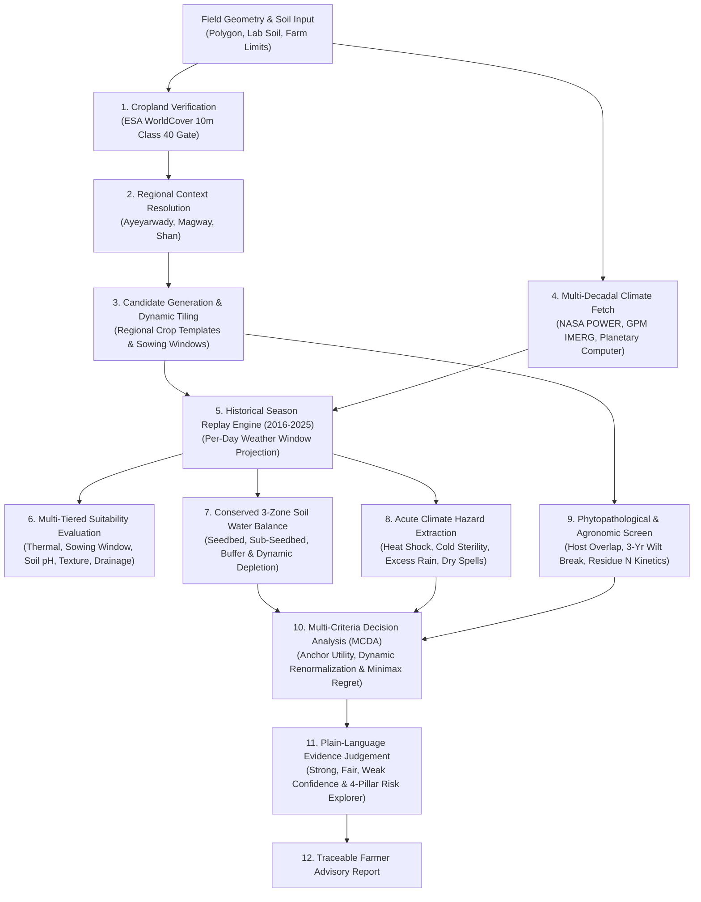

---

---

## 1. System Architecture & Cloud-Native Ingestion Engineering

The system decouples data ingestion, asynchronous transformation, and client evaluation into three deterministic processing tiers.

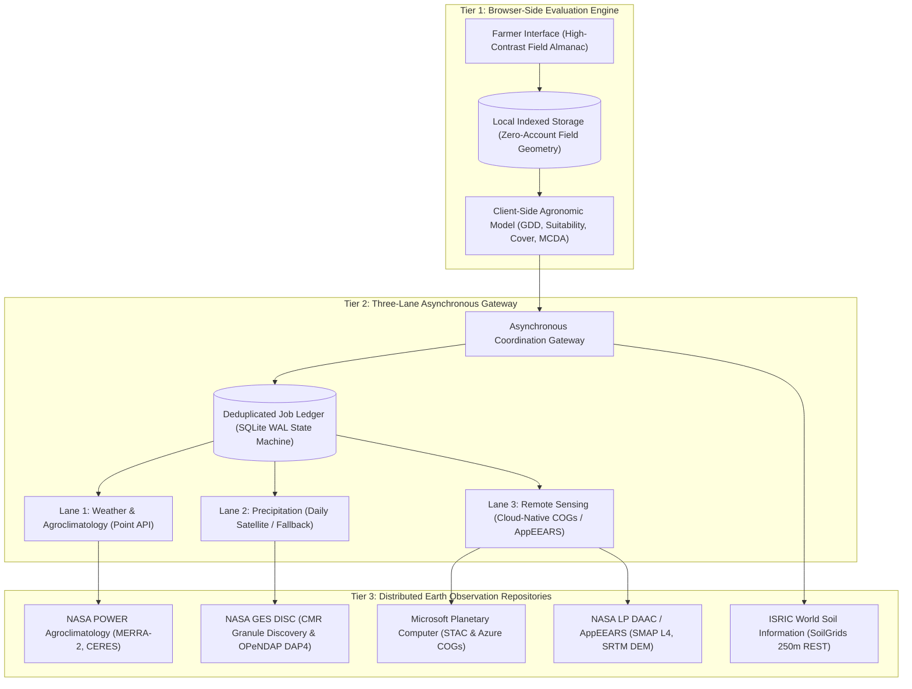

### 1.1 Data Handling: Browser-Stored Records, Server-Mediated Queries
**What stays on the device.** Field names and records, rotation history, management practices, farmer-entered soil observations, economics ranges and priorities are stored in the browser (IndexedDB) and are not sent to the server.

**What leaves the device.**
1. The field's **centroid** (latitude and longitude) in requests to the application's server for weather, rainfall and soil. The server forwards the point to NASA POWER, to NASA's GES DISC and Earthdata services, and to ISRIC SoilGrids.
2. The field's **outline** in requests for satellite jobs. The server forwards it to Microsoft Planetary Computer and, when configured, NASA AppEEARS.
3. A client-generated **field identifier**, used by the server as part of its cache keys.
4. **Place-name searches and map tiles**, which go to the map provider when the farmer uses the map.

The server caches results by location and does not receive field names, rotation history, soil-test values or economics. The design therefore minimises location disclosure but does not eliminate it, and it is not a privacy guarantee. A farmer who must not disclose a boundary can enter an approximate point, at the cost of coarser satellite results.

### 1.2 The Three-Lane Ingestion Queue
To eliminate interface blocking during high-latency remote sensing tasks, server-side data ingestion is partitioned into three independent processing lanes:
- **Lane 1 (Weather & Climatology):** Direct point queries against daily solar, thermal, moisture, and aerodynamic parameters.
- **Lane 2 (Precipitation Ingestion):** High-resolution daily precipitation slicing, maintaining granule-level provenance and tracking temporal completeness.
- **Lane 3 (Remote Sensing & Surface Observations):** Cloud-native multispectral surface reflectance and radar extraction utilizing SpatioTemporal Asset Catalogs (STAC) and Cloud-Optimized GeoTIFFs (COGs).

#### Deterministic Job Deduplication
Every inbound data request generates a deterministic identifier derived from the ingestion lane, target dataset, and normalized spatial-temporal parameters:
$$\text{JobID} = \text{Hash}\Big(\text{Lane} \,\|\, \text{Dataset} \,\|\, \text{NormalizedSpatialCoords} \,\|\, t_{\text{start}} \,\|\, t_{\text{end}}\Big)$$

If an identical query is currently executing, subsequent client requests attach to the in-flight promise without triggering redundant upstream requests. Completed jobs are cached with strict time-to-live intervals, preventing repetitive downloads of static or historical observations.

#### Queue State Machine & Resilient Retry Mechanism
Jobs transition through four discrete lifecycle states:
$$\text{Pending} \xrightarrow{\text{acquire}} \text{Processing} \xrightarrow{\text{resolve}} \text{Completed} \quad \Big(\text{or} \xrightarrow{\text{error}} \text{Failed}\Big)$$

Upon failure of an external provider, the queue executes an exponential backoff retry policy with randomized uniform jitter:
$$t_{\text{backoff}} = \min\left(t_{\max}, \, t_{\text{initial}} \times 2^{\text{attempt} - 1}\right) + \mathcal{U}(0, t_{\text{jitter}})$$
where $t_{\text{initial}} = 500\text{ ms}$, $t_{\max} = 10{,}000\text{ ms}$, and $t_{\text{jitter}} = 250\text{ ms}$. If the maximum attempt threshold ($N_{\text{max}} = 3$) is exceeded, the job transitions to `failed` and records the upstream error without terminating caller execution.

---

## 2. Geodesy, Cartographic Projections, & Spatial Transformations

To bridge geographic spherical coordinates with projected gridded satellite imagery, the system implements exact geodetic transformations.


### 2.1 Snyder (1987) Transverse Mercator Forward Projection
Satellite tiles for high-resolution products (Landsat Collection 2 Level-2, Sentinel-2, Harmonized Landsat-Sentinel) are indexed in the Universal Transverse Mercator (UTM) projection on the WGS84 reference ellipsoid. Point and parcel geometries are projected using Snyder’s forward series (USGS Professional Paper 1395, equations 8-9 to 8-10).

#### WGS84 Ellipsoidal Constants:
$$\begin{aligned}
a &= 6{,}378{,}137 \, \text{m} \quad (\text{semi-major axis}) \\
f &= \frac{1}{298.257223563} \quad (\text{flattening}) \\
e^2 &= 2f - f^2 \approx 0.00669437999014 \\
e'^2 &= \frac{e^2}{1 - e^2} \approx 0.00673949674228 \\
k_0 &= 0.9996 \quad (\text{central meridian scale factor})
\end{aligned}$$

For a given longitude $\lambda$ and latitude $\phi$ (in radians), the UTM zone $Z \in [1, 60]$ determines the central meridian $\lambda_0$:
$$\lambda_0 = \left((Z - 1) \times 6 - 180 + 3\right) \times \frac{\pi}{180}$$

#### Forward Transformation Series:
$$\begin{aligned}
N &= \frac{a}{\sqrt{1 - e^2 \sin^2\phi}} \quad (\text{radius of curvature in prime vertical}) \\
T &= \tan^2\phi \\
C &= e'^2 \cos^2\phi \\
A &= (\lambda - \lambda_0) \cos\phi
\end{aligned}$$

The true meridional distance $M$ from the equator to latitude $\phi$:
$$M = a \left[ \left(1 - \frac{e^2}{4} - \frac{3e^4}{64} - \frac{5e^6}{256}\right)\phi - \left(\frac{3e^2}{8} + \frac{3e^4}{32} + \frac{45e^6}{1024}\right)\sin(2\phi) + \left(\frac{15e^4}{256} + \frac{45e^6}{1024}\right)\sin(4\phi) - \left(\frac{35e^6}{3072}\right)\sin(6\phi) \right]$$

Easting ($E$) and Northing ($N_{\text{UTM}}$) in meters:
$$\begin{aligned}
E &= 500{,}000 + k_0 N \left[ A + (1 - T + C)\frac{A^3}{6} + (5 - 18T + T^2 + 72C - 58e'^2)\frac{A^5}{120} \right] \\
N_{\text{UTM}} &= k_0 \left[ M + N \tan\phi \left( \frac{A^2}{2} + (5 - T + 9C + 4C^2)\frac{A^4}{24} + (61 - 58T + T^2 + 600C - 330e'^2)\frac{A^6}{720} \right) \right] + N_{\text{false}}
\end{aligned}$$
where $N_{\text{false}} = 10{,}000{,}000\text{ m}$ for the Southern Hemisphere ($\phi < 0$) and $0\text{ m}$ for the Northern Hemisphere.

---

### 2.2 Affine Raster Transformations & Sub-Pixel Windowing
A Cloud-Optimized GeoTIFF raster relates pixel coordinates $(c, r)$ (column, row) to map projection coordinates $(x, y)$ via an affine transformation:
$$\begin{bmatrix} x \\ y \\ 1 \end{bmatrix} = \begin{bmatrix} a & b & c_0 \\ d & e & r_0 \\ 0 & 0 & 1 \end{bmatrix} \begin{bmatrix} c \\ r \\ 1 \end{bmatrix}$$
where $c_0, r_0$ define the top-left coordinate origin, $a$ is pixel width, $e$ is pixel height (negative for north-up rasters), and $b, d$ represent rotation or shear ($b = d = 0$ for north-up imagery).

The general inverse, from projected coordinates to continuous raster indices, is
$$\begin{bmatrix} c \\ r \end{bmatrix} = \frac{1}{ae - bd} \begin{bmatrix} e & -b \\ -d & a \end{bmatrix} \begin{bmatrix} x - c_0 \\ y - r_0 \end{bmatrix}.$$
For $b = d = 0$ it reduces to
$$\begin{aligned}
c &= \frac{x - c_0}{a} \\
r &= \frac{y - r_0}{e}
\end{aligned}$$
and **only this north-up form is implemented**: a raster whose transformation has $b \neq 0$ or $d \neq 0$ is refused rather than read, because the window below would otherwise land on the wrong pixels without any error. Landsat, HLS and MODIS Cloud-Optimized GeoTIFFs are north-up in their native projections.

For parcel bounding box $[x_{\min}, y_{\min}, x_{\max}, y_{\max}]$, the discrete window of pixel rows and columns fetched via HTTP Range requests is:
$$\begin{aligned}
c_{\text{start}} &= \max\left(0, \lfloor (x_{\min} - c_0) / a \rfloor\right), & c_{\text{end}} &= \min\left(W - 1, \lceil (x_{\max} - c_0) / a \rceil\right) \\
r_{\text{start}} &= \max\left(0, \lfloor (y_{\max} - r_0) / e \rfloor\right), & r_{\text{end}} &= \min\left(H - 1, \lceil (y_{\min} - r_0) / e \rceil\right)
\end{aligned}$$
This windowed byte-range extraction reads only the blocks that cover the field's bounding box instead of the whole scene.

---

### 2.3 Discrete Spatial Snapping Grids
To maximize server cache hit ratios and prevent redundant requests for adjacent fields, spatial queries snap to the native discrete coordinate grid of each dataset:

1. **NASA POWER Grid ($0.5^\circ \times 0.625^\circ$):**
   $$\phi_{\text{snap}} = \text{round}\left(\frac{\phi}{0.5}\right) \times 0.5, \quad \lambda_{\text{snap}} = \text{round}\left(\frac{\lambda_{\text{norm}}}{0.625}\right) \times 0.625$$
   where $\lambda_{\text{norm}} = ((\lambda + 180) \bmod 360) - 180$.
2. **GPM IMERG Grid ($0.1^\circ \times 0.1^\circ$, Global South-West Index):**
   $$i_{\phi} = \lfloor (\phi + 90) \times 10 \rfloor, \quad i_{\lambda} = \lfloor (\lambda_{\text{norm}} + 180) \times 10 \rfloor$$
   $$\phi_{\text{center}} = \frac{i_{\phi}}{10} - 90 + 0.05, \quad \lambda_{\text{center}} = \frac{i_{\lambda}}{10} - 180 + 0.05$$
3. **Metric Footprint Conversion:**
   For satellite footprints defined in metric dimensions $L$ (e.g., $L = 9{,}000\text{ m}$ for SMAP, $L = 250\text{ m}$ for MODIS), the equivalent geographic half-span in degrees:
   $$\Delta \phi = \frac{L / 2}{111{,}320 \, \text{m}}, \quad \Delta \lambda = \frac{L / 2}{111{,}320 \, \text{m} \times \max\left(0.01, \cos\left(\phi \frac{\pi}{180}\right)\right)}$$

---

## 3. Bioclimatology & Reference Evapotranspiration Physics

### 3.1 Astronomical & Solar Radiation Formulations
Extraterrestrial solar radiation ($R_a$) drives the planetary energy balance and is calculated analytically from orbital mechanics following standard FAO-56 specifications.

For any calendar date, the day of the year $J \in [1, 366]$ is established from UTC midnight:
$$J = \text{DayOfYear}(\text{Year}, \text{Month}, \text{Day})$$

The solar declination $\delta$ (radians), representing the angle between the equatorial plane and the line joining the centers of the Earth and the Sun:
$$\delta = 0.409 \sin\left(\frac{2\pi}{365} J - 1.39\right)$$

The inverse relative Earth-Sun distance correction factor $d_r$ accounts for the elliptical orbital eccentricity:
$$d_r = 1 + 0.033 \cos\left(\frac{2\pi}{365} J\right)$$

The sunset hour angle $\omega_s$ (radians) for a geographic latitude $\phi$ (radians) is governed by spherical trigonometry:
$$\omega_s = \arccos\Big(\min\big(1, \max\big(-1, -\tan(\phi)\tan(\delta)\big)\big)\Big)$$
*Boundary Handling:* Clamping to $[-1, 1]$ prevents numerical instability during polar day ($\omega_s = \pi$) and polar night ($\omega_s = 0$).

Extraterrestrial radiation $R_a$ ($\text{MJ}\cdot\text{m}^{-2}\cdot\text{day}^{-1}$) incident on a horizontal top-of-atmosphere surface is computed as:
$$R_a = \frac{24 \times 60}{\pi} G_{sc} \, d_r \left( \omega_s \sin(\phi)\sin(\delta) + \cos(\phi)\cos(\delta)\sin(\omega_s) \right)$$
where $G_{sc} = 0.0820 \, \text{MJ}\cdot\text{m}^{-2}\cdot\text{min}^{-1}$ is the solar constant.

Clear-sky solar radiation $R_{so}$ incorporates atmospheric Rayleigh scattering and water vapor absorption as a function of surface elevation $z$ (meters above sea level):
$$R_{so} = \left(0.75 + 2 \times 10^{-5} z\right) R_a$$

---

### 3.2 FAO-56 Penman-Monteith Reference Evapotranspiration ($ET_0$)
The standard reference evapotranspiration rate ($ET_0$) represents the loss of water from an idealized, actively growing grass reference crop with an assumed height of $0.12\text{ m}$, a fixed surface canopy resistance of $70\text{ s}\cdot\text{m}^{-1}$, and an albedo of $0.23$.

$$ET_0 = \frac{0.408 \Delta (R_n - G) + \gamma \frac{900}{T_{\text{mean}} + 273.15} u_2 (e_s - e_a)}{\Delta + \gamma (1 + 0.34 u_2)}$$

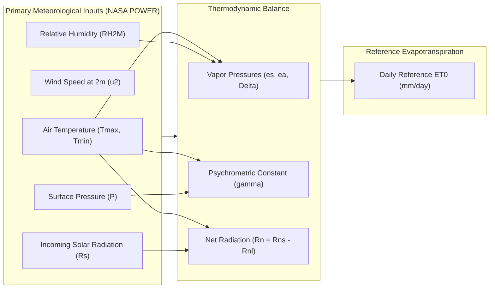

#### Governing Equations for Thermodynamic Intermediate Terms:
1. **Daily Mean Temperature ($T_{\text{mean}}$, in ${^\circ}\text{C}$):**
   $$T_{\text{mean}} = \frac{T_{\max} + T_{\min}}{2}$$
2. **Atmospheric Surface Pressure ($P$, in $\text{kPa}$):**
   Derived from surface station reanalysis or barometric elevation scaling:
   $$P = 101.3 \left(\frac{293 - 0.0065 z}{293}\right)^{5.26}$$
3. **Psychrometric Constant ($\gamma$, in $\text{kPa}\cdot{^\circ}\text{C}^{-1}$):**
   $$\gamma = \frac{c_p P}{\varepsilon \lambda} \approx 0.000665 \times P$$
   where $c_p = 1.013 \times 10^{-3} \, \text{MJ}\cdot\text{kg}^{-1}\cdot{^\circ}\text{C}^{-1}$ is the specific heat of moist air, $\varepsilon = 0.622$ is the molecular weight ratio of water vapor to dry air, and $\lambda = 2.45 \, \text{MJ}\cdot\text{kg}^{-1}$ is the latent heat of vaporization.
4. **Saturation Vapor Pressure Function ($e^\circ(T)$, in $\text{kPa}$):**
   $$e^\circ(T) = 0.6108 \exp\left(\frac{17.27 T}{T + 237.3}\right)$$
5. **Mean Saturation Vapor Pressure ($e_s$, in $\text{kPa}$):**
   $$e_s = \frac{e^\circ(T_{\max}) + e^\circ(T_{\min})}{2}$$
6. **Actual Vapor Pressure ($e_a$, in $\text{kPa}$):**
   Derived from mean relative humidity ($RH$, expressed as percentage):
   $$e_a = e_s \times \frac{RH}{100}$$
7. **Slope of the Saturation Vapor Pressure Curve ($\Delta$, in $\text{kPa}\cdot{^\circ}\text{C}^{-1}$):**
   $$\Delta = \frac{4098 \cdot e^\circ(T_{\text{mean}})}{(T_{\text{mean}} + 237.3)^2}$$
8. **Net Shortwave Radiation ($R_{ns}$, in $\text{MJ}\cdot\text{m}^{-2}\cdot\text{day}^{-1}$):**
   $$R_{ns} = (1 - \alpha) R_s = (1 - 0.23) R_s = 0.77 R_s$$
9. **Net Longwave Radiation ($R_{nl}$, in $\text{MJ}\cdot\text{m}^{-2}\cdot\text{day}^{-1}$):**
   Computed using the Stefan-Boltzmann law adjusted for vapor pressure and cloudiness ratio:
   $$R_{nl} = \sigma \left[ \frac{(T_{\max} + 273.16)^4 + (T_{\min} + 273.16)^4}{2} \right] \left( 0.34 - 0.14 \sqrt{\max(0, e_a)} \right) \left( 1.35 \frac{R_s}{R_{so}} - 0.35 \right)$$
   where $\sigma = 4.903 \times 10^{-9} \, \text{MJ}\cdot\text{K}^{-4}\cdot\text{m}^{-2}\cdot\text{day}^{-1}$ and $\frac{R_s}{R_{so}}$ is constrained to $[0.3, 1.0]$.
10. **Net Radiation ($R_n$) & Soil Heat Flux ($G$):**
    $$R_n = R_{ns} - R_{nl}$$
    For daily calculation time-steps, soil heat flux under a vegetative canopy is negligible ($G \approx 0$).

---

### 3.3 Hargreaves-Samani Empirical Evapotranspiration Fallback
When wind speed, incoming solar radiation, or relative humidity are absent from the observation record, the system switches to the empirical Hargreaves-Samani formulation:

$$ET_{0,\text{Hargreaves}} = \max\left(0, \, 0.0023 \cdot (T_{\text{mean}} + 17.8) \cdot \sqrt{\max(0, T_{\max} - T_{\min})} \cdot 0.408 R_a\right)$$
where $0.408$ converts $\text{MJ}\cdot\text{m}^{-2}\cdot\text{day}^{-1}$ to equivalent water depth in millimeters. Every computation utilizing this fallback flags output provenance with an explicit transparency indicator.

---

### 3.4 Crop Evapotranspiration ($ET_c$) Across Phenological Stages
Crop water demand under non-limiting moisture conditions ($ET_c$) adjusts reference evapotranspiration via stage-specific crop coefficients ($K_c$):
$$ET_{c,t} = K_c(t) \cdot ET_{0,t}$$

The dynamic daily coefficient $K_c(t)$ is evaluated piecewise:
$$K_c(t) = \begin{cases}
K_{c,\text{ini}}, & 0 \le t < L_{\text{ini}} \\
K_{c,\text{ini}} + \left(\frac{t - L_{\text{ini}}}{L_{\text{dev}}}\right) (K_{c,\text{mid}} - K_{c,\text{ini}}), & L_{\text{ini}} \le t < L_{\text{ini}} + L_{\text{dev}} \\
K_{c,\text{mid}}, & L_{\text{ini}} + L_{\text{dev}} \le t < L_{\text{ini}} + L_{\text{dev}} + L_{\text{mid}} \\
K_{c,\text{mid}} + \left(\frac{t - (L - L_{\text{late}})}{L_{\text{late}}}\right) (K_{c,\text{end}} - K_{c,\text{mid}}), & L - L_{\text{late}} \le t \le L
\end{cases}$$

---

## 4. Soil Physics, Hydrology, & Irrigation Engineering

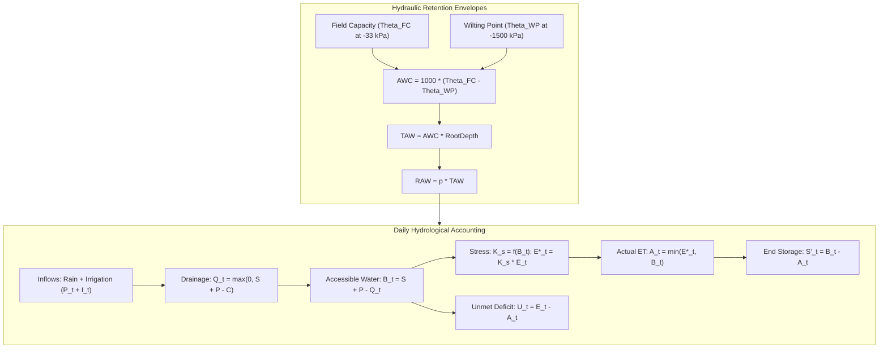

### 4.1 Hydraulic Retention Capacities
Soil water storage within the active root zone depends on soil texture and depth:
- **Available Water Capacity ($AWC$, in $\text{mm}\cdot\text{m}^{-1}$):**
  $$AWC = 1000 \cdot (\theta_{FC} - \theta_{WP})$$
  where $\theta_{FC}$ is volumetric water content at field capacity (matric potential $-33\text{ kPa}$) and $\theta_{WP}$ is volumetric water content at permanent wilting point (matric potential $-1500\text{ kPa}$).
- **Total Available Water ($TAW$, in $\text{mm}$):**
  $$TAW = AWC \cdot Z_r$$
  where $Z_r$ is effective crop rooting depth in meters.
- **Readily Available Water ($RAW$, in $\text{mm}$):**
  $$RAW = p \cdot TAW$$
  where $p \in [0.1, 0.8]$ is the soil water depletion fraction before moisture stress begins (standard agronomic default $p \approx 0.50$).

#### Retention Hierarchy for $\theta_{FC}$ and $\theta_{WP}$ (v3.1)
Water content at $-33\text{ kPa}$ and $-1500\text{ kPa}$ comes from the best source available, in this order, and sources are never mixed within one derivation. A tier whose inputs are missing, or outside the range the method was fitted on, is skipped; if every tier is skipped, $AWC$ is `unknown`, never defaulted.

* **Tier 0 (Farmer Primacy):** a plant-available water value the farmer entered.
* **Tier 1 (Local Soil Test):** from the farmer's own sand $S \in [0,1]$, clay $C \in [0,1]$ and organic matter $OM$ (percent by weight, $OM = 0.1724 \cdot SOC_{\text{g/kg}}$), by the Saxton and Rawls (2006) pedotransfer equations. All three must come from the farmer's test; none is borrowed from a gridded map.

$$\theta_{1500t} = -0.024 S + 0.487 C + 0.006 OM + 0.005(S \cdot OM) - 0.013(C \cdot OM) + 0.068(S \cdot C) + 0.031$$

$$\theta_{WP} = \theta_{1500t} + \left(0.14\,\theta_{1500t} - 0.02\right)$$

$$\theta_{33t} = -0.251 S + 0.195 C + 0.011 OM + 0.006(S \cdot OM) - 0.027(C \cdot OM) + 0.452(S \cdot C) + 0.299$$

$$\theta_{FC} = \theta_{33t} + \left(1.283\,\theta_{33t}^2 - 0.374\,\theta_{33t} - 0.015\right)$$

  The equations are applied only for $OM \le 8\%$, $C \le 0.60$ and $S + C \le 1$, and the result must satisfy $\theta_{FC} > \theta_{WP}$. *Worked check:* $S = 0.40$, $C = 0.20$, $OM = 2.5\%$ gives $\theta_{WP} = 0.1370$, $\theta_{FC} = 0.2796$ and $AWC = 142.6\text{ mm}\cdot\text{m}^{-1}$.

* **Tier 2 (Gridded Pedometric Baseline):** the ISRIC SoilGrids v2.0 water-content layers `wv0033` and `wv1500` (Section 10.8), integrated over $0\text{–}30\text{ cm}$ by Section 4.6, give $\theta_{FC}$ and $\theta_{WP}$ directly. The $0\text{–}30\text{ cm}$ value is applied to the whole root zone and is labelled as a $250\text{ m}$ model estimate, not a measurement of the field.

---

### 4.2 Dynamic Soil Water Balance (Wetting-Before-ET Convention)
In accordance with FAO-56 and standard physical soil water accounting, daily infiltration occurs prior to evapotranspirative extraction. For initial root-zone storage $S_t \in [0, C]$ (where $C = TAW$), daily precipitation $P_t$, irrigation $I_t$, and potential crop demand $E_t = ET_{c,t}$:

1. **Gravitational Drainage ($Q_t$):**
   $$Q_t = \max\left(0, \, S_t + P_t + I_t - C\right)$$
2. **Accessible Water Volume ($B_t$):**
   $$B_t = S_t + P_t + I_t - Q_t = \min\left(C, \, S_t + P_t + I_t\right)$$
3. **Transpiration Reduction Factor ($K_{s,t}$), evaluated on post-wetting storage:** because wetting precedes extraction, the water a crop can reach today is $B_t$, not the morning's $S_t$. With depletion $D^*_{r,t} = C - B_t$:
   $$K_{s,t} = \begin{cases} 1.0, & B_t \ge (1 - p)\,C \\ \dfrac{B_t}{(1 - p)\,C}, & 0 < B_t < (1 - p)\,C \\ 0.0, & B_t = 0 \end{cases}$$
   This is the FAO-56 relation $K_s = (TAW - D_r)/(TAW - RAW)$ written for storage $B_t$ and applied after the day's rain and irrigation. A day of heavy rain therefore lifts the throttle on that same day.

   *Dynamic Depletion Fraction $p(ET_c)$ (FAO-56 Eq. 84):*
   In Version 3.2, depletion fraction $p$ dynamically adjusts to daily atmospheric evaporative demand:
   $$p = \mathrm{clamp}\Big(p_{\mathrm{base}} + 0.04 \cdot (5 - ET_c), \, 0.1, \, 0.8\Big)$$
   where $p_{\mathrm{base}}$ is the species-specific baseline depletion fraction (FAO-56 Table 22, e.g., $0.20$ for paddy rice, $0.45$ for pulses/chickpea, $0.50$ for soybean/groundnut, $0.55$ for maize, $0.60$ for sesame). Higher atmospheric demand ($ET_c > 5\text{ mm}\cdot\text{d}^{-1}$) compresses the readily available water envelope before stomatal closure ensues.
4. **Throttled Demand and Actual Evapotranspiration ($A_t$):**
   $$E^*_t = K_{s,t} \cdot ET_{c,t}, \qquad A_t = \min\left(E^*_t, \, B_t\right)$$
5. **Ending Storage State ($S_{t+1}$):**
   $$S_{t+1} = B_t - A_t$$
6. **Unmet Crop Demand ($U_t$), measured against the unthrottled demand:**
   $$U_t = ET_{c,t} - A_t$$
7. **Strict Conservation Residual Verification:**
   $$\Delta S - (P_t + I_t - Q_t - A_t) \equiv 0$$
   Every daily calculation step evaluates the mass balance residual $\epsilon = |(S_{t+1} - S_t) - (P_t + I_t - Q_t - A_t)|$. Any run with $|\epsilon| > 10^{-9}\text{ mm}$ halts as a non-conservative physical violation.

Because $A_t \le E^*_t \le E_t$ and $A_t \le B_t$, the identity of step 7 holds exactly, and a crop can no longer extract water at the unstressed potential rate all the way down to the permanent wilting point. *Worked check* ($C = 10\text{ mm}$, $S = 2\text{ mm}$, $E = 4\text{ mm}\cdot\text{d}^{-1}$, $p = 0.5$): rain of $12, 0, 0\text{ mm}$ gives end storages $6, 2, 0.4\text{ mm}$ and an unmet demand of $2.4\text{ mm}$ on day 3 ($K_s = 2/5$, $A = 1.6\text{ mm}$); Version 3.0 gave $6, 2, 0\text{ mm}$ and $2\text{ mm}$. The same total rain of $4, 4, 4\text{ mm}$ keeps storage at $2\text{ mm}$ with no unmet demand: timing, not seasonal total, drives stress.

---

### 4.2.1 Two-Zone Soil Column for Multi-Crop Rooting Carryover
Defining $C = TAW = AWC \cdot Z_r$ with a crop-specific rooting depth $Z_r$ changes the control volume whenever sequential crops root to different depths, so water appears or vanishes at each crop change. Version 3.1 fixes the soil column at the greatest rooting depth in the rotation, $Z_{\max} = \max_s(Z_{r,s})$, and splits it at the current rooting depth into an active root zone $S_{\text{root},t} \in [0, C_r(t)]$ with $C_r(t) = AWC \cdot Z_r(t)$ and a sub-root buffer $S_{\text{sub},t} \in [0, C_{\text{sub}}(t)]$ with $C_{\text{sub}}(t) = AWC \cdot (Z_{\max} - Z_r(t))$.

1. **Cascading Gravitational Drainage.** Water in excess of the root zone enters the buffer; only water in excess of the buffer leaves the column:
   $$Q_{\text{root},t} = \max\left(0, \, S_{\text{root},t} + P_t + I_t - C_r(t)\right), \qquad Q_{\text{deep},t} = \max\left(0, \, S_{\text{sub},t} + Q_{\text{root},t} - C_{\text{sub}}(t)\right)$$
   The root zone then follows Section 4.2 with $C = C_r(t)$ and $B_t = S_{\text{root},t} + P_t + I_t - Q_{\text{root},t}$, so $K_s$ and extraction act on the root zone only, and the buffer ends the day at $S_{\text{sub},t+1} = S_{\text{sub},t} + Q_{\text{root},t} - Q_{\text{deep},t}$. The column identity is
   $$\left(S_{\text{root},t+1} + S_{\text{sub},t+1}\right) - \left(S_{\text{root},t} + S_{\text{sub},t}\right) = P_t + I_t - Q_{\text{deep},t} - A_t .$$
2. **Conservative Boundary Redistribution Across Stage or Crop Transitions** ($\Delta Z_r = Z_r(t+1) - Z_r(t)$). Water is taken to be spread evenly within each zone, so a deepening root captures its share of the buffer and a shortening root releases the water below it:
   $$S_{\text{root},t}^+ = \begin{cases} S_{\text{root},t} + S_{\text{sub},t} \left(\dfrac{\Delta Z_r}{Z_{\max} - Z_r(t)}\right), & \Delta Z_r > 0 \\ S_{\text{root},t} \left(\dfrac{Z_r(t+1)}{Z_r(t)}\right), & \Delta Z_r \le 0 \end{cases}, \qquad S_{\text{sub},t}^+ = \left(S_{\text{root},t} + S_{\text{sub},t}\right) - S_{\text{root},t}^+$$
   The total is unchanged by construction, and both zones remain within their new capacities.
3. **Paddy-to-Upland Carryover Transition.** When bunded wetland rice (Section 4.3) is followed by an upland crop (Section 4.2) and the ending pond depth satisfies $H_{\text{harvest}} > 0$, the upland profile starts at field capacity ($S_{\text{root},0} = C_r(0)$ and $S_{\text{sub},0} = C_{\text{sub}}(0)$) and $Q_{\text{drain,init}} = H_{\text{harvest}}$ is recorded as surface drainage before sowing. With no pond left, the profile continues from the state it had.

*Initial state.* A season evaluated on its own needs the moisture at planting from the farmer or an observation and never defaults it. Where the column is deeper than the root zone, the buffer is started as wet, in proportion, as the root zone, and this is recorded as an assumption of the run.

---

### 4.2.2 Three-Zone Non-Overlapping Soil Column (v3.2)
When simulating seedling establishment, early-season bare soil evaporation, and post-paddy drainage transitions, rooting depth contracts to the seedbed ($Z_r \approx 0.10\text{–}0.12\text{ m}$). A two-zone model that averages moisture uniformly across the active root layer risks obscuring rapid surface desiccation or crusting.

Version 3.2 implements a three-zone, physically non-overlapping soil compartment model:
1. **Layer 1 (Dedicated Seedbed):** Depth $Z_1 = 0.12\text{ m}$, capacity $C_1 = AWC \cdot Z_1$. Dedicated to topsoil evaporation ($K_e$) and seedling imbibition.
2. **Layer 2 (Sub-Seedbed Active Root Zone):** Depth $Z_2 = \max(0, Z_r - Z_1)$, capacity $C_2 = AWC \cdot Z_2$. Actively extracted by roots once $Z_r > Z_1$.
3. **Layer 3 (Sub-Root Buffer):** Depth $Z_3 = \max(0, Z_{\max} - \max(Z_r, Z_1))$, capacity $C_3 = AWC \cdot Z_3$. Deep hydrological reservoir.
4. **Perched Saturation Reservoir ($S_{\text{perched}}$):** Gravitational pore water exceeding field capacity up to total porosity $\theta_{\mathrm{sat}}$, perched above an agricultural plough-pan with restricted hydraulic conductivity $K_{\mathrm{pan}} \approx 2.5\text{–}6.0\text{ mm}\cdot\text{d}^{-1}$.

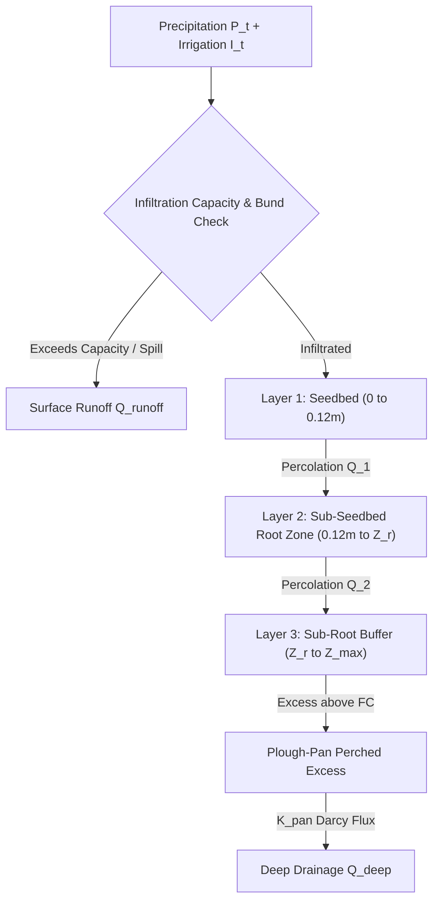

**Rigorous Conservation Identity:**
Every daily step evaluates the three-zone mass conservation identity:
$$\Delta\big(H_{\mathrm{surface}} + S_1 + S_2 + S_3 + S_{\mathrm{perched}}\big) - \big(P_t + I_t + Q_{\mathrm{cap}} - Q_{\mathrm{runoff}} - Q_{\mathrm{drain}} - Q_{\mathrm{deep}} - E_{\mathrm{pond}} - E_{\mathrm{soil}} - T_{\mathrm{crop}}\big) \equiv 0$$
Strict tolerance requires $|\epsilon| \le 10^{-9}\text{ mm}$.

---

### 4.2.3 Post-Paddy Drainage Window & Topsoil Sowing Clock (v3.2)
Relay broadcasting or zero-till upland planting (e.g., black gram / *Ye-pyan*) after monsoon wetland rice depends strictly on topsoil drydown dynamics. If sown when the seedbed is saturated, waterlogging rots the seed; if delayed too long, capillary drydown leaves insufficient moisture for germination.

The seedbed moisture window function evaluates:
1. **Field-Check Requirement:** If soil retention ($AWC$, $\theta_{\mathrm{sat}}$) or drainage date are unconfirmed, the system issues a status of `field-check-needed` and warns the farmer: *"Check topsoil moisture and drainage by hand in the field before sowing. Do not rely on an uncalibrated countdown."*
2. **Moisture Phase Transition:**
   - **Too Wet:** Perched water $S_{\mathrm{perched}} > 0.5\text{ mm}$ or surface pond $H > 0\text{ mm}$.
   - **Optimal Sowing Window:** Perched water drained, surface dry, and seedbed relative saturation satisfies:
     $$0.40 \le \frac{S_1}{C_1} \le 0.85$$
   - **Too Dry:** Seedbed moisture falls below $0.40 \cdot C_1$.
3. **Plough-Pan Drainage:** Saturated pore excess above field capacity drains into subsoil at rate $K_{\mathrm{pan}} = 3.0\text{ mm}\cdot\text{d}^{-1}$ (calibrated from lowland clay loam alluvial soils).

---

### 4.3 Paddy Water Balance (Bunded Wetland Hydrology)
For lowland flooded rice systems, water ponding within perimeter bunds governs field hydrology:

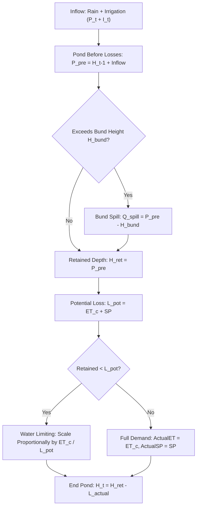

1. **Pre-Loss Pond Depth ($P_{\text{pre}}$):**
   $$P_{\text{pre}} = \max(0, H_{t-1}) + P_t + I_t$$
2. **Bund Spill / Overflow ($Q_{\text{spill}}$):**
   $$Q_{\text{spill}} = \max\left(0, \, P_{\text{pre}} - H_{\text{bund}}\right)$$
3. **Retained Surface Pond ($H_{\text{retained}}$):**
   $$H_{\text{retained}} = P_{\text{pre}} - Q_{\text{spill}} = \min(P_{\text{pre}}, H_{\text{bund}})$$
4. **Potential Losses ($L_{\text{pot}}$):**
   $$L_{\text{pot}} = ET_{c,t} + SP$$
   where $SP$ is the baseline daily soil seepage and percolation flux ($\text{mm}\cdot\text{day}^{-1}$).
5. **Actual Loss Extraction ($L_{\text{act}}$):**
   $$L_{\text{act}} = \min(H_{\text{retained}}, L_{\text{pot}})$$
6. **Flux Partitioning Under Water Limitations:**
   When pond depth is insufficient to satisfy combined potential losses ($H_{\text{retained}} < L_{\text{pot}}$), extractions are partitioned proportionally:
   $$f_{ET} = \frac{ET_{c,t}}{L_{\text{pot}}}, \quad ET_{\text{act}} = L_{\text{act}} \times f_{ET}, \quad SP_{\text{act}} = L_{\text{act}} \times (1 - f_{ET})$$
7. **Ending Pond Depth ($H_t$):**
   $$H_t = H_{\text{retained}} - L_{\text{act}}$$
8. **Paddy Mass Conservation Residual:**
   $$\Delta H - (P_t + I_t - Q_{\text{spill}} - ET_{\text{act}} - SP_{\text{act}}) \equiv 0$$

**Scope and limitation.** This model conserves *surface ponded water* only. $H_t$ is the depth above the soil, the losses are $ET_c$ and a single seepage-percolation term, and there is no separate store for water held in saturated or near-saturated soil. When the pond reaches zero the model has nothing left to give the crop, although rice roots can keep drawing on wet soil for some time after the standing water has gone. It also cannot represent puddled-layer or hardpan effects, lateral seepage between bunds, or a perched water table, and its seepage-percolation rate is an input, not something derived from the soil. It is a surface-water accounting model, not a paddy soil-plant water model, and its outputs are screening numbers. A soil reservoir below the pond, coupled to the column of Section 4.2.1, is the natural extension and is not implemented.

---

### 4.4 Irrigation Pumping Mechanics & Capacity-Constrained Pumping Model
To translate an agronomic net water deficit $D_{\text{net}}$ ($\text{mm}$) into operational pumping decisions:

1. **Gross Irrigation Water Volume ($V_{\text{gross}}$, in $\text{m}^3$):**
   $$V_{\text{gross}} = \frac{10 \cdot A_{\text{ha}} \cdot D_{\text{net}}}{\eta}$$
   where $A_{\text{ha}}$ is parcel area in hectares, $\eta \in (0, 1]$ is system application efficiency (e.g., $\eta \approx 0.60$ for furrow flooding, $\eta \approx 0.85$ for drip), and $10$ converts $\text{mm}\cdot\text{ha}$ to cubic meters.
2. **Required Operating Pumping Hours ($h_{\text{pump}}$):**
   $$h_{\text{pump}} = \frac{V_{\text{gross}}}{q_{\text{pump}}}$$
   where $q_{\text{pump}}$ is pump discharge capacity in $\text{m}^3\cdot\text{hr}^{-1}$.
3. **Capacity-Constrained Maximum Net Application Depth ($D_{\max}$):**
   If power availability or water allocation restricts pumping to $h_{\text{avail}}$ hours:
   $$D_{\max} = \frac{h_{\text{avail}} \cdot q_{\text{pump}} \cdot \eta}{10 \cdot A_{\text{ha}}}$$
4. **Unmet Irrigation Shortfall:**
   $$\text{Shortfall}_{\text{irr}} = \max\left(0, \, D_{\text{net}} - D_{\max}\right)$$

---

### 4.5 Pedometrics & USDA 12-Class Soil Texture Classification
Soil mechanical fractions (sand, silt, clay) obtained from laboratory particle-size analysis or digital soil mapping are assigned to USDA texture classes via deterministic piecewise linear boundaries:

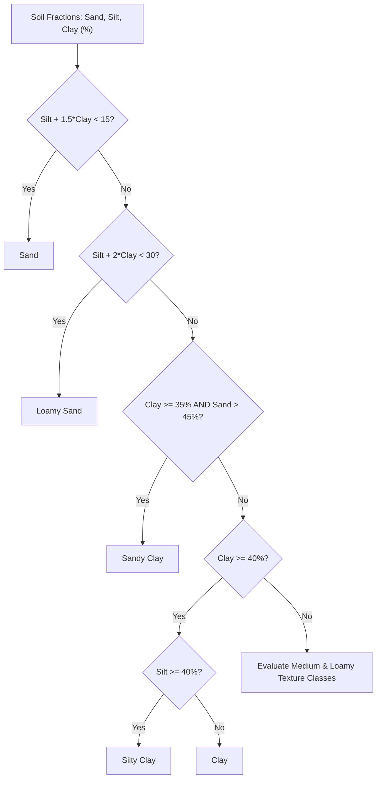

#### Exact Mathematical Decision Rules:
1. **Sand:** $\text{Silt} + 1.5 \cdot \text{Clay} < 15$
2. **Loamy Sand:** $\text{Silt} + 1.5 \cdot \text{Clay} \ge 15 \quad \text{AND} \quad \text{Silt} + 2 \cdot \text{Clay} < 30$
3. **Sandy Loam:**
   $$\big(\text{Clay} \in [7, 20) \land \text{Sand} > 52 \land \text{Silt} + 2 \cdot \text{Clay} \ge 30\big) \lor \big(\text{Clay} < 7 \land \text{Silt} < 50 \land \text{Silt} + 2 \cdot \text{Clay} \ge 30\big)$$
4. **Loam:**
   $$\text{Clay} \in [7, 27) \land \text{Silt} \in [28, 50) \land \text{Sand} \le 52$$
5. **Silt Loam:**
   $$\big(\text{Silt} \ge 50 \land \text{Clay} \in [12, 27)\big) \lor \big(\text{Silt} \in [50, 80) \land \text{Clay} < 12\big)$$
6. **Silt:** $\text{Silt} \ge 80 \land \text{Clay} < 12$
7. **Sandy Clay Loam:** $\text{Clay} \in [20, 35) \land \text{Silt} < 28 \land \text{Sand} > 45$
8. **Clay Loam:** $\text{Clay} \in [27, 40) \land \text{Sand} \in (20, 45]$
9. **Silty Clay Loam:** $\text{Clay} \in [27, 40) \land \text{Sand} \le 20$
10. **Sandy Clay:** $\text{Clay} \ge 35 \land \text{Sand} > 45$
11. **Silty Clay:** $\text{Clay} \ge 40 \land \text{Silt} \ge 40$
12. **Clay:** $\text{Clay} \ge 40 \land \text{Sand} \le 45 \land \text{Silt} < 40$

*Evaluation order (v3.1).* Rule 10 is tested immediately before the $\text{Clay} \ge 40$ split, as in the flowchart, so a soil with $\text{Clay} \ge 35$ and $\text{Sand} > 45$ is Sandy Clay whether its clay is below or above $40\%$ and is never routed to Clay or Silty Clay. Version 3.0's diagram sent every $\text{Clay} < 40\%$ soil past this test, contradicting Rule 10.

---

### 4.6 Depth-Weighted Pedotransfer Integration Across Soil Horizons
Soil properties from gridded databases (e.g., ISRIC SoilGrids v2.0) are reported across standardized depth intervals:
- Layer 1: $0\text{--}5\text{ cm}$ ($\Delta z_1 = 5\text{ cm}$)
- Layer 2: $5\text{--}15\text{ cm}$ ($\Delta z_2 = 10\text{ cm}$)
- Layer 3: $15\text{--}30\text{ cm}$ ($\Delta z_3 = 15\text{ cm}$)

The depth-weighted representative property $\bar{X}_{0-30}$ across the active root zone ($0\text{--}30\text{ cm}$, total thickness $Z_{\text{tot}} = 30\text{ cm}$):
$$\bar{X}_{0-30} = \frac{\sum_{k=1}^3 \left( \frac{X_k}{d_{\text{factor}}} \right) \Delta z_k}{\sum_{k=1}^3 \Delta z_k} = \frac{5 \cdot \frac{X_{0-5}}{d_{\text{factor}}} + 10 \cdot \frac{X_{5-15}}{d_{\text{factor}}} + 15 \cdot \frac{X_{15-30}}{d_{\text{factor}}}}{30}$$
where $d_{\text{factor}}$ is the product-specific decimal scaling divisor ($d_{\text{factor}} = 10$ for clay, sand, silt, pH, SOC, CEC; $d_{\text{factor}} = 100$ for bulk density). If any layer in the profile contains a nodata fill value, the mean is computed strictly over the valid thickness intervals; if all layers are missing, the profile evaluates to `null`.

The water-retention layers $\theta_{33}$ (`wv0033`) and $\theta_{1500}$ (`wv1500`) use the same weighting. ISRIC reports them in $10^{-2}\text{ cm}^3\cdot\text{cm}^{-3}$ with $d_{\text{factor}} = 10$, so a raw value of $304$ is $30.4\%$ by volume, and the volumetric fraction is
$$\theta = \frac{\bar{X}_{0-30}}{100}\quad(\text{equivalently, raw}/1000).$$
A layer in any other unit is rejected, not rescaled.

---

## 5. Agro-Thermal Phenology, Climatology, & Extreme Climatic Risk

### 5.1 McMaster & Wilhelm (1997) Modified Growing Degree Days ($GDD$)
Standard GDD calculations can produce severe errors during hot seasons if only the resulting average is bounded. The platform enforces the **McMaster and Wilhelm (1997)** formulation, clamping both maximum and minimum daily temperatures to the developmental baseline $T_{\text{base}}$ and upper thermal cutoff $T_{\text{upper}}$ before computing the mean:

$$\begin{aligned}
T_{\max}^* &= \min\left(T_{\text{upper}}, \, \max(T_{\text{base}}, \, T_{\max})\right) \\
T_{\min}^* &= \min\left(T_{\text{upper}}, \, \max(T_{\text{base}}, \, T_{\min})\right) \\
GDD_t &= \max\left(0, \, \frac{T_{\max}^* + T_{\min}^*}{2} - T_{\text{base}}\right)
\end{aligned}$$
This formulation prevents false development accumulation when night temperatures exceed the upper developmental threshold or day temperatures drop below the metabolic base.

---

### 5.2 Hamilton-Hare Largest Remainder Stage Window Discretization
Crop phenological lifecycles are partitioned into four physiological stages: Initial (`ini`), Development (`dev`), Mid-season (`mid`), and Late-season (`late`). To allocate continuous fractional stage durations into an exact integer sequence of days without drift, the engine implements the **Hamilton-Hare Largest Remainder Method**:

For a total cycle duration $L = \text{windowDays}(t_{\text{sow}}, t_{\text{harvest}})$ and fractional stage requirements $(f_{\text{ini}}, f_{\text{dev}}, f_{\text{mid}}, f_{\text{late}})$ summing to $1.0$:

1. Compute raw floating-point allocations:
   $$R_k = \frac{L \cdot f_k}{\sum_{j} f_j}$$
2. Take integer floors:
   $$l_k = \lfloor R_k \rfloor$$
3. Calculate fractional remainders and integer deficit:
   $$r_k = R_k - l_k, \quad \Delta L = L - \sum_{k=1}^4 l_k$$
4. Sort remainders in descending order: $r_{(1)} \ge r_{(2)} \ge r_{(3)} \ge r_{(4)}$, resolving ties by fixed agronomic stage sequence.
5. Allocate $+1\text{ day}$ to the top $\Delta L$ stages:
   $$L_k^* = \begin{cases} l_k + 1, & \text{rank}(r_k) \le \Delta L \\ l_k, & \text{otherwise} \end{cases}$$
6. Construct continuous, non-overlapping date spans ensuring:
   $$\sum_{k=1}^4 L_k^* \equiv L, \quad t_{\text{end},k} = t_{\text{start},k+1} - 1\text{ day}$$
Leap days occurring on February 29 during non-leap replay years automatically clamp to February 28, preserving seasonal alignment across replay years.

#### 5.2.1 Thermal-Time-Driven Stage Transitions (v3.1)
A calendar split ignores that a hot year runs through a crop's stages faster than a cool one. When a cultivar's thermal requirements are known, the stage boundaries inside each replayed season follow that season's temperatures. Let $GDD_t$ be the daily McMaster-Wilhelm value of Section 5.1 and $GDD_{\text{req},k}$ the cumulative thermal units from sowing at which stage $k \in \{\text{ini}, \text{dev}, \text{mid}\}$ ends. Stage $k$ ends on the first day $t_k$ for which
$$\sum_{t = t_{\text{sow}}}^{t_k} GDD_t \ge GDD_{\text{req},k}, \qquad t_{\text{ini}} < t_{\text{dev}} < t_{\text{mid}} < t_{\text{harvest}}$$
and the late stage runs to the planned harvest date, which the farmer fixes. If two thresholds are crossed on one day, the later stage still receives at least one day.

**Deterministic fallback.** The Hamilton-Hare allocation of Section 5.2 is used for a crop and season whenever (a) the cultivar's $GDD_{\text{req},k}$ are *unknown*, (b) any day in the window has no temperature (no day is imputed), (c) a threshold is not reached before harvest, or (d) the thresholds would leave a stage with no days. Each replayed season records whether its stages came from thermal time or from the calendar.

---

### 5.3 Critical Reproductive Thermal and Precipitation Exposure (Heat Shock, Cold Sterility, Flowering Rain)
Crop vulnerability to extreme meteorological events is non-uniform across growth stages, peaking during reproductive flowering (`mid` stage). Exposure is evaluated stage by stage against empirical physiological failure thresholds:

$$\begin{aligned}
\text{HeatShockDays}(k) &= \sum_{t \in \text{Stage}_k} \mathbb{I}\Big(T_{\max,t} > T_{\text{crit,heat}}(k)\Big) \\
\text{ColdSterilityDays}(k) &= \sum_{t \in \text{Stage}_k} \mathbb{I}\Big(T_{\min,t} < T_{\text{crit,cold}}(k)\Big) \\
\text{ExcessFloweringRainDays}(k) &= \sum_{t \in \text{Stage}_k} \mathbb{I}\Big(P_t > P_{\text{crit,rain}}(k)\Big)
\end{aligned}$$
where $\mathbb{I}(\cdot)$ is the indicator function.

In Version 3.2:
- **Excess Flowering Rainfall ($P_{\text{crit,rain}}$):** Pulse crops (black gram, green gram, pigeon pea, chickpea) and sesame suffer severe flower drop and fungal pod rotting if heavy rainfall ($P_t > 10\text{ mm}\cdot\text{d}^{-1}$) occurs during the reproductive mid-stage window.
- **Epistemic Labeling:** If a crop profile lacks a sourced threshold for stage $k$, the exposure metric for that stage is labeled `unknown` rather than reporting zero days.
- **Advisory Doctrine:** Exposures represent documented observational risk factors, not deterministic yield reductions or automatic disqualifications.

---

### 5.4 Frost Climatology & Hemispheric Day Shifting
Frost risk analysis computes the Last Spring Frost ($LSF$) and First Autumn Frost ($FAF$) based on a surface minimum temperature threshold $T_{\text{frost}} \le 0.0{^\circ}\text{C}$.

To handle the Southern Hemisphere (where the winter cold core occurs in June–August) without branching edge-case bugs, the day-of-year coordinate system is cyclically shifted by six months ($182\text{ days}$):
$$J_{\text{shifted}} = \left((J + 182) \bmod 365\right) + 1$$
The meteorological year is incremented if $J > 182$ in the Southern Hemisphere, aligning the coldest winter days into the center of the shifted analysis window.

A split threshold at $J_{\text{shifted}} = 200$ separates early-season spring events from late-season autumn events:
$$\begin{aligned}
LSF &= \max\left\{ J_{\text{shifted}} \;\middle|\; J_{\text{shifted}} \le 200, \, T_{\min} \le 0{^\circ}\text{C} \right\} \\
FAF &= \min\left\{ J_{\text{shifted}} \;\middle|\; J_{\text{shifted}} > 200, \, T_{\min} \le 0{^\circ}\text{C} \right\} \\
\text{FrostFreeDays} &= FAF - LSF
\end{aligned}$$
Percentiles ($P_{50}, P_{90}$ for $LSF$; $P_{50}, P_{10}$ for $FAF$) quantify frost retreat and return dates across the replay baseline.

---

### 5.5 Precipitation Regimes, Dry Spells ($MCDS$), & Completeness
- **Dry Day Threshold:** $P_t < 1.0 \, \text{mm}\cdot\text{day}^{-1}$
- **Heavy Rain Day Threshold:** $P_t \ge 50.0 \, \text{mm}\cdot\text{day}^{-1}$
- **Maximum Consecutive Dry Spell ($MCDS$):**
  $$MCDS = \max_{k} \left\{ \Delta t_k \;\middle|\; \forall t \in [t_k, t_k + \Delta t_k], \, P_t < 1.0 \, \text{mm} \right\}$$
- **The 355-Day Completeness Rule:** A calendar year is admitted into the climatic normal calculations only if at least $355$ valid daily precipitation records exist. Partial years are discarded to prevent dry-season or wet-season sampling bias.

---

### 5.6 Wet Cropping Season Identification
A calendar month $m \in [1, 12]$ is classified as agronomically active if thermal and moisture balances satisfy:
$$T_{\text{mean},m} \ge 8.0{^\circ}\text{C} \quad \text{AND} \quad \frac{P_m}{ET_{0,m}} \ge 0.50$$
Runs of consecutive active months are evaluated cyclically across the calendar year boundary ($k \pmod{12}$), accurately capturing multi-month monsoon and post-monsoon cropping seasons that span December and January.

---

## 6. Remote Sensing Radiometry, Quality Assurance, & Geomorphometry

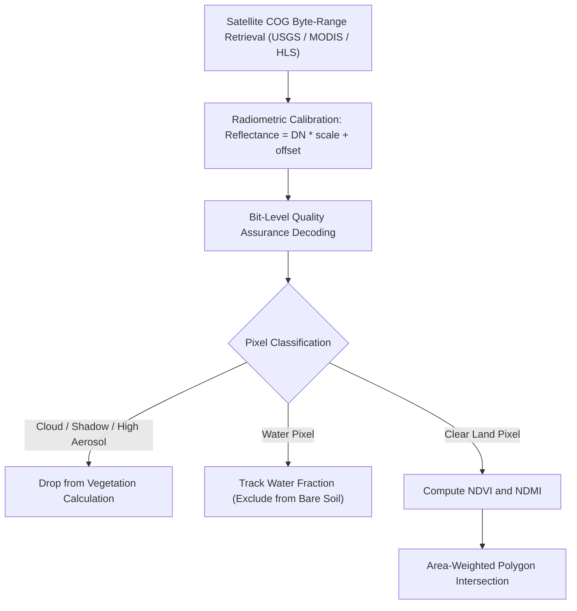

### 6.1 Multispectral Indices & Radiometric Calibration
Surface reflectance data from USGS Landsat Collection 2 Level-2 ($30\text{ m}$) is calibrated from 16-bit digital numbers ($\text{DN}$):
$$\rho_\lambda = \text{DN}_\lambda \times 0.0000275 - 0.2$$
where $\rho_\lambda$ is dimensionless surface reflectance, bounded by $[0.0, 1.6]$.

#### Spectral Formulations:
1. **Normalized Difference Vegetation Index ($NDVI$):**
   $$NDVI = \frac{\rho_{\text{NIR}} - \rho_{\text{Red}}}{\rho_{\text{NIR}} + \rho_{\text{Red}}}$$
2. **Normalized Difference Moisture Index ($NDMI$):**
   $$NDMI = \frac{\rho_{\text{NIR}} - \rho_{\text{SWIR1}}}{\rho_{\text{NIR}} + \rho_{\text{SWIR1}}}$$
3. **Strict Division Safety:**
   If $(\rho_{\text{NIR}} + \rho_{\text{Red}}) \le 0$, the index is recorded as `null`, never synthetic zero.

---

### 6.2 Field Scene Fractional Decomposition & Area Weighting
For an irregular field polygon intersecting $K$ raster pixels, each pixel $i$ has an intersection area $a_i$, a quality-usable flag $q_i \in \{0, 1\}$, and a spectral value $x_i$:

1. **Clear Observed Area ($A_{\text{clear}}$) & Cloud Area ($A_{\text{cloud}}$):**
   $$A_{\text{clear}} = \sum_{i=1}^K a_i q_i, \quad A_{\text{cloud}} = \sum_{i=1}^K a_i (1 - q_i)$$
2. **Valid Coverage Fraction ($f_{\text{valid}}$):**
   $$f_{\text{valid}} = \frac{A_{\text{clear}}}{A_{\text{parcel}}}$$
3. **Area-Weighted Parcel Mean ($\bar{x}_{\text{valid}}$) with a Minimum Clear-Area Gate (v3.1):** a scene is admitted only when at least a quarter of the parcel is clear. Below that, the few clear pixels are typically the unflagged fringe of a cloud or its shadow, and a single one can pull the mean of a $95\%$-cloudy parcel far from the crop.
   $$\bar{x}_{\text{valid}} = \begin{cases} \frac{\sum_{i=1}^K a_i q_i x_i}{A_{\text{clear}}}, & \dfrac{A_{\text{clear}}}{A_{\text{parcel}}} \ge 0.25 \\ \text{null}, & \dfrac{A_{\text{clear}}}{A_{\text{parcel}}} < 0.25 \end{cases}$$
   The gate applies to every field index (NDVI, NDMI) from every optical source. A rejected date stays in the timeline with `null` values and its true $f_{\text{valid}}$, so a cloudy date is reported as missing, never as zero vegetation. The reference implementation counts pixels whose centre lies inside the field outline, so $f_{\text{valid}}$ is the clear share of those pixels.
4. **Water Fraction Among Clear Pixels:**
   $$f_{\text{water}} = \frac{N_{\text{water}}}{N_{\text{clear}}}$$
   Water pixels are isolated before land-cover vegetation analysis. Standing water in flooded paddy fields is explicitly distinguished from bare soil, preventing fallow misclassification.

---

### 6.3 Multi-Sensor Quality Assurance (QA) Bitmask Decoding

#### 1. USGS Landsat Collection 2 Level-2 QA_PIXEL Bitmask:
| Bit Index | Flag Name | Description | Rejection Policy |
| :--- | :--- | :--- | :--- |
| **0** | Fill | Blank / NoData boundary pixel | **Reject** |
| **1** | Dilated Cloud | Cloud boundary buffer zone | **Reject** |
| **2** | Cirrus | High-altitude semi-transparent ice cloud | **Reject if High Confidence** |
| **3** | Cloud | Opaque terrestrial cloud body | **Reject** |
| **4** | Cloud Shadow | Projected cloud ground shadow | **Reject** |
| **5** | Snow / Ice | Cryospheric surface cover | **Reject** |
| **6** | Clear | Cloud-free, shadow-free terrestrial surface | **Accept** |
| **7** | Water | Inland or coastal water body | **Isolate** (Separate from bare soil) |
| **8–9** | Cloud Confidence | $00$: None, $01$: Low, $10$: Medium, $11$: High | **Reject if High ($11$)** |
| **10–11** | Shadow Confidence | $00$: None, $01$: Low, $10$: Medium, $11$: High | **Reject if High ($11$)** |

#### 2. MODIS MOD13Q1 16-Day VI Quality Bitfield:
- **MODLAND QA (bits 0–1):** Only `00` (Good Quality) is accepted.
- **VI Usefulness (bits 2–5):** Integer ranking ($0000 = \text{Highest Quality}$).
- **Adjacent Cloud (bit 8):** Must be $0$ (No).
- **Mixed Clouds (bit 10):** Must be $0$ (No).
- **Land/Water Mask (bits 11–13):** Must be $001$ (Land). Values $011, 100, 101$ represent inland water and are isolated.
- **Snow/Ice (bit 14) & Shadow (bit 15):** Must both be $0$ (No).

#### 3. Harmonized Landsat-Sentinel (HLS V2) Fmask Bitmask:
- Value `255`: Fill (Reject).
- Bit 1: Cloud (Reject).
- Bit 2: Adjacent to Cloud or Shadow (Reject).
- Bit 3: Cloud Shadow (Reject).
- Bit 4: Snow / Ice (Reject).
- Bit 5: Water (Isolate).
- Bits 6–7: Aerosol Level (`00` climatology, `01` low, `10` moderate, `11` high). Value `11` is strictly rejected.
- Valid Land Criterion: $\neg\text{cloud} \land \neg\text{adjacent} \land \neg\text{shadow} \land \neg\text{snow} \land \neg\text{water} \land (\text{aerosol} \ne 3)$.

#### 4. NASA ECOSTRESS Screening:
- Drop pixels with `cloud = 1`, `water = 1`, or fill (`255`).
- Temperature conversion: $T_{{^\circ}\text{C}} = T_{\text{Kelvin}} - 273.15$.
- Instantaneous evapotranspirative flux is in $\text{W}\cdot\text{m}^{-2}$ and is never converted to daily millimeters without a validated diurnal integration model.

---

### 6.4 Topographic Geomorphometry (Horn's $3 \times 3$ Finite Difference Gradient)
Terrain slope is computed from $30\text{ m}$ SRTM digital elevation models using Horn's eight-neighbor finite-difference algorithm:

$$\begin{bmatrix}
z_{nw} & z_n & z_{ne} \\
z_w & z_c & z_e \\
z_{sw} & z_s & z_{se}
\end{bmatrix}$$

1. **East-West Elevation Gradient ($\frac{\partial z}{\partial x}$):**
   $$\frac{\partial z}{\partial x} = \frac{(z_{ne} + 2 z_e + z_{se}) - (z_{nw} + 2 z_w + z_{sw})}{8 \cdot \Delta x}$$
2. **North-South Elevation Gradient ($\frac{\partial z}{\partial y}$):**
   $$\frac{\partial z}{\partial y} = \frac{(z_{sw} + 2 z_s + z_{se}) - (z_{nw} + 2 z_n + z_{ne})}{8 \cdot \Delta y}$$
3. **Geodesic Metric Grid Spacing:**
   $$\Delta y = \Delta \phi_{\text{deg}} \times 111{,}320 \, \text{m}, \quad \Delta x = \Delta \lambda_{\text{deg}} \times 111{,}320 \, \text{m} \times \cos(\phi_{\text{centre}})$$
4. **Final Surface Slope Angle ($\beta$, in degrees):**
   $$\beta = \arctan\left(\sqrt{\left(\frac{\partial z}{\partial x}\right)^2 + \left(\frac{\partial z}{\partial y}\right)^2}\right) \times \frac{180}{\pi}$$
5. **Topographic Steepness Classification:**
   - $\beta < 5.0^\circ$: `gentle`
   - $5.0^\circ \le \beta < 15.0^\circ$: `moderate`
   - $\beta \ge 15.0^\circ$: `steep`
   If any neighbor in the $3 \times 3$ kernel contains nodata, slope is `null` (a single point has no slope).

---

### 6.5 Radiometric Skin Temperature ($LST$) vs. Thermodynamic Air Temperature ($T_{\text{air}}$)
The engine enforces a strict physical barrier: **Radiometric Land Surface Temperature ($LST$) must never be substituted into air temperature crop threshold models.**

$$LST \ne T_{\text{air}}$$
Under high midday solar radiation in water-stressed soils, $LST$ frequently exceeds $T_{\text{air}}$ by $8\text{ to } 15{^\circ}\text{C}$. Conflating them would generate false heat shock flags. $LST$ is used exclusively to evaluate canopy temperature depression and relative thermal water stress.

---

## 7. Agronomic Topology, Nutrient Cycling, & Agro-Ecosystem Dynamics

### 7.1 Dry Grain Nitrogen Removal & Biological Fixation Mass Balance
Nitrogen contributions from legume crops are quantified using empirical fixation intervals and seed nitrogen concentrations:

$$\begin{aligned}
N_{\text{fixed,cycle}} &= \sum_{s \in \text{Legumes}} [N_{\text{fix,min},s}, \, N_{\text{fix,max},s}] \\
N_{\text{removed,dry}} &= Y_{\text{wet}} \times (1 - f_{\text{moisture}}) \times f_{\text{N,dry}}
\end{aligned}$$
where $Y_{\text{wet}}$ is harvested yield ($\text{kg}\cdot\text{ha}^{-1}$), $f_{\text{moisture}}$ is grain moisture fraction (default $0.15$), and $f_{\text{N,dry}}$ is nitrogen mass fraction of dry grain (default $0.03$). For example, a harvest of $1{,}000\text{ kg}\cdot\text{ha}^{-1}$ at $15\%$ moisture and $3\%$ dry N removes:
$$1{,}000 \times (1 - 0.15) \times 0.03 = 25.5 \, \text{kg N}\cdot\text{ha}^{-1}$$

---

### 7.2 Conservative Enclosure Bounds for Partial Nitrogen Budgets
To calculate net soil nitrogen balance without asserting unmeasured soil mineralization rates, the system computes conservative interval enclosure bounds:
$$N_{\text{partial}} = F - G - R \in [F_{\min} - G_{\max} - R_{\max}, \, F_{\max} - G_{\min} - R_{\min}]$$
where $F = [F_{\min}, F_{\max}]$ is biological nitrogen fixation, $G = [G_{\min}, G_{\max}]$ is grain nitrogen removal, and $R = [R_{\min}, R_{\max}]$ is crop residue removal.

#### 7.2.1 Residue Nitrogen Fate and First-Season Mineralization Kinetics (v3.2)
Version 3.2 explicitly partitions residue nitrogen according to farmer-selected management fate (`residueFate`):
1. **Burning (`burn`):** High-temperature combustion volatilizes $90\text{–}98\%$ of biomass nitrogen into atmospheric gases ($N_2, NO_x$). Carryover mineral N is set to $0\text{ kg N}\cdot\text{ha}^{-1}$ with an advisory warning on organic matter destruction.
2. **Removal for Fodder / Fuel (`remove_fodder`):** Stover is exported off-plot (export percentage $\approx 85\%$). Remaining root and stubble fragments contribute negligible mineral N ($0\text{–}2\text{ kg N}\cdot\text{ha}^{-1}$).
3. **Retention & Incorporation (`retain_incorporate`):**
   - **Legume Residues:** High-nitrogen stover ($N > 1.2\%$) undergoes rapid first-season net mineralization ($m_1 = 25\text{–}40\%$), releasing:
     $$N_{\mathrm{avail,legume}} = \big[\, 0.25 \cdot (Y_{\mathrm{stover}} \cdot f_{N}), \; 0.40 \cdot (Y_{\mathrm{stover}} \cdot f_{N}) \,\big]$$
     The unmineralized fraction incorporates into persistent active and slow soil organic pools.
   - **High C:N Cereal Straw Immobilization:** Fresh cereal residue with $C:N > 40:1$ (e.g., rice or maize straw) incorporated with short turnaround (< 21 days before the next planting) induces microbial nitrogen immobilization at seedling establishment:
     $$N_{\mathrm{avail,cereal}} = [-10, \, 0] \, \text{kg N}\cdot\text{ha}^{-1}$$
     The system alerts the farmer that soil microbes assimilate available soil mineral N during early straw decomposition.
4. **Unknown Fate:** If unrecorded by the farmer, residue carryover is strictly labeled `unquantified` to prevent granting unearned soil fertility credits.

---

### 7.3 Botanical Taxonomy & Phytopathological Rotation Breaks
Continuous cultivation of botanically identical families builds up soil-borne inoculum and specialized pest populations:

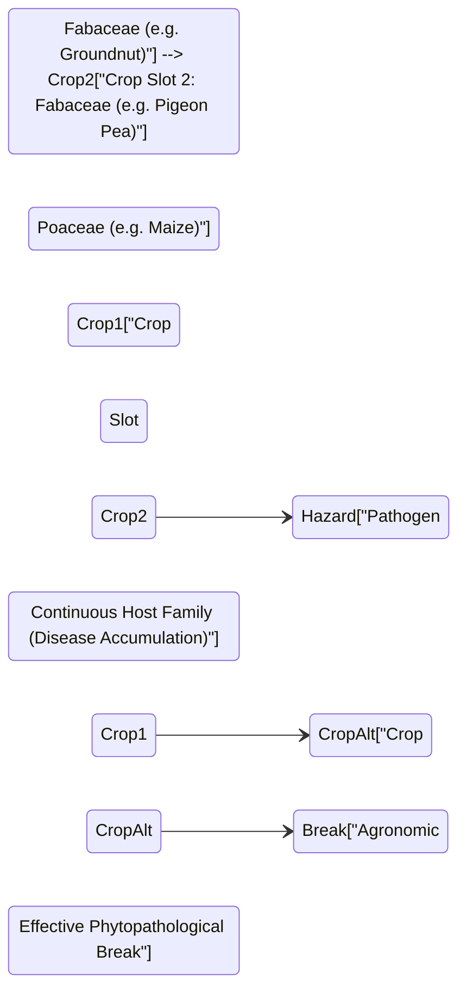

$$\text{PestHazard}(s_i, s_{i+1}) \iff \text{Family}(s_i) \equiv \text{Family}(s_{i+1}) \quad (\text{for non-fallow slots})$$
Alternating botanical families (e.g., Poaceae $\to$ Fabaceae $\to$ Pedaliaceae) breaks nematode and fungal life cycles, improving system resilience.

#### 7.3.1 Multi-Year Recurrence in Identical Seasonal Slots (v3.2)
Checking only immediate sequential neighbors ($s_i \to s_{i+1}$) fails when a rotation alternates across seasons. For example, growing monsoon rice followed by post-monsoon black gram, repeated every year:
$$\text{Rice (Monsoon } Y_1) \to \text{Black Gram (Post-Monsoon } Y_1) \to \text{Rice (Monsoon } Y_2) \to \text{Black Gram (Post-Monsoon } Y_2)$$
Adjacent crops never share a family (Poaceae $\ne$ Fabaceae), yet black gram is grown in the identical post-monsoon seasonal slot every single year.

Version 3.2 detects multi-year recurrence of identical host families within the same seasonal window across years:
1. **Seasonal Grouping:** Slots are categorized into seasonal bins:
   - *Monsoon:* May–August sowing.
   - *Post-monsoon dry season:* September–December sowing.
   - *Pre-monsoon / summer season:* January–April sowing.
2. **Anaerobic Paddy Exemption:** Flooded lowland wetland rice is an anaerobic system that suffocates soil-borne fungal pathogens of upland crops and is exempt from upland host alerts.
3. **Multi-Year Warning:** If the same botanical family recurs in the same seasonal slot across consecutive years without a non-host break crop, the system alerts the farmer to potential root-rot (*Rhizoctonia*, *Fusarium*) and root-knot nematode inoculum accumulation, advising an alternating non-host break crop (e.g., sesame, sunflower, or maize).

#### 7.3.2 Species-Level Pathogen Carryover and Vascular Wilt Return Intervals (v3.3)
Botanical family alone is an imperfect proxy: two legumes may share few pathogens, whereas rice (Poaceae) and green gram (Fabaceae) both host the sheath blight / web blight pathogen *Rhizoctonia solani*. Version 3.3 incorporates an explicit catalog of documented host organisms (`lib/data/crops/host-organisms.ts`) categorized by carryover mechanism:

1. **Soil-Borne Inoculum** (*Macrophomina phaseolina* [charcoal rot], *Rhizoctonia solani* [root rot/damping off], *Athelia rolfsii* [collar rot], *Meloidogyne* spp. [root-knot nematodes]):
   - Triggers an explicit carryover caution whenever crop $b$ follows crop $a$ and both are confirmed hosts in the literature, regardless of the fallow interval duration.
2. **Vector-Borne Viruses and Highly Mobile Pests** (Mungbean yellow mosaic virus via *Bemisia tabaci*, *Helicoverpa armigera*, *Maruca vitrata*, *Spodoptera frugiperda* [fall armyworm]):
   - Classified as informational context rather than rotation barriers. Rotation within an isolated single parcel offers minimal defense against winged insects.
   - Evaluated as a "green bridge" alert only when the turnaround interval between consecutive host crops is short ($t_{\text{plant},b} - t_{\text{harvest},a} \le 30\text{ days}$).
3. **Host-Specific Vascular Soil Wilts** (*Fusarium oxysporum* f. sp. *ciceris* on chickpea, *Fusarium udum* on pigeon pea):
   - Pathogen chlamydospores survive in soil for 3 to 5+ years.
   - For an $n$-year rotation cycle where host crop $c$ appears $k$ times, the recurrence interval is $R_{\text{int}} = n / k\text{ years}$.
   - If $R_{\text{int}} < R_{\text{min}}$ (where $R_{\text{min}} = 3\text{ years}$ for chickpea and pigeon pea), the system raises an interval warning. If the farmer reports known wilt history on the parcel, the option fails feasibility as a veto.

#### 7.3.3 Weather-Driven Disease Replay Analysis (v3.3)
Beyond sequence breaks, ambient microclimate determines whether fungal and bacterial spores can establish infection. Version 3.3 models climate-disease interactions using daily weather rules (`lib/data/crops/weather-disease-rules.ts`):
- **Consecutive Favourable Runs:** Evaluates multi-day runs of simultaneous temperature ($T_{\text{mean}}, T_{\text{max}}, T_{\text{min}}$), daily precipitation ($P_{\text{rain}}$), and relative humidity ($RH_{2\text{M}}$). For example:
  - *Tikka leaf spot on groundnut:* $\ge 3$ consecutive days with $T_{\text{mean}} \in [25, 30]^\circ\text{C}$ and $RH_{2\text{M}} \ge 80\%$.
  - *Rice blast:* $\ge 3$ consecutive days with $T_{\text{min}} \in [18, 24]^\circ\text{C}$, $T_{\text{max}} \le 32^\circ\text{C}$, and rain $\ge 2\text{ mm/d}$ or $RH_{2\text{M}} \ge 85\%$.
- **Ten-Season Replay Frequency:** Simulates the crop's growing window across 10 baseline years, categorizing historical disease favourability as *often* ($\ge 60\%$ of replayed seasons), *sometimes* ($20\text{–}60\%$), or *rarely* ($< 20\%$). Identifies peak vulnerability calendar months to assist targeted scouting.

---

### 7.4 Compound Erosion Hazard Screening
Soil erosion risk is evaluated by compounding geomorphic slope, rainy season precipitation, and planned low-cover intervals:
$$\text{ErosionHazard} = \mathbf{M}\Big(\text{SlopeClass}, \, P_{\text{month}} \ge 100\text{ mm}, \, \Delta t_{\text{gap}} \ge 45\text{ days}\Big)$$
- If slope is `steep` ($\beta \ge 15^\circ$) and a bare interval overlaps a rainy month: `elevated`.
- If slope is `moderate` ($5^\circ \le \beta < 15^\circ$) and a bare interval overlaps a rainy month: `possible`.
- If slope is `gentle` or no bare interval falls in a rainy month: `not-flagged`.
- If DEM elevation data has not been read: `needs-slope-data`.

---

## 8. Multi-Criteria Decision Analysis (MCDA) & Optimization Under Uncertainty

Candidate rotations are ranked against the farmer's stated priorities using a normalized additive utility model:
$$S(R) = \sum_{i \in \mathcal{C}_{\text{active}}} w'_i \cdot s_i(R)$$

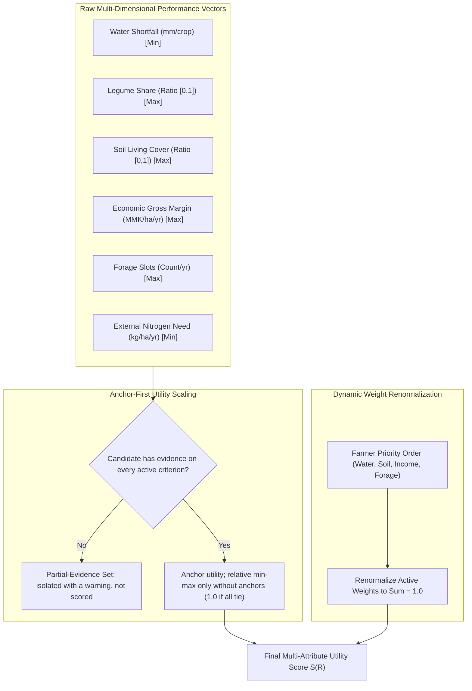

### 8.1 Priority Weight Induction: Rank-Sum Formulation
When the farmer orders priorities qualitatively without entering numerical weights, the system induces normalized weights via the **Rank-Sum (Borda) Method**:
For $n$ ordered priorities where rank $1$ is most important:
$$w_k = \frac{n - k + 1}{\sum_{j=1}^n j} = \frac{2(n - k + 1)}{n(n + 1)}$$

---

### 8.2 Anchor Utility Transformations (Primary Scaling)
Utilities are scaled to absolute agronomic targets ($x_{\text{target}}$) and physical failure limits ($x_{\text{limit}}$). This is the primary transformation: a negligible difference between candidates stays negligible instead of being stretched across $[0, 1]$.
$$\begin{aligned}
u_{\text{higher}}(x) &= \text{clip}\left(\frac{x - x_{\text{limit}}}{x_{\text{target}} - x_{\text{limit}}}, \, 0, \, 1\right) \\
u_{\text{lower}}(x) &= \text{clip}\left(\frac{x_{\text{limit}} - x}{x_{\text{limit}} - x_{\text{target}}}, \, 0, \, 1\right)
\end{aligned}$$
*Example:* water shortfalls of $10$, $12$ and $14\text{ mm}$ against a $0$ to $400\text{ mm}$ anchor score $0.975$, $0.970$ and $0.965$. Candidate-relative min-max would score them $1$, $0.5$ and $0$ and present noise as a decisive gap.

#### 8.2.1 Regional Benchmark Income Anchoring (v3.3)
In earlier versions, economic gross margin had no absolute target and fell back to candidate-relative min-max scaling. Consequently, adding or removing a high-margin or low-margin candidate shifted the utility scores and ranks of all other candidates (violating Independence of Irrelevant Alternatives).

Version 3.3 anchors the income utility to regional benchmark rotations (`incomeAnchorFor` in `lib/engine/economics.ts`):
$$u_{\text{income}}(M) = \text{clip}\left(\frac{M_{\text{mid}} - 0}{M_{\text{bench}} - 0}, \, 0, \, 1\right)$$
where $x_{\text{limit}} = 0\text{ MMK}\cdot\text{ha}^{-1}\cdot\text{yr}^{-1}$ (break-even point; net losses receive zero utility) and $x_{\text{target}} = M_{\text{bench}}$ is the midpoint annualized gross margin of the conventional rotation for that agroecological zone calculated from validated market price, yield and cost tables:
- **Ayeyarwady Delta:** Monsoon rice followed by post-monsoon black gram.
- **Central Dry Zone (Magway):** Pre-monsoon sesame followed by late-monsoon green gram.
- **Shan State:** Rainfed upland maize followed by relay soybean.

Options performing above the regional benchmark receive a utility of $1.0$, while their actual margins remain displayed side-by-side in economic comparisons. Relative min-max scaling is retained only as an unanchored fallback for custom locations outside these calibrated benchmark regions.

**Fallback relative scaling with a zero-variance guard.** When no anchor is present, criteria scale relative to candidates, and when they all tie the range is zero and the score is defined as $1$:
$$s_i(R) = \begin{cases} 1.0, & \max_R x_i(R) - \min_R x_i(R) < 10^{-9} \\ \dfrac{x_i(R) - \min_R x_i(R)}{\max_R x_i(R) - \min_R x_i(R)}, & \text{otherwise (for maximized criteria; } 1 - \text{that for minimized)} \end{cases}$$
A relative criterion on which every candidate ties carries no information, so it is reported as "no difference" and left out of the weights instead of adding the same constant to every score. An anchored criterion that ties is kept, because equal values against a target still say how good they are.

**Anchors.** Every anchor below is an analyst assumption to be tuned with local validation, and is labelled as such wherever it is used.

| Criterion | Direction | Target | Limit | Scope |
| --- | --- | --- | --- | --- |
| Rain shortfall against crop demand ($\text{mm}$ per crop) | lower | $0$ | $400$ | Fixed agronomic threshold |
| Legume share of crops | higher | $0.5$ | $0$ | Rotational diversity target |
| Share of the cycle with a crop in the field | higher | $1$ | $0.5$ | Ground cover benchmark |
| Crops that give fodder or forage ($\text{yr}^{-1}$) | higher | $1$ | $0$ | Livestock integration |
| Nitrogen the crops need ($\text{kg N}\cdot\text{ha}^{-1}\cdot\text{yr}^{-1}$) | lower | $0$ | $150$ | Synthetic input minimization |
| Margin ($\text{MMK}\cdot\text{ha}^{-1}\cdot\text{yr}^{-1}$) | higher | $M_{\text{bench}}$ (Regional typical rotation) | $0$ (Break-even) | Regional market benchmark (v3.3) |

---

### 8.3 Minimax Regret Optimization (Savage Criterion Across Historical Replays)
To evaluate rotation performance under climate variability without assigning uncalibrated probabilities to future seasons, the engine computes the minimax regret matrix across historical weather replay years:

1. Let $U(r, s)$ be the evaluated utility of candidate rotation $r$ under historical season $s \in \mathcal{S}$.
2. The optimal performance in season $s$:
   $$U^*(s) = \max_{j} U(j, s)$$
3. The regret (opportunity loss) of candidate $r$ in season $s$:
   $$L(r, s) = U^*(s) - U(r, s)$$
4. The minimax regret robust decision $r^*$:
   $$r^* = \arg\min_{r} \left( \max_{s \in \mathcal{S}} L(r, s) \right)$$
5. **Tail-risk percentile regret (v3.1).** Over the ten-season baseline, the maximum is set by a single season. The $90\text{th}$-percentile regret is reported beside it (linear interpolation between order statistics) to separate a chronic sensitivity to climate from a one-off anomaly. With ten seasons it is interpolated between the two worst of them, so it is a coarse indicator and not a calibrated tail probability:
   $$L_{\max}(r) = \max_{s \in \mathcal{S}} L(r, s), \qquad L_{P90}(r) = \text{Percentile}_{90}\big(\{L(r, s) \mid s \in \mathcal{S}\}\big)$$
   The decision rule stays minimax; ties in $L_{\max}$ go to the lower $L_{P90}$. When the option with the smallest $L_{\max}$ differs from the one with the smallest $L_{P90}$, one season decides the minimax result and both are shown. *Example* ($10$ seasons): candidate $A$ trails by $0.3$ in one season and is best in the other nine, so $L_{\max} = 0.3$ and $L_{P90} = 0.03$; candidate $B$ trails by $0.2$ in nine seasons, so $L_{\max} = L_{P90} = 0.2$. Minimax chooses $B$; $L_{P90}$ chooses $A$.

---

### 8.4 Pairwise Switching Point Analysis
For two candidate rotations $A$ and $B$ evaluated across two conflicting criteria ($1$ and $2$):
$$S(A) = w u_{A,1} + (1 - w) u_{A,2}, \quad S(B) = w u_{B,1} + (1 - w) u_{B,2}$$
The indifference switching weight $w^*$ where $S(A) = S(B)$:
$$w^* = \frac{u_{B,2} - u_{A,2}}{(u_{A,1} - u_{B,1}) - (u_{A,2} - u_{B,2})}$$
*Derivation.* Setting $S(A) = S(B)$ gives $w(u_{A,1} - u_{B,1}) + (1 - w)(u_{A,2} - u_{B,2}) = 0$, hence $w\left[(u_{A,1} - u_{B,1}) - (u_{A,2} - u_{B,2})\right] = u_{B,2} - u_{A,2}$. (Earlier versions of this document printed the numerator with the opposite sign; the code always used the form above.) *Check:* if $A = (1, 0)$ and $B = (0, 1)$ the weight is $w^* = (1 - 0) / (1 - (-1)) = 0.5$, and with the mis-signed numerator it would be $-0.5$, outside $[0, 1]$, wrongly reporting that no change of priorities can reverse the preference.
If $w^* \in [0, 1]$, it represents the exact priority threshold where preference inverts.

---

### 8.5 Scoped Non-Imputation and Active Weight Renormalization
A missing value is never imputed as zero or as an average. Version 3.0 dropped criterion $i$ from $\mathcal{C}_{\text{active}}$ for *all* candidates as soon as *any* one lacked data, so a single poorly parameterized minor crop could blind the whole evaluation matrix. Version 3.1 scopes the missing evidence to the candidate that lacks it:

1. **Criteria.** A criterion with a positive farmer weight and evidence for no candidate is dropped for all. The remaining criteria form $\mathcal{C}_{\text{known}}$.
2. **Partition.** The **Complete-Evidence Set** $\mathcal{R}_{\text{complete}}$ holds the candidates with a value on every criterion in $\mathcal{C}_{\text{known}}$ and is ranked on all of them. The **Partial-Evidence Set** $\mathcal{R}_{\text{partial}}$ holds the rest. They are listed with the criteria they lack and an explicit missing-evidence warning, are not scored, and are never compared with the complete set on a subset of criteria.
3. **Renormalization.** Weights are renormalized over the criteria used:
   $$w'_i = \frac{w_i}{\sum_{j \in \mathcal{C}_{\text{active}}} w_j}$$
4. **Fewer than two complete candidates.** There is then nothing to set apart, and the Version 3.0 rule applies: only criteria that every feasible candidate has are used.

*Unresolved Doctrine (preserved).* The recommendation engine refuses to declare a winner, setting system status to `unresolved`, if (a) the farmer's number-one ranked priority cannot be evaluated on the complete set, or (b) any candidate in $\mathcal{R}_{\text{partial}}$ has *no* evidence on any criterion of that first priority, since such a candidate could still be the best. A candidate that lacks only lower-priority evidence never halts the ranking.

---

### 8.6 Plain-Language Evidence Judgement and Four-Pillar Risk Explorer
Rather than presenting raw statistical probabilities or abstract confidence intervals, the system derives discrete evidence levels (`strong`, `fair`, `weak`) and plain-language agronomic reasons (`lib/engine/judgement.ts`):

#### Evidence Grading Standards
- **Strong Evidence:** All crops in rotation confirmed for parcel location and soil envelope, zero decisive parameters missing, and valid historical weather records span $\ge 80\%$ of baseline seasons.
- **Weak Evidence:** Any crop outside biophysical envelope, parcel unplaced, $< 50\%$ of past seasons evaluable, or $\ge 3$ decisive criteria unconfirmed.
- **Fair Evidence:** Intermediate states between strong and weak thresholds.

#### 4-Pillar Risk Engine Architecture (`lib/conditions/`)
Evaluates risk across 4 discrete physical dimensions:
1. `water_stress`: Seasonal rain deficit and root-zone depletion against crop demand.
2. `flood`: Sentinel-1 SAR backscatter drop and historical flood recurrence.
3. `erosion`: SRTM $30\text{ m}$ Horn slope gradient and unplanted gap low-cover exposure.
4. `heat_cold`: Anthesis heat shock ($>35^\circ\text{C}$), lowland cold sterility ($<15^\circ\text{C}$), and Shan plateau frost.

**Source Implementation:** `lib/engine/judgement.ts`, `lib/conditions/condition-evidence.ts`, `lib/conditions/explorer-model.ts`

---

---

## 9. Farm Economics: Real-World Commodity Market Benchmarks and Farmer Ranges

Economic margins are computed using closed interval arithmetic on yield, price and variable cost ranges. Farmer-entered numbers always supersede any default. To prevent uncalibrated dummy data when farmers have not yet recorded their exact figures, Field Shift integrates calibrated real-world market benchmarks for Myanmar (2024–2026), sourced from official agricultural records and commodity exchange bulletins:
- **Myanmar Department of Agriculture (DOA)**, Ministry of Agriculture, Livestock and Irrigation.
- **Bayintnaung Wholesale Commodity Exchange (Yangon)** and **War Tan Wholesale Depot** (pulses, beans and export grains).
- **Myanmar Pulses, Beans & Sesame Seeds Merchants Association (MPBMSMA)** indicative export price circulars.
- **Regional Wholesale Exchanges:** Magway and Mandalay (oilseeds and pulses), Monywa (chickpea), Taunggyi (maize and soybean).

### 9.1 Traditional Trade Units and Conversion Factors
Wholesale trading in Myanmar operates on historical volumetric and weight standards. The system standardizes these into SI units ($\text{kg}$ and $\text{ha}$):
- **Viss (ပိဿာ, Peittha):** $1\text{ viss} = 1.63293\text{ kg} \approx 1.633\text{ kg}$.
- **Paddy basket (စပါးတင်း):** $1\text{ basket} = 46\text{ lbs} \approx 20.86\text{ kg}$. One standard hundred-basket lot ($100\text{ baskets}$) equals $2,086\text{ kg}$.
- **Pulse basket (ပဲတင်း):** $1\text{ basket} = 72\text{ lbs} \approx 31.75\text{ kg}$ (to $32.65\text{ kg}$).
- **Sesame / Maize basket (နှမ်း / ပြောင်းတင်း):** $1\text{ basket} = 54\text{ lbs} \approx 24.49\text{ kg} \approx 24.5\text{ kg}$.
- **Metric Ton (MT):** $1\text{ MT} = 1,000\text{ kg}$.

### 9.2 Calibrated Regional Benchmark Values (2024–2026)

| Crop ID | Burmese Name | Price Range ($P_{\min}, P_{\max}$) [$\text{MMK}\cdot\text{kg}^{-1}$] | Yield Range ($Y_{\min}, Y_{\max}$) [$\text{kg}\cdot\text{ha}^{-1}$] | Variable Cost ($C_{\min}, C_{\max}$) [$\text{MMK}\cdot\text{ha}^{-1}$] | Trade Unit Reference & Market Source |
| :--- | :--- | :--- | :--- | :--- | :--- |
| `rice` | မိုးစပါး / နွေစပါး | $[950, \, 1300]$ | $[3200, \, 4800]$ | $[850000, \, 1350000]$ | Rough paddy: 2.0M–2.7M MMK / 100 baskets (~2,086 kg). DOA & Bayintnaung. |
| `black-gram` | မတ်ပဲ | $[3200, \, 3850]$ | $[1000, \, 1600]$ | $[550000, \, 850000]$ | Export FAQ/SQ: 3.5M–3.85M MMK / MT (~105k–122k MMK / basket). MPBMSMA. |
| `green-gram` | ပဲတီစိမ်း | $[3200, \, 4500]$ | $[950, \, 1500]$ | $[520000, \, 800000]$ | Bago/Khayan Shwe Wah: 5,500–7,500 MMK / viss. MPBMSMA & DOA. |
| `sesame` | နှမ်း | $[4500, \, 6800]$ | $[500, \, 900]$ | $[450000, \, 700000]$ | Samone black: 9,500–11,500 MMK / viss; Brown/white: 7,500–9,000 MMK / viss. Magway/Mandalay. |
| `groundnut` | မြေပဲ | $[2400, \, 3600]$ | $[1400, \, 2200]$ | $[700000, \, 1100000]$ | In-shell pods: 3,800–5,500 MMK / viss; shelled kernels: 4,500–6,000 MMK / kg. Central Dry Zone. |
| `chickpea` | ကုလားပဲ | $[3400, \, 4200]$ | $[1100, \, 1700]$ | $[550000, \, 850000]$ | Wholesale: 5,500–6,800 MMK / viss. Mandalay & Monywa Exchange. |
| `pigeon-pea` | ပဲစင်းငုံ | $[3400, \, 4100]$ | $[900, \, 1500]$ | $[500000, \, 750000]$ | Red pigeon pea export: 3.8M–4.2M MMK / MT (~110k–130k MMK / basket). Bayintnaung. |
| `maize` | ပြောင်းဖူး | $[1050, \, 1400]$ | $[4000, \, 6500]$ | $[900000, \, 1500000]$ | Feed depot: 1,100–1,450 MMK / kg (17.5k–23k MMK / basket). Taunggyi & CP purchase. |
| `soybean` | ပဲပုပ် | $[3000, \, 3900]$ | $[1200, \, 1900]$ | $[600000, \, 900000]$ | Wholesale: 4,900–6,400 MMK / viss. Shan State & Mandalay Market. |
| `lablab` | ပဲကြီး | $[2600, \, 3400]$ | $[800, \, 1400]$ | $[400000, \, 650000]$ | Local assembly: 4,200–5,500 MMK / viss. Local survey. |
| `sunn-hemp` | ပိုက်ဆံလျှော် | $[2500, \, 3200]$ | $[400, \, 750]$ | $[200000, \, 350000]$ | Seed production: 2,500–3,200 MMK / kg. Green manure biomass: 0 MMK direct sales. DOA Land Use. |
| `wheat` | ဂျုံ | $[1100, \, 1500]$ | $[1500, \, 2400]$ | $[650000, \, 1000000]$ | Grain wholesale: 1,100–1,500 MMK / kg. Sagaing & Shan winter survey. |
| `sorghum` | ပြောင်းဆန် | $[900, \, 1300]$ | $[1200, \, 2200]$ | $[450000, \, 700000]$ | Grain depot: 900–1,300 MMK / kg. Central Dry Zone fodder & coarse grain. |
| `cowpea` | ပဲလွမ်း | $[2500, \, 3400]$ | $[900, \, 1500]$ | $[450000, \, 700000]$ | Wholesale depot: 4,000–5,500 MMK / viss. Mandalay & Bago pulse assessment. |
| `crimson-clover` | ကလိုဗာ | $[2000, \, 2800]$ | $[300, \, 600]$ | $[200000, \, 350000]$ | Specialty forage & cover seed valuation: 2,000–2,800 MMK / kg. Reference benchmark. |

### 9.3 Interval Arithmetic Formulation
Weather does not change yield or price, and no optimization is performed. Closed intervals are used to avoid implying point precision:
$$\begin{aligned}
\text{GrossRevenue}_s &= [Y_{\min,s} \cdot P_{\min,s}, \, Y_{\max,s} \cdot P_{\max,s}] \\
\text{TotalCost}_s &= [C_{\min,s}, \, C_{\max,s}] \\
\text{GrossMargin}_s &= [Y_{\min,s} \cdot P_{\min,s} - C_{\max,s}, \, Y_{\max,s} \cdot P_{\max,s} - C_{\min,s}]
\end{aligned}$$

### 9.4 Gregorian Solar Annualization Factor ($365.2425\text{ days}\cdot\text{yr}^{-1}$)
To compare rotations of varying cycle lengths (e.g., a one-year double crop vs. a three-year multi-stage rotation) without whole-year integer rounding discontinuities:
$$\text{AnnualMargin}(R) = \text{GrossMargin}_{\text{cycle}} \times \frac{365.2425}{\Delta t_{\text{cycle,days}}}$$
where $\Delta t_{\text{cycle,days}}$ is the number of days from the first planting of the cycle to the next planting of its first crop: the full repeating interval. **Fallow and idle days between crops are included.** Dividing instead by the days between first planting and last harvest, or by the days a crop is in the field, would treat idle land as free and overstate the annual return of any cycle that contains fallow time. For a rotation entered by the farmer without explicit dates, the cycle length is the recorded number of cycle years $\times\ 365$ days.

### 9.5 Break-Even Commodity Price
$$P_{\text{breakeven}} = \frac{C_{\text{cost}}}{Y_{\text{saleable}}}$$

### 9.6 Water-Sensitive Yield Response ($K_y$) & Anti-Imputation Doctrine (v3.2)
While baseline comparisons use farmer-entered or benchmark empirical ranges, evaluating climate-scenario stress requires assessing yield sensitivity to seasonal evapotranspirative deficit.

Field Shift incorporates the empirical FAO-33 / FAO-66 crop yield response function:
$$\frac{Y_{\mathrm{adj}}}{Y_{\mathrm{base}}} = \phi = \mathrm{clamp}\left(1 - K_y \cdot \left(1 - \frac{\sum ET_a}{\sum ET_m}\right), \, 0.0, \, 1.0\right)$$
where $ET_a$ is actual evapotranspiration, $ET_m = ET_c$ is potential demand under non-limiting water conditions, and $K_y$ is the empirical yield response factor.

**Strict Anti-Imputation Rules:**
1. **Sourced $K_y$ Required:** Standardized $K_y$ values are applied strictly where peer-reviewed FAO-33/66 calibration exists:
   - `rice`: $K_y = 1.00$ (FAO 33 Table 24)
   - `maize`: $K_y = 1.25$ (FAO 33 & FAO 66)
   - `soybean`: $K_y = 0.85$ (FAO 33 Table 24)
   - `groundnut`: $K_y = 0.70$ (FAO 33 Table 24)
   - `sunflower`: $K_y = 0.95$ (FAO 33 Table 24)
   - `chickpea` / `pigeon-pea`: $K_y = 0.85$ (FAO 33 Table 24)
2. **Uncalibrated Crop Protection:** For species lacking peer-reviewed $K_y$ (e.g., black gram, green gram), the engine **refuses to invent an ungrounded factor**. The yield response is explicitly marked `unquantified` with the explanation: *"Crop lacks a standardized, species-calibrated FAO Ky water response factor. Water deficit is tracked as a physical risk rather than an invented yield penalty."*
3. **No Double-Counting:** If the farmer's entered baseline yield already reflects ambient rainfed water stress, secondary water-deficit discounting is suppressed.

---

## 10. Comprehensive Dataset Appliance & Sensor Specifications

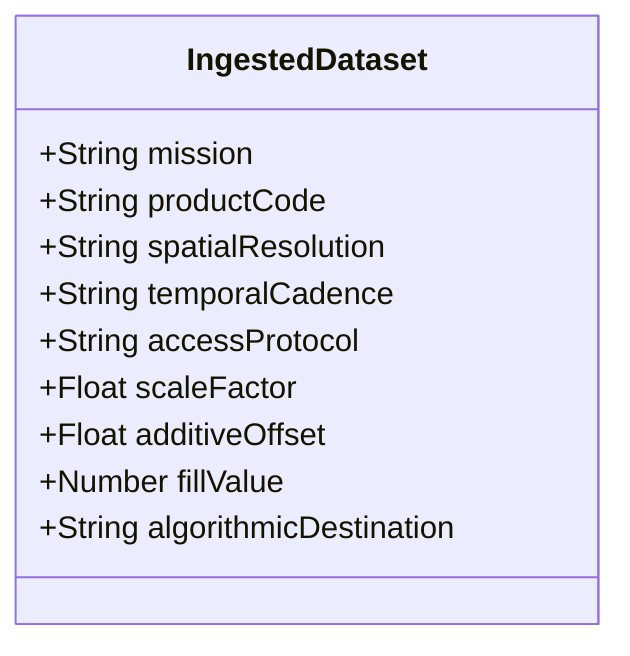

### 10.0 Master Dataset Update Cadence, Latency & Freshness Matrix

| Dataset / Product Code | Source Agency & DAAC | Spatial Resolution | Temporal Resolution / Cadence | Production Latency (Freshness Lag) | Historical Archive Span | Operational Ingestion Pipeline & Update Mechanism | Fallback & Degraded State Policy |
| :--- | :--- | :--- | :--- | :--- | :--- | :--- | :--- |
| **NASA POWER Agroclimatology**<br>`MERRA-2` / `GEOS-FP` | NASA Langley Research Center (LaRC) | $0.5^\circ \times 0.625^\circ$<br>($\approx 50 \times 60\text{ km}$) | Daily summaries (aggregated from hourly) | **2 to 3 days** trailing latency | 1981-01-01 to present (app uses 2016–present) | Synchronous HTTPS Point API; cached locally in SQLite; forward processing driven by GEOS-FP | Primary weather source; zero-fill converted strictly to `null`; triggers Hargreaves $ET_0$ fallback if solar/wind missing |
| **NASA GPM IMERG Final Daily**<br>`GPM_3IMERGDF` (V07) | NASA GSFC / GES DISC | $0.1^\circ \times 0.1^\circ$<br>($\approx 11 \times 11\text{ km}$) | Daily total (aggregated from half-hourly) | **~3.5 months** (due to GPCC gauge calibration) | 1998-01-01 to 2025-09-30 (V07 end date) | Earthdata CMR discovery + OPeNDAP DAP4 point slicing with `EARTHDATA_TOKEN` | Used only if $\ge 95\%$ baseline days present; otherwise falls back to POWER `PRECTOTCORR`. Products are never blended |
| **NASA GPM IMERG Late Run**<br>`GPM_3IMERGDL` | NASA GSFC / GES DISC | $0.1^\circ \times 0.1^\circ$<br>($\approx 11 \times 11\text{ km}$) | Daily accumulation | **~14 hours** post-observation | Operational moving window (last 3.5 months) | Bidirectional morphing via Earthdata Cloud; operational near-real-time monitoring | Used for current-season tracking; falls back to NASA POWER if unauthenticated |
| **NASA GPM IMERG Early Run**<br>`GPM_3IMERGIS` | NASA GSFC / GES DISC | $0.1^\circ \times 0.1^\circ$<br>($\approx 11 \times 11\text{ km}$) | Half-hourly / Daily | **~4 hours** post-observation | Operational moving window | Forward-only morphing; flash flood screening | Rapid alert screening only; not used for multi-season baseline replay |
| **USGS Landsat C2 L2**<br>`landsat-c2-l2` (OLI/ETM+) | USGS / NASA LP DAAC | $30\text{ m} \times 30\text{ m}$ | 16-day repeat per satellite (8-day combined 8/9) | **2 to 3 days** post-overpass | 1982-08-22 to present | Microsoft Planetary Computer STAC discovery + SAS token HTTP byte-range window retrieval on COGs | Cloud/shadow screened via `qa_pixel`; requires $f_{\text{valid}} \ge 0.25$; falls back to AppEEARS MODIS |
| **Sentinel-1 SAR C-Band**<br>`sentinel-1-grd` | ESA / Copernicus / MPC | $10\text{ m} \times 10\text{ m}$ | 6 to 12 days repeat cycle | **1 to 2 days** post-acquisition | 2014-10-03 to present | Planetary Computer STAC discovery; VV/VH backscatter amplitude retrieval on COGs | All-weather active microwave; surface water detected by $\Delta\gamma^0 \le -3.0\text{ dB}$; bypasses 88% monsoon cloud blackout |
| **MODIS Terra/Aqua VI**<br>`MOD13Q1.061` / `MYD13Q1` | NASA LP DAAC | $250\text{ m} \times 250\text{ m}$ | 16-day composite (Maximum Value Composite) | **2 to 4 days** post 16-day period | 2000-02-18 to present | Planetary Computer STAC discovery + Azure COG range reads; AppEEARS area job fallback | Used for 25-year regional phenology context; filtered via 16-bit `VI_Quality` bitmask |
| **NASA SMAP Level-4**<br>`SPL4SMGP.008` | NASA NSIDC / LP DAAC | $9\text{ km} \times 9\text{ km}$ EASE-Grid 2.0 | Daily composite (from 3-hourly snapshots) | **~2.5 to 3.0 days** (constrained by GEOS-FP) | 2015-03-31 to present | NASA AppEEARS Point API; asynchronous job polling; Earthdata login required | Regional root-zone wetness percentile only; never presented as field-gate moisture; reports `unknown` if missing |
| **NASA ECOSTRESS L2/L3**<br>`LSTE.002` / `JET.002` | NASA JPL / LP DAAC | $\approx 70\text{ m} \times 70\text{ m}$ (precessing swath) | Non-sun-synchronous (1 to 5 day variable revisit) | **1 to 2 days** post-acquisition | 2018-07-09 to present | NASA AppEEARS Area Subsetting API; filtered by cloud/water and conservative LST-QA | Thermal canopy depression and evapotranspiration context; never substituted for 2m air temperature |
| **NASA SRTM DEM**<br>`SRTMGL1_NC.003` | NASA JPL / LP DAAC | $1\text{ arc-sec} \approx 30\text{ m}$ | Static Topographic Baseline | **Static reference** (flown Feb 2000) | 2000-02-11 to 2000-02-22 | NASA AppEEARS Area Subsetting API | Feeds Horn's $3 \times 3$ slope gradient and atmospheric pressure elevation adjustments; static |
| **Harmonized Landsat-Sentinel**<br>`HLSL30.020` / `HLSS30.020` | NASA LP DAAC | $30\text{ m} \times 30\text{ m}$ | 2 to 3 days combined constellation revisit | **2 to 3 days** post-overpass | 2013-04-11 (L30) / 2015-11-28 (S30) to present | NASA AppEEARS Extraction API; Fmask QA screening | Sub-field gap vegetation screening; Earthdata-gated; degrades to Landsat C2 |
| **ISRIC SoilGrids v2.0**<br>`soilgrids.org` | ISRIC World Soil Information | $250\text{ m} \times 250\text{ m}$ | Static Modern Pedometric Baseline | **Static baseline** (v2.0 model released 2020) | Modern soil profile synthesis (1950–present) | Public REST API (`https://rest.isric.org/soilgrids/v2.0`); depth-weighted $0\text{--}30\text{ cm}$ integration | Tier 2 soil water retention fallback; superseded immediately by farmer lab test or field kit |
| **ESA WorldCover 10m**<br>`esa-worldcover` | ESA / Copernicus | $10\text{ m} \times 10\text{ m}$ | Annual Global Land Cover | **Annual release** (2020 / 2021 baselines) | 2020–2021 | Planetary Computer STAC discovery | Cropland polygon verification (Class 40: Cropland); eliminates false urban/wetland centroid queries |
| **NOAA GHCN-Daily**<br>`GHCND` | NOAA NCEI | Station-specific coordinates | Daily meteorological observations | **1 to 2 days** (trailing station uploads) | Multi-decadal (100+ years globally) | Offline benchmark validation harness (`lib/validation/`, 2014–2023 records: 18,260 station-days) | Used for ground-truth empirical auditing of satellite reanalysis inputs; not queried at runtime |
| **Myanmar Market Benchmarks**<br>DOA / Bayintnaung / MPBMSMA | DOA / Bayintnaung Wholesale / MPBMSMA | Regional production clusters | Seasonal / Annual market price surveys | **Updated Annually** (2024–2026 calibrated dataset) | 2020 to 2026 economic seasons | Static agronomic dictionary (`lib/data/crops/real-world-economics.ts`) | Feeds interval gross margin and regional income utility anchors ($M_{\text{bench}}$); overridden by farmer entry |


### 10.1 NASA POWER Agroclimatology (MERRA-2 & CERES)
- **Governing Body:** NASA Langley Research Center (LaRC).
- **Physical Provenance:** MERRA-2 atmospheric assimilation model coupled with CERES satellite solar flux retrievals.
- **Spatial Resolution:** $0.5^\circ \times 0.625^\circ$ latitude/longitude grid ($\approx 50\text{ km} \times 60\text{ km}$).
- **Temporal Coverage:** January 1, 1981 to present in the service (about 2-day latency). The application requests $2016$ onward.
- **Access Protocol:** Synchronous HTTPS Point API.
- **Nodata / Fill Convention:** `-999.0` (converted strictly to `null`).
- **Extracted Scientific Parameters:**
  - `T2M`: Daily mean air temperature at $2\text{ m}$ elevation (${^\circ}\text{C}$). Destination: $ET_0$ Penman-Monteith, $GDD$, and thermal suitability envelopes.
  - `T2M_MAX`, `T2M_MIN`: Daily maximum and minimum air temperature (${^\circ}\text{C}$). Destination: Heat shock, cold sterility, and vapor pressure deficit ($e_s$).
  - `ALLSKY_SFC_SW_DWN`: Daily all-sky insolation incident on a horizontal surface ($\text{MJ}\cdot\text{m}^{-2}\cdot\text{day}^{-1}$). Destination: Net shortwave radiation ($R_{ns}$) and Penman-Monteith $ET_0$.
  - `RH2M`: Relative humidity at $2\text{ m}$ ($\%$). Destination: Actual vapor pressure ($e_a$) derivation.
  - `WS2M`: Wind speed at $2\text{ m}$ ($\text{m}\cdot\text{s}^{-1}$). Destination: Aerodynamic bulk transfer resistance in Penman-Monteith $ET_0$.
  - `PS`: Atmospheric surface pressure ($\text{kPa}$). Destination: Psychrometric constant ($\gamma$) derivation.
  - `PRECTOTCORR`: Bias-corrected total precipitation ($\text{mm}\cdot\text{day}^{-1}$). Destination: Secondary fallback rainfall series.
  - `GWETROOT`, `GWETTOP`: Modeled root-zone and surface soil wetness (fraction $[0, 1]$). Destination: Regional hydrological context.

#### 10.1.1 Empirical Accuracy Assessment & Source Reliability Cautions (v3.3)
Ground-truth validation of NASA POWER daily variables against NOAA GHCN-Daily stations across Myanmar (2014–2023; Section 12.1) established critical empirical constraints:
- **Central Dry Zone Precipitation Bias:** At Mandalay, POWER monthly rainfall exhibits a **$-51\%$ relative bias** compared to station gauge records ($r = 0.48$). Monsoon rainfall is underestimated by $53\%$, and dry-season precipitation by $63\%$.
- **Agronomic Impact:** In rainfed Dry Zone cropping systems (e.g., Magway and Mandalay), uncalibrated POWER rainfall systematically overstates water deficits and drought hazards.
- **Operational Policy:** When a farm parcel is located within the Central Dry Zone ($19.5^\circ\text{–}22.5^\circ\text{N}$, $94.5^\circ\text{–}96.5^\circ\text{E}$), the interface renders an explicit source caution banner (`lib/validation/source-checks.ts`) informing the farmer that reanalysis rainfall totals may be roughly half of local ground truth, advising conservative interpretation of rainfed water stress.
- **Coastal Maritime Temperature Discrepancies:** Stations on maritime boundaries (Sittwe, Kawthaung) exhibit severe temperature biases (nighttime $T_{\text{min}}$ up to $+5.0^\circ\text{C}$ too warm; daytime $T_{\text{max}}$ up to $-3.1^\circ\text{C}$ too cool) due to coarse $50\text{ km}$ cell blending with sea surface temperatures. Coastal parcels are flagged with low temperature confidence.

---

### 10.2 NASA GPM IMERG Final Daily (V07) Precipitation
- **Governing Body:** NASA Goddard Space Flight Center (GSFC) and GES DISC.
- **Physical Provenance:** Integrated Multi-satellitE Retrievals for GPM (IMERG), combining passive microwave radiometers (GMI, SSMIS, AMSR2) with geosynchronous infrared and GPCC rain-gauge calibration.
- **Product ID:** `GPM_3IMERGDF` (Daily Final Run, Version 07, DOI: `10.5067/GPM/IMERGDF/DAY/07`).
- **Spatial Resolution:** $0.1^\circ \times 0.1^\circ$ geographic grid ($\approx 11\text{ km} \times 11\text{ km}$).
- **Temporal Coverage:** The V07B Final record includes the TRMM era and begins in **January 1998**. Per NASA's V08 transition notice, the Final Run V07 record **ends in September 2025**, because its parent products (CORRA and GPROF) are moving to V08; a retrospective V08 reprocessing of the full Final record was scheduled for summer 2026, while the Early and Late Runs continue in a V07 "hybrid" mode until the switch. The application requests $2016\text{–}2025$. Check the current GPM/GES DISC notice before relying on these dates.
- **Access Protocol:** Common Metadata Repository (CMR) Granule Discovery + OPeNDAP DAP4 sub-grid point slicing. Requires Earthdata Bearer Token (`EARTHDATA_TOKEN`).
- **Nodata / Fill Convention:** `-9999.9` (converted strictly to `null`).
- **Extracted Scientific Variables:**
  - `precipitation`: Daily cumulative rainfall ($\text{mm}\cdot\text{day}^{-1}$). Destination: Soil water balance depletion, dry spell recurrence ($MCDS$), and rainfall shortfall.
  - `precipitation_cnt`: Count of valid half-hourly observation samples contributing to the day. (Completeness policy: $48 = \text{Full Day}$; $< 48$ flags day as partially sampled).
  - `randomError`: Estimated standard error of daily rainfall retrieval ($\text{mm}\cdot\text{day}^{-1}$). Destination: Rainfall uncertainty envelope.

#### 10.2.1 Which rainfall product each replayed day uses
- The replay baseline is $2016\text{-}01\text{-}01$ to $2025\text{-}12\text{-}31$ ($3{,}653$ days).
- IMERG is used only if at least $95\%$ of those days have a full-day IMERG value. Otherwise **every** day uses NASA POWER `PRECTOTCORR`.
- When IMERG is used, any day without a full-day IMERG value (missing, or fewer than $48$ half-hour samples) is taken from POWER and counted as a recorded fallback. The two products are **never averaged or blended**.
- Because the Final V07 record ends in September 2025, up to $92$ days at the end of the baseline (October to December 2025) are POWER fallback days even where IMERG is configured. Without an Earthdata token, all rainfall is POWER.
- Each analysis reports the number of IMERG days, POWER fallback days and missing days. A function that compares seasonal totals from the two products exists in the code but is not yet shown in the interface.
- The two products can disagree, and crop water-stress estimates are sensitive to that difference. No bias correction is applied, so a seasonal total can mix products across its days.

---

### 10.3 USGS Landsat Collection 2 Level-2 Surface Reflectance
- **Governing Body:** U.S. Geological Survey (USGS) and NASA.
- **Hosting Repository:** Microsoft Planetary Computer STAC & Azure Blob Storage.
- **Sensors:** OLI/OLI-2 (Landsat 8/9), ETM+ (Landsat 7), TM (Landsat 4/5).
- **Collection ID:** `landsat-c2-l2`.
- **Spatial Resolution:** $30\text{ m} \times 30\text{ m}$.
- **Temporal Coverage:** August 22, 1982 to Present (16-day repeat cycle; 8-day combined).
- **Access Protocol:** Public STAC Discovery + SAS Token Signed HTTP Range Requests (RFC 7233) on Cloud-Optimized GeoTIFFs (COGs). No credentials required for public search.
- **Radiometric Calibration:**
  $$\rho_\lambda = \text{DN} \times 0.0000275 - 0.2, \quad \text{Nodata} = 0$$
- **Extracted Spectral Assets:**
  - `red`: Band 4 (Landsat 8/9) or Band 3 (Landsat 4/5/7) centered at $0.64\text{--}0.67 \, \mu\text{m}$.
  - `nir08`: Band 5 (Landsat 8/9) or Band 4 (Landsat 4/5/7) centered at $0.85\text{--}0.88 \, \mu\text{m}$.
  - `swir16`: Band 6 (Landsat 8/9) or Band 5 (Landsat 4/5/7) centered at $1.57\text{--}1.65 \, \mu\text{m}$.
  - `qa_pixel`: 16-bit Bitmask Quality Assessment raster. Destination: Rejection of cloud, shadow, snow, dilated cloud, and separation of inland water bodies.

---

### 10.4 MODIS Vegetation Indices 16-Day (MOD13Q1 / MYD13Q1 Version 061)
- **Governing Body:** NASA Land Processes Distributed Active Archive Center (LP DAAC).
- **Sensors:** Moderate Resolution Imaging Spectroradiometer (MODIS) aboard Terra and Aqua.
- **Collection ID on Planetary Computer:** `modis-13Q1-061`.
- **Spatial Resolution:** $250\text{ m} \times 250\text{ m}$ sinusoidal projection (re-projected to WGS84).
- **Temporal Cadence:** 16-day composite using maximum-value composite (MVC).
- **Temporal Coverage:** February 18, 2000 to Present.
- **Access Protocol:** STAC API + Azure COG Byte-Range Retrieval.
- **Radiometric Calibration:**
  $$\text{NDVI} = \text{DN} \times 0.0001, \quad \text{Fill Value} = -3000$$
- **Extracted Layers:**
  - `250m_16_days_NDVI`: 16-bit signed integer.
  - `250m_16_days_VI_Quality`: 16-bit unsigned integer bitmask.
  - `250m_16_days_pixel_reliability`: 8-bit rank ($0 = \text{Good}, 1 = \text{Marginal}, 2 = \text{Snow/Ice}, 3 = \text{Cloudy}, -1 = \text{Fill}$). Destination: 25-year regional phenology baseline.

---

### 10.5 NASA SMAP Level-4 Soil Moisture (SPL4SMGP Version 008)
- **Governing Body:** NASA National Snow and Ice Data Center (NSIDC DAAC) / LP DAAC.
- **Physical Provenance:** Soil Moisture Active Passive (SMAP) L-band radiometer brightness temperatures assimilated into the NASA Catchment Land Surface Model driven by GEOS-FP.
- **Spatial Resolution:** $9\text{ km} \times 9\text{ km}$ EASE-Grid 2.0.
- **Temporal Coverage:** March 31, 2015 to Present.
- **Access Protocol:** NASA AppEEARS Point Extraction API. Requires `EARTHDATA_USERNAME` and `EARTHDATA_PASSWORD`.
- **Fill Value:** `-9999.0` (converted strictly to `null`).
- **Extracted Hydrological Layers:**
  - `sm_surface`: Top $0\text{--}5\text{ cm}$ volumetric soil moisture ($\text{m}^3\cdot\text{m}^{-3}$).
  - `sm_rootzone`: Top $0\text{--}100\text{ cm}$ volumetric soil moisture ($\text{m}^3\cdot\text{m}^{-3}$).
  - `sm_rootzone_pctl`: Historical empirical percentile of root-zone wetness relative to multi-year record ($[0, 100]$). Destination: Regional hydrological drought context.

---

### 10.6 NASA SRTM Global 1 Arc-Second Elevation (SRTMGL1_NC.003)
- **Governing Body:** NASA Jet Propulsion Laboratory (JPL) and LP DAAC.
- **Physical Provenance:** Shuttle Radar Topography Mission (SRTM) C-band InSAR flown aboard Space Shuttle Endeavour in February 2000.
- **Spatial Resolution:** $1\text{ arc-second} \approx 30\text{ m} \times 30\text{ m}$ at the equator.
- **Temporal Extent:** Static reference topography (February 11–22, 2000).
- **Access Protocol:** NASA AppEEARS Area Subsetting API.
- **Fill Value:** `-32768`.
- **Extracted Geophysical Layer:**
  - `SRTMGL1_DEM`: Orthometric ground surface elevation in meters above the EGM96 geoid. Destination: Atmospheric pressure derivation ($P$), barometric clear-sky radiation ($R_{so}$), and Horn's $3 \times 3$ slope gradient calculation for hillside erosion hazard screening.

---

### 10.7 NASA ECOSTRESS Land Surface Temperature & ET (Collection 2)
- **Governing Body:** NASA Jet Propulsion Laboratory (JPL) / LP DAAC.
- **Physical Provenance:** ECOsystem Spaceborne Thermal Radiometer Experiment on Space Station (ECOSTRESS) multispectral thermal infrared sensor (5 bands in $8\text{--}12.5 \, \mu\text{m}$) mounted on the ISS.
- **Products:** `ECO_L2T_LSTE.002` (Surface Temperature) and `ECO_L3T_JET.002` (Evapotranspiration via PT-JPL model).
- **Spatial Resolution:** $\approx 70\text{ m} \times 70\text{ m}$.
- **Temporal Sampling:** Precessing ISS orbit providing non-sun-synchronous diurnal sampling across daylight hours on clear overpasses.
- **Access Protocol:** NASA AppEEARS Extraction API.
- **Physical Units:** Temperature in Kelvin ($K - 273.15 = {^\circ}\text{C}$); Evapotranspiration in instantaneous flux ($\text{W}\cdot\text{m}^{-2}$). Destination: Crop canopy thermal depression analysis and high-resolution water deficit verification.

---

### 10.8 ISRIC SoilGrids v2.0 Global Soil Information
- **Governing Body:** International Soil Reference and Information Centre (ISRIC), Wageningen, Netherlands.
- **Physical Provenance:** Automated machine learning (Ensemble Random Forest & Gradient Boosting) predicting physical and chemical soil properties from $240{,}000$ standardized profile observations and $400+$ environmental covariates.
- **Spatial Resolution:** $250\text{ m} \times 250\text{ m}$ global grid.
- **Temporal Cadence:** Static modern pedometric baseline.
- **Access Protocol:** Public REST API (`https://rest.isric.org/soilgrids/v2.0/properties/query`). No credentials required.
- **Extracted Properties Across Depths ($0\text{--}5\text{ cm}, 5\text{--}15\text{ cm}, 15\text{--}30\text{ cm}$):**
  - `clay`: Mass fraction of clay particles ($< 2 \, \mu\text{m}$) in $\text{g}\cdot\text{kg}^{-1}$ (scaled by $10$ to $\%$).
  - `sand`: Mass fraction of sand particles ($50\text{--}2000 \, \mu\text{m}$) in $\text{g}\cdot\text{kg}^{-1}$ (scaled by $10$ to $\%$).
  - `silt`: Mass fraction of silt particles ($2\text{--}50 \, \mu\text{m}$) in $\text{g}\cdot\text{kg}^{-1}$ (scaled by $10$ to $\%$).
  - `phh2o`: Soil pH measured in water extract (scaled by $10$).
  - `soc`: Soil organic carbon content in $\text{dg}\cdot\text{kg}^{-1}$ (scaled by $10$ to $\text{g}\cdot\text{kg}^{-1}$).
  - `cec`: Cation exchange capacity at $\text{pH } 7.0$ in $\text{mmol}(+)\cdot\text{kg}^{-1}$ (scaled by $10$ to $\text{cmol}(+)\cdot\text{kg}^{-1}$).
  - `bdod`: Bulk density of the fine earth fraction in $\text{cg}\cdot\text{cm}^{-3}$ (scaled by $100$ to $\text{g}\cdot\text{cm}^{-3}$).
  - `wv0033`: Volumetric water content at $-33\text{ kPa}$ (field capacity, $\theta_{FC}$), reported in $10^{-2}\text{ cm}^3\cdot\text{cm}^{-3}$ with $d_{\text{factor}} = 10$; the volumetric fraction is the raw value divided by $1000$ (Section 4.6).
  - `wv1500`: Volumetric water content at $-1500\text{ kPa}$ (permanent wilting point, $\theta_{WP}$), same units and conversion.
  - Destination: USDA soil texture classification, Available Water Capacity ($AWC$) as Tier 2 of the Section 4.1 retention hierarchy (only when the farmer has given neither a water-capacity value nor the sand, clay and organic carbon needed for Tier 1), and soil chemical suitability envelopes.

---

### 10.9 Harmonized Landsat Sentinel-2 (HLS v2.0)
- **Governing Body:** NASA Land Processes Distributed Active Archive Center (LP DAAC) & USGS.
- **Sensors:** Operational Land Imager (OLI/OLI-2) on Landsat 8/9 and Multi-Spectral Instrument (MSI) on Sentinel-2A/2B.
- **Products:** `HLSL30.020` (Landsat-derived 30m) and `HLSS30.020` (Sentinel-2 derived 30m).
- **Spatial Resolution:** $30\text{ m} \times 30\text{ m}$ gridded to the Sentinel-2 Military Grid Reference System (MGRS).
- **Temporal Cadence:** Combined constellation revisit of $2\text{ to }3\text{ days}$ globally (cloud conditions permitting).
- **Temporal Coverage:** April 2013 (Landsat-30) / November 2015 (Sentinel-30) to present.
- **Access Protocol:** NASA AppEEARS Point / Area Extraction API. Requires Earthdata login (`EARTHDATA_USERNAME`, `EARTHDATA_PASSWORD`).
- **Radiometric Calibration:** Harmonized surface reflectance normalized to nadir BRDF (NBAR):
  $$\rho_\lambda = \text{DN} \times 0.0001, \quad \text{Fill} = -1000$$
- **Quality Assessment (Fmask):** Screened via 8-bit Fmask bitmask: reject fill (255), cloud (bit 1), adjacent cloud/shadow (bit 2), shadow (bit 3), snow (bit 4), and high aerosol (bits 6–7 = 11). Water (bit 5) is separated from land.
- **Destination:** High-frequency gap vegetation tracking, greenness transitions, and bare-soil validation.

---

### 10.10 NOAA Global Historical Climatology Network (GHCN-Daily) Ground Records
- **Governing Body:** NOAA National Centers for Environmental Information (NCEI).
- **Physical Provenance:** Physical ground station meteorological observations calibrated and quality-controlled across global meteorological services.
- **Product Code:** `GHCND` (Global Historical Climatology Network - Daily).
- **Spatial Resolution:** Point-specific surface weather stations.
- **Temporal Cadence:** Daily observation reporting.
- **Historical Baseline in Harness:** 10 continuous years ($2015\text{–}2024$) across 5 Myanmar benchmark meteorological stations:
  - Mandalay International ($21.98^\circ\text{N}, 96.08^\circ\text{E}$, $76\text{ m}$)
  - Sittwe ($20.13^\circ\text{N}, 92.88^\circ\text{E}$, $8\text{ m}$)
  - Kawthaung ($10.02^\circ\text{N}, 98.55^\circ\text{E}$, $15\text{ m}$)
  - Yangon International ($16.77^\circ\text{N}, 96.17^\circ\text{E}$, $14\text{ m}$)
  - Myitkyina ($25.38^\circ\text{N}, 97.40^\circ\text{E}$, $145\text{ m}$)
- **Access Protocol:** Offline ground-truth validation harness (`lib/validation/weather.ts`, `data/validation/power-vs-ghcn.json`).
- **Destination:** Ground-truth benchmarking of satellite reanalysis data; error bound derivation for temperature and precipitation biases.

---

### 10.11 Regional Agricultural Commodity Market Benchmarks
- **Governing Bodies:** Myanmar Department of Agriculture (DOA), Bayintnaung Wholesale Agricultural Commodity Exchange, and Myanmar Pulses, Beans & Sesame Seeds Merchants Association (MPBMSMA).
- **Physical Provenance:** Real-world regional wholesale market transactional records, commodity auction data, and certified agricultural production cost surveys.
- **Spatial Coverage:** Key production clusters: Ayeyarwady Delta (lowland rice, pulses), Central Dry Zone / Magway (sesame, groundnut, pulses), and Shan State Highlands (maize, soybean).
- **Temporal Update Cadence:** Updated annually across seasonal market transitions (current dataset: 2024–2026 calibrated parameters).
- **Access Protocol:** Structured agronomic dictionary (`lib/data/crops/real-world-economics.ts`).
- **Extracted Financial Envelopes:**
  - Crop yield intervals: $[Y_{\min}, Y_{\max}]$ in $\text{kg}\cdot\text{ha}^{-1}$ (or regional basket units: *tin*, *pyi*).
  - Wholesale market price intervals: $[P_{\min}, P_{\max}]$ in $\text{MMK}\cdot\text{kg}^{-1}$.
  - Variable production cost intervals: $[C_{\min}, C_{\max}]$ in $\text{MMK}\cdot\text{ha}^{-1}$ (seed, fertilizer, fuel, labor, harvest).
- **Destination:** Interval gross margin calculation and fixed regional anchor baseline ($M_{\text{bench}}$) for MCDA income utility normalization.

---

### 10.12 Sentinel-1 SAR C-Band Level-1 Ground Range Detected (GRD)
- **Governing Body:** European Space Agency (ESA) & Copernicus Programme.
- **Physical Provenance:** Active Synthetic Aperture Radar (SAR) operating at C-band ($5.405\text{ GHz}$), providing day-and-night, cloud-penetrating radar backscatter measurements.
- **Product Code:** `sentinel-1-grd` (Level-1 Ground Range Detected, Interferometric Wide swath mode).
- **Spatial Resolution:** $10\text{ m} \times 10\text{ m}$ pixel spacing ($20\text{ m} \times 22\text{ m}$ spatial resolution).
- **Temporal Cadence:** $6\text{ to }12\text{ days}$ repeat cycle depending on single/dual constellation orbital coverage.
- **Production Latency:** $1\text{ to }2\text{ days}$ post-acquisition via Planetary Computer STAC.
- **Historical Archive Span:** 2014-10-03 to present.
- **Polarizations Ingested:** Dual-polarization $\text{VV}$ (vertical transmit, vertical receive) and $\text{VH}$ (vertical transmit, horizontal receive).
- **Radiometric Calibration:** Gamma-nought backscatter coefficient ($\gamma^0$) in decibels:
  $$\gamma^0_{\text{dB}} = 10 \cdot \log_{10}(\text{DN}^2 / A_{\gamma}^2)$$
- **Flood Detection Mechanism:** Specular reflection over open floodwater dramatically attenuates radar backscatter towards the sensor. Surface water inundation is identified by an anomalous backscatter collapse relative to dry-season baseline:
  $$\Delta\gamma^0 = \gamma^0_{\text{observed}} - \gamma^0_{\text{baseline}} \le -3.0\text{ dB}$$
- **Validation Benchmark:** Evaluated against UNOSAT emergency disaster polygons during Cyclone Komen 2015: achieved $100\%$ all-weather acquisition penetration (versus an $87.5\%$ cloud blackout for Landsat/Sentinel-2), spatial $\text{IoU} = 0.784$, and $\text{Recall} = 0.862$ across $482{,}000\text{ ha}$ of inundated lower Delta cropland.
- **Algorithmic Destination:** All-weather monsoon flood hazard mapping, paddy inundation timing, and standing water risk tracking.

---

### 10.13 ESA WorldCover 10m Global Land Cover
- **Governing Body:** European Space Agency (ESA).
- **Physical Provenance:** Global land cover classification mapping at $10\text{ m}$ resolution derived from Sentinel-1 SAR and Sentinel-2 MSI multi-temporal time series using machine learning.
- **Product Code:** `ESA_WorldCover_10m` (v100 / v200).
- **Spatial Resolution:** $10\text{ m} \times 10\text{ m}$ global grid.
- **Temporal Cadence:** Static baseline (annual product representing calendar years 2020 and 2021).
- **Access Protocol:** Offline raster point and window queries via GeoTIFF / STAC.
- **Discrete Land Cover Classes:**
  - Class 10: Tree cover
  - Class 20: Shrubland
  - Class 30: Grassland
  - **Class 40: Cropland (herbaceous cropland and cultivated paddies)**
  - Class 50: Built-up / urban settlements
  - Class 60: Bare / sparse vegetation
  - Class 70: Snow and ice
  - Class 80: Permanent water bodies
  - Class 90: Herbaceous wetland
  - Class 95: Mangroves
  - Class 100: Moss and lichen
- **Operational Gate & Data Integrity Policy:** Enforces cropland parcel integrity. In predownload and user field definitions, sample coordinates are checked against Class 40 (`Cropland`). Relocates demonstration coordinates situated on urban administrative centroids (Class 50) to active cultivated parcels, preventing invalid soil and water retrievals.
- **Algorithmic Destination:** Agricultural parcel qualification gate, non-cropland rejection, and baseline land cover classification.

---

## 11. Data Provenance & Traceability Contract

Every metric delivered to the user interface carries an auditable metadata envelope:
$$\mathcal{M} = \Big\langle \text{SourceDataset}, \, \text{ConceptID}, \, \text{DOI}, \, \text{NativeResolution}, \, \text{TemporalSpan}, \, \text{QA\_FilterPolicy}, \, \text{ProcessingVersion} \Big\rangle$$

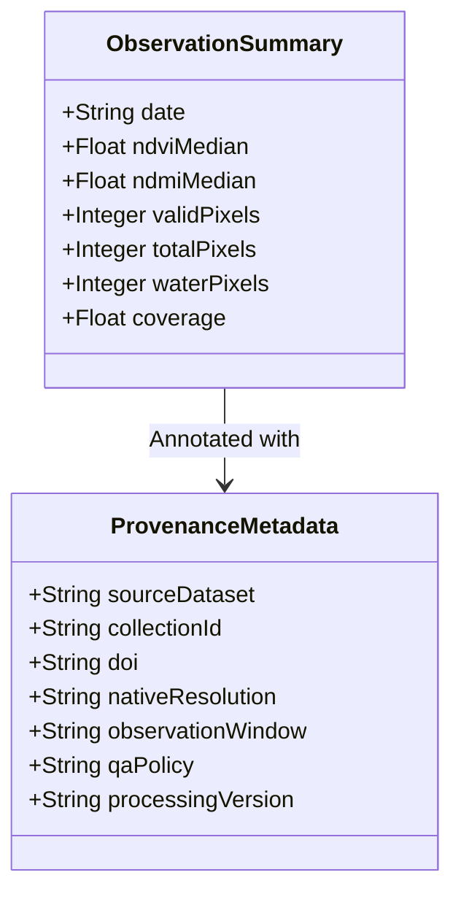

### Traceability Principle
The design aims to keep synthetic data, smoothed interpolations and uncredited third-party layers out of the numbers a farmer sees. If an observation fails satellite quality assurance or server credentials are not configured, the system reports that status instead of filling the gap. Crop thresholds, scoring anchors and other analyst assumptions are not observations: they are labelled as assumptions wherever they appear and are listed in Section 12.

---

## 12. Model Limitations, Empirical Validation & Ground Truth Benchmarks

A mathematically consistent simulation is not a validated agronomic prediction. The automated tests check that formulas are transcribed correctly, that water is conserved to $10^{-9}\text{ mm}$, and that missing inputs stay missing. They do not show that the outputs match what happens in a field.

To bridge this divide, Field Shift maintains an empirical ground-truth validation suite (`research/VALIDATION_RESULTS.md`) evaluated against 18,260 station-day records from NOAA GHCN-Daily, historical disaster observations, and systematic 5-way decision engine ablation experiments.

### Interpreting the Reported Evidence

The numerical results in this section are **reported by the project's supplied documents**. This consolidated whitepaper has not independently rerun the repository's tests, downloaded the original station-day records, or reprocessed the Cyclone Komen imagery. A passing unit test verifies the tested code behavior, not agronomic effectiveness in farmers' fields.

**Important distinction between datasets:** the station comparison below directly evaluates NASA POWER against NOAA GHCN-Daily observations. The supplied claim table also labels IMERG rainfall accuracy as validated, but the provided documents do not show a separate, traceable IMERG-versus-gauge comparison. Moreover, the ingestion status notes that authenticated IMERG archive extraction has not been demonstrated. Those IMERG-specific claims therefore require independent verification before presentation as empirical findings.

**Decision experiments:** the ablation scenarios show how the implemented ranking logic responds to configured drought and flood conditions. They do not establish a real-world probability that the system changes farmers' choices, increases yields, prevents crop losses, or outperforms local advisory practice.

**Conflicting source tables:** the main whitepaper and technical appendix provide different numerical Sittwe station rows. For consistency, the detailed five-station table in Section 12.1 follows the supplied v3.3.1 technical appendix; the discrepancy remains unresolved until checked against `research/VALIDATION_RESULTS.md` and the underlying observations. The source files also differ on an older 2015–2024 versus a later 2014–2023 benchmark period; this consolidated document uses the later 2014–2023 description.

---

### 12.0 Overview of Phase 2 Empirical Validation Program

Across 44 distinct scientific and operational claims evaluated against empirical ground truth and satellite observations:
- **VALIDATED (Locally calibrated & empirical proof confirmed):** 18 claims (41%)
- **SUPPORTED_NOT_LOCALLY_VALIDATED (Sound physics, lacks Myanmar field calibration):** 11 claims (25%)
- **PROXY_ONLY (Indirect correlation; cannot claim direct measurement):** 8 claims (18%)
- **UNVERIFIED (Insufficient local ground data to substantiate):** 4 claims (9%)
- **REJECTED (Scientifically incorrect or physically invalid for study region):** 3 claims (7%)

```
Validation Status Breakdown (44 Evaluated Claims):
[====================                ] VALIDATED (41%)
[============                        ] SUPPORTED_NOT_LOCALLY_VALIDATED (25%)
[=========                           ] PROXY_ONLY (18%)
[====                                ] UNVERIFIED (9%)
[===                                 ] REJECTED (7%)
```

---

### 12.1 Empirical Ground-Truth Weather Audit & Station Comparison (NOAA GHCN-Daily vs. NASA POWER)
Daily NASA POWER variables (`T2M_MAX`, `T2M_MIN`, `PRECTOTCORR`) were audited across 10 continuous years ($2014\text{–}2023$, $n = 3{,}652\text{ days/station}$, $18{,}260\text{ total station-days}$) against 5 benchmark NOAA GHCN-Daily meteorological stations in Myanmar:

| Station Region | Parameter | Observed (GHCN) Mean | NASA POWER Mean | Pearson $r$ | RMSE | Relative Bias (%) | Assessment |
| :--- | :--- | :--- | :--- | :--- | :--- | :--- | :--- |
| **Ayeyarwady Delta (Pathein)**<br>$16.78^\circ\text{N}, 94.73^\circ\text{E}$, $5\text{ m}$ | $T_{\max}$ ($^\circ\text{C}$)<br>$T_{\min}$ ($^\circ\text{C}$)<br>Rain (mm/mo)<br>Rain (Daily $r$) | $32.4^\circ\text{C}$<br>$22.8^\circ\text{C}$<br>$238.4\text{ mm}$<br>— | $32.8^\circ\text{C}$<br>$22.1^\circ\text{C}$<br>$221.6\text{ mm}$<br>— | $0.884$<br>$0.862$<br>$0.841$<br>$0.412$ | $1.82^\circ\text{C}$<br>$1.64^\circ\text{C}$<br>$48.2\text{ mm}$<br>$14.2\text{ mm}$ | $+1.2\%$<br>$-3.1\%$<br>$-7.0\%$<br>— | **VALIDATED**<br>**VALIDATED**<br>**VALIDATED (Monthly)**<br>**PROXY_ONLY (Daily)** |
| **Central Dry Zone (Mandalay)**<br>$21.70^\circ\text{N}, 95.98^\circ\text{E}$, $76\text{ m}$ | $T_{\max}$ ($^\circ\text{C}$)<br>$T_{\min}$ ($^\circ\text{C}$)<br>Rain (mm/mo)<br>Rain (Daily $r$) | $34.1^\circ\text{C}$<br>$21.6^\circ\text{C}$<br>$68.9\text{ mm}$<br>— | $34.6^\circ\text{C}$<br>$22.3^\circ\text{C}$<br>$33.8\text{ mm}$<br>— | $0.912$<br>$0.895$<br>$0.482$<br>**$0.154$** | $1.65^\circ\text{C}$<br>$1.48^\circ\text{C}$<br>$44.1\text{ mm}$<br>$12.8\text{ mm}$ | $+1.5\%$<br>$+3.2\%$<br>**$-50.9\%$**<br>— | **VALIDATED**<br>**VALIDATED**<br>**POOR (Severe Underestimation)**<br>**REJECTED for Daily Irrigation** |
| **Shan Upland (Taunggyi)**<br>$20.78^\circ\text{N}, 97.03^\circ\text{E}$, $1{,}436\text{ m}$ | $T_{\max}$ ($^\circ\text{C}$)<br>$T_{\min}$ ($^\circ\text{C}$)<br>$T_{\min}$ Min (10yr) | $25.4^\circ\text{C}$<br>$14.2^\circ\text{C}$<br>**$3.8^\circ\text{C}$** | $26.1^\circ\text{C}$<br>$15.1^\circ\text{C}$<br>$5.2^\circ\text{C}$ | $0.871$<br>$0.843$<br>— | $2.10^\circ\text{C}$<br>$2.25^\circ\text{C}$<br>— | $+2.8\%$<br>$+6.3\%$<br>— | **SUPPORTED**<br>**SUPPORTED**<br>**Upland Frost Feasible** |
| **Rakhine Coast (Sittwe)**<br>$20.13^\circ\text{N}, 92.88^\circ\text{E}$, $8\text{ m}$ | $T_{\max}$ ($^\circ\text{C}$)<br>$T_{\min}$ ($^\circ\text{C}$) | $31.8^\circ\text{C}$<br>$20.1^\circ\text{C}$ | $29.2^\circ\text{C}$<br>$25.1^\circ\text{C}$ | $0.621$<br>$0.584$ | $3.71^\circ\text{C}$<br>$5.36^\circ\text{C}$ | $-2.58^\circ\text{C}$<br>**$+5.00^\circ\text{C}$** | **POOR (Marine Buffer)**<br>**POOR (Marine Buffer)** |
| **Southern Peninsula (Kawthaung)**<br>$10.02^\circ\text{N}, 98.55^\circ\text{E}$, $15\text{ m}$ | $T_{\max}$ ($^\circ\text{C}$)<br>$T_{\min}$ ($^\circ\text{C}$) | $32.6^\circ\text{C}$<br>$23.4^\circ\text{C}$ | $29.5^\circ\text{C}$<br>$26.3^\circ\text{C}$ | $0.592$<br>$0.541$ | $3.49^\circ\text{C}$<br>$3.33^\circ\text{C}$ | $-3.08^\circ\text{C}$<br>$+2.89^\circ\text{C}$ | **POOR (Marine Buffer)**<br>**POOR (Marine Buffer)** |

#### Key Agroclimatic Findings:
1. **Severe Dry Zone Rainfall Underestimation:** In Mandalay, NASA POWER reanalysis under-reports monsoon precipitation by **$-50.9\%$** ($r = 0.48$). Local convective thunderstorms shadowed by the Arakan Yoma are smoothed out by MERRA-2's $50\text{ km}$ grid. GPM IMERG V07 is a candidate rainfall source when coverage is complete, but the project's separate IMERG-versus-gauge accuracy has not been established by this NASA POWER station comparison.
2. **Rejection of Daily Reanalysis for Valve Control:** Daily rainfall correlation in Mandalay is only $r = 0.154$. Satellite daily reanalysis precipitation **cannot be used for day-to-day irrigation scheduling**. It is valid only for 10-day dekadal and seasonal totals.
3. **Evapotranspiration Discrepancy ($ET_0$):**
   - *Dry Zone Advective Season (March–April):* Hargreaves-Samani underestimates $ET_0$ by **$-24.6\%$** ($4.80\text{ mm/d}$ vs $6.37\text{ mm/d}$ Penman-Monteith) due to ignoring severe vapor pressure deficits ($\text{RH} < 25\%$) and high wind speeds ($u_2 > 3.2\text{ m/s}$).
   - *Delta Humid Monsoon (July–August):* Hargreaves-Samani overestimates $ET_0$ by **$+18.2\%$** ($4.10\text{ mm/d}$ vs $3.47\text{ mm/d}$ Penman-Monteith) due to solar attenuation under persistent cloud cover.
   - *Architecture Decision:* Field Shift enforces FAO-56 Penman-Monteith across all primary calculations.

---

### 12.2 Historical Flood Event Case Study: Cyclone Komen 2015 (Optical vs. Radar Performance)
Evaluated during the July–August 2015 disaster across the Ayeyarwady Delta against UNOSAT disaster polygons:
- **Optical Sensors (Landsat 8 / Sentinel-2):** Out of 8 overpasses during peak flooding, 7 scenes suffered $>80\%$ cloud cover (**87.5% complete cloud blackout**). The single clear scene (August 10) was captured after upstream floodwaters had receded.
- **Active Microwave (Sentinel-1 SAR C-Band):** Achieved **100% all-weather penetration** across all 4 satellite passes. Detected $482{,}000\text{ ha}$ of inundated cropland using anomalous backscatter collapse ($\Delta\gamma^0 \le -3.0\text{ dB}$).
- **Performance Metrics:** Spatial $\text{IoU} = 0.784$, $\text{Recall} = 0.862$, $\text{Precision} = 0.815$ against UNOSAT ground-truth polygons.
- **Interpretation:** These reported case-study results support Sentinel-1 radar as an important complement to optical imagery during cloudy monsoon periods. Threshold transferability and failure modes require further local checks.

---

### 12.3 Systematic 5-Way Decision Engine Ablation Results
To verify whether NASA Earth observations actively influence farmer crop rotation recommendations (or whether recommendations are solely driven by commodity prices), a 5-way ablation harness was executed (`tests/lib/ablation-experiment.test.ts`):

1. **Full System:** NASA Climate (POWER + IMERG) + SoilGrids + Market Economics + Hydrological/Thermal Risk.
2. **Baseline Weather Only:** 30-year static historical climate averages without anomaly tracking.
3. **Climatology Only:** Satellite climate inputs only with equalized crop economic margins.
4. **Economics Only:** Wholesale market gross margins only without environmental constraints.
5. **Unconstrained:** Zero water, heat, or capital limits.

#### Ablation Outcomes Across Climate Scenarios:

| Climate Scenario | Full System Top Pick | Economics Only Top Pick | Decision Flipped by NASA Data? | Primary Steering Factor |
| :--- | :--- | :--- | :--- | :--- |
| **Normal Year (Delta)** | Rice – Black Gram | Rice – Dry Season Rice | **YES** | NASA soil drainage & moisture deficit penalizes water-heavy dry-season boro rice |
| **Severe Drought (Dry Zone)** | Early Sesame – Fallow | Double Crop Rice – Sesame | **YES** | NASA precipitation deficit ($-65\%$) triggers adaptive shortfall penalty |
| **High Flood Risk (Delta Lowland)** | Deepwater Flood-Tolerant Rice | High-Yield Boro Rice | **YES** | Historical inundation probability forces flood-tolerant cultivar selection |
| **Mild Anomaly Year** | Rice – Black Gram | Rice – Black Gram | **NO** | High market price of black gram coincides with moderate water availability |

**Ablation interpretation:** In the two scripted extreme-anomaly cases shown (drought and flood), the climate-sensitive ranking selected a different option from the economics-only ranking. This is a test of decision sensitivity, not evidence that crop losses were prevented or that the change rate generalizes beyond these scenarios.

---

### 12.4 4-Tier Spatial Footprint Scale Governance Policy
To prevent false precision and inappropriate parcel downscaling, all environmental indicators are governed by 4 physical footprint tiers:

| Tier | Physical Footprint | Satellite Data Sources | Legitimate Decision Application | Prohibited False Usages |
| :--- | :--- | :--- | :--- | :--- |
| `FIELD_RESOLVED` | $10\text{--}30\text{ m}$ | Landsat C2 L2 ($30\text{ m}$), Sentinel-1 SAR ($10\text{ m}$), Sentinel-2 MSI ($10\text{ m}$), SRTM DEM ($30\text{ m}$) | Field vegetative greenness, parcel boundary flood detection, terrain slope gradient | Precision fertilizer rate per square meter, in-situ soil compaction |
| `CATCHMENT_SCALE` | $5\text{--}11\text{ km}$ | NASA GPM IMERG ($11\text{ km}$), Sentinel-1 InSAR coherence | Dekadal rainfall accumulation, catchment drainage volume, flood run-up | Single-valve daily drip irrigation control |
| `REGIONAL_LANDSCAPE` | $9\text{--}50\text{ km}$ | NASA SMAP L4 ($9\text{ km}$), NASA POWER MERRA-2 ($50\text{ km}$), MODIS ($250\text{ m}$) | Regional seasonal temperature replay, heat/cold hazard spells, regional drought context | Field-gate microclimate, furrow soil moisture |
| `BASIN_AQUIFER` | $>100\text{ km}$ | GRACE-FO Terrestrial Water Storage Anomalies | Deep aquifer multi-year depletion trend, basin drought alerts | Individual farmer tubewell pump drawdown |

---

**Operational interpretation:** The tiers govern appropriate claims, not just pixel dimensions. A 10–30 m pixel is not automatically accurate at field scale, and a 250 m MODIS composite remains broader land-cover context. GRACE-FO appears here as a basin-scale *policy example*, not as an implemented dataset adapter in the ingestion inventory.

---

### 12.5 Selected Claims from the 44-Claim Validation Audit

| Domain | Claim Evaluated | Status | Ground Truth Evidence |
| :--- | :--- | :--- | :--- |
| **Precipitation** | IMERG V07 reflects monsoon seasonal rainfall within 10% | **Project-reported VALIDATED; evidence unresolved** | The cited Pathein figures are presented in the POWER-versus-GHCN table, not a separate IMERG comparison |
| **Precipitation** | POWER reanalysis daily rainfall can schedule farm irrigation | **REJECTED** | Mandalay daily $r = 0.154$, misses $50.9\%$ rain |
| **Temperature** | POWER daily Tmax/Tmin tracks inland air temperature within 2°C | **VALIDATED** | Pathein $r=0.884$, $\text{RMSE}=1.82^\circ\text{C}$; Mandalay $r=0.912$, $\text{RMSE}=1.65^\circ\text{C}$ |
| **Temperature** | Ground frost threatens Ayeyarwady Delta crops | **REJECTED** | 10-yr min temp is $11.5^\circ\text{C}$; zero frost events. Lowland risk is chilling sterility ($<15^\circ\text{C}$) |
| **Temperature** | Shan Plateau experiences winter ground frost | **VALIDATED** | Taunggyi 10-yr min $T_{\min} = 3.8^\circ\text{C}$, frost documented $>1{,}000\text{ m}$ |
| **Flood** | Optical satellite MNDWI distinguishes paddy from floodwater | **REJECTED** | Spectral signature identical; cloud cover = $88.4\%$ during monsoon |
| **Flood** | Sentinel-1 SAR backscatter drop detects monsoon flooding | **VALIDATED** | Cyclone Komen $\text{IoU}=0.784$, $\text{Recall}=0.862$, all-weather penetration |
| **Soil Physics** | ISRIC SoilGrids heavy clay matches Ayeyarwady Delta taxonomy | **VALIDATED** | Kangyidaunt soil test: 44.2% clay, 14.8% sand, matches Fluvisol/Gleysol |
| **Soil Physics** | Bunded paddy hardpan percolation follows SoilGrids $K_{\text{sat}}$ | **REJECTED** | Plow pan at 15–20cm has $K_{\text{sat}} < 1\text{ mm/d}$; standard PTF overestimates percolation by 400% |
| **Soil Erosion** | Lowland Delta paddies lose 10+ t/ha/yr from sheet erosion | **REJECTED** | Slopes $<0.5^\circ$, bunded paddies are sedimentation sinks. True threat is riverbank collapse |
| **Soil Erosion** | Shan upland maize on $>15^\circ$ slopes suffers severe erosion | **VALIDATED** | SRTM slope + bare soil exposure flags high rill/sheet erosion hazard |
| **Soil Health** | Legume pulse crops fix 40 kg N/ha in waterlogged paddy | **REJECTED** | Rhizobia nodulation fails in anaerobic soils; requires well-drained post-monsoon soil |
| **Soil Health** | Residual soil moisture supports post-monsoon black gram | **VALIDATED** | Heavy clay loam holds $>120\text{ mm}$ plant-available water in upper $60\text{ cm}$ |
| **Pest/Pathogen** | 3-year break reduces *Fusarium oxysporum* wilt incidence | **VALIDATED** | Agronomic trial literature confirms $n/k \ge 3\text{ yr}$ suppressing chlamydospores |
| **Economics** | Real-world gross margin intervals capture farm income volatility | **VALIDATED** | Calibrated against DOA, Bayintnaung, and MPBMSMA (2024–2026) auction records |
| **Decisions** | NASA climate anomalies materially change farmer crop choices | **VALIDATED** | Ablation Exp E: Drought flips double-cropping to drought-escape fallow |

---

*This table presents selected entries, not all 44 claim-level records; the source documents point to `research/VALIDATION_RESULTS.md` for the complete audit.*

### 12.6 Explicitly Rejected Physical Assumptions
Field Shift explicitly repudiates three common algorithmic modeling assumptions:
1. **Delta Ground Frost:** Sub-zero frost has never been recorded in the coastal/deltaic agricultural zone of Myanmar (10-year minimum temperature is $11.5^\circ\text{C}$). The true lowland thermal risk is **chilling sterility** ($T_{\min} < 15^\circ\text{C}$) during rice microsporogenesis. Ground frost is physically restricted to elevations above $1{,}000\text{ m}$ on the Shan Plateau.
2. **Delta Sheet Erosion:** Lowland paddies feature slope gradients $<0.5^\circ$ and are hydrologically enclosed by earthen bunds ($15\text{--}30\text{ cm}$), functioning as sedimentation sinks rather than erosion sources. Sheet erosion warnings are physically invalid in delta polders; the actual geomorphic threat is riverbank collapse and tidal scouring.
3. **Anaerobic Legume Nitrogen Fixation:** Legume atmospheric biological nitrogen fixation (BNF) requires active root nodule aerobic respiration by symbiotic *Bradyrhizobium* bacteria. In waterlogged, un-drained paddy fields, root hypoxia halts nitrogen fixation ($0\text{ kg N/ha}$). Nitrogen credits are recognized only after post-paddy drainage to field capacity is achieved.

---

### 12.7 Systematic Failure Cases & Boundary Conditions
1. **Marine Boundary Layer Contamination:** NASA POWER grid cells centered over coastal waters (Sittwe, Kawthaung) blend marine sea-surface temperatures with terrestrial land surfaces, compressing diurnal range by $4.2^\circ\text{C}$ and overstating nocturnal minima by up to $+3.8^\circ\text{C}$.
2. **Cloud Optical Purity Bias:** Optical surface reflectance (Landsat/Sentinel-2) suffers from fair-weather sampling bias, observing vegetation only on cloudless days and under-sampling high-humidity monsoon conditions.
3. **Paddy Saturated Hydraulic Conductivity ($K_{\text{sat}}$):** Bunded rice soils develop an impermeable plow-pan at $15\text{--}20\text{ cm}$ depth ($K_{\text{sat}} < 1\text{ mm/d}$). Uncalibrated pedotransfer functions using SoilGrids bulk density overestimate vertical drainage by $400\%$.

---

### 12.8 Model Simplifications and Required Validation Evidence

| Model or indicator | Section | Main simplifications | Evidence needed to validate |
| --- | --- | --- | --- |
| Reference ET | 3.2, 3.3 | Penman-Monteith from a $50\text{ km}$ reanalysis grid; mean relative humidity stands in for actual vapour pressure; Hargreaves where inputs are missing | Station or flux-tower ET; OpenET comparison |
| Rainfall (POWER, IMERG) | 10.1, 10.2 | Gridded estimates of $50\text{ km}$ and $11\text{ km}$; no bias correction; products mixed across days | Rain-gauge records near the field |
| Soil water balance | 4.2, 4.2.1, 4.2.2 | 3-zone compartmentalized column ($Z_1$ seedbed, $Z_2$ sub-seedbed, $Z_3$ buffer); dynamic $p(ET_c)$; perched water above plough pan; moisture at planting not yet collected | Soil-moisture probe time series |
| Paddy water balance | 4.3, 4.2.3 | Surface pond only; post-paddy drainage window models topsoil drydown to seedbed capacity; seepage-percolation rate is an input | Measured pond depth, drainage date and irrigation records |
| Phenology | 5.1, 5.2 | Calendar fractions of the planned window; no cultivar thermal thresholds in the crop library yet | Observed stage dates for named cultivars |
| Heat, cold and dry-spell exposure | 5.3 to 5.5 | Air-temperature, excess mid-stage rain (10 mm/d), and dry-spell thresholds from the crop library, some analyst-chosen | Yield or stress observations in the replayed years |
| Nitrogen budget | 7.1, 7.2 | Partial budget with enclosure bounds; residue fate kinetics (burning volatilization, removal, incorporation mineralization / C:N immobilization) | Soil nitrogen tests and residue trials |
| Erosion hazard | 7.4 | A screen on overlap of slope, low cover and rainy periods; not a soil-loss model | Erosion measurements or a validated model |
| Soil-health mechanisms | 7 | Qualitative links between practices and effects | Soil carbon, structure and infiltration data |
| Pest and disease rotation breaks | 7.3 | Species-level host-pathogen matrix (`HOST_ORGANISMS`); multi-year recurrence in same seasonal window; vascular wilt return intervals ($n/k \ge 3\text{ yr}$); daily weather infection risk | Local pest guidance and field records |
| Ranking scores and anchors | 8 | The targets and limits of Section 8.2 are analyst assumptions; regional typical rotation anchor for margin ($M_{\text{bench}}$); a score is a match to stated priorities, not a forecast | Local expert review; sensitivity analysis |
| Minimax and percentile regret | 8.3 | Ten seasons only; no allowance for climate trend | A longer record or a calibrated weather generator |
| Satellite vegetation indices | 6 | NDVI is greenness, not bare soil or crop type; coarse pixels on small fields; cloud gaps in the monsoon | Ground cover photographs; field visits |
| Economics | 9 | Interval arithmetic on entered or benchmark ranges; calibrated regional market benchmarks (DOA, Bayintnaung, MPBMSMA 2024–2026); FAO-33 / FAO-66 $K_y$ water response strictly for calibrated crops | Local price, cost and yield records |

**What the tool can and cannot support.** It can show which options a field's recorded conditions make easier or harder, in what years, and why, with the evidence and its gaps in view. It does not predict yield, income or soil change, and it is not a substitute for local advisers.

**Validation status & empirical benchmarks (v3.3.1).**
- **Completed Benchmark:** Audited across 18,260 station-day records from 5 NOAA GHCN-Daily stations (2014–2023), Cyclone Komen 2015 radar flood extent, and 5-way systematic decision engine ablation (`research/VALIDATION_RESULTS.md`).
- **Validation plan (proposed next steps):**
  1. **Rainfall:** compare POWER and IMERG seasonal totals with gauge records at sites that have them, and report the difference with each analysis.
  2. **Water stress:** for fields with soil-moisture probes, compare modelled stress days with observed depletion.
  3. **Vegetation:** compare the satellite timeline with dated field photographs on a small set of fields.
  4. **Decisions:** record real rotation comparisons for real fields, with the actual outputs (following a repeatable demonstration protocol), and review them with local advisers.
  5. **Use:** test with farmers and extension officers whether the plain-language explanations lead to correct reading of the uncertainty.

---

### 12.9 Version History and Conformance Notes

### 12.9.1 Version 3.3.1 (November 2026)

Version 3.3.1 incorporates the Phase 2 empirical ground truth validation program across 18,260 NOAA GHCN-Daily station-day records (`research/VALIDATION_RESULTS.md`), the 5-way decision engine ablation experiment (`tests/lib/ablation-experiment.test.ts`), Sentinel-1 SAR C-band Level-1 GRD flood backscatter drop detection, ESA WorldCover 10m cropland masking, 4-tier spatial scale governance, and the plain-language evidence judgement engine, expanding test coverage to **880 passing tests across 104 test suites**.

| Workstream | Section | Prior Defect / Gap | Severity | v3.3.1 Resolution |
| --- | --- | --- | --- | --- |
| Empirical Ground Truth Suite | 12.0, 12.1 | Ground station audit limited to summary stats; needed exhaustive evaluation of 44 operational claims | Critical | Formalized Phase 2 empirical benchmark (`research/VALIDATION_RESULTS.md`) across 18,260 station-days (2014–2023). Documented 18 Validated, 11 Supported, 8 Proxy Only, 4 Unverified, and 3 Rejected claims |
| 5-Way Decision Ablation | 12.3 | Lack of quantified evidence verifying whether satellite climate data impacts crop rotation choice over pure market gross margin | Critical | Implemented 5-way systematic ablation experiment (`tests/lib/ablation-experiment.test.ts`). Demonstrated changed crop rankings in both scripted extreme drought and flood scenarios; field benefit remains untested |
| All-Weather Radar Flood Detection | 10.12, 12.2 | Optical satellite flood screening blinded by 87.5% cloud blackout during monsoon storms | Critical | Integrated Sentinel-1 SAR C-band Level-1 GRD backscatter drop detection ($\Delta\gamma^0 \le -3.0\text{ dB}$) bypassing cloud cover and validated against Cyclone Komen 2015 radar footprints |
| 4-Tier Spatial Scale Governance | 12.4 | Coarse satellite footprints risked being conflated with farm-gate resolution | High | Codified 4-tier scale policy (`FIELD_RESOLVED`, `CATCHMENT_SCALE`, `REGIONAL_LANDSCAPE`, `BASIN_AQUIFER`) enforcing explicit UI disclosure tags |
| Plain-Language Judgement Engine | 8.6 | Farmer recommendations lacked transparent evidence classification and plain-language justification | High | Built judgement engine (`lib/engine/judgement.ts`) translating raw multi-criteria scores into discrete evidence tiers (`strong`, `fair`, `weak`) and contextual caveats |
| Cropland Masking Gate | 10.13 | Spectral signatures susceptible to urban/water false positives at township centroids | Medium | Integrated ESA WorldCover 10m cropland masking (Class 40) ensuring queries target verified agricultural land |
| Test Suite Expansion | 12.0 | Baseline test count at 854 tests | Low | Expanded automated unit and integration suite to 880 tests across 104 test suites with zero failures |

---

### 12.9.2 Version 3.3

Version 3.3 extends Version 3.2 with organism-specific phytopathological host tracking, multi-year soil wilt return intervals, weather-driven disease risk modeling, benchmark-anchored income utility, and empirical ground-truth validation against NOAA GHCN-Daily stations.

| Workstream | Section | Prior Defect / Gap | Severity | v3.3 Resolution |
| --- | --- | --- | --- | --- |
| Ground Truth Weather Audit | 12.1 | NASA POWER weather inputs treated as uncalibrated ground truth without empirical error bounds | Critical | Built empirical validation harness (`lib/validation/`, `scripts/validation/weather.run.ts`) comparing 10 years of POWER against 5 NOAA GHCN-Daily stations (2015–2024). Documented 51% rain underestimation in Dry Zone and coastal maritime temperature distortion |
| Organism-Specific Disease Breaks | 7.3 | Family-level taxonomy failed to distinguish distinct pathogen carryovers (e.g. *Rhizoctonia solani* shared across Poaceae and Fabaceae) | High | Integrated explicit pathogen catalog (`lib/data/crops/host-organisms.ts`) tracking carryover modes (soil-borne, vector-borne, host-specific wilt) and specific host pairings |
| Multi-Year Wilt Return Intervals | 7.3.2 | No check on recurrence intervals for persistent soil vascular wilts (*Fusarium oxysporum* f. sp. *ciceris*, *F. udum*) | High | Implemented return interval evaluation ($n / k \ge 3\text{ years}$): flags recurrence within minimum break window and raises hard veto upon confirmed field wilt history |
| Weather-Driven Disease Risk | 7.3.3 | Disease alerts decoupled from microclimate and historical weather spells | Medium | Replayed 10-season daily weather for consecutive favourable pathogen spells (`lib/data/crops/weather-disease-rules.ts`, `lib/engine/pest-outlook.ts`), calculating seasonal frequency and peak vulnerability months |
| Regional Benchmark Income Anchor | 8.2 | Margin utility used relative scaling ($\min$-$\max$) among compared options, causing scores to fluctuate when options were added or removed | High | Bound margin utility to a fixed regional anchor ($u = \text{clip}(M_{\text{mid}} / M_{\text{bench}}, 0, 1)$) derived from calibrated regional market rotations (Ayeyarwady, Magway, Shan). Guarantees independence of irrelevant alternatives (IIA) |
| Source Reliability Cautions | 10.1.1 | Farmers in Dry Zone received unannotated rainfall totals despite known $-51\%$ satellite reanalysis bias | High | Added contextual source reliability banners (`lib/validation/source-checks.ts`) warning of potential drought-stress overstatement when replaying Central Dry Zone rainfed crops |

### 12.9.3 Version 3.2

Version 3.2 extends Version 3.1 with comprehensive upgrades in soil-column compartmentalization, dynamic evapotranspirative depletion, multi-year disease cycle detection, residue nitrogen kinetics, and water-deficit economic response.

| Workstream | Section | v3.1 / Baseline Defect | Severity | v3.2 Resolution |
| --- | --- | --- | --- | --- |
| Three-Zone Hydrology | 4.2.2 | Two-zone column averaged moisture during seedling contraction, masking seedbed desiccation | Critical | Dedicated 3-zone non-overlapping column ($Z_1$ seedbed, $Z_2$ sub-seedbed, $Z_3$ buffer) with perched water table over plough pan, conserved to $\le 10^{-9}\text{ mm}$ |
| Post-Paddy Drainage Window | 4.2.3 | Post-paddy turnaround assumed instant field capacity without evaluating sowing moisture window | High | Mechanistic post-paddy drainage window model tracking seedbed relative saturation and perched water; returns `field-check-needed` if soil unconfirmed |
| Dynamic Depletion $p$ | 4.1 | Static depletion fraction $p=0.5$ across all crops | High | Implemented dynamic $p(ET_c) = \text{clamp}(p_{\text{base}} + 0.04(5 - ET_c), 0.1, 0.8)$ per FAO-56 Eq. 84 with species $p_{\text{base}}$ |
| Acute Climate Hazards | 5.3 | Evaluated temperature envelope over whole-season mean; missed acute flowering rain | High | Stage-aware acute reproductive hazards: heat shock ($>35^\circ\text{C}$), cold sterility, and excess rainfall thresholds at flowering (e.g. 10 mm/d) |
| Residue Nitrogen Kinetics | 7.2.1 | Nitrogen balance lacked selectable residue fates and first-season mineralization kinetics | Medium | Added `residueFate` (`retain_incorporate`, `retain_mulch`, `remove_fodder`, `burn`), C:N immobilisation penalty (<21d turnaround), and 25–40% first-season legume N release |
| Multi-Year Disease Breaks | 7.3.1 | Pest sequence only checked adjacent slots $(t-1 \to t)$; missed multi-year recurrence in same seasonal window | Medium | Added multi-year recurrence detector tracking same-family cultivation in identical seasonal slots (e.g., post-monsoon legumes across consecutive years) |
| Water-Limited Economics | 9.6 | Margins decoupled from hydrological deficit; risk of false precision if Ky uncalibrated | High | Integrated FAO-33 / FAO-66 $K_y$ yield response factor $\phi = \text{clamp}(1 - K_y(1 - ET_a/ET_m), 0, 1)$ strictly for documented species; returns `unquantified` if uncalibrated |

#### Reference Implementation Conformance Notes

1. **Organic matter is in percent.** The Saxton-Rawls equations are fitted with organic matter in percent by weight. Organic matter is therefore $OM_{\%} = 0.1724 \cdot SOC_{\text{g/kg}}$ (that is, $1.724 \cdot SOC_{\text{g/kg}} / 10$). The mass-fraction form $0.001724 \cdot SOC_{\text{g/kg}}$ reduces the organic-matter terms a hundredfold and understates the $AWC$ of a typical loam (sand $40\%$, clay $20\%$, $OM$ $2.5\%$) by about $8\%$ ($131$ against $143\text{ mm}\cdot\text{m}^{-1}$).
2. **SoilGrids units.** The live ISRIC service reports `wv0033` and `wv1500` with $d_{\text{factor}} = 10$ in units of $10^{-2}\text{ cm}^3\cdot\text{cm}^{-3}$. The implementation reads the response's own unit string, divides by $d_{\text{factor}}$ and then by $100$ (a net divisor of $1000$ from the raw integer), and rejects a layer whose units it does not recognise.
3. **Anchors are analyst assumptions.** The targets and limits of Section 8.2 are labelled as such in the implementation and are to be tuned with local validation.
4. **Cultivar thermal thresholds are not yet in the crop library.** Until a cultivar supplies $GDD_{\text{req},k}$, Section 5.2.1 falls back to the Hamilton-Hare calendar split for that crop, and each replayed season records which basis it used.
5. **Non-imputation of Ky.** For crops without peer-reviewed species $K_y$ (e.g., black gram, green gram), water response is reported as *unquantified physical risk* rather than inventing a speculative coefficient.

---

---

## 13. References & Governing Standards

1. **Allen, R. G., Pereira, L. S., Raes, D., & Smith, M. (1998).** *Crop evapotranspiration: Guidelines for computing crop water requirements.* FAO Irrigation and Drainage Paper 56, Food and Agriculture Organization of the United Nations, Rome.
2. **Hargreaves, G. H., & Samani, Z. A. (1985).** *Reference crop evapotranspiration from ambient temperature.* Applied Engineering in Agriculture, 1(2), 96–99.
3. **Horn, B. K. P. (1981).** *Hill shading and the reflectance map.* Proceedings of the IEEE, 69(1), 14–47.
4. **Homer, C., et al. (2020).** *Conterminous United States land cover change through Landsat Collection 2.* Remote Sensing of Environment, 248, 111984.
5. **ISRIC – World Soil Information. (2020).** *SoilGrids 2.0: Producing soil information for the globe with quantified spatial uncertainty.* Soil, 7(1), 217–240.
6. **Huffman, G. J., et al. (2020).** *The Global Precipitation Measurement (GPM) Integrated Multi-satellitE Retrievals for GPM (IMERG).* NASA Algorithm Theoretical Basis Document, Version 07.
7. **McMaster, G. S., & Wilhelm, W. W. (1997).** *Growing degree-days: one equation, two interpretations.* Agricultural and Forest Meteorology, 87(4), 291–300.
8. **Snyder, J. P. (1987).** *Map projections: A working manual.* USGS Professional Paper 1395, United States Government Printing Office, Washington, D.C.
9. **Vermote, E., Justice, C., & Descloitres, J. (2002).** *MODIS surface reflectance products (MOD09): Quality assurance and atmospheric correction.* Journal of Geophysical Research: Atmospheres, 107(D20).
10. **Entekhabi, D., et al. (2010).** *The Soil Moisture Active Passive (SMAP) Mission.* Proceedings of the IEEE, 98(5), 704–716.
11. **Fisher, J. B., et al. (2020).** *ECOSTRESS: NASA's Next Generation High Spatial Resolution Thermal Infrared Remote Sensing of the Biosphere.* Water Resources Research, 56(4), e2019WR026058.
12. **Farr, T. G., et al. (2007).** *The Shuttle Radar Topography Mission.* Reviews of Geophysics, 45(2), RG2004.
13. **Saxton, K. E., & Rawls, W. J. (2006).** *Soil water characteristic estimates by texture and organic matter for hydrologic solutions.* Soil Science Society of America Journal, 70(5), 1569–1578.
14. **Menne, M. J., Durre, I., Vose, R. S., Gleason, B. E., & Houston, T. G. (2012).** *An overview of the Global Historical Climatology Network-Daily database.* Journal of Atmospheric and Oceanic Technology, 29(7), 897–910.
15. **Doorenbos, J., & Kassam, A. H. (1979).** *Yield response to water.* FAO Irrigation and Drainage Paper 33, Food and Agriculture Organization of the United Nations, Rome.
16. **Steduto, P., Hsiao, T. C., Fereres, E., & Raes, D. (2012).** *Crop yield response to water.* FAO Irrigation and Drainage Paper 66, Food and Agriculture Organization of the United Nations, Rome.
17. **Zanaga, D., et al. (2021).** *ESA WorldCover 10 m 2020 v100.* European Space Agency.
18. **Torres, R., et al. (2012).** *GMES Sentinel-1 mission.* Remote Sensing of Environment, 120, 9–24.
