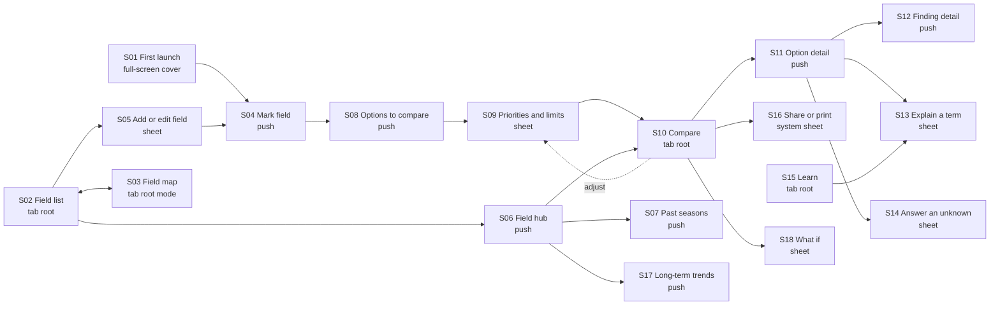

# Field Shift — Product and UX Plan

**Scope:** challenge-aligned (Space Apps 2026, *Field Shift: Adapting Farms with NASA Data*; see whitepaper Appendix A), farmer-centred UX, iOS-native app behaviour, field management, responsive layout, per-screen wireframes and specs, the UI data contract, and the build order.
**Companion documents:** `DESIGN_SYSTEM.md` (tokens, components, layout and per-screen placement; authoritative for visual and placement decisions), `whitepaper.md` (science and status), `whitepaper-technical-appendix.md` (equations and datasets).
**Status labels** follow the whitepaper: **Implemented** (runs and is tested), **Partial** (code exists, gated), **Proposed** (designed, not built). Nothing in Field Shift is validated against field data. Every item in this plan not already marked Implemented in the whitepaper is **Proposed**.

### How an agent should use this plan

1. Read Sections 2, 8, 9 and 21 of this plan and all of `DESIGN_SYSTEM.md` once; they are constraints on every screen.
2. Build in the phase order of Section 12, using the task IDs in Section 22. Each phase lists the screen IDs it covers in Section 19; Section 20 is the submission checklist.
3. For each screen, implement exactly what its spec in Section 16 says: container, route, components, data, states, interactions. Use the data contract in Section 18.
4. Tick the screen's **Acceptance** checkboxes in the pull-request description. A screen is done only when every box is ticked and the Section 8 accessibility checks pass on it.
5. Wireframe text and numbers are placeholders. Never hard-code them as output; every number on screen comes from the comparison engine or the farmer's records.
6. Do not mark anything Implemented in the whitepaper's status tables unless it runs and is tested. Nothing here is "validated".
7. If a spec conflicts with the whitepaper or appendix (for example a formula or a data rule), the whitepaper and appendix win; note the conflict in the PR.

---

## 1. Goals and non-goals

**Goals**
1. A farmer with no map or data training can mark a field, record what they grow, and understand how two or three rotation options would have fared over the last ten seasons.
2. The farmer's priorities and limits (water, equipment, labour, market, household, land) shape the comparison.
3. Every result shows its evidence, its scale, and what is unknown, and points to what a local adviser should check.
4. The app behaves like a native iOS app on iPhone and iPad, and the same structure works in a browser.

**Non-goals**
- Forecasting the coming season, predicting yield or income, or telling the farmer what to plant.
- Accounts, cloud sync of field records, or market data.
- Downscaling coarse data to look field-precise.

---

## 2. Principles

| Principle | What it means in the UI |
| --- | --- |
| Plain words first | Each option leads with one sentence and a count of seasons ("short of rain in 2 of 10 seasons"). Indices and units live one level down |
| Unknown is not zero | *Not known* is shown with a word and an icon, and always with the question or check that would resolve it |
| The farmer's data wins | Anything the farmer enters overrides a gridded estimate and is labelled "you told us" |
| Scale in words | Badges: *Your field* (30 m), *Village area* (≈10 km), *Wider area* (≈50 km), *Estimated map* (SoilGrids) |
| Past, not future | "Past 10 seasons at your field. Not a forecast." on every comparison and printed page |
| Local judgement named | Every report ends with *Check locally*: variety, pests, buyer and price, land rules, local flooding or frost |
| Limits don't hide options | An option that breaks a stated limit is dimmed with the reason, never removed |
| Records stay on the phone | Field records, history, soil tests, priorities and limits are stored on the device; only the location goes to data services |

---

## 3. Information architecture

**Tab bar (compact width) / sidebar (regular width)**

| Tab | Root screen | Purpose |
| --- | --- | --- |
| Fields | Field list (large title, search, List / Map) | Manage fields and their history |
| Compare | Comparison for the selected field | Rotation options side by side |
| Learn | Plain-language explanations | ET, NDVI, soil moisture, dry spells, frost, crop roles |

**Navigation patterns**

| Pattern | Used for |
| --- | --- |
| Push (back chevron, edge swipe) | Field hub, option detail, finding detail, past seasons, long-term trends |
| Sheet, medium and large detents, grabber | Priorities and limits, explain a term, answer an unknown, add or edit a field, what-if test |
| Full-screen cover | First launch only (language, data notice) |
| System share sheet | Share or print a report |
| Context menu (long press, right click) | Field and comparison actions that also exist as swipe actions |

---

## 4. Core flows



### 4.1 First run
1. **First launch** (full-screen cover): choose language (Myanmar Unicode, with a Zawgyi check; English), read a short data notice saying what stays on the phone and what is sent.
2. **Mark field** (map, pushed): open on satellite imagery, search by village, pagoda or river; draw an outline or drop an approximate point; area shown in acres; confirm "This is my field".
2b. **Name and current crop** (S05 form, shown inline in first run): name, current crop, sowing date; "About 2 minutes", everything else "Add later".
3. **Options to compare** (pushed, inset list): the current rotation (crops, sowing and harvest dates, fallow, residue practice) and at least two alternatives from regional templates or built by hand.
4. **Priorities and limits** (sheet): drag four priority cards into order; answer limits (Section 6).
5. **Compare** (tab root): results load from cache first, then update.

### 4.2 Comparing
1. **Compare** shows one card per option with a sentence, a ten-season strip and a 12-month crop calendar; the best match carries the only accent outline on screen.
2. A segmented control switches depth: **Answer / Reasons / Evidence**.
3. A line under the cards states the switching point in words: "If earning mattered as much as soil, Option A would come first."
4. Tapping a card pushes **Option detail**, which explains the option in five parts: why it was suggested, what it could do for the field, the evidence (findings with scale badges), what is not known, and what to check locally. It also has the season strip as two rows of five years, with a neutral recall question ("How was 2022 at your field? Dry / Normal / Wet / Don't know") whose data answer is revealed only after the farmer replies.
5. Tapping a term opens **Explain a term** (sheet, medium detent, read-aloud).
6. Tapping a *Not known* row opens **Answer an unknown** (sheet, one question).
7. **What if** (sheet, from Compare): shift rain and temperature to see how close each option is to the edge; always labelled hypothetical.
8. **Share or print** uses the system share sheet; location can be left off.

### 4.3 Returning
1. **Fields** list shows each field's current crop, its stage, and the count of open questions.
2. Field hub → **Compare options**, or open a saved comparison (frozen with its app version and data dates).

---

## 5. Field management

### 5.1 Field list (Fields tab root)
- Large title, search, List / Map segmented control.
- Grouped by area with a header total ("Ayeyarwady · 3 fields · 7.1 acres").
- Row: thumbnail outline or pin, name, "Rice now · harvest in 3 weeks", open-question badge.
- Swipe left: **Archive**, **Delete**. Edit: multi-select and reorder. Long press: context menu with the same actions.
- Empty state: "Add your first field" with a single button.

### 5.2 Field hub (pushed)
- Map outline at top; name, area, outline or point, confirmed status.
- **Seasons:** current 12-month bar and plan; past seasons list.
- **Soil test**, **Water and limits**, **Notes and photos**, **Comparisons** (saved, frozen).
- One primary button: **Compare options**.
- "Point only" fields offer "Draw outline" to enable the satellite view.

### 5.3 Add or edit field (sheet)
- Required to save: name, location, current crop. Everything else is "Optional, add later".
- Cancel asks before discarding entered data; swipe-down is blocked while there are unsaved changes.
- Footer: "Saved on this phone only".

### 5.4 Lifecycle rules
| Action | Rule |
| --- | --- |
| Archive | Hides the field from the list; keeps history and comparisons; reversible |
| Delete | Confirmation states that history exists only on this phone and will be lost |
| Edit outline | Saved comparisons keep the old outline and are marked as run on an earlier outline |
| Move to another phone | Export and import of a file chosen by the farmer; no account |
| Adviser with many farms | Open question: needs its own privacy decision before any shared workspace is built |

### 5.5 Helpers
- Open-question count per field, fed by *unknowns*.
- Local reminders at season milestones ("Harvest coming: record the date"); local notifications only.
- In-field photos auto-tagged with date and field; usable as labels for greenness changes.

---

## 6. Priorities and limits

**Priority cards** (drag to reorder, rank-sum weights): Save water, Build the soil, Earn more, Feed animals. *Proposed finer choices:* Build the soil → add nitrogen, stop soil washing away, add organic matter, help rain soak in; Earn more → higher margin, crops I can sell nearby, extra income between main crops. Together these cover every priority named in the challenge brief (water use, forage, nitrogen fixation, erosion reduction, organic matter, market suitability). *Implemented:* the four priorities and rank-sum weighting. *Proposed cards to test:* Household food, Less work at peak times, Lower cash outlay.

| Limit | Input | Effect on options | Status |
| --- | --- | --- | --- |
| Water | Rain only, or source plus months available | "Needs water you said you don't have" | Irrigation amounts Implemented; months Proposed |
| Pump | Capacity and hours available | Shortfall converted to pumping hours; flagged if over | Proposed (Appendix 4.4) |
| Equipment, draught power | What they have or can hire | Flags tight turnarounds after harvest | Proposed |
| Labour | Peak periods | Flags harvest and sowing overlaps | Proposed |
| Market | Crops they can sell | "No market you know of" | Proposed |
| Prices, yields, costs | Ranges | Margin ranges | Implemented |
| Household | e.g. must grow own rice | "Does not meet your household need" | Proposed |
| Land | Lease length | Notes when long-term soil benefits don't apply | Proposed |

Rules: an unanswered limit shows **Not asked**, never a pass; a failed limit dims the option with a reason; every limit appears in the report as "you told us".

---

## 7. Screen inventory

| # | Screen | Container | Key components |
| --- | --- | --- | --- |
| 1 | First launch | Full-screen cover | Language picker, data notice |
| 2 | Field list | Tab root | Large title, search, segmented control, inset grouped list, swipe actions |
| 3 | Field map (list's Map mode) | Tab root | Map, field pins and outlines, vulnerability layers, dataset overlay, timeline, floating controls |
| 4 | Mark field | Push | Satellite map, draw, point option, confirm |
| 5 | Add or edit field | Sheet, large | Form in inset grouped list |
| 6 | Field hub | Push | Map header, season bar, grouped rows, primary button |
| 7 | Past seasons | Push | List by year |
| 8 | Options to compare | Push | Current rotation plus at least two alternatives; crop slots with dates and residue |
| 9 | Priorities and limits | Sheet, large | Reorderable list, limit rows |
| 10 | Compare | Tab root | Large title, segmented depth control, option cards, season strip, calendar bar |
| 11 | Option detail | Push | Five-part explanation (why, could do, evidence, not known, check locally), tappable season strip |
| 12 | Finding detail (Evidence) | Push | Source, resolution, dates, valid share, rainfall mix |
| 13 | Explain a term | Sheet, medium | Text, read aloud, "where it comes from" |
| 14 | Answer an unknown | Sheet, medium | One question, three answers |
| 15 | Learn | Tab root | Topic list, crop roles |
| 16 | Share or print | System share sheet | Image or PDF report, optional location |
| 17 | Long-term trends | Push | Per-trend charts with scale badges, trend-test sentence, GRACE gap shown |
| 18 | What if | Sheet, large | Rain and temperature sliders, before/after counts, hypothetical banner |

---

## 8. iOS behaviour requirements

- Tab bar at top level; push for depth; back chevron and left-edge swipe always work (no custom gestures on that edge).
- Sheets for short, self-contained tasks, with grabber and detents; confirm before discarding edits.
- Full-screen cover only where the task must be finished first (first launch).
- Large titles on tab roots, collapsing on scroll; inline titles on pushed screens.
- Touch targets at least 44 × 44 pt.
- Dynamic Type through the accessibility sizes; VoiceOver labels in Myanmar language; Dark Mode; Reduce Motion; Increase Contrast.
- Haptics: light impact when a priority card snaps into place; warning when an option breaks a limit. No decorative haptics.
- Performance: local recomputes (priorities, what-if, answered questions) finish within 400 ms on a mid-range reference phone; cached content renders immediately (Doherty Threshold, Section 21).
- First run shows "Step n of 4" across S04, S05, S08, S09; permissions are requested only when the feature that needs them is tapped.
- System share sheet, date pickers, search field, context menus; no custom replacements.
- Local notifications only; no remote push, which would need an account and a server-side record of the farmer.

---

## 9. Visual design guide (summary; `DESIGN_SYSTEM.md` is authoritative)

### 9.1 Surfaces

| Treatment | Use for | Avoid for |
| --- | --- | --- |
| Flat (solid fill) | Content: option cards, lists, explanations, season strips | Controls floating over the map |
| Translucent (system materials, Liquid Glass on iOS 26) | Controls layer: tab bar, toolbars, controls over the map, sheet chrome | Content cards, text panels, anything over satellite imagery read in sunlight |
| Raised (system shadow) | Sheets and menus the system already elevates | Cards inside a list |
| Inset grouped list | Findings, limits, Check locally, forms | Long prose |
| Accent outline (2 pt) | The single best-match option per screen | More than one element per screen |

### 9.2 Borders and separators
- Separate by spacing first; grouped lists need no outer borders.
- Hairline separators between rows, inset to the text, never above the first or below the last row.
- No full borders on flat cards inside grouped backgrounds.
- **Dashed outlines mean unknown or proposed** and are used for nothing else.

### 9.3 Colour and contrast
- Colour is never the only signal: every status has a word and an icon.
- Amber for *Not known*, red only for destructive actions, accent for links and the best match.
- Aim above the 4.5:1 minimum on the map and Compare screens, which are used outdoors.

### 9.4 Typography and units
- System font with Myanmar script support; no text truncated on decision screens.
- Acres; baskets (*tin*) and viss with per-crop conversions confirmed locally.
- Counts of seasons, never percentages, in the Answer layer.

---

## 10. Responsive behaviour

| Context | Size class or width | Layout |
| --- | --- | --- |
| iPhone portrait | Compact width | Tab bar, one screen at a time; compare cards stacked and swipeable |
| iPhone landscape | Compact height | Map full height with a floating field panel; compare in 2 columns on large phones |
| iPad split view, Stage Manager, portrait | Regular width (varies with window) | Sidebar + list + detail; compare in 2 columns |
| iPad landscape | Regular width | Sidebar + list + detail; compare in 3 columns |
| Browser | < 600 px | Same as iPhone portrait |
| Browser | 600–900 px | List + detail; compare in 2 columns |
| Browser | 900–1200 px | Sidebar + content; compare in 3 columns |
| Browser | ≥ 1200 px | Sidebar + comparison + collapsible evidence panel |

Rules:
- Adapt to the window, not the device; transitions between layouts preserve selection and scroll position.
- Season strips align year by year across columns whenever two or more options are side by side.
- At accessibility text sizes, rows switch from side-by-side to stacked, and the season strip wraps into two rows of five.
- Pointer and keyboard: hover states, ⌘N new field, ⌘F search, drag and drop of photos onto a field, right-click context menus.
- Offline-first: show cached data immediately with "Updated 3 days ago"; never a blank screen while loading.

---

## 11. Content and copy

- Sentence case; verbs first on buttons ("Compare options", "Add field").
- Answer-layer template: *[Option] [ran short of rain / had heat at flowering / was bare in the rains] in [n] of the last 10 seasons, mostly in [month].*
- Unknown template: *[Thing] is not known. [Question or check that would settle it.]*
- Reminder on every comparison and printed page: *This shows how these crops would have done in past years at your field, using satellite and model data. It is not a forecast and not advice. Talk it through with your extension officer or an experienced farmer before deciding.*
- Glossary entries in Learn and term sheets come from whitepaper Section 5.1 and must stay short enough to read aloud.

---

## 12. Build plan

| Phase | Deliverable | Depends on | Done when |
| --- | --- | --- | --- |
| 0. Research | Interviews and paper-prototype tests with farmers and extension officers in Ayeyarwady, Magway and Shan | Interview guide, translated screens | Priority cards, limits list, units and report layers confirmed or revised |
| 1. Foundations | Navigation shell (tabs / sidebar), design tokens, Myanmar localisation, accessibility baseline | Phase 0 findings | All 16 screens reachable; Dynamic Type and VoiceOver pass on core flow |
| 2. Field management | Field list, hub, add/edit, archive/delete, export/import | Phase 1 | A field can be created, edited, archived, exported and re-imported with history intact |
| 3. Compare v1 | Compare and option detail on the existing engine; Answer / Reasons / Evidence; scale badges; Check locally | Phase 2; existing engine | Demonstration steps 1–4 in whitepaper Section 9 can be run from the UI |
| 4. Limits and unknowns | Limit inputs and checks; Answer-an-unknown sheet; Not asked state; finer priorities | Phase 3 | Every limit in Section 6 produces pass, fail-with-reason or Not asked |
| 4b. Trends, maps and what-if | S17 trends (POWER since 1981, SMAP, GRACE/GRACE-FO), S03 map layers, S18 what-if | Phase 3; Earthdata credentials for SMAP and GRACE | Trend sentences match test results; layers withheld with reasons where data can't support them; what-if banner on every output |
| 5. Ground truth inputs | Season-strip recall, rain-gauge entry, photo labels | Phase 3 | Entries stored per field and shown beside satellite values |
| 6. Responsive and iPad | Regular-width layouts, browser breakpoints, pointer and keyboard | Phases 2–3 | Layout table in Section 10 met in all listed contexts |
| 7. Demonstration and usability | Run whitepaper Section 9 on a real field; usability sessions | Phases 3–4 | Observed outputs recorded; comprehension measures from whitepaper Section 10 collected |

Data work that runs in parallel (from the whitepaper): Earthdata credentials and end-to-end IMERG, SMAP and SRTM retrieval; soil moisture at planting; stage-feature table; ranking sensitivity tests.

---

## 13. Success measures

| Measure | Target set with local advisers before testing |
| --- | --- |
| A farmer marks and confirms a field unaided | Share of participants; median time |
| After reading a report, a farmer can say what each option risks and what is unknown | Share of participants |
| Season counts are read as past events, not forecasts | Share of participants |
| Limits raised in interviews that the app can capture | Share of limits |
| Advisers say a comparison changed or sharpened the conversation | Structured feedback |
| Core flow passes VoiceOver and largest Dynamic Type size | Pass / fail |

---

## 14. Risks and open questions

| Risk or question | Mitigation or next step |
| --- | --- |
| Design assumptions untested with farmers | Phase 0 before any build |
| Small fields cover few 30 m pixels | "Your field" badge plus pixel count in Evidence; point-only fields skip the field view |
| Weak connectivity and shared phones | Offline-first; small reports; no account |
| Location privacy | Approximate point option; location optional on shared reports |
| Adviser multi-farm workspace | Separate privacy decision; out of scope until then |
| Myanmar script, Zawgyi phones, other local languages | Unicode with Zawgyi detection; language list from Phase 0 |
| Land-use rules on paddy land | Listed under Check locally; no rule encoded in the app |
| Liquid Glass and older iOS versions | Use system components so appearance follows the OS; test on the oldest supported iOS |
| Trends or what-if read as forecasts | Past-tense trend sentences; no line without a significant test; fixed hypothetical banner on S18 and in shared output |
| GRACE read as local groundwater | "Wider region" badge and the sentence "regional, not your well" |

---

## 15. Reference patterns (Mobbin)

| Pattern | Reference |
| --- | --- |
| Map with a single action, area outline | Airbnb, Waymo |
| Drag to reorder | BitePal, WHOOP |
| Option cards, one highlighted | Neo Financial, Brilliant |
| Explanation in a sheet | TradingView |

Use these for interaction patterns only; Field Shift's visual identity, copy and data presentation are its own.

---

## 16. Screen specifications and wireframes

Each screen below is a build unit. Wireframes are compact-width (iPhone portrait, browser < 600 px) unless stated. Legend: `[ ]` button or control, `>` disclosure, `( )`/`(•)` radio, `[x]` checked or stressed season, `▢` outline thumbnail, `◦` point, `=` drag handle, `#`/`=`/`.` in calendar bars = crop / second crop / bare, `---` divider between content and tab bar or sheet. Numbers and names are placeholders, never real output.

Component names give the iOS (SwiftUI) choice first and the web equivalent where it differs. Acceptance items are written as checkboxes so an agent can tick them off in a PR description.

### S01 — First launch

- **Container:** Full-screen cover (not dismissible by swipe)
- **Route:** `/welcome`
- **Entry:** App opened with no stored settings
- **Exit:** Continue → S04 Mark field

```text
┌────────────────────────────────────────┐
│ 9:41                         wifi batt │
│                                        │
│              [ app mark ]              │
│              Field Shift               │
│     See how crop rotations did in      │
│       past seasons at your field       │
│                                        │
│ Language                               │
│ (•) Myanmar                            │
│ ( ) English                            │
│                                        │
│ What stays on this phone               │
│  · Your fields, crops, soil tests      │
│  · Your priorities and limits          │
│ What is sent                           │
│  · Field location, to NASA, ISRIC      │
│    and Microsoft data services         │
│ Read more                            > │
│                                        │
│       [        Continue        ]       │
└────────────────────────────────────────┘
```

**Components**
- Language picker: iOS inset grouped list with checkmark / web radio group
- Data notice: static text + disclosure row to Learn › Your data
- Primary button: Continue (only primary on screen)

**Data**
- `settings.language`
- `settings.dataNoticeAcceptedAt`

**States**
- Zawgyi detected: banner 'Your phone may use an older Myanmar font. Switch to Unicode for correct text.' with Learn more
- Offline: allowed; notice says data will load when connected

**Interactions**
- Select language → UI re-renders immediately
- Continue → stores acceptance timestamp, dismisses cover

**Acceptance**
- [ ] Cannot reach other screens until Continue is pressed
- [ ] Language change applies without restart
- [ ] VoiceOver reads the notice in the chosen language

---

### S02 — Field list (Fields tab root)

- **Container:** Tab root, large title
- **Route:** `/fields`
- **Entry:** Fields tab; app launch after first run
- **Exit:** Row → S06; + → S05; Map → S03

```text
┌────────────────────────────────────────┐
│ 9:41                         wifi batt │
│ Edit                                 + │
│ Fields                                 │
│ [ Search fields                ]       │
│ [ List | Map ]                         │
│                                        │
│ AYEYARWADY · 3 fields · 7.1 acres      │
│ ▢ Field 1, by the creek                │
│   Rice now · harvest in 3 wks        > │
│ ▢ Upper field                      (1) │
│   Fallow · 1 question open           > │
│ ◦ Rented plot           [Archive][Del] │
│   Point only   <- swiped left          │
│                                        │
│ ARCHIVED                               │
│ Show 2 archived fields               > │
│                                        │
│                                        │
├────────────────────────────────────────┤
│      [Fields]   Compare    Learn       │
└────────────────────────────────────────┘
```

**Components**
- Large title + searchable list (iOS List .insetGrouped + .searchable / web list with sticky search)
- Segmented control List | Map
- Section header per area with totals
- Row: outline thumbnail (▢) or pin (◦), name, status line, open-question badge (n)
- Trailing swipe actions: Archive (gray), Delete (destructive); context menu with the same
- Toolbar: Edit (multi-select, reorder), + (add field)

**Data**
- `Field[] where archivedAt == null, grouped by field.area`
- `field.currentSeason.crop, stage, nextMilestone`
- `openQuestions(field).count`

**States**
- Empty: 'Add your first field' + one button → S05
- Search with no match: 'No fields named "x"'
- Loading: none; list is local
- Many fields (>30): sections collapse per area

**Interactions**
- Tap row → push S06
- Swipe Archive → sets archivedAt, undo toast 5 s
- Swipe Delete → confirmation dialog (S02a)
- Pull to refresh → refetch remote data for all fields

**Acceptance**
- [ ] Delete confirmation text: 'Delete Field 1? Its seasons and comparisons are stored only on this phone and will be lost.'
- [ ] Open-question badge equals count shown in S06
- [ ] Archived fields hidden from Compare picker

---

### S03 — Field map (Fields tab, Map mode)

- **Container:** Tab root, map fills content; translucent floating controls
- **Route:** `/fields?view=map`
- **Entry:** S02 segmented control
- **Exit:** Pin → bottom card → S06

```text
┌────────────────────────────────────────┐
│ 9:41                         wifi batt │
│ [ List | Map ]                [layers] │
│  . . . . . . . . . . . . . . . . . .   │
│  .        ┌──┐                     .   │
│  .        │F1│        ◦ Rented     .   │
│  .        └──┘                     .   │
│  .                ┌───┐            .   │
│  .  satellite     │Up │            .   │
│  .  basemap       └───┘            .   │
│  .                                 .   │
│  .  ////// steep       [locate me] .   │
│  . . . . . . . . . . . . . . . . . .   │
│ Layer: Erosion risk         Your field │
│ [Erosion][Water stress][Frost][Dry]    │
├────────────────────────────────────────┤
│ Field 1, by the creek                x │
│ Rice now · 2.4 acres                   │
│       [      Open field       ]        │
├────────────────────────────────────────┤
│      [Fields]   Compare    Learn       │
└────────────────────────────────────────┘
```

**Components**
- Map (MapKit / web map) with field outlines and pins
- Floating controls on translucent material: layers, locate me
- Layers menu (one at a time): Erosion risk (SRTM slope × bare months in rains), Water-stress hotspots (repeated low NDMI inside the outline), Possible frost pockets (SRTM low ground, only where POWER shows frost nights), Regional dryness (SMAP percentile) and Water storage (GRACE anomaly) as coarse cells
- Legend row naming the active layer and its scale badge; Compare datasets mode puts two layers side by side with resolution printed on each
- Timeline scrubber under the map for SMAP and GRACE layers (month by month)
- Bottom card (sheet, small detent) for the selected field

**Data**
- `Field[].geometry (outline or point)`

**States**
- No location permission: locate button asks once; map still usable
- Offline: cached tiles if available, else outlines on blank background with 'Map tiles need a connection'

**Interactions**
- Tap outline/pin → bottom card
- Open field → push S06
- Layer chip → switch layer; long press → explanation sheet S13

**Acceptance**
- [ ] Text on floating controls passes contrast over satellite imagery (solid fill fallback when Increase Contrast is on)
- [ ] Coarse layers are drawn as cells at native size, never smoothed or resampled finer
- [ ] Water-stress layer is withheld (with reason) when fewer than the minimum clear dates or pixels exist
- [ ] Frost-pocket layer is labelled 'Possible: check with the farmer'

---

### S04 — Mark field

- **Container:** Pushed (from S01/S05); map full screen
- **Route:** `/fields/new/location`
- **Entry:** First run, or Location row in S05
- **Exit:** Confirm → back to S05 / on to S08 on first run

```text
┌────────────────────────────────────────┐
│ 9:41                         wifi batt │
│ < Back   Step 1 of 4              Undo │
│ [ Village, pagoda, river...     ]      │
│  . . . . . . . . . . . . . . . . . .   │
│  .          ●────────●             .   │
│  .         /          \            .   │
│  .        ●   outline   ●          .   │
│  .         \          /            .   │
│  .          ●────────●             .   │
│  .   satellite                     .   │
│  .                     [locate me] .   │
│  . . . . . . . . . . . . . . . . . .   │
├────────────────────────────────────────┤
│ Area                         2.4 acres │
│ [Draw outline]  [Drop a point]         │
│ Point shares less, coarser view        │
│ [x] This is my field                   │
│       [     Confirm field     ]        │
└────────────────────────────────────────┘
```

**Components**
- Satellite map with place search
- Drawing tool: tap to add vertices, drag to move, Undo
- First-run progress 'Step 1 of 4'
- Location permission requested only when 'locate me' is tapped, never on screen entry
- Mode toggle: Draw outline | Drop a point
- Area readout in acres (and hectares in Evidence)
- Confirmation checkbox; Confirm disabled until checked AND geometry valid → instead keep enabled and show inline error

**Data**
- `draft.geometry`
- `draft.areaAcres`
- `draft.confirmedAt`

**States**
- Self-intersecting outline: inline error 'The outline crosses itself. Move a corner.'
- Outline > 200 acres: warning 'This is larger than most fields. Check the outline.'
- Offline: search disabled with reason; drawing still works on cached tiles

**Interactions**
- Confirm without checkbox → inline error 'Tick "This is my field" first'
- Confirm → saves geometry, returns

**Acceptance**
- [ ] Nothing is fetched for the field until it is confirmed
- [ ] Point mode stores a point and marks field as 'Point only'

---

### S05 — Add or edit field

- **Container:** Sheet, large detent, grabber; interactive dismiss blocked when dirty
- **Route:** `/fields/new | /fields/:id/edit`
- **Entry:** + in S02; Edit in S06 menu
- **Exit:** Save → S06; Cancel → confirm if dirty

```text
┌────────────────────────────────────────┐
│                   ──                   │
│ Cancel                            Save │
│               New field                │
│                                        │
│ Name                Field by the creek │
│ Location               Outline drawn > │
│ Area                         2.4 acres │
│                                        │
│ NOW GROWING                            │
│ Crop                    Monsoon rice > │
│ Sown                       15 Jun 2026 │
│ Harvest planned               Nov 2026 │
│ Water                      Rain only > │
│                                        │
│ OPTIONAL, ADD LATER                    │
│ + Soil test                            │
│ + Past seasons                         │
│                                        │
│        Saved on this phone only        │
└────────────────────────────────────────┘
```

**Components**
- Form in inset grouped list
- Text field (name), navigation rows (location → S04, crop picker, water → S09 limits)
- Date pickers (system)
- Cancel / Save in sheet toolbar

**Data**
- `Field.name, geometry, areaAcres`
- `Season(current).crop, sownOn, harvestPlannedOn`
- `Limits.water`

**States**
- Missing required (name, location, crop): inline error under each on Save
- Dirty + Cancel or swipe down: action sheet 'Discard changes?' Discard / Keep editing

**Interactions**
- Save → creates Field + current Season, pushes S06

**Acceptance**
- [ ] Only name, location and crop are required
- [ ] Edit mode prefills and title reads 'Edit field'

---

### S06 — Field hub

- **Container:** Pushed from S02/S03
- **Route:** `/fields/:id`
- **Entry:** Field row or map card
- **Exit:** Compare options → S10; rows → S07, S12, notes, saved comparison

```text
┌────────────────────────────────────────┐
│ 9:41                         wifi batt │
│ < Fields                         (...) │
│   ┌──────────────────────────────┐     │
│   │      outline on map          │     │
│   └──────────────────────────────┘     │
│ Field 1, by the creek                  │
│ 2.4 acres · outline · confirmed        │
│                                        │
│ SEASONS                                │
│ [#####=====.......]                    │
│  Jun       Now        May              │
│ 2026: rice, then fallow planned        │
│ Past seasons                       4 > │
│                                        │
│ Soil test                   Mar 2025 > │
│ Water and limits           Rain only > │
│ Notes and photos                   6 > │
│ Comparisons                  2 saved > │
│ Long-term trends                     > │
│       [    Compare options    ]        │
├────────────────────────────────────────┤
│      [Fields]   Compare    Learn       │
└────────────────────────────────────────┘
```

**Components**
- Map header (static snapshot, tap to S04 edit)
- 12-month season bar: crop / bare / planned
- Inset grouped rows with trailing values
- More menu: Edit, Draw outline (point-only), Export, Archive, Delete
- Primary button: Compare options

**Data**
- `Field`
- `Season[] (current + past)`
- `SoilTest?`
- `Limits`
- Note[] / Photo[]
- `Comparison[] (saved, frozen)`

**States**
- Point only: header shows pin + row 'Draw outline to see your field from satellite'
- No soil test: row value 'Add' in accent colour
- Open questions: banner 'n questions would make this comparison clearer' → S14 list

**Interactions**
- Compare options → S09 if priorities never set, else S10
- Saved comparison → S10 in frozen mode (banner: 'Run on 3 Nov 2026 with app 3.1. Re-run')

**Acceptance**
- [ ] Exactly one primary button
- [ ] Season bar matches entered dates

---

### S07 — Past seasons

- **Container:** Pushed from S06
- **Route:** `/fields/:id/seasons`
- **Entry:** Past seasons row
- **Exit:** Row → edit season sheet

```text
┌────────────────────────────────────────┐
│ 9:41                         wifi batt │
│ < Field 1                            + │
│              Past seasons              │
│                                        │
│ 2025                                   │
│ Rice, then black gram                > │
│   Jun–Oct · Nov–Feb                    │
│ 2024                                   │
│ Rice, then fallow                    > │
│ 2023                                   │
│ Rice, then fallow                    > │
│                                        │
│ + Add a past season                    │
│                                        │
│                                        │
├────────────────────────────────────────┤
│      [Fields]   Compare    Learn       │
└────────────────────────────────────────┘
```

**Components**
- Sectioned list by year
- + opens season sheet (same form as S05 'Now growing' section)

**Data**
- `Season[] ordered by year desc`

**States**
- Empty: 'Add seasons you remember. They help compare like with like.'

**Interactions**
- Swipe to delete a season (confirm)

**Acceptance**
- [ ] Seasons saved here appear in S06 counts

---

### S08 — Set up options to compare

- **Container:** Pushed
- **Route:** `/fields/:id/options`
- **Entry:** First run after S04; 'Edit options' in S10
- **Exit:** Next → S09

```text
┌────────────────────────────────────────┐
│ 9:41                         wifi batt │
│ < Back                            Next │
│           Options to compare           │
│                                        │
│ CURRENT (YOURS)                        │
│ A  Rice, then fallow                 > │
│                                        │
│ ALTERNATIVES (AT LEAST 2)              │
│ B  Rice, then black gram             > │
│ C  Rice, then summer rice            > │
│ + Add from 3 Ayeyarwady ideas          │
│ + Build your own                       │
│                                        │
│ FOR EACH CROP                          │
│  crop · sow · harvest · residue        │
│                                        │
│                                        │
└────────────────────────────────────────┘
```

**Components**
- List of options A, B, C... (current rotation plus 2–3 alternatives; a fifth option asks the farmer to remove one first)
- Template picker shows at most 3 suggested templates for the region, each with its one-line 'why'; 'See all ideas' for the rest
- First-run progress 'Step 3 of 4'
- Option editor: ordered crops with sow/harvest dates, fallow gaps, residue kept/removed/burned

**Data**
- `Option[] each with CropSlot[]`

**States**
- Fewer than 2 alternatives on Next: inline error 'Add at least two other options to compare'
- Overlapping crop dates: inline error on the slot

**Interactions**
- Reorder options by drag
- Swipe to remove an alternative

**Acceptance**
- [ ] Current rotation is always option A and cannot be removed

---

### S09 — Priorities and limits

- **Container:** Sheet, large detent
- **Route:** `/fields/:id/priorities`
- **Entry:** First run; adjust icon in S10; S06 row
- **Exit:** Done → S10

```text
┌────────────────────────────────────────┐
│                   ──                   │
│ Cancel                            Done │
│          What matters to you           │
│ Step 4 of 4                       ●●●● │
│ Drag to put the most important first   │
│ 1  Save water                        = │
│ 2  Build the soil                    = │
│ 3  Earn more                         = │
│ 4  Feed animals                      = │
│                                        │
│ WHAT LIMITS YOU (3 QUICK QUESTIONS)    │
│ Water                      Rain only > │
│ What I can sell           Rice, gram > │
│ Household needs             Own rice > │
│ More limits (5)            Not asked > │
│ Pump, equipment, labour, prices, land  │
└────────────────────────────────────────┘
```

**Components**
- Reorderable list with drag handles (=) and haptic on snap
- Limit rows push to a small form each
- Progressive disclosure: the three limits that most often decide feasibility (water, market, household) shown first; the other five behind 'More limits'
- First-run progress indicator 'Step n of 4' (S04 = 1, S05 = 2, S08 = 3, S09 = 4)
- 'Not asked' shown in secondary text, never as a pass

**Data**
- `Priorities: ordered keys → rank-sum weights`
- `Limits{water, pump, equipment, labour, market[], prices[], household, land}`

**States**
- Unchanged Cancel dismisses silently; changed asks

**Interactions**
- Done → re-runs comparison locally; S10 shows 'Updated for your priorities'

**Acceptance**
- [ ] Weights = 2(n−k+1)/(n(n+1)) for rank k
- [ ] Unanswered limits evaluate to Not asked in S10/S11

---

### S10 — Compare (Compare tab root)

- **Container:** Tab root, large title
- **Route:** `/compare?field=:id`
- **Entry:** Compare tab; S06 Compare options
- **Exit:** Card → S11; adjust → S09; share → S16

```text
┌────────────────────────────────────────┐
│ 9:41                         wifi batt │
│ Field 1 v                [adj] [share] │
│ Compare                                │
│ [ Answer | Reasons | Evidence ]        │
│ Past 10 seasons. Not a forecast.       │
│╔══════════════════════════════════════╗│
│ B Rice, then black gram  BEST MATCH    │
│ Short of rain in 2 of 10 seasons,      │
│ mostly February.                       │
│ [x][ ][ ][ ][ ][ ][x][ ][ ][ ]         │
│ 2016                         2025      │
│ [#####=====....]  rice gram bare       │
│╚══════════════════════════════════════╝│
│ A Rice, then fallow (yours)          > │
│   Bare in 2 rainy months.              │
│ C Rice, then summer rice             > │
│   Needs water you don't have     (dim) │
│ If earning mattered as much as         │
│ soil, A would come first.              │
│ [ What if rain were less? ]          > │
├────────────────────────────────────────┤
│       Fields   [Compare]   Learn       │
└────────────────────────────────────────┘
```

**Components**
- Field switcher in nav bar (menu)
- Segmented control Answer | Reasons | Evidence
- Option card: title, sentence, ten-season strip, 12-month bar
- Accent outline on best match only
- Dimmed card + reason for limit failures (still tappable)
- Switching-point sentence
- What-if row → S18 (hypothetical test)
- Toolbar: adjust (S09), share (S16)

**Data**
- `ComparisonResult{options[], ranking, status: ranked|unresolved, switchingPoints[], provenance}`
- Per option: seasonStress[10] booleans + reason, calendar segments, sentence

**States**
- Loading: cached result shown with 'Updated 3 days ago'; spinner only in nav bar
- Unresolved (first priority can't be evaluated): no Best match; banner 'Can't rank yet: water use is unknown for C. Answer 1 question' → S14
- Partial evidence option: card shows 'Missing: ...' and is listed below ranked ones
- Frozen saved comparison: banner with run date and Re-run

**Interactions**
- Reasons layer: each card expands to show hard seasons and causes
- Evidence layer: each card shows sources, scale badges, rainfall mix
- Tap card → S11

**Acceptance**
- [ ] Never shows a percentage in Answer layer
- [ ] At most one accent-outlined card
- [ ] Order: best match first, other alternatives next, the farmer's current rotation last and labelled 'yours'; when unresolved, current rotation first and no best match
- [ ] All options use the same frame for the same measure (all 'short of rain in n of 10'), never mixed positive and negative frames
- [ ] Changing priorities or the what-if sliders updates the cards within 400 ms on a mid-range phone
- [ ] Season strip years align across cards in multi-column layouts

---

### S11 — Option detail

- **Container:** Pushed from S10
- **Route:** `/compare/:fieldId/options/:optionId`
- **Entry:** Option card
- **Exit:** Rows → S12; terms → S13; Not known → S14

```text
┌────────────────────────────────────────┐
│ 9:41                         wifi batt │
│ < Compare                      [share] │
│         Rice, then black gram          │
│ WHY IT WAS SUGGESTED                   │
│ Adds a pulse after rice on water       │
│ the soil already holds.                │
│ WHAT IT COULD DO FOR YOUR FIELD        │
│  · Add nitrogen for next rice          │
│  · Cover soil 9 of 12 months           │
│  · Extra income if you can sell gram   │
│ TAP A YEAR YOU REMEMBER                │
│ [2016][2017][2018][2019][2020]         │
│ [2021][2022][2023][2024][2025]         │
│ How was 2022 at your field?            │
│ [Dry] [Normal] [Wet] [Don't know]      │
│                                        │
│ WHAT WE FOUND · WATER AND WEATHER      │
│ Rain shortfall          Village area > │
│ Heat at flowering         Wider area > │
│ Soil at sowing             Not known > │
│ WHAT WE FOUND · SOIL                   │
│ Soil cover                Your field > │
│ Nitrogen                       Range > │
│                                        │
│ CHECK LOCALLY                          │
│ Which black gram variety               │
│ Pests reported this year               │
│ Buyer and price                        │
├────────────────────────────────────────┤
│       Fields   [Compare]   Learn       │
└────────────────────────────────────────┘
```

**Components**
- Five-part explanation, top to bottom: Why it was suggested · What it could do for your field · What we found (evidence) · Not known (information gaps) · Check locally (risks for local review)
- Why text: from template (reviewed with advisers) or the adviser's one-line reason, labelled as theirs
- Benefits phrased with 'could', never 'will'
- Season strip as two rows of five full-year cells (each ≥ 44 pt wide) with a neutral recall prompt: Dry / Normal / Wet / Don't know; the data's own label for that year is revealed only after the farmer answers
- Findings chunked into groups (Water and weather · Soil · Money), at most four rows per group
- Not known rows (amber fill + word)
- Check locally list (static per option, from rules)
- Adviser note row (adds Note to field)

**Data**
- `OptionResult`
- `Recall[] (year, answer) stored on Field`

**States**
- Recall disagreement (farmer says dry, data says not): row 'You remember 2022 as dry; the data shows it as normal at village scale' — shown, not resolved

**Interactions**
- Tap year → recall prompt for that year
- Tap finding → S12
- Tap Not known → S14

**Acceptance**
- [ ] Every finding row has a scale badge
- [ ] Recall answers persist and appear in Evidence
- [ ] Recall prompt never names the answer the data gives before the farmer answers
- [ ] Every season-strip cell has a hit area of at least 44 × 44 pt
- [ ] All five parts present for every option, including the farmer's current rotation
- [ ] Hand-built option cannot be saved without a one-line reason

---

### S12 — Finding detail (Evidence)

- **Container:** Pushed from S11
- **Route:** `.../findings/:key`
- **Entry:** Finding row
- **Exit:** Back

```text
┌────────────────────────────────────────┐
│ 9:41                         wifi batt │
│ < Option B                             │
│                 Water                  │
│ Short of rain in 2016 and 2022         │
│ mostly in February.                    │
│                                        │
│ BY SEASON (mm short of crop need)      │
│ 2016  ########                     180 │
│ 2017  #                             20 │
│ 2022  ######                       140 │
│ ...                                    │
│                                        │
│ EVIDENCE                               │
│ Rain                       IMERG 11 km │
│ Days                       3,561 IMERG │
│                      92 POWER fallback │
│ Demand             POWER 50 km, FAO-56 │
│ Assumptions                        2 > │
│ Learn: rain shortfall                > │
└────────────────────────────────────────┘
```

**Components**
- Plain sentence
- Per-season bar list (numbers allowed at this depth)
- Provenance rows: product, version, resolution, dates, valid share, processing version
- Assumptions list (labelled analyst assumptions)

**Data**
- `Finding{sentence, perSeason[], provenance, assumptions[]}`

**States**
- Source not connected: 'Rain from POWER only (satellite rain not connected)'

**Interactions**
- Learn row → S13

**Acceptance**
- [ ] All provenance fields of the whitepaper contract are present

---

### S13 — Explain a term

- **Container:** Sheet, medium detent (expandable to large)
- **Route:** `/learn/:term (as sheet)`
- **Entry:** Any underlined term; Learn rows
- **Exit:** Done

```text
┌────────────────────────────────────────┐
│ (parent screen dimmed)                 │
│                                        │
│                                        │
├────────────────────────────────────────┤
│                   ──                   │
│ Evapotranspiration                Done │
│ Water that leaves the field as         │
│ vapour: from the soil, and through     │
│ the plants' leaves. Hot, sunny,        │
│ windy days take more.                  │
│                                        │
│ > Read aloud                           │
│ Where it comes from                  > │
│                                        │
│    Drag up for the full explanation    │
└────────────────────────────────────────┘
```

**Components**
- Sheet with grabber, medium + large detents
- Read aloud (AVSpeechSynthesizer / Web Speech) in chosen language

**Data**
- `Glossary[term]{short, long, sourceSection}`

**States**
- Read aloud unavailable for language: row hidden

**Interactions**
- Drag up → long explanation

**Acceptance**
- [ ] Short text ≤ 40 words; matches whitepaper Section 5.1

---

### S14 — Answer an unknown

- **Container:** Sheet, medium detent
- **Route:** `/fields/:id/questions/:qid`
- **Entry:** Not known rows; open-questions banner
- **Exit:** Save → re-run, back

```text
┌────────────────────────────────────────┐
│ (parent screen dimmed)                 │
│                                        │
├────────────────────────────────────────┤
│                   ──                   │
│ Cancel                            Save │
│ Soil water at sowing                   │
│ When you sowed last year, was the      │
│ soil:                                  │
│ ( ) Wet, water stood in places         │
│ ( ) Damp, held together in a ball      │
│ ( ) Dry, crumbled                      │
│ ( ) I don't remember                   │
│                                        │
│ Helps: Water, for options B and C      │
└────────────────────────────────────────┘
```

**Components**
- Single-question form; radio list; explanation of what it unlocks

**Data**
- `Question{id, prompt, choices, unlocks[]}`
- Answer stored on Field as farmer-entered

**States**
- 'I don't remember' keeps the item Not known and stops asking for this season

**Interactions**
- Save without choice → inline error 'Choose an answer first'
- Save → recompute, toast 'Comparison updated'

**Acceptance**
- [ ] Answer shown as 'you told us' in Evidence

---

### S15 — Learn (Learn tab root)

- **Container:** Tab root, large title
- **Route:** `/learn`
- **Entry:** Learn tab
- **Exit:** Row → S13 (large) or article

```text
┌────────────────────────────────────────┐
│ 9:41                         wifi batt │
│                                        │
│ Learn                                  │
│ [ Search                       ]       │
│                                        │
│ WEATHER AND WATER                      │
│ Evapotranspiration                   > │
│ Rain shortfall and dry spells        > │
│ Soil moisture compared to usual      > │
│ FROM SATELLITES                        │
│ Greenness (NDVI)                     > │
│ Satellite and ground measurements    > │
│ CROPS AND SOIL                         │
│ Nitrogen-fixing crops                > │
│ Cover, deep-rooting, drought-tough   > │
│ YOUR DATA                              │
│ What stays on this phone             > │
├────────────────────────────────────────┤
│       Fields    Compare   [Learn]      │
└────────────────────────────────────────┘
```

**Components**
- Searchable sectioned list

**Data**
- `Glossary`
- `Articles`

**States**
- Offline: all content bundled

**Interactions**
- Row → article

**Acceptance**
- [ ] Works fully offline

---

### S16 — Share or print

- **Container:** System share sheet with a preview step
- **Route:** `/compare/:fieldId/share`
- **Entry:** Share in S10/S11
- **Exit:** System

```text
┌────────────────────────────────────────┐
│                   ──                   │
│ Cancel                           Share │
│              Share report              │
│ ┌──────────────────────────────┐       │
│ │ Field 1 · past 10 seasons    │       │
│ │ B  short of rain 2 of 10     │       │
│ │ A  bare in 2 rainy months    │       │
│ │ Check locally: variety, ...  │       │
│ │ Not a forecast. Talk to ...  │       │
│ └──────────────────────────────┘       │
│ Format                     Image | PDF │
│ Include location               ( off ) │
│ Include Evidence page           ( on ) │
└────────────────────────────────────────┘
```

**Components**
- Preview of a single-page report
- Toggles: include location (default off), include Evidence page
- Hands off to system share sheet / print

**Data**
- Rendered report from ComparisonResult

**States**
- Location off removes coordinates and map from the output

**Interactions**
- Share → system share sheet

**Acceptance**
- [ ] Report always contains the not-a-forecast reminder and Check locally list

---

### S17 — Long-term trends

- **Container:** Pushed from S06 (and sidebar item on regular width)
- **Route:** `/fields/:id/trends`
- **Entry:** Long-term trends row in S06
- **Exit:** Back; tap a chart → S13 explanation

```text
┌────────────────────────────────────────┐
│ 9:41                         wifi batt │
│ < Field 1                              │
│            Long-term trends            │
│ What has changed around your field.    │
│ Past change only. Not a forecast.      │
│                                        │
│ Monsoon rain                Wider area │
│  |||.||.|||||.|.||||.|||.|||||||       │
│  1981                       2025       │
│  No clear change since 1981            │
│ Hot days at flowering       Wider area │
│  ..|.|..||.|||.||||.|||||.||||||       │
│  More common since 1981                │
│ Soil moisture             Village area │
│  2015 ── drier than usual in 2023      │
│ Water stored in the region     ~300 km │
│  2002 ──\_── gap ──\___ 2025           │
│  Falling; regional, not your well      │
│                                        │
│ How trends are tested                > │
└────────────────────────────────────────┘
```

**Components**
- One small chart per trend (bars per year or monthly line)
- Scale badge on every chart
- Trend sentence from the trend test result: 'No clear change' when not significant
- GRACE chart shows the 2017–2018 gap between missions as a gap

**Data**
- Trend{key, source, record:[from,to], series[], test:{method, significant, slopePerDecade?}, sentence, scale}

**States**
- Source not connected (SMAP, GRACE): chart replaced by 'Needs a NASA Earthdata connection' row
- Short record (< 10 years): no trend test, sentence 'Too few years to judge a trend'

**Interactions**
- Tap chart → full-screen chart with values; long press term → S13

**Acceptance**
- [ ] No trend line is drawn unless the test is significant
- [ ] No chart extends beyond the last observed year
- [ ] Copy never uses 'will' about the future

---

### S18 — What if (scenario test)

- **Container:** Sheet, large detent
- **Route:** `/compare/:fieldId/what-if`
- **Entry:** What-if row in S10
- **Exit:** Done → back to S10 (results not saved unless pinned)

```text
┌────────────────────────────────────────┐
│                   ──                   │
│ Reset                             Done │
│                What if                 │
│ HYPOTHETICAL. Not a forecast or        │
│ a climate projection.                  │
│                                        │
│ Rain                              -20% │
│ [-30% ====●======|====== +30%]         │
│ Temperature                    +1.5 °C │
│ [-2 °C =======|==●====== +3 °C]        │
│                                        │
│ RESULT                                 │
│ B  short of rain          2 -> 5 of 10 │
│ A  short of rain          1 -> 3 of 10 │
│ C  short of rain          4 -> 8 of 10 │
│ Best match                B, unchanged │
│                                        │
│ Past rain timing is kept, so a later   │
│ monsoon start is not tested.           │
│ [ Pin this test to the report ]        │
└────────────────────────────────────────┘
```

**Components**
- Two sliders with step (rain 5%, temperature 0.5 °C), haptic tick at 0
- Result list: before → after counts per option, best-match change
- Fixed hypothetical banner and limitation note

**Data**
- Scenario{rainPct, tempC}
- ScenarioResult{perOption:{id, stressedBefore, stressedAfter}[], bestMatchBefore, bestMatchAfter}

**States**
- Recomputing: results dim, spinner in header; previous values remain visible
- Ranking unresolved under the scenario: 'Can't rank under this test' with reason

**Interactions**
- Slider change → debounce 300 ms → local recompute
- Pin → adds scenario and result to the saved comparison and to S16 output

**Acceptance**
- [ ] Scenario applies an even shift to every replayed day; nothing else changes
- [ ] Banner and limitation text are always visible, including in shared output
- [ ] Reset returns both sliders to 0 and restores the original result

---

## 17. Responsive wireframes

### R1 — iPad / browser 900–1200 px: sidebar + list + detail

```text
┌────────────────────────────────────────────────────────────────────────────────┐
│ Sidebar       │ Fields          │ Field 1, by the creek                        │
│────────────────────────────────────────────────────────────────────────────────│
│  Fields  •    │ [Search     ]   │ ┌──────────── map ──────────────┐            │
│  Compare      │ Field 1      >  │ └───────────────────────────────┘            │
│  Learn        │ Upper field (1) │ SEASONS [#####=====.......]                  │
│               │ Rented plot  >  │ Soil test             Mar 2025 >             │
│  AREAS        │                 │ Water and limits     Rain only >             │
│  Ayeyarwady   │                 │ Comparisons            2 saved >             │
│  Magway       │                 │         [ Compare options ]                  │
└────────────────────────────────────────────────────────────────────────────────┘
```

- Selection in the list drives the detail column; the tab bar is replaced by the sidebar.
- Window narrowed to compact width (Split View, Stage Manager) collapses to the S02 → S06 stack, keeping the selected field.

### R2 — Browser ≥ 1200 px: sidebar + comparison columns + evidence panel

```text
┌────────────────────────────────────────────────────────────────────────────────┐
│ Field Shift                                                  [search] [share]  │
│────────────────────────────────────────────────────────────────────────────────│
│ Fields    │ Compare · Field 1     [Answer|Reasons|Evidence]   │ Evidence       │
│ Ayeyarwady│ ┌ B BEST ───────┐┌ A yours ──────┐┌ C dimmed ────┐│ Rain           │
│  Field 1 •│ │2 of 10 short  ││bare 2 rainy   ││needs water   ││ IMERG 11 km    │
│  Upper (1)│ │x.....x...     ││.......x..     ││..........    ││ POWER 92 days  │
│  Rented   │ │#####=====...  ││#####........  ││#####=====### ││ Unknowns 1     │
│ Magway    │ └───────────────┘└───────────────┘└──────────────┘│ [collapse]     │
└────────────────────────────────────────────────────────────────────────────────┘
```

- Compare shows options as columns; season strips are aligned year by year.
- Evidence panel follows the focused option and collapses to a toolbar button below 1200 px.

### R3 — iPhone landscape: map with floating panel (S04)

```text
┌────────────────────────────────────────────────────────────────────────────────┐
│ . . . . . . . . . . . . . . . . . . . . . .    ┌─────────────────────────────┐ │
│ .          satellite map                    .  │ Field 1, by the creek     x │ │
│ .        ●──────●                           .  │ Area 2.4 acres              │ │
│ .        │      │                           .  │ [Draw] [Point]   [Undo]     │ │
│ .        ●──────●                           .  │ [x] This is my field        │ │
│ . . . . . . . . . . . . . . . . . . . . . .    └ [   Confirm field   ] ──────┘ │
└────────────────────────────────────────────────────────────────────────────────┘
```

- Panel uses translucent material over the map with a solid fallback when Increase Contrast is on.

---

## 18. UI data contract

Shapes the screens read and write. Field records live on the device (IndexedDB in the browser, on-device storage in the iOS app); comparison results come from the existing engine. Names are a contract for the UI layer: map them onto the existing engine types rather than duplicating them, and record any renames in the PR.

```ts
type ISODate = string;           // "2026-06-15"
type Scale = "field" | "village" | "wider" | "estimated-map";   // badge text: Your field / Village area / Wider area / Estimated map
type Tri = "pass" | "fail" | "not-asked";

interface Settings {
  language: "my" | "en";
  dataNoticeAcceptedAt?: ISODate;
}

interface Field {
  id: string;
  name: string;
  area: string;                  // grouping, e.g. "Ayeyarwady"
  geometry: { kind: "outline"; ring: [number, number][] } | { kind: "point"; at: [number, number] };
  areaAcres?: number;            // outline only
  confirmedAt?: ISODate;         // nothing is fetched until set
  archivedAt?: ISODate;
  seasons: Season[];             // current + past
  soilTest?: SoilTest;           // farmer-entered, overrides SoilGrids
  limits: Limits;
  priorities?: PriorityOrder;    // ordered, most important first; sub-orders optional
  recall: { year: number; answer: "dry" | "normal" | "wet" | "not-sure" }[];
  answers: { questionId: string; value: string; at: ISODate }[];
  notes: { id: string; text: string; at: ISODate; author: "farmer" | "adviser"; photo?: string }[];
  comparisons: SavedComparison[];
}

interface Season { year: number; slots: CropSlot[]; status: "past" | "current" | "planned"; }
interface CropSlot { crop: string; sownOn: ISODate; harvestOn: ISODate; residue: "kept" | "removed" | "burned" | "grazed"; irrigationMm?: number; }
interface Option { id: "A" | "B" | "C" | string; label: string; isCurrent: boolean; slots: CropSlot[]; templateId?: string; }

type PriorityKey = "water" | "soil" | "income" | "forage";     // proposed: "food" | "labour" | "cash"
type SoilSub = "nitrogen" | "erosion" | "organic-matter" | "infiltration";   // finer choices under "soil"
type IncomeSub = "margin" | "market-fit" | "extra-income";                   // finer choices under "income"
interface PriorityOrder { top: PriorityKey[]; soil?: SoilSub[]; income?: IncomeSub[]; }

interface Limits {
  water?: { rainOnly: boolean; monthsAvailable?: number[] };
  pump?: { capacityM3h: number; hoursAvailable: number };
  equipment?: { have: string[]; canHire: string[] };
  labour?: { peakMonths: number[] };
  market?: { canSell: string[] };
  prices?: { crop: string; yield: [number, number]; price: [number, number]; cost: [number, number]; unit: string }[];
  household?: { mustGrow: string[] };
  land?: { tenure: "owned" | "leased"; leaseYears?: number };
}

interface Provenance {             // whitepaper Section 11 contract
  sourceDataset: string; collectionId?: string; doi?: string;
  nativeResolution: string; observationWindow: string;
  qaPolicy?: string; processingVersion: string; validShare?: number;
}

interface Finding {
  key: "water" | "cover" | "heat" | "dryspell" | "nitrogen" | "erosion" | "pests" | "margin" | string;
  sentence: string;                // Answer-layer text
  scale: Scale;
  status: "known" | "unknown";
  unknownQuestionId?: string;      // opens S14
  perSeason?: { year: number; value: number | null; stressed: boolean }[];
  provenance: Provenance[];
  assumptions: string[];
}

interface OptionResult {
  option: Option;
  sentence: string;
  why: { text: string; source: "template" | "adviser" };          // part 1
  benefits: { priority: PriorityKey | SoilSub | IncomeSub; text: string }[];   // part 3, "could" wording
  infiltration?: "helps" | "neutral" | "unknown";                  // qualitative indicator
  seasonStress: { year: number; stressed: boolean | null; reason?: string }[];   // length 10
  calendar: { from: number; to: number; kind: "crop" | "second-crop" | "bare" | "planned"; crop?: string }[];
  limitChecks: { limit: keyof Limits; result: Tri; reason?: string }[];
  findings: Finding[];
  checkLocally: string[];
  evidence: "complete" | "partial";
  missing?: string[];
}

interface ComparisonResult {
  fieldId: string;
  status: "ranked" | "unresolved";
  unresolvedReason?: string;
  bestMatchId?: string;            // absent when unresolved
  options: OptionResult[];
  switchingPoints: { a: string; b: string; text: string }[];
  rainfallMix: { imergDays: number; powerFallbackDays: number; missingDays: number };
  appVersion: string;
  retrievedAt: ISODate;
}

interface SavedComparison { id: string; result: ComparisonResult; savedAt: ISODate; geometryAtRun: Field["geometry"]; }

interface Trend {
  key: "monsoon-rain" | "rain-onset" | "hot-days" | "heat-waves" | "soil-moisture" | "water-storage";
  source: "POWER" | "IMERG" | "SMAP" | "GRACE/GRACE-FO";
  scale: Scale | "region";            // GRACE is "region" (~300 km)
  record: [ISODate, ISODate];
  series: { t: ISODate; value: number | null }[];   // GRACE mission gap stays null
  test?: { method: "mann-kendall-sen"; significant: boolean; slopePerDecade?: number };
  sentence: string;                   // past tense only
}

interface MapLayer {
  key: "erosion" | "water-stress" | "frost-pocket" | "regional-dryness" | "water-storage";
  scale: Scale | "region";
  available: boolean;
  withheldReason?: string;            // e.g. too few clear dates, field too small
  label: string;                      // includes "Possible: check with the farmer" for frost
}

interface Scenario { rainPct: number; tempC: number; }   // rain −30..+30 step 5; temp −2..+3 step 0.5
interface ScenarioResult {
  scenario: Scenario;
  perOption: { id: string; stressedBefore: number; stressedAfter: number }[];
  bestMatchBefore?: string;
  bestMatchAfter?: string;
  status: "ranked" | "unresolved";
}

interface Question { id: string; prompt: string; choices: { value: string; label: string }[]; unlocks: string[]; }
```

Rules the UI must enforce:
- `null` and `"unknown"` render as *Not known*, never as 0, a dash, or a pass.
- `Tri = "not-asked"` renders as *Not asked* and never dims or ranks an option.
- A `SavedComparison` is displayed frozen with its `appVersion` and `retrievedAt`; re-running creates a new one.
- Only `geometry` (centroid or outline) leaves the device; nothing else in `Field` is sent.
- `Trend.sentence` never describes the future; no trend line is drawn unless `test.significant`.
- Coarse `MapLayer`s render at native cell size; `available: false` shows `withheldReason`.
- Every `ScenarioResult` is displayed and exported with the hypothetical banner.

---

## 19. Phase-to-screen task map

| Phase (Section 12) | Screens | Agent tasks |
| --- | --- | --- |
| 0. Research | Paper versions of S01, S02, S06, S09, S10, S11 | Print wireframes from Section 16 in Myanmar; produce interview guide; record findings and update this plan before Phase 1 |
| 1. Foundations | Shell for all; S01, S15 | Tabs / sidebar shell with routes from Section 16; design tokens per Section 9; localisation scaffolding with Myanmar Unicode and Zawgyi detection; glossary content for S13/S15 |
| 2. Field management | S02, S03, S04, S05, S06, S07 | Data store for `Field`; archive, delete with confirmation, export / import file; map drawing with validation |
| 3. Compare v1 | S08, S10, S11, S12, S13, S16 | Wire `ComparisonResult` from the existing engine; Answer / Reasons / Evidence; five-part option explanation; scale badges; frozen saved comparisons; share preview |
| 4. Limits and unknowns | S09, S14 | `Limits` forms; `Tri` checks in results; finer soil and income priorities; `Question` flow and re-run |
| 4b. Trends, maps and what-if | S03 layers, S17, S18 | POWER long-record trends with Mann-Kendall / Sen's slope; GRACE/GRACE-FO ingestion (Earthdata); map layers; scenario recompute |
| 5. Ground truth inputs | S11 (recall), S06 (notes, photos) | Recall storage and disagreement row; photo tagging; rain-gauge entry under Water and limits |
| 6. Responsive | R1, R2, R3 | Size-class / breakpoint layouts per Section 10 and 17; keyboard, pointer, drag and drop |
| 7. Demonstration and usability | All | Run whitepaper Section 9 from the UI; record outputs; run comprehension measures from Section 13 |

Definition of done for every screen: its Section 16 acceptance boxes ticked; VoiceOver labels in both languages; largest Dynamic Type size without truncation; Dark Mode and Increase Contrast checked; no hard-coded result text.

---

## 20. Submission checklist (Space Apps 2026)

The challenge page lists objectives and considerations only. Confirm the submission rules on the official Space Apps site before submitting; the items marked † were reported by another team and are not on the challenge page.

- [ ] † Demo video of at most 30 seconds, or a slide deck of at most 7 slides
- [ ] † Public, working links: app, repository, video or deck
- [ ] † List of NASA datasets used, with partner-agency data (HLS includes ESA Sentinel-2) and non-NASA sources (ISRIC SoilGrids, Microsoft Planetary Computer) listed separately
- [ ] † Every project-page field completed; terms accepted
- [ ] Demo shows a real field: current rotation plus two alternatives, the ten-season strip, a *Not known* item, *Check locally*, and one data source switched off (whitepaper Section 9 steps 1–4)
- [ ] Demo states once that the tool supports and does not replace farmer and adviser judgement
- [ ] Nothing in the deck or video calls the tool validated or predictive

### Suggested 7-slide structure
1. The farmer's question and why rotations are hard to choose now
2. What Field Shift does: field, options, past ten seasons, the farmer's priorities and limits
3. Live screens: Compare and Option detail (five-part explanation)
4. NASA data and what each can and cannot say (scale badges)
5. Trends, vulnerability layers and the what-if test
6. Honesty by design: unknowns, uncertainty, Check locally
7. Status, validation plan and next steps in Myanmar

---

## 21. Laws of UX applied

Source: [lawsofux.com](https://lawsofux.com/) (30 laws). Each row turns one law into a rule for Field Shift, names the screens it governs, and gives a check an agent or reviewer can verify. Where a law and a whitepaper honesty rule pull in different directions, the honesty rule wins (for example, attractive visuals never hide an *unknown*).

### 21.1 Perception and grouping (Gestalt)

| Law | Rule for Field Shift | Screens | Check |
| --- | --- | --- | --- |
| Law of Proximity | Keep each finding's value, scale badge and *Not known* state on the same row; put space between groups, not between a label and its value | S06, S11, S12 | No value sits more than one row away from its label |
| Law of Common Region | Each option is one card; each findings group is one inset group; a sheet is one task | S10, S11, S09 | Nothing belonging to option B appears outside B's card |
| Law of Similarity | The four scale badges share one shape and style; *Not known* always uses the same amber treatment; stressed season cells always look the same | All | One component each for badge, unknown, stressed cell |
| Law of Uniform Connectedness | In multi-column Compare, faint vertical year guides run through all season strips so 2019 lines up across options | S10 (regular width), R2 | Year cells align to the pixel across columns |
| Law of Prägnanz | Use the simplest shapes that carry meaning: one bar for the year, filled or empty squares for seasons, a plain outline for the field | S06, S10, S17 | No chart needs a legend longer than one line |

### 21.2 Choices and decisions

| Law | Rule for Field Shift | Screens | Check |
| --- | --- | --- | --- |
| Hick's Law | One primary action per screen; first-run asks 3 quick limits and hides 5 behind *More limits* | S06, S09 | Each screen has exactly one filled button |
| Choice Overload | Compare holds the current rotation plus 2–3 alternatives; at most 3 suggested templates per region; map shows 4 layer chips | S08, S10, S03 | A fifth option requires removing one |
| Cognitive Bias | Recall prompt is neutral (Dry / Normal / Wet / Don't know) and hides the data's answer until the farmer replies; *Best match to your priorities*, never "best"; the switching point is always shown so the rank is not taken as final; all options use the same framing | S10, S11 | No leading question; no mixed frames; switching sentence present when one exists |
| Occam's Razor | When two explanations fit, show the one with fewer assumptions; cut any screen element that does not change a decision | All | Each element on S10 and S11 is traceable to a farmer question in Section 4.3 or the brief |
| Pareto Principle | Most use is Compare and the field hub: they get the most design, testing and performance work | S06, S10, S11 | Usability sessions cover these first |
| Serial Position Effect | Compare order: best match first, the farmer's own rotation last ("yours"); in *Check locally* the most important item first and the second-most last | S10, S11 | Order rule implemented and tested for the unresolved case (current rotation first, no best match) |
| Von Restorff Effect | Only two things stand out: the single best-match outline and the amber *Not known*. Nothing else gets accent colour | S10, S11 | At most one accent element per screen |

### 21.3 Memory and attention

| Law | Rule for Field Shift | Screens | Check |
| --- | --- | --- | --- |
| Miller's Law | No more than about seven items in any unchunked list; option cards carry at most three facts in the Answer layer | S10, S11 | Lists over seven rows are grouped |
| Chunking | Findings grouped as Water and weather · Soil · Money; ten seasons drawn as two rows of five on phones | S11, S12 | Group headers present; strip wraps 5 + 5 |
| Working Memory | Never make the farmer remember a value from another screen: what-if shows before and after side by side; the field name stays in the header; Compare columns sit side by side when there is room | S10, S18 | Before → after on the same row |
| Cognitive Load | Answer layer is the default; Reasons and Evidence are opt-in; units and indices appear only in Evidence | S10, S12 | No index or unit in the Answer layer |
| Selective Attention | Critical messages are inline, never only in dismissible banners: "Not a forecast" sits directly above the season strip; the what-if label sits on the result itself | S10, S17, S18 | Critical text cannot be dismissed |
| Zeigarnik Effect | Open questions show as a count on each field and a short list on the hub, so unfinished checks are remembered and finished | S02, S06, S14 | Count matches open questions; drops when answered |

### 21.4 Expectations and learning

| Law | Rule for Field Shift | Screens | Check |
| --- | --- | --- | --- |
| Jakob's Law | Use standard iOS and web patterns (tab bar, push, sheets, share sheet, swipe actions, search) as in Section 8 | All | No custom replacement for a system control |
| Mental Model | Speak in the farmer's model: years they lived through, months, the soil as a water tank, acres and baskets. The ten-season strip uses full years, not "season 1–10" | S11, S13, S15 | Years shown as 2016–2025; glossary uses the tank metaphor |
| Paradox of the Active User | No tutorial or manual: first run is doing (mark field, name it, pick options, order priorities), with help inline where a term appears | S01, S04, S13 | First run has no screen that is only instructions |
| Tesler's Law | The unavoidable complexity (rain-product mixing, soil water tiers, scale) is held by the system and the Evidence layer for advisers, not pushed onto the farmer's screens | S10, S12 | Farmer screens never ask the farmer to choose a data source |
| Postel's Law | Accept input liberally: Myanmar and Latin digits, acres or hectares, "mid-June" or an exact date, ranges or single values; output conservatively in one consistent format and unit | S05, S08, S09 | Inputs in either digit set parse to the same value |

### 21.5 Effort, time and motivation

| Law | Rule for Field Shift | Screens | Check |
| --- | --- | --- | --- |
| Fitts's Law | Primary buttons full width at the bottom within thumb reach; every tap target at least 44 × 44 pt, including season cells and layer chips; destructive actions placed away from the primary action | All | Hit areas measured in UI tests |
| Doherty Threshold | Local recompute after a priority change, a what-if move or an answered question completes within 400 ms on a mid-range phone; cached results show immediately; remote fetches show progress in the nav bar while old values stay visible | S09, S10, S14, S18 | Performance test on the reference device |
| Goal-Gradient Effect | First run shows "Step n of 4" (S04 mark field, S05 name and crop, S08 options, S09 priorities) and lands on a finished comparison | S04, S05, S08, S09 | Progress visible on all four steps |
| Parkinson's Law | Bound the first visit: only three required fields; the setup sheet says "About 2 minutes"; everything else is "Add later" | S05 | Field saves with name, location and crop only |
| Flow | No interruptions in first run or comparing: no permission prompts until the farmer taps the feature that needs them, no pop-up tips, no forced sign-in | S01–S10 | Location permission requested only from *locate me* |
| Peak-End Rule | The peak is the first comparison appearing for the farmer's own field, so make it fast and clear; the end of every report is the *Check locally* list with a share button, so the session finishes on a next step, not a number | S10, S11, S16 | Report ends with Check locally and share |
| Aesthetic-Usability Effect | Keep visuals calm and polished, but test comprehension, not liking: a pleasant screen can hide a misread. Unknowns and the hypothetical label are never softened for looks | All | Usability measures in Section 13 are comprehension-based |

### 21.6 Changes this section made to the screen specs

- **S11:** the season strip is two rows of five full-year cells (Fitts, Chunking, Mental Model). The recall question is now neutral and hides the data's answer until the farmer replies (Cognitive Bias). Findings are grouped (Chunking).
- **S09:** shows three quick limits first, with five behind *More limits* (Hick, Choice Overload). It also shows the first-run progress step (Goal-Gradient).
- **S08:** at most three suggested templates, and the comparison is capped at the current rotation plus 2–3 alternatives (Choice Overload).
- **S04:** shows first-run progress and asks for location permission only from *locate me* (Goal-Gradient, Flow).
- **S10:** fixed order rule (Serial Position), the same framing for every option (Cognitive Bias), and a 400 ms update budget (Doherty).

---

## 22. Detailed work breakdown

Each task has an ID, the screens or system parts it touches, what it produces, what it depends on, and when it is done. `DS` refers to `DESIGN_SYSTEM.md`. Tasks inside a phase can run in parallel unless a dependency says otherwise.

### Phase 0 — Research and validation of the design (before any build)

| ID | Task | Produces | Depends on | Done when |
| --- | --- | --- | --- | --- |
| P0.1 | Translate S01, S02, S06, S09, S10, S11, S17 wireframes into Myanmar; print paper prototypes | Paper prototype set | — | Reviewed by a native speaker for plain wording |
| P0.2 | Interview guide: rotations, limits, units, trust in satellite data, how advisers explain risk | Guide (Myanmar and English) | — | Piloted with one adviser |
| P0.3 | Interviews and paper tests: 5–8 farmers and 2–3 extension officers per region (Ayeyarwady, Magway, Shan) | Notes, recordings with consent | P0.1, P0.2 | All three regions covered |
| P0.4 | Synthesis: priority cards, limits, units, colour meanings, icon recognition, report layers | Findings memo; changes to PLAN and DS | P0.3 | Every change logged in DS Section 15 |
| P0.5 | Comprehension baseline: can farmers read "2 of 10 seasons" as past, not future? | Measures for Section 13 | P0.3 | Baseline recorded |

### Phase 1 — Foundations

| ID | Task | Produces | Depends on | Done when |
| --- | --- | --- | --- | --- |
| P1.1 | `tokens.json` and generators to Swift colour assets and CSS variables | Token pipeline | DS 2–7, 14 | Light, dark and increase-contrast variants build; contrast script passes |
| P1.2 | Type ramp with Myanmar line-height rule and font cascade | Text styles | DS 3 | Longest Myanmar strings render without clipping at AX5 |
| P1.3 | App shell: tab bar (compact), split view sidebar (regular), web nav; routes from Section 16 | Navigable shell | P1.1 | All 18 routes reachable with placeholders |
| P1.4 | Localisation scaffolding; Zawgyi detection and conversion on input; digit-set handling | i18n layer | P1.2 | Both digit sets parse identically |
| P1.5 | Core components: buttons, rows, section headers, tags, scale badge, inline notice, toast, empty state | Component library | P1.1, P1.2 | Each component has a preview with all states, VoiceOver labels and AX5 layout |
| P1.6 | Data-display components: season strip (2×5 / 1×10), calendar bar, chart card | Viz components | P1.5 | Visual and VoiceOver tests for every state in DS 9 |
| P1.7 | S01 First launch and S15 Learn with glossary content | Two screens | P1.3–P1.5 | Section 16 acceptance boxes ticked |

### Phase 2 — Field management

| ID | Task | Produces | Depends on | Done when |
| --- | --- | --- | --- | --- |
| P2.1 | On-device store for `Field`, `Season`, notes, photos (IndexedDB / on-device database) | Data layer | Section 18 | Create, read, update, archive, delete tested |
| P2.2 | S02 Field list with search, groups, swipe actions, undo toast | Screen | P1.5, P2.1 | Acceptance boxes ticked |
| P2.3 | S04 Mark field: drawing, validation, point mode, area in acres | Screen | P1.3 | Self-intersection and size checks work offline |
| P2.4 | S05 Add/edit field sheet with dirty-state protection | Screen | P2.1 | Required-field validation inline |
| P2.5 | S06 Field hub and S07 Past seasons | Screens | P2.1, P1.6 | One primary button; season bar matches dates |
| P2.6 | Export / import of a field file | Feature | P2.1 | Round trip keeps all history |
| P2.7 | First-run sequence S01 → S04 → S05 → S08 → S09 with "Step n of 4" | Flow | P2.3, P2.4 | Completed in under ~2 minutes in a test |

### Phase 3 — Compare v1

| ID | Task | Produces | Depends on | Done when |
| --- | --- | --- | --- | --- |
| P3.1 | Adapter from the existing comparison engine to `ComparisonResult` / `OptionResult` | Data adapter | Section 18 | Unknowns stay null end to end |
| P3.2 | S08 Options to compare with max-3 templates and their "why" text | Screen | P3.1 | Fifth option blocked with message |
| P3.3 | S10 Compare: order rule, framing rule, three layers, switching sentence | Screen | P3.1, P1.6 | Acceptance boxes ticked; 400 ms update budget met |
| P3.4 | S11 Option detail: five-part explanation, neutral recall, grouped findings | Screen | P3.3 | Recall hides data answer until replied |
| P3.5 | S12 Finding detail with full provenance | Screen | P3.1 | All provenance fields present |
| P3.6 | S13 Explain a term sheet with read-aloud | Screen | P1.7 | Works offline |
| P3.7 | S16 Share or print with location off by default | Screen | P3.3 | Output always ends with Check locally |
| P3.8 | Saved, frozen comparisons | Feature | P3.3, P2.1 | Re-run creates a new record |

### Phase 4 — Limits, priorities and unknowns

| ID | Task | Produces | Depends on | Done when |
| --- | --- | --- | --- | --- |
| P4.1 | S09 with three quick limits, More limits, finer soil and income priorities | Screen | P3.3 | Unanswered = Not asked everywhere |
| P4.2 | Limit checks (`Tri`) in results and dimmed cards with reasons | Feature | P4.1 | Each limit yields pass, fail-with-reason or not-asked |
| P4.3 | S14 Answer an unknown and the open-questions count | Screen | P3.4 | Count matches across S02, S06, S11 |

### Phase 4b — Trends, maps and what-if

| ID | Task | Produces | Depends on | Done when |
| --- | --- | --- | --- | --- |
| P4b.1 | POWER long record (1981 onward) and trend test (Mann-Kendall, Sen's slope) | Trend service | P3.1 | Sentences match test output; no line without significance |
| P4b.2 | GRACE/GRACE-FO ingestion with Earthdata credentials; mission gap preserved | Data source | Earthdata access | Regional badge; gap shown |
| P4b.3 | S17 Long-term trends | Screen | P4b.1, P4b.2, P1.6 | Acceptance boxes ticked |
| P4b.4 | S03 map layers: erosion, water-stress, frost pocket, regional dryness, water storage; dataset overlay; timeline | Screen features | P2.2, data sources | Withheld layers show reasons |
| P4b.5 | S18 What if with scenario recompute | Screen | P3.3 | Hypothetical label on screen and in exports |

### Phase 5 — Ground-truth inputs

| ID | Task | Produces | Depends on | Done when |
| --- | --- | --- | --- | --- |
| P5.1 | Recall storage and disagreement row in S11 and S12 | Feature | P3.4 | Disagreement shown, not resolved |
| P5.2 | Rain-gauge entry under Water and limits, shown beside satellite totals | Feature | P2.5 | Season totals side by side |
| P5.3 | Photo capture with field and date tags | Feature | P2.5 | Photos appear on the field timeline |

### Phase 6 — Responsive and iPad / web

| ID | Task | Produces | Depends on | Done when |
| --- | --- | --- | --- | --- |
| P6.1 | Regular-width layouts R1–R3 and placement tables in DS 12 | Layouts | Phases 2–4 | Selection and scroll kept across size changes |
| P6.2 | Web breakpoints, aligned year guides, evidence panel | Web layouts | P6.1 | Matches DS 11.1 at each breakpoint |
| P6.3 | Keyboard shortcuts, pointer hover, drag and drop, context menus | Input support | P6.1 | Full keyboard path through the core flow |

### Phase 7 — Demonstration, usability and submission

| ID | Task | Produces | Depends on | Done when |
| --- | --- | --- | --- | --- |
| P7.1 | Run whitepaper Section 9 steps 1–5 on a real field; record outputs | Demonstration record | Phases 3–4 | Results table filled with real outputs |
| P7.2 | Usability sessions measuring Section 13 | Findings | P7.1 | Comprehension measures collected |
| P7.3 | Accessibility audit (VoiceOver in both languages, AX5, contrast, Reduce Motion) | Audit report | Phases 1–6 | No blocking issues |
| P7.4 | 30-second demo or 7-slide deck; dataset list; public repo | Submission | P7.1 | Section 20 checklist ticked |

### Critical path

P0.3 → P0.4 → P1.1 → P1.5 → P1.6 → P2.1 → P3.1 → P3.3 → P3.4 → P4.1 → P7.1 → P7.4.
Earthdata access (for IMERG, SMAP, SRTM and GRACE) is the main external dependency; request it during Phase 0 so P4b and the demonstration aren't blocked.
