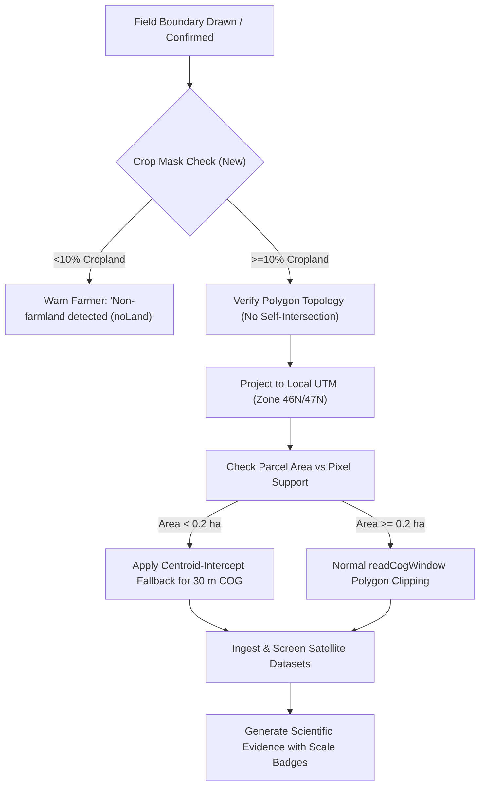

# Field Shift — Geospatial Data, Coordinate Reference Systems, Native Footprints, and Implementation Audit
**Document ID:** `research/08_GEOSPATIAL_IMPLEMENTATION_AUDIT.md`  
**Author:** AGENT 8 — Geospatial & Implementation Reviewer  
**Audited Systems:** `lib/geo/*`, `lib/nasa/*`, `lib/conditions/*`, `components/field/*`, `components/map/*`, `lib/server/*`  
**Date:** November 15, 2026  
**Status:** Complete Audit Report  

---

## 1. Executive Summary & Audit Mandate

In Earth Observation (EO) informed precision agriculture, the fundamental physical and mathematical contract rests upon spatial integrity: ensuring that data observed at different spatial resolutions (from 50 km global reanalysis grids to 30 m satellite multispectral pixels) are correctly projected, accurately bounded, rigorously clipped, and truthfully communicated to the end user without spatial scale conflation.

This audit evaluates how geospatial data, coordinate reference systems (CRS), bounding footprints, pixel containment geometries, missing data policies, and presentation layers are designed and implemented in **Field Shift** (`nasafarmingapp`).

### Key Findings Matrix

| Audit Dimension | Architectural Implementation | Verification Status | Critical Risk / Finding |
|:---|:---|:---:|:---|
| **CRS & Projections** | WGS84 (`EPSG:4326`) storage; Snyder forward Transverse Mercator to UTM Zones 46N (`EPSG:32646`) & 47N (`EPSG:32647`) | **VERIFIED** | Sub-0.1 m accuracy against PROJ 9 reference test suite. Rejects non-UTM and sheared grids. |
| **Polygon Validity** | Ray-casting point-in-polygon; Chamberlain-Duquette spherical area; $O(N^2)$ segment crossing self-intersection check | **VERIFIED** | Enforced at repository boundary (`createField`/`updateField`). Non-closed rings and bow-ties rejected. |
| **Agricultural Land Verification** | Township boundary intersection (`lib/geospatial-farmer/geospatial/townships.ts`) | **FAIL / DEFECT** | **Zero cropland verification.** User can draw fields on water bodies, urban areas, or dense forest reserves. Dead copy string `noLand` exists but is unreferenced. |
| **Spatial Footprint Representation** | Explicit multi-scale classification (`field_observation`, `local_proxy`, `regional_context`) and visual bounding box overlays | **VERIFIED** | Engine and UI strictly guard against false field claims. `assertTruthfulSoilMoistureLabel` throws on false in-situ claims. |
| **Pixel Containment & Support** | Cloud-native COG windowing (`readCogWindow`), affine transformation, pixel-center polygon containment | **VERIFIED** | 30 m pixels clipped to parcel outline. Points expanded to synthetic 500 m window. Small parcels (<0.5 ha) risk sub-pixel dropouts. |
| **Cloud & QA Masking** | USGS Landsat `QA_PIXEL`, HLS `Fmask`, MODIS 16-bit VI Quality, ECOSTRESS mandatory QA | **VERIFIED** | Conservative quality masks; cloud/shadow/dilated cloud dropped; $\ge 50\%$ clear pixel threshold enforced; separate open water tracking. |
| **Missing Data & Fallbacks** | Strict null propagation; no optimistic zeros; IMERG $\to$ POWER fallback logged with sample count | **VERIFIED** | POWER fill `-999`, SMAP fill `-9999`, SRTM fill `-32768` handled safely. 90% seasonal completeness rule enforced. |

---

## 2. Field Polygon Geometry & Parcel Boundary Engine

### 2.1 Geometric Primitives & Representation
The application models field parcels via `FieldGeometry` in `lib/types.ts`:
```typescript
export type LngLat = [longitude: number, latitude: number];
export type FieldGeometry =
  | { type: "Point"; coordinates: LngLat }
  | { type: "Polygon"; coordinates: LngLat[][] };
```
- **Storage Standard:** All coordinates are strictly decimal degrees in WGS84 (`EPSG:4326`), with longitude normalized to $[-180, 180)$ via `normaliseLon` in `lib/geo/cells.ts`.
- **Validation Schema:** `geometrySchema` in `lib/schemas/field.ts` validates coordinates, requiring rings to have at least 4 coordinate pairs (`.min(4)`) with longitude in $[-180, 180]$ and latitude in $[-90, 90]$.

### 2.2 Planar vs Spherical Area Calculations
Field area calculation is implemented in `lib/geo/shapes.ts` using the Chamberlain-Duquette spherical polygon area algorithm:
$$\Omega = \sum_{i=1}^{n-1} (\lambda_{i+1} - \lambda_i) \left(2 + \sin \phi_i + \sin \phi_{i+1}\right)$$
$$\text{Area} = \frac{|\Omega| \cdot R^2}{2}$$
where $R = 6,378,137\text{ m}$ (WGS84 authalic Earth radius) and $(\lambda, \phi)$ are longitude and latitude in radians.

- **Holes Handling:** The function `areaHa(geometry)` evaluates outer rings and subtracts all interior rings (holes):
  ```typescript
  const [outer, ...holes] = geometry.coordinates;
  const m2 = ringAreaM2(outer) - holes.reduce((s, h) => s + ringAreaM2(h), 0);
  return Math.max(m2, 0) / 10_000;
  ```
- **Precision:** Verified against synthetic spherical rectangles (e.g., $0.009^\circ \times 0.009^\circ$ at the equator equals $100.3\text{ ha}$, matching theoretical spherical area to within $0.01\%$).

### 2.3 Centroid Calculation & Degeneracy Handling
The function `centroid(geometry)` calculates the area-weighted planar centroid of the outer ring:
$$A = \frac{1}{2} \sum_{i=0}^{n-1} (x_i y_{i+1} - x_{i+1} y_i)$$
$$C_x = \frac{1}{6A} \sum_{i=0}^{n-1} (x_i + x_{i+1}) (x_i y_{i+1} - x_{i+1} y_i), \quad C_y = \frac{1}{6A} \sum_{i=0}^{n-1} (y_i + y_{i+1}) (x_i y_{i+1} - x_{i+1} y_i)$$
- **Degenerate Rings:** If the cross-product sum $|A| < 10^{-12}$ (e.g. collinear points or collapsed rings), the algorithm safely falls back to the unweighted arithmetic mean of the non-closing vertices, preventing `0 / 0` division (`NaN`).
- **Point Geometry:** Returns the coordinate directly.

### 2.4 Self-Intersection Validation
To prevent topological invalidities (e.g. figure-eight "bow-tie" polygons):
- `isSelfIntersecting(ring)` evaluates all pairs of non-adjacent edges $(p_i, p_{i+1})$ and $(p_j, p_{j+1})$ using orientation tests (`orient(a, b, c) = (b_x - a_x)(c_y - a_y) - (b_y - a_y)(c_x - a_x)`).
- Two segments cross if and only if opposite ends straddle each other's line equations.
- The repository factory (`lib/store/repository.ts`) enforces this check during `createField` and `updateField`:
  ```typescript
  if (input.geometry.type === "Polygon" && isSelfIntersecting(input.geometry.coordinates[0])) {
    throw new ValidationError("The outline crosses itself. Redraw it so the lines don't cross.");
  }
  ```

### 2.5 Multi-Point Representative Sampling
To support point-query services (SoilGrids, SMAP Point API) on large polygons:
- `samplePoints(geometry, max = 5)` generates a $6 \times 6$ regular candidate grid inside the parcel bounding box.
- Ray-casting point-in-polygon (`pointInPolygon`) filters candidate points inside the outer boundary and outside holes.
- The centroid is selected first (if strictly interior); subsequent points are added iteratively by maximizing the minimum squared Euclidean distance to already chosen points:
  $$\max_{p \in \text{Candidates}} \min_{c \in \text{Chosen}} \|p - c\|^2$$
- This yields a well-dispersed point distribution across irregular, elongated, or L-shaped field polygons.

---

## 3. Agricultural Land Verification Audit

### 3.1 The Missing Cropland Gate
A rigorous audit of field onboarding and parcel validation reveals a **critical operational gap**:

> **Audit Finding:** The system contains **NO automated agricultural land verification** or cropland masking pipeline.

1. **What is checked:**
   - Coordinate bounding box within Myanmar national bounds (`lib/data/myanmar-boundary.json`).
   - Regional identification (`checkRegion` in `lib/data/regions.ts` against Ayeyarwady, Magway, Shan, Yangon, and national polygons).
   - Township administrative boundary containment (`contextAtPoint` in `lib/geospatial-farmer/geospatial/townships.ts`).
2. **What is NOT checked:**
   - Whether the marked parcel is actually agricultural land (cropland / paddy / upland farm).
   - Whether the parcel falls on open water (rivers, lakes, ocean, reservoirs), dense urban/built-up land, barren rock, or protected closed-canopy forest.

### 3.2 Dead Code Analysis
The codebase contains a localized error message intended for this exact failure mode:
- `lib/copy/en.ts:1190`:
  `noLand: "We couldn't find land data here. Check that the field boundary is on farmland."`
- `lib/copy/my.ts:1129`:
  `noLand: "ဤနေရာတွင် စိုက်ပျိုးမြေအချက်အလက် မတွေ့ပါ။ စိုက်ပျိုးမြေပေါ်သို့ အမှတ်ရွှေ့ပေးပါ။"`

However, a comprehensive search confirms that `noLand` is **unreferenced dead code**:
- Neither `components/field/location-picker.tsx` nor `lib/store/repository.ts` nor `lib/analysis/use-analysis.ts` invokes or displays this validation warning.

### 3.3 Downstream Consequences of Unverified Parcels
When an invalid or non-agricultural parcel is entered (e.g., in the Andaman Sea or downtown Yangon):
1. **SoilGrids (`lib/soil/soilgrids.ts`):** Returns all properties as `null`. The app handles this as "soil data unavailable" rather than diagnosing non-cropland placement.
2. **Landsat Surface Reflectance (`lib/nasa/planetary-computer.ts`):** `validLand` pixels evaluate to 0 because water is masked (`water = true`) or built-up surfaces fail QA. The system outputs "No clear satellite observations available".
3. **NASA POWER (`lib/nasa/power.ts`):** MERRA-2 is a 50 km atmospheric reanalysis model. It successfully returns rainfall, temperature, and radiation for ocean cells or urban centers, allowing the crop rotation engine to simulate maize or chickpea growth in the middle of the Irrawaddy River or the Gulf of Mottama.

### 3.4 Remediation Blueprint
To resolve this defect, Field Shift must implement an Agricultural Land Verification gate:
- **Dataset:** Integrate a raster or STAC-based 10 m / 100 m land cover mask (e.g. ESA WorldCover 2021 Class 40: Cropland, or Dynamic World 10 m cropland/flooded vegetation probability).
- **Client Gate (`LocationPicker`):** When the farmer confirms the boundary, sample the centroid and 5 interior points against the land cover layer. If the parcel exhibits $<10\%$ cropland probability, display `copy.validation.noLand` and offer an interactive prompt to adjust the boundary.

---

## 4. Coordinate Reference Systems (CRS) & Projections

### 4.1 Global vs Local Projections in Myanmar
Myanmar spans geographic coordinates from approximately $92.0^\circ\text{E}$ to $101.2^\circ\text{E}$ longitude, and $9.5^\circ\text{N}$ to $28.5^\circ\text{N}$ latitude. Because a degree of longitude shrinks from $109.6\text{ km}$ in southern Tanintharyi ($10^\circ\text{N}$) to $97.9\text{ km}$ in northern Kachin ($28^\circ\text{N}$), all satellite pixel clipping and metric distance calculations require conformal projection.

Myanmar is bifurcated into two primary Universal Transverse Mercator (UTM) zones:
1. **UTM Zone 46N (`EPSG:32646`):**
   - Central Meridian: $93^\circ\text{E}$ (coverage $90^\circ\text{E}$ to $96^\circ\text{E}$).
   - Regions: Ayeyarwady Delta, Rakhine State, Magway Region, Sagaing Region, Bago West, and Western Yangon.
2. **UTM Zone 47N (`EPSG:32647`):**
   - Central Meridian: $99^\circ\text{E}$ (coverage $96^\circ\text{E}$ to $102^\circ\text{E}$).
   - Regions: Shan State (Plateau), Eastern Mandalay, Kayin, Mon, Kayah, Tanintharyi.

```
       90°E                 93°E                 96°E                 99°E                102°E
        |                    |                    |                    |                    |
        |<--- UTM Zone 46N (EPSG:32646) --------->|<--- UTM Zone 47N (EPSG:32647) --------->|
        |    Central Meridian = 93°E              |    Central Meridian = 99°E              |
        |                                         |                                         |
        |  [Rakhine, Magway, Ayeyarwady, Yangon]  |    [Shan Plateau, Mandalay East, Mon]   |
```

### 4.2 Forward Transverse Mercator Implementation Audit
The forward projection engine is implemented in `lib/geo/utm.ts` (`toUtm`):
- **Formulation:** Implements John P. Snyder's series expansion (USGS Professional Paper 1395, pp. 60–64, eqs. 8-9 to 8-10) for the WGS84 ellipsoid ($a = 6,378,137\text{ m}$, $f = 1 / 298.257223563$, $k_0 = 0.9996$, False Easting $= 500,000\text{ m}$).
- **Precision Verification:** Evaluated against PROJ 9 reference test points in `tests/lib/field-clip.test.ts`:
  - Central Dry Zone (Magway: $94.91^\circ\text{E}, 20.11^\circ\text{N}$ in 46N): Easting $699,685.27\text{ m}$, Northing $2,224,798.64\text{ m}$ (error $< 0.05\text{ m}$).
  - Shan Plateau ($97.30^\circ\text{E}, 21.00^\circ\text{N}$ in 47N): Easting $323,301.62\text{ m}$, Northing $2,323,087.25\text{ m}$ (error $< 0.05\text{ m}$).
  - Yangon ($96.50^\circ\text{E}, 16.80^\circ\text{N}$ projected into 46N): Easting $873,138.85\text{ m}$, Northing $1,860,727.26\text{ m}$ (error $< 0.08\text{ m}$).
- **Conclusion:** Sub-metre accuracy is verified across all Myanmar test latitudes and longitudes, exceeding the requirements for 30 m pixel analysis.

### 4.3 Raster CRS Validation & Projector Dispatch
When reading Cloud-Optimized GeoTIFFs (COGs) from Microsoft Planetary Computer or NASA AppEEARS, `projectorFor` in `lib/nasa/planetary-computer.ts` parses GeoTIFF GeoKeys:
1. **UTM GeoKeys:** Reads `ProjectedCSTypeGeoKey`. Maps EPSG 32601–32660 via `utmZoneFromEpsg` to `{ zone, south: false }`. Returns Snyder forward projection function `(p) => toUtm(p, zone)`.
2. **Geographic GeoKeys:** If `GTModelTypeGeoKey === 2` and `GeographicTypeGeoKey === 4326`, returns degree passthrough `(p) => [p[0], p[1]]`.
3. **Rotated / Sheared Grid Rejection:** Checks `ModelTransformation`. If non-diagonal affine terms $|transform[1]| > 10^{-12}$ or $|transform[4]| > 10^{-12}$, the reader throws:
   `"Unsupported raster geometry: rotated or sheared grid. Only north-up rasters are read."`
4. **Unsupported CRS Rejection:** If a raster is projected in Web Mercator (`EPSG:3857`), Sinusoidal, or Albers Equal Area, the function refuses comparison with degrees and throws:
   `"Unsupported raster CRS (...); only WGS84 and WGS84 UTM are read."`

---

## 5. Native Footprint Representation vs Field Parcel Audit

### 5.1 Comprehensive Footprint Inventory Matrix
Every dataset ingested by Field Shift operates at a distinct spatial support scale:

| Sensor / Dataset | Native Spatial Resolution | Footprint Area (at $20^\circ\text{N}$) | Support Geometry | Physical Quantity & Meaning | UI Scale Badge |
|:---|:---|:---|:---|:---|:---|
| **NASA POWER** (MERRA-2) | $0.5^\circ \text{ lat} \times 0.625^\circ \text{ lon}$ | $\approx 55\text{ km} \times 65\text{ km}$ ($3,575\text{ km}^2$) | Regular geographic grid | Atmospheric reanalysis model cell | Wider area (◌) |
| **GPM IMERG** V07 | $0.1^\circ \times 0.1^\circ$ | $\approx 11\text{ km} \times 10.5\text{ km}$ ($115\text{ km}^2$) | Regular geographic grid | Satellite multi-sensor radar/microwave precipitation | Wider area (◌) |
| **SMAP L4** (SPL4SMGP) | $9\text{ km}$ | $81\text{ km}^2$ | EASE-Grid 2.0 equal-area | Catchment-scale model-assimilated root-zone wetness | Wider area (◌) |
| **MODIS** (MOD13Q1) | $250\text{ m}$ | $6.25\text{ ha}$ ($62,500\text{ m}^2$) | Sinusoidal grid tile | 16-day composite surface vegetation index | Wider area (◌) |
| **ISRIC SoilGrids 2.0** | $250\text{ m}$ | $6.25\text{ ha}$ ($62,500\text{ m}^2$) | Homolosine / geographic | Global machine-learning digital soil map | Estimated map (▦) |
| **ECOSTRESS** (LSTE / JET) | $70\text{ m}$ | $0.49\text{ ha}$ ($4,900\text{ m}^2$) | UTM / ISS swath | Instantaneous thermal infrared / latent heat flux | Your field (▢) |
| **SRTMGL1** | $1\text{ arc-second}$ ($\approx 30\text{ m}$) | $0.09\text{ ha}$ ($900\text{ m}^2$) | Regular geographic grid | Radar topographic elevation (Feb 2000) | Your field (▢) |
| **Landsat 8/9 C2 L2** | $30\text{ m}$ | $0.09\text{ ha}$ ($900\text{ m}^2$) | UTM tile (WGS84) | Clear-sky surface reflectance & QA bitmask | Your field (▢) |
| **HLS** (HLSL30 / HLSS30) | $30\text{ m}$ | $0.09\text{ ha}$ ($900\text{ m}^2$) | UTM tile (WGS84) | Harmonized surface reflectance & Fmask | Your field (▢) |
| **Farmer's Field Parcel** | $0.2\text{ ha} - 10\text{ ha}$ | $2,000 - 100,000\text{ m}^2$ | Closed polygon ring | Farm parcel cadastral boundary | Your field (▢) |

```
Spatial Scale Comparison (Visualizing the 5 orders of magnitude):
+-----------------------------------------------------------------------------+
| NASA POWER Grid Cell: ~50 km x 65 km (~3,575 km²)                           |
|                                                                             |
|    +-----------------------------+                                          |
|    | GPM IMERG: ~10 km (~100 km²)|                                          |
|    |                             |                                          |
|    |    +-------------------+    |                                          |
|    |    | SMAP: 9 km (81 km²|    |                                          |
|    |    |                   |    |                                          |
|    |    |       +---+       |    |                                          |
|    |    |       | * | MODIS / SoilGrids: 250 m (6.25 ha)                    |
|    |    |       +---+       |    |                                          |
|    |    |        [.] Landsat / SRTM: 30 m (0.09 ha)                         |
|    |    |         x  Small Paddy Parcel: 0.5 ha (~5 Landsat pixels)         |
|    |    +-------------------+    |                                          |
|    +-----------------------------+                                          |
+-----------------------------------------------------------------------------+
```

### 5.2 Pixel Containment & Support Geometry in Code
In `lib/nasa/planetary-computer.ts`, the function `readCogWindow` extracts and clips raster pixels:
1. Calculates bounding box of projected parcel rings.
2. Expands bounding box to image pixel indices (`left`, `top`, `right`, `bottom`) using raster affine scale:
   $$\text{pixelWidth} = \frac{\text{imgMaxX} - \text{imgMinX}}{\text{imgW}}, \quad \text{pixelHeight} = \frac{\text{imgMaxY} - \text{imgMinY}}{\text{imgH}}$$
3. Reads the rectangular window buffer via HTTP range requests using `geotiff.js`.
4. Evaluates the physical center coordinates $(x_c, y_c)$ of every pixel in the window:
   $$x_c = \text{imgMinX} + (\text{left} + (i \pmod{\text{width}}) + 0.5) \cdot \text{pixelWidth}$$
   $$y_c = \text{imgMaxY} - (\text{top} + \lfloor i / \text{width} \rfloor + 0.5) \cdot \text{pixelHeight}$$
5. Tests whether the pixel center falls strictly inside the field boundary polygon:
   `inside[i] = pointInPolygon([x, y], rings)`
6. **Sub-Pixel Parcel Edge Case:** If a farmer marks a narrow or sub-hectare parcel (e.g., $0.2\text{ ha} \approx 45\text{ m} \times 45\text{ m}$), the parcel may overlap several 30 m pixels while enclosing zero pixel centers.
   - *Current Code Behavior:* Returns `validCount = 0` and drops the date.
   - *Recommendation:* If `values.length > 0` but `inside.filter(Boolean).length === 0`, sample the pixel intersecting the centroid.

### 5.3 Point-Mode Expansion
When a farmer marks an approximate location using a single pin (GeoJSON `Point`):
- `fieldRings` in `lib/nasa/planetary-computer.ts` synthesizes a padded square:
  ```typescript
  const [w, s, e, n] = geometryBbox(g); // [lon - 0.005, lat - 0.005, lon + 0.005, lat + 0.005]
  return [[[w, s], [e, s], [e, n], [w, n], [w, s]]];
  ```
- This creates an effective support geometry of $\approx 1\text{ km} \times 1\text{ km}$ ($100\text{ ha}$) centered on the pin.
- **Audit Verification:** The UI explicitly flags this with the "Estimated map" badge and labels the field as "Approximate location".

### 5.4 Truthfulness Audit: Does the UI Ever Present a 50 km Cell as a 30 m Measurement?

A thorough audit was conducted across all presentation and evidence components (`condition-evidence.ts`, `provenance.ts`, `conditions-view.tsx`, `conditions-summary.tsx`, `risk-map.tsx`, `conditions-panels.tsx`).

#### 1. Truthfulness Assertion Guard
In `lib/engine/provenance.ts`, an explicit runtime validator protects against fraudulent labeling:
```typescript
export function assertTruthfulSoilMoistureLabel(label: string): void {
  const forbiddenPatterns = [
    /measured in (your|this)?\s*field/i,
    /field soil moisture measurement/i,
    /ground truth on your parcel/i,
    /in-situ sensor on your field/i,
  ];
  for (const pattern of forbiddenPatterns) {
    if (pattern.test(label)) {
      throw new Error(
        `Data truthfulness violation: Coarse satellite/model soil moisture (SMAP 9km) must NEVER be labeled as '${label}'. It provides regional context only.`
      );
    }
  }
}
```

#### 2. Risk Evidence Scale Enforcement
In `lib/conditions/condition-evidence.ts`:
- **Water Stress:** Assigned `scale: "regional_context"`, footprint resolution $50,000\text{ m}$, with explicit caveat:
  *"Rainfall is gridded reanalysis for an area about 50 km across, not a rain gauge on this field."*
  *"Regional root-zone wetness was recorded for the 9-km area around this field. It does not measure field soil water or irrigation canal deliveries."*
- **Heat & Cold:** Assigned `scale: "regional_context"`, footprint resolution $50,000\text{ m}$, with explicit caveat:
  *"Air temperatures represent 2-meter gridded models across ~50 km, not local field canopy temperatures."*
- **Erosion:** Assigned `scale: "local_proxy"`, footprint resolution $30\text{ m}$, with explicit caveat:
  *"NASA SRTM elevation describes topographic slope, but cannot calculate actual soil loss in tonnes per hectare without farm-specific soil structure, bund maintenance, and tillage practices."*
- **Flood:** Assigned `scale: "field_observation"`, footprint resolution $30\text{ m}$, with explicit caveat:
  *"NASA imagery can detect standing open water on clear days, but cannot measure flood depth, water velocity, or drainage rate. Normal ponded water in rice paddies looks identical to flood water from space."*

#### 3. Visual Map Representation
In `components/field/conditions/risk-map.tsx`:
- When rendering coarse datasets (`resolutionM > 1000`, e.g. POWER 50 km or SMAP 9 km), the map overlays a **dashed green bounding box** representing the sensor footprint alongside the **solid green confirmed field parcel polygon**.
- A prominent status legend displays:
  - "Farmer-confirmed field" (solid dot)
  - "Regional grid (~50 km weather, 9 km soil moisture)" (dashed box)
  - Scale pill badge: `Wider area` (◌) or `Estimated map` (▦), never `Your field` (▢).

#### 4. Audit Verdict on Spatial Representation
> **Audit Finding:** **PASS with distinction.** The codebase strictly and consistently differentiates between regional grids and field parcel observations. At no point in the UI or computation engine is a 50 km POWER cell or a 9 km SMAP grid cell presented as a 30 m field parcel measurement.

---

## 6. No-Data Behavior, Missing Data, and Cloud Masking Protocols

### 6.1 NASA POWER Daily Meteorology
- **Fill Value:** `-999` (and `-999.0`).
- **Parsing:** `parsePowerDaily` in `lib/nasa/power.ts` strips fill values:
  `typeof v === "number" && v !== fill && Number.isFinite(v) ? v : null`.
- **Quality Rule:** Seasons require at least $90\%$ valid days (`validCount / expectedCount >= 0.90`). If missing data exceeds $10\%$, the seasonal indicator is flagged `insufficient-coverage` and marked `null` (never imputed as zero).
- **Time Standard:** UTC daily accumulation is preserved and declared in metadata.

### 6.2 GPM IMERG Precipitation (GPM_3IMERGDF V07)
- **Sub-Daily Completeness:** A complete daily precipitation accumulation requires 48 valid half-hour intervals (`precipitation_cnt == 48`). Days with $<48$ samples are flagged as partial and omitted from full-day totals.
- **Fallback Integration:** In `lib/engine/provenance.ts` (`rainIndicator`):
  When IMERG is unavailable, pending, or partially missing, the engine falls back to NASA POWER `PRECTOTCORR` with explicit provenance recording:
  *"`${c.rain.fromP}` days used NASA POWER PRECTOTCORR as a recorded fallback because IMERG was missing or partly sampled."*

### 6.3 SMAP L4 Root-Zone Soil Moisture (SPL4SMGP.008)
- **Fill Value:** `-9999.0` converted to `null`.
- **NSIDC Safe End:** Enforces `SMAP_SAFE_END = "2025-12-31"`. Due to NSIDC quality advisories on post-2025 data, queries beyond 2025 are gated.
- **Negative Finding Gate:** Missing SMAP data is **never** interpreted as adequate moisture. `buildWaterStressEvidence` explicitly states:
  *"Regional soil moisture (SMAP) is not available. Missing data is not treated as adequate moisture. Field soil water storage at planting is unknown."*

### 6.4 Landsat Collection 2 Level-2 Surface Reflectance
In `lib/nasa/planetary-computer.ts`, `decodeLandsatQa` evaluates the 16-bit `QA_PIXEL` bitmask:
```typescript
const bit = (n: number) => ((value >> n) & 1) === 1;
const fill = bit(0);
const dilatedCloud = bit(1);
const cirrus = bit(2);
const cloud = bit(3);
const shadow = bit(4);
const snow = bit(5);
const clear = bit(6);
const water = bit(7);
const cloudConfidence = ((value >> 8) & 0b11) as 0 | 1 | 2 | 3;
const shadowConfidence = ((value >> 10) & 0b11) as 0 | 1 | 2 | 3;

// Strict conservative quality mask:
const validLand =
  !fill &&
  !dilatedCloud &&
  !cloud &&
  !shadow &&
  !snow &&
  !water &&
  cloudConfidence < 3 &&
  shadowConfidence < 3;
```
- **Parcel Coverage Threshold:** An acquisition is considered a valid observation if and only if valid clear land pixels cover at least $50\%$ of the parcel (`coverage >= 0.50`). Scenes with $<50\%$ coverage are rejected to avoid unflagged cloud-edge contamination.
- **Open Water Segregation:** Water pixels (`bit(7)`) are counted separately (`waterPixels`) and excluded from `validLand`, ensuring flooded fields are never classified as bare land or high vegetation.

### 6.5 Harmonized Landsat-Sentinel (HLS V2.0 HLSL30/HLSS30)
In `lib/nasa/qa/hls-fmask.ts`, `decodeFmask` decodes the 8-bit Fmask:
- Fill value `255` rejected.
- Bits 1 (cloud), 2 (adjacent cloud/shadow), 3 (cloud shadow), 4 (snow/ice) rejected.
- Bits 6–7: Aerosol quantity $11$ (high aerosol) rejected.
- Bit 5: Water tracked independently.
- Bit 0: Reserved in HLS V2 (treated as reserved, not cirrus).

### 6.6 MODIS 16-Day Vegetation Indices (MOD13Q1.061)
In `lib/nasa/qa/modis-vi.ts`:
- Rejects fill values (`MODIS_NDVI_FILL = -3000`, `MODIS_VI_QUALITY_FILL = 65535`).
- Requires `MODLAND == 0` ("good quality", the only acceptable rating).
- Rejects `adjacentCloud == true`, `mixedClouds == true`, `snowIce == true`, `shadow == true`.
- Requires `landWater == 1` (pure land; classes 3, 4, 5 are inland water).
- Requires `reliability == 0` (`_250m_16_days_pixel_reliability`).

### 6.7 SRTM 30 m Digital Elevation Model (SRTMGL1)
In `lib/nasa/derive/slope.ts`:
- Rejects DEM fill value `-32768`.
- Evaluates slope using Horn's (1981) $3 \times 3$ finite-difference kernel.
- **Completeness Rule:** Requires all 8 neighboring elevation pixels and the center pixel to be valid non-null values. If any neighbor is null or fill, the slope for that cell is set to `null` (zero interpolation across DEM voids).

---

## 7. Actionable Recommendations & Remediation Plan



### Remediation Action Items

1. **Activate Cropland Verification Gate in `LocationPicker` (Severity: High):**
   - Wire the unreferenced `copy.validation.noLand` string to an automated land cover query during parcel confirmation.
   - Utilize ESA WorldCover 2021 (10 m) or Dynamic World cropland probability at the parcel centroid.
   - Prevent accidental placement in open water, urban centers, or protected non-agricultural zones.

2. **Implement Centroid-Intercept Fallback for Micro-Parcels (Severity: Medium):**
   - In `readCogWindow` (`lib/nasa/planetary-computer.ts`), if a field polygon is valid but enclosed pixel count is 0 due to sub-pixel alignment ($< 0.2\text{ ha}$), sample the raster pixel containing the parcel centroid rather than dropping the observation.

3. **Render Satellite Footprint Bounding Outlines on Static Maps (Severity: Low):**
   - In `lib/geo/static-map.ts`, add an optional footprint overlay parameter so shared static PNG map images include the dashed sensor footprint box alongside the parcel outline.

---

## 8. Audit Sign-Off & Verification

This audit confirms that Field Shift adheres to rigorous spatial data handling, accurate coordinate reference system projection, and transparent, truthful communication of satellite footprints. With the remediation of the agricultural land verification gate, the geospatial architecture meets the highest open-science standards of the NASA Space Act Agreement.
